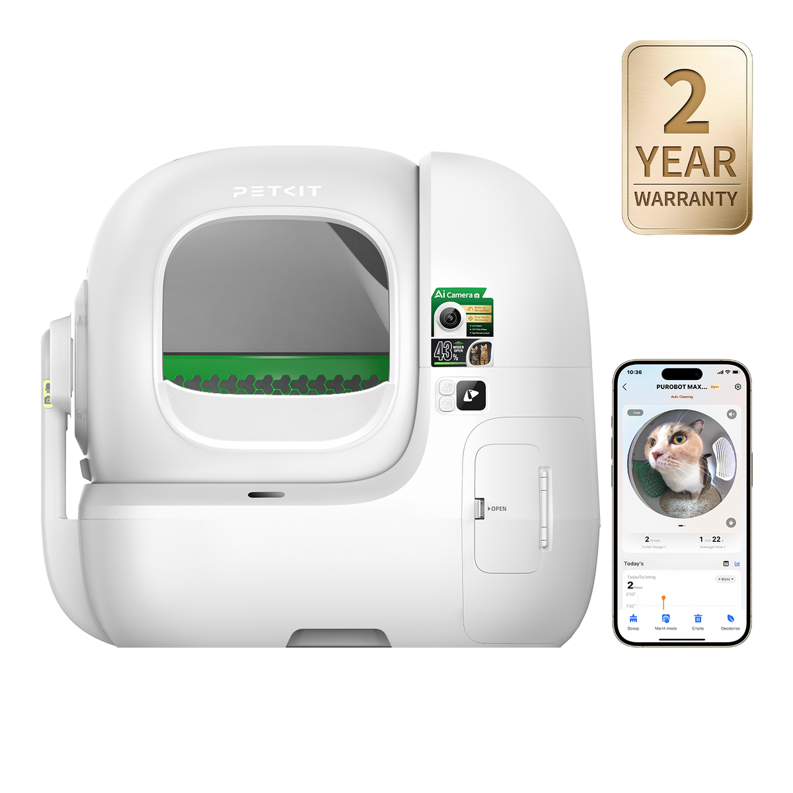
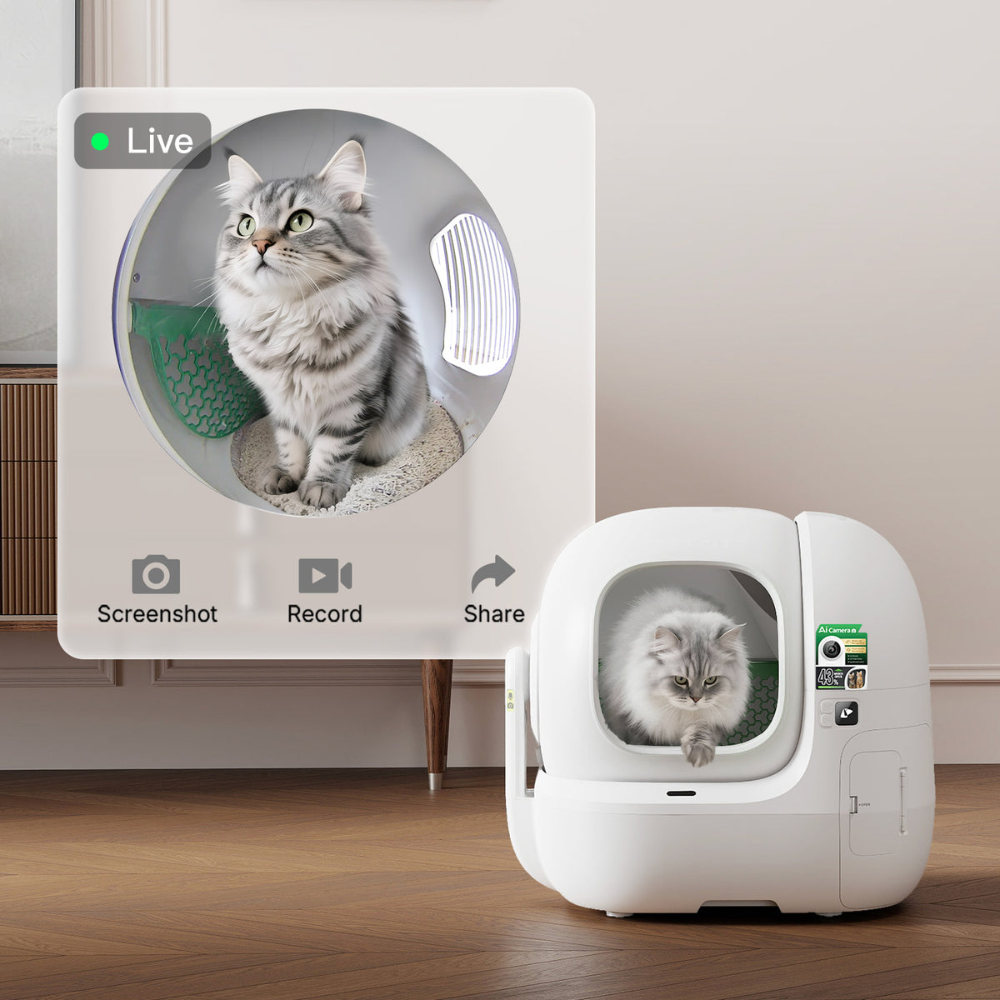
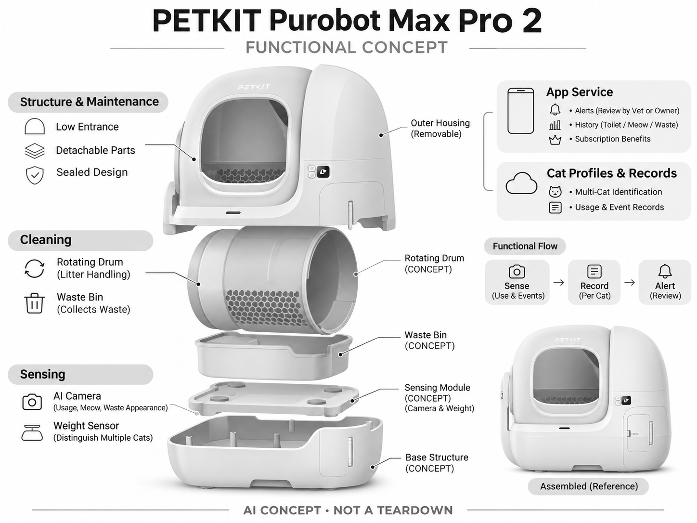

# PETKIT Purobot Max Pro 2

**PETKIT** · 宠物照护 · 核查 2026-11-04

以低入口和个体如厕记录服务家庭猫照护

消费渠道：个人零售。

## 产品图片与结构参考

### 产品图

PETKIT Purobot Max Pro 2 官方产品外观图 · 来源：[PETKIT · 官方图片](<https://www.petkit.com/products/purobot-max-pro-2-automatic-cat-litter-box-with-ai-camera>) · [原始图片](<https://cdn.shopify.com/s/files/1/0569/0526/9388/files/purobot-max-pro-2-automatic-cat-litter-box-2-year-warranty-with-fance-2-0.png?v=1789370565&width=1200>)

### 参考图

PETKIT Purobot Max Pro 2 官方场景或功能参考图 · 来源：[PETKIT · 官方图片](<https://www.petkit.com/products/purobot-max-pro-2-automatic-cat-litter-box-with-ai-camera>) · [原始图片](<https://cdn.shopify.com/s/files/1/0569/0526/9388/files/purobot-max-pro-2-scene-live.jpg?v=1773385083&width=1200>)

### AI 生成爆炸示意

**AI 生成 · 非实物拆机。** 内部为概念推断，不能作为元件布局、BOM 或维修依据。[生成提示词](../../content/hardware/prompts/petkit-purobot-max-pro-2.txt)

> 依据官方外观参考与公开功能生成；未披露的内部布局只作概念模块，不构成BOM或真实结构证据。

> 保留官方图原始内容与出处；画面中的营销声明不视为独立验证。

> 分析为基于公开资料的案头研究与 AI 辅助判断，未经用户访谈、销量审计或实物拆机。需求、画像、竞争冷门度、审美及商业机会均为研究假设，不是投资结论。

## 销售与购买

- 状态：在售。官方商店显示Purobot Max Pro 2单机、明确价格与Add to cart，Fence 2.0为该页面随附物，不另计为产品。

- 地区：美国官方零售；其他地区须分别确认

- 价格：US$499.99。核查日官方页面参考；税运、订阅及优惠条件另计。会员价、服务套餐与硬件买断价不可直接混用。

- 中国大陆：本轮核实国际官方渠道；未核实中国大陆该型号的官方现货、地区服务与保修，不把跨境硬件可送达等同于全部AI功能可用。

- [官方产品 / 商店](<https://www.petkit.com/products/purobot-max-pro-2-automatic-cat-litter-box-with-ai-camera>)

## AI 的实际作用

AI相机结合重量传感区分多只猫，记录如厕、叫声和排泄物外观；异常提示需要兽医或主人复核。

服务与联网依赖：需要PETKIT App进行个体档案和远程查看；视频保存及高级功能以Care+当前方案为准，不预设全部免费。

## 是否冷门

细分专业（研究判断）：家庭宠物照护是细分消费任务，需求取决于宠物习惯、主人投入与长期服务；已有替代产品，冷门不等于低竞争或高利润。

## 需求与市场

需求假设：想减少铲砂、又希望低入口方便老年或短腿猫进出的家庭，可能更看重进入与清洗体验。应把猫主动使用率和记录完整度与传统猫砂盆比较，不能只凭大入口宣传推定动物更舒适。

### 产品任务与边界 · 研究判断

需求假设：想减少铲砂、又希望低入口方便老年或短腿猫进出的家庭，可能更看重进入与清洗体验。应把猫主动使用率和记录完整度与传统猫砂盆比较，不能只凭大入口宣传推定动物更舒适。

依据：[PETKIT Purobot Max Pro 2 官方商店](<https://www.petkit.com/products/purobot-max-pro-2-automatic-cat-litter-box-with-ai-camera>) · [PETKIT Health 官方AI能力说明](<https://www.petkit.com/pages/petkit-health>)

### 需求判断 · 研究判断

低入口和较大开口可能改善进入便利，但动物舒适与实际使用不能由尺寸宣传替代。相机加重量记录提供另一种价值，用户需要同时理解机械维护和数据归属，若只是想少铲砂，复杂健康面板可能不是必要功能。

依据：[PETKIT Purobot Max Pro 2 官方商店](<https://www.petkit.com/products/purobot-max-pro-2-automatic-cat-litter-box-with-ai-camera>) · [PETKIT Health 官方AI能力说明](<https://www.petkit.com/pages/petkit-health>)

### 需求验证 · 待验证

可记录猫自主选择、进出犹豫、人工清理和身份纠错，比较传统低入口盆与自动方案。把进入便利、记录完整和维护分别评价，不能用某只猫首次成功使用推断所有老年或短腿猫适合，也不能据记录趋势宣称健康改善。

依据：[PETKIT Purobot Max Pro 2 官方商店](<https://www.petkit.com/products/purobot-max-pro-2-automatic-cat-litter-box-with-ai-camera>) · [PETKIT Health 官方AI能力说明](<https://www.petkit.com/pages/petkit-health>)

## 用户画像

画像推断：多猫、相近体重猫或关注老年猫日常变化的主人，通常同时承担清洁与费用。其数字能力未必高，需要理解每条记录属于哪只猫、异常如何复核，而非学习复杂的监控面板。

### 适用行为与条件 · 研究判断

画像推断：多猫、相近体重猫或关注老年猫日常变化的主人，通常同时承担清洁与费用。其数字能力未必高，需要理解每条记录属于哪只猫、异常如何复核，而非学习复杂的监控面板。

依据：[PETKIT Purobot Max Pro 2 官方商店](<https://www.petkit.com/products/purobot-max-pro-2-automatic-cat-litter-box-with-ai-camera>) · [PETKIT Health 官方AI能力说明](<https://www.petkit.com/pages/petkit-health>)

### 人群取舍 · 研究判断

相近体重和相似毛色会使不同传感的优势与限制交叠，多猫家庭不能仅凭支持数量推定档案可靠。主人能否理解不确定记录和完成拆洗更重要，画像应包含数字操作、清洁能力和猫的自愿接受，而不只看健康关注程度。

依据：[PETKIT Purobot Max Pro 2 官方商店](<https://www.petkit.com/products/purobot-max-pro-2-automatic-cat-litter-box-with-ai-camera>) · [PETKIT Health 官方AI能力说明](<https://www.petkit.com/pages/petkit-health>)

### 画像验证 · 待验证

画像验证应让实际维护者建立猫档案并纠正一次错误，再观察日常是否持续复核。对动物应保留原有选择并逐步适应，不强迫使用，识别真正需要低入口与多猫归属的人，避免以高价家电的购买意愿代替使用条件。

依据：[PETKIT Purobot Max Pro 2 官方商店](<https://www.petkit.com/products/purobot-max-pro-2-automatic-cat-litter-box-with-ai-camera>) · [PETKIT Health 官方AI能力说明](<https://www.petkit.com/pages/petkit-health>)

## 竞争与替代

竞争判断：Max Pro 2与Ultra在废物处理方式、空间和预算上形成不同取舍，不能作为颜色变体计算。市场替代也包括廉价称重记录和普通猫砂盆；应验证省维护是否足以支撑额外投入。

### 比较对象与差异 · 研究判断

竞争判断：Max Pro 2与Ultra在废物处理方式、空间和预算上形成不同取舍，不能作为颜色变体计算。市场替代也包括廉价称重记录和普通猫砂盆；应验证省维护是否足以支撑额外投入。

依据：[PETKIT Purobot Max Pro 2 官方商店](<https://www.petkit.com/products/purobot-max-pro-2-automatic-cat-litter-box-with-ai-camera>) · [PETKIT Health 官方AI能力说明](<https://www.petkit.com/pages/petkit-health>)

### 竞争判断 · 研究判断

与 Ultra 相比，Max Pro 2 的废物处理和维护取舍不同，不应把自动封袋等功能混入比较。普通盆、称重附件和外挂相机也可满足部分任务，竞争优势需要由进入与清洗体验支撑，而不是只增加相机或算法标签。废物仓处理所需步骤也应比较。

依据：[PETKIT Purobot Max Pro 2 官方商店](<https://www.petkit.com/products/purobot-max-pro-2-automatic-cat-litter-box-with-ai-camera>) · [PETKIT Health 官方AI能力说明](<https://www.petkit.com/pages/petkit-health>)

### 竞争验证 · 待验证

可在同一家庭比较入口接受、废物仓处理、清洗及记录纠错，明确各型号机械与会员差别。不要拿 Ultra 的封袋演示代表本款，也不以使用次数或告警数量评价健康价值，重点看真实劳动和信息是否可理解。

依据：[PETKIT Purobot Max Pro 2 官方商店](<https://www.petkit.com/products/purobot-max-pro-2-automatic-cat-litter-box-with-ai-camera>) · [PETKIT Health 官方AI能力说明](<https://www.petkit.com/pages/petkit-health>)

## 供应链

供应链分析：重点是大开口舱体、称重结构、视觉窗口与密封废物仓的协同。真实芯片和工厂未披露；清洗拆装重复寿命、粉尘对镜头的影响和安全传感冗余比推算电子元件单价更重要。

### 功能模块拆分 · 研究判断

功能层包括低入口舱体、相机与重量感知、多猫档案及事件、滚筒与密封废物仓、可拆维护和应用。公开资料没有完整工厂或芯片清单，功能架构不代表实际冗余安全设计，也不能把其他 Purobot 型号机构直接移植。

依据：[PETKIT Purobot Max Pro 2 官方商店](<https://www.petkit.com/products/purobot-max-pro-2-automatic-cat-litter-box-with-ai-camera>) · [PETKIT Health 官方AI能力说明](<https://www.petkit.com/pages/petkit-health>)

### 制造与供应约束 · 研究判断

供应链分析：重点是大开口舱体、称重结构、视觉窗口与密封废物仓的协同。真实芯片和工厂未披露；清洗拆装重复寿命、粉尘对镜头的影响和安全传感冗余比推算电子元件单价更重要。

依据：[PETKIT Purobot Max Pro 2 官方商店](<https://www.petkit.com/products/purobot-max-pro-2-automatic-cat-litter-box-with-ai-camera>) · [PETKIT Health 官方AI能力说明](<https://www.petkit.com/pages/petkit-health>)

### 候选与证据缺口 · 研究判断

金宝可作为猫砂家电控制和模塑制造候选，RapidDirect 可支持大开口、废物仓和拆洗结构原型。没有 Max Pro 2 点名合作证据，称重校准、滚筒安全和粉尘视觉需专项验证，候选不代表完整产品设计或实际代工关系。

依据：[PETKIT Purobot Max Pro 2 官方商店](<https://www.petkit.com/products/purobot-max-pro-2-automatic-cat-litter-box-with-ai-camera>) · [PETKIT Health 官方AI能力说明](<https://www.petkit.com/pages/petkit-health>)

## 技术路径

官方描述相机与重量融合识别，以及如厕事件分类。技术判断：个体身份错误会污染长期档案，应提供纠错与不确定状态；叫声或猫砂颜色的解释仅是筛查线索，不能自动成为疾病结论。

### 已披露技术边界 · 研究判断

官方描述相机与重量融合识别，以及如厕事件分类。技术判断：个体身份错误会污染长期档案，应提供纠错与不确定状态；叫声或猫砂颜色的解释仅是筛查线索，不能自动成为疾病结论。

依据：[PETKIT Purobot Max Pro 2 官方商店](<https://www.petkit.com/products/purobot-max-pro-2-automatic-cat-litter-box-with-ai-camera>) · [PETKIT Health 官方AI能力说明](<https://www.petkit.com/pages/petkit-health>)

### 系统难点判断 · 研究判断

身份一旦错归，后续趋势可能持续误导，系统需要提供低置信、原始片段和可追溯纠错。重量与相机融合不是简单相加，清洗复装或粉尘会改变输入，叫声及排泄物外观也只能作观察线索，不能自动形成疾病结论。

依据：[PETKIT Purobot Max Pro 2 官方商店](<https://www.petkit.com/products/purobot-max-pro-2-automatic-cat-litter-box-with-ai-camera>) · [PETKIT Health 官方AI能力说明](<https://www.petkit.com/pages/petkit-health>)

### 技术验证 · 待验证

验证应记录相似猫、遮挡和清洗复装前后的识别与称重，单独检查机械停止和档案纠正。测试需受控且不让动物承担风险，不能把传感器数量或一次准确身份当作长期趋势可靠，更不能用健康界面替代专业复核。

依据：[PETKIT Purobot Max Pro 2 官方商店](<https://www.petkit.com/products/purobot-max-pro-2-automatic-cat-litter-box-with-ai-camera>) · [PETKIT Health 官方AI能力说明](<https://www.petkit.com/pages/petkit-health>)

## 产品审美

审美判断：圆舱和低门槛使它接近家用电器，入口与猫身体比例是重点。可拆部件、废物仓和旁边散落猫砂会影响实际整洁度，外观评价应涵盖日常使用后的场景而非空机摆拍。

### 外观与交互语言 · 研究判断

审美判断：圆舱和低门槛使它接近家用电器，入口与猫身体比例是重点。可拆部件、废物仓和旁边散落猫砂会影响实际整洁度，外观评价应涵盖日常使用后的场景而非空机摆拍。

依据：[PETKIT Purobot Max Pro 2 官方商店](<https://www.petkit.com/products/purobot-max-pro-2-automatic-cat-litter-box-with-ai-camera>) · [PETKIT Health 官方AI能力说明](<https://www.petkit.com/pages/petkit-health>)

### 使用中审美判断 · 研究判断

低门槛和圆舱让设备更家电化，真实整洁还包括出口散砂、废物仓与可拆部件。若开口改善进入却使清洁区域更难管理，主人感受可能不同，设计应同时观察猫与人的动作，而不是仅评价空机在客厅里的外观。

依据：[PETKIT Purobot Max Pro 2 官方商店](<https://www.petkit.com/products/purobot-max-pro-2-automatic-cat-litter-box-with-ai-camera>) · [PETKIT Health 官方AI能力说明](<https://www.petkit.com/pages/petkit-health>)

### 设计验证 · 待验证

设计验证应记录自主进出、周边散砂、废物仓取出和拆洗晾干，比较不同摆放空间。还需检查维护后复装是否直观，避免外壳平滑隐藏脏污死角，也不将入口看起来宽敞当作所有猫都舒适的证据。

依据：[PETKIT Purobot Max Pro 2 官方商店](<https://www.petkit.com/products/purobot-max-pro-2-automatic-cat-litter-box-with-ai-camera>) · [PETKIT Health 官方AI能力说明](<https://www.petkit.com/pages/petkit-health>)

## 关键风险

风险判断：仍有机械动作、耗材与网络服务依赖，猫的适应期和清洁死角也可能带来退货。健康档案存在误识别与误解释风险；如果主人只关注设备告警，可能遗漏需要主动观察的行为。

### 主要失效与依赖 · 研究判断

风险判断：仍有机械动作、耗材与网络服务依赖，猫的适应期和清洁死角也可能带来退货。健康档案存在误识别与误解释风险；如果主人只关注设备告警，可能遗漏需要主动观察的行为。

依据：[PETKIT Purobot Max Pro 2 官方商店](<https://www.petkit.com/products/purobot-max-pro-2-automatic-cat-litter-box-with-ai-camera>) · [PETKIT Health 官方AI能力说明](<https://www.petkit.com/pages/petkit-health>)

### 风险传播判断 · 研究判断

健康档案的存在可能让主人忽略设备之外的行为，而漏记或错归又可能造成误解释。服务和机械异常应与健康提示分开，产品需要明确数据缺口和人工观察边界，不能让设备没有告警被理解为已经确认猫的健康。

依据：[PETKIT Purobot Max Pro 2 官方商店](<https://www.petkit.com/products/purobot-max-pro-2-automatic-cat-litter-box-with-ai-camera>) · [PETKIT Health 官方AI能力说明](<https://www.petkit.com/pages/petkit-health>)

### 风险验证 · 待验证

风险验证应演练网络、档案错归、废物仓和传感异常，观察提示与人工恢复，再核对体重及使用限制。不能通过让幼猫或行动受限猫接近运行机构测试安全，也不以多猫支持或低入口宣传保证普遍适配。

依据：[PETKIT Purobot Max Pro 2 官方商店](<https://www.petkit.com/products/purobot-max-pro-2-automatic-cat-litter-box-with-ai-camera>) · [PETKIT Health 官方AI能力说明](<https://www.petkit.com/pages/petkit-health>)

## 机会与验证

机会假设：围绕老年猫进入便利、主人清洗和多猫纠错建立真实任务测试。若主要问题是身份归属与解释，完善软件和售后教育可能比增加传感器更有效，需要先验证长期使用意愿。

### 可能的机会入口 · 研究判断

机会假设：围绕老年猫进入便利、主人清洗和多猫纠错建立真实任务测试。若主要问题是身份归属与解释，完善软件和售后教育可能比增加传感器更有效，需要先验证长期使用意愿。

依据：[PETKIT Purobot Max Pro 2 官方商店](<https://www.petkit.com/products/purobot-max-pro-2-automatic-cat-litter-box-with-ai-camera>) · [PETKIT Health 官方AI能力说明](<https://www.petkit.com/pages/petkit-health>)

### 机会成立条件 · 研究判断

机会在于清楚的身份纠错、低入口和易清洗，而不一定需要更多传感器。若用户主要困惑来自档案归属与解释，软件和售后教育可能更有效；新项目应先证明猫愿使用及主人愿维护，再扩展健康功能。

依据：[PETKIT Purobot Max Pro 2 官方商店](<https://www.petkit.com/products/purobot-max-pro-2-automatic-cat-litter-box-with-ai-camera>) · [PETKIT Health 官方AI能力说明](<https://www.petkit.com/pages/petkit-health>)

### 下一步验证 · 待验证

下一步可追踪长期自主使用、人工清洗、错归修正和订阅采用，比较低入口普通盆与完整自动系统。以真实任务确定是结构、记录还是服务问题，不用健康评分数量、设备使用次数或新型号名称推断需求增长。

依据：[PETKIT Purobot Max Pro 2 官方商店](<https://www.petkit.com/products/purobot-max-pro-2-automatic-cat-litter-box-with-ai-camera>) · [PETKIT Health 官方AI能力说明](<https://www.petkit.com/pages/petkit-health>)

## 对应供应链公司

能力候选用于选型研究，不代表本产品实际采用；未公开的供货关系不作推断。

- [new-kinpo-group](../supply-chain/new-kinpo-group.md) — **能力候选 · 非已采用** / 低入口自动猫砂盆电子与结构制造：金宝的家电、PCBA及模塑能力可对应控制和大舱体制造评估，但称重、密封和机械安全需专项确认；没有 Max Pro 2 点名合作证据，候选不代表实际生产或健康算法供应。

- [rapiddirect](../supply-chain/rapiddirect.md) — **能力候选 · 非已采用** / 入口废物仓与拆洗结构原型：RapidDirect 的模塑和原型服务可支持低入口、废物仓及可拆清洗结构比较，但安全、粉尘和重复复装需验证；未见 Max Pro 2 供货披露，候选限定于结构开发。

[浏览供应链目录](../supply-chain.md)

## 功能分层示意

这是功能关系，不是实物拆机、真实空间结构或已核实 BOM。

1. **传感**：AI相机及重量传感器观察使用情况。（官方披露）

2. **档案**：多猫身份和事件记录。（官方披露）

3. **清理**：滚筒与废物仓处理猫砂。（官方披露）

4. **结构维护**：低入口、可拆部件与密封构成维护体验。（官方披露）

5. **服务**：App提示、历史及订阅权益。（官方披露）

## 来源

1. [PETKIT Purobot Max Pro 2 官方商店](<https://www.petkit.com/products/purobot-max-pro-2-automatic-cat-litter-box-with-ai-camera>) — 已实际打开；核查购物入口、产品形态与AI声明，未完成支付或收货。

2. [PETKIT Health 官方AI能力说明](<https://www.petkit.com/pages/petkit-health>) — 已实际打开的官方技术或服务说明；厂商声明不视为独立性能或疗效验证。

[返回目录](../hardware-market.md) · [网页分析](https://romanagent.github.io/Roman/#hardware/product/petkit-purobot-max-pro-2)
