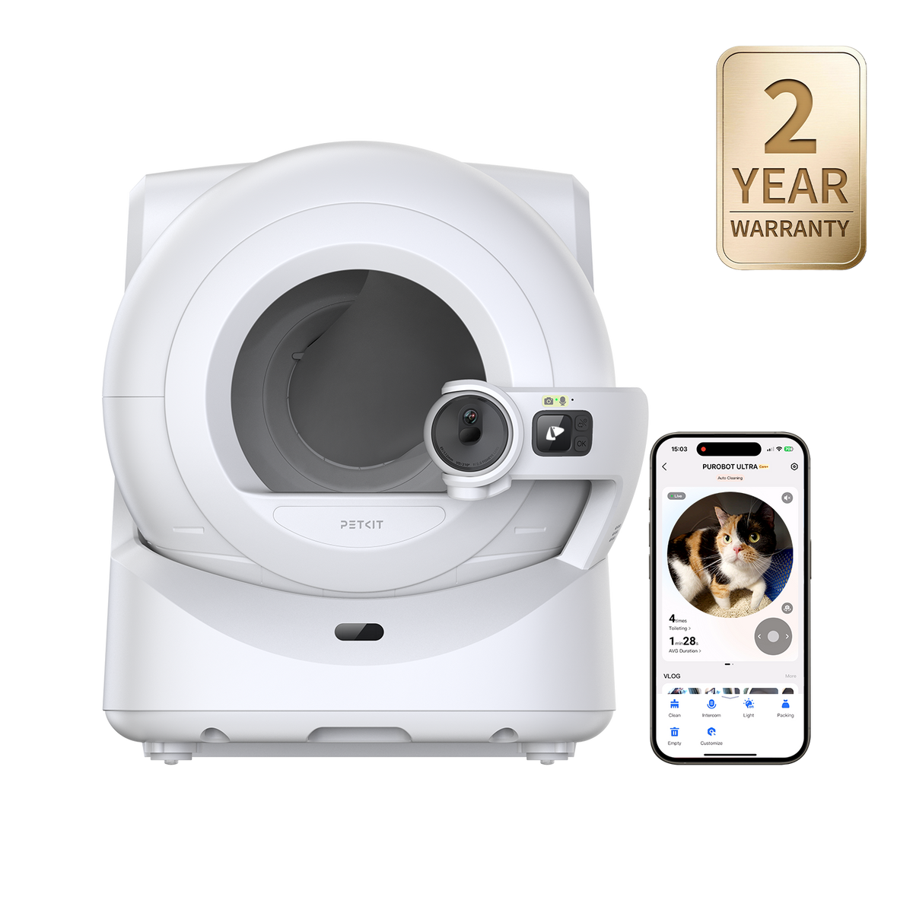
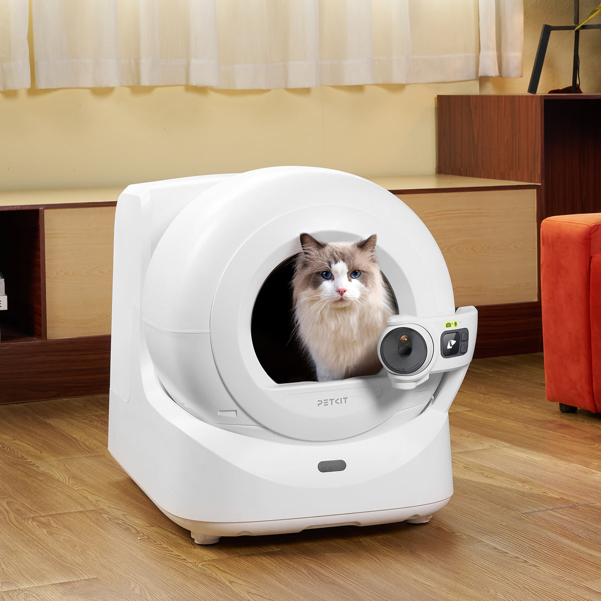
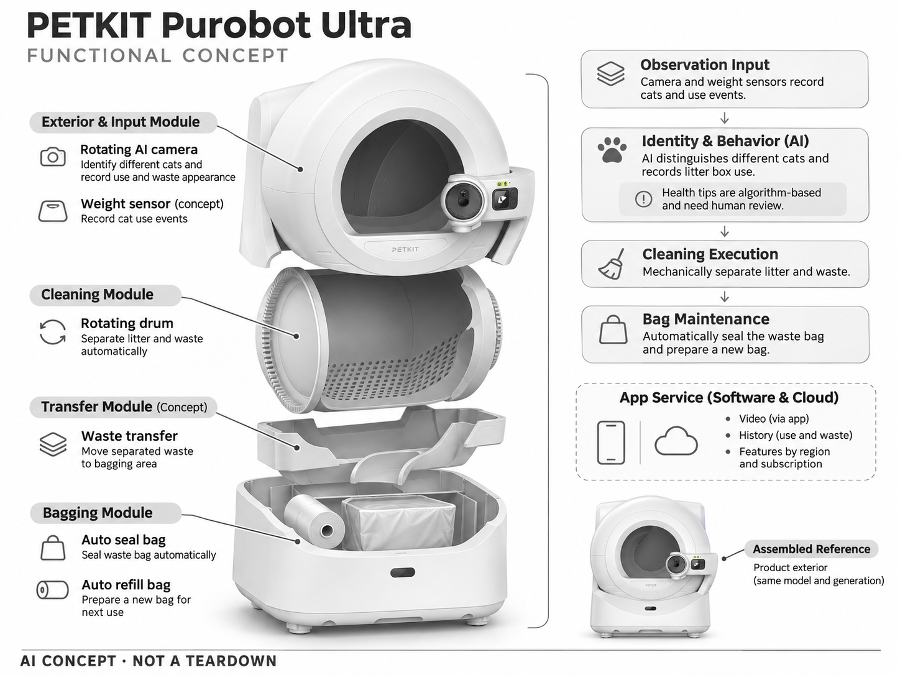

# PETKIT Purobot Ultra

**PETKIT** · 宠物照护 · 核查 2026-11-04

把个体识别、如厕记录与自动封袋结合的家用猫砂盆

消费渠道：个人零售。

## 产品图片与结构参考

### 产品图

PETKIT Purobot Ultra 官方产品外观图 · 来源：[PETKIT · 官方图片](<https://www.petkit.com/products/purobot-ultra>) · [原始图片](<https://cdn.shopify.com/s/files/1/0569/0526/9388/files/purobot-ultra-automatic-cat-litter-box-app-control-2-year-warranty.png?v=1773384298&width=1200>)

### 参考图

PETKIT Purobot Ultra 官方场景或功能参考图 · 来源：[PETKIT · 官方图片](<https://www.petkit.com/products/purobot-ultra>) · [原始图片](<https://cdn.shopify.com/s/files/1/0569/0526/9388/files/purobot-ultra-automatic-cat-litter-box-cat-using-at-home.jpg?v=1773384298&width=1200>)

### AI 生成爆炸示意

**AI 生成 · 非实物拆机。** 内部为概念推断，不能作为元件布局、BOM 或维修依据。[生成提示词](../../content/hardware/prompts/petkit-purobot-ultra.txt)

> 依据官方外观参考与公开功能生成；未披露的内部布局只作概念模块，不构成BOM或真实结构证据。

> 保留官方图原始内容与出处；画面中的营销声明不视为独立验证。

> 分析为基于公开资料的案头研究与 AI 辅助判断，未经用户访谈、销量审计或实物拆机。需求、画像、竞争冷门度、审美及商业机会均为研究假设，不是投资结论。

## 销售与购买

- 状态：在售。官方商店显示Purobot Ultra单机价格和Add to cart；未使用其它型号或耗材套装作为销售证据。

- 地区：美国官方零售；其他地区须分别确认

- 价格：US$799.99。核查日官方页面参考；税运、订阅及优惠条件另计。会员价、服务套餐与硬件买断价不可直接混用。

- 中国大陆：本轮核实国际官方渠道；未核实中国大陆该型号的官方现货、地区服务与保修，不把跨境硬件可送达等同于全部AI功能可用。

- [官方产品 / 商店](<https://www.petkit.com/products/purobot-ultra>)

## AI 的实际作用

旋转AI相机识别不同猫、记录如厕与排泄物外观，配合自动清洁和封袋；健康提示是厂商算法推断，不是兽医诊断。

服务与联网依赖：远程视频、历史和部分AI服务依赖PETKIT App、网络及Care+方案；机械清洁和摄像服务的权益应分别核对。

## 是否冷门

细分专业（研究判断）：家庭宠物照护是细分消费任务，需求取决于宠物习惯、主人投入与长期服务；已有替代产品，冷门不等于低竞争或高利润。

## 需求与市场

需求假设：多猫家庭不仅需要少铲砂，还想分辨是谁改变了如厕习惯。应跟踪封袋失败、人工清理及身份混淆次数，验证省时和记录价值；没有用户访谈或真实健康改善数据支持销量推断。

## 用户画像

画像推断：养多只猫、愿意提供较大摆放空间，并能坚持维护耗材的家庭。照护老年猫的主人可能更关注趋势，但猫是否愿意进入装置和主人能否理解告警，比科技兴趣更决定留存。

## 竞争与替代

竞争判断：自动猫砂盆与普通猫砂盆都是替代方案；Ultra的封袋减少直接接触污物，但增加耗材依赖。与只做相机识别的产品相比，机械可靠性、气味控制和维修便利更难被软件迅速复制。

## 供应链

供应链分析：滚筒、密封件、称重传感、相机与袋材机构需要联调，材料应耐清洗与猫抓。具体芯片、代工工厂和BOM未披露；应核查袋材兼容性、密封寿命与安全停机测试，不据外观估成本。

## 技术路径

已披露AI相机、多猫识别与排泄物记录。技术判断：相似毛色、遮挡和特殊猫砂会改变输入分布；需要把身份置信、机械安全与健康提示分开，识别失败时不应触发危险清洁动作。

## 产品审美

审美判断：白色圆舱将卫生工具家电化，有利于融入住宅，但体积和进出口决定猫的接受程度。垃圾袋出口、抽屉把手与清洗后的晾干路径同样属于设计质量，不能只评价正面照片。

## 关键风险

风险判断：幼猫、行动受限猫和多猫同时靠近会增加机械安全要求；算法健康提示可能误报或漏报。用户需遵守重量与使用限制，出现排尿异常仍需兽医判断，不能依赖设备替代就诊。

## 机会与验证

机会假设：先研究多猫家庭最难追踪的异常和最厌烦的维护步骤，比较相机外挂与整机方案。可验证指标是有效记录率、人工接管和耗材年成本，而不是从AI健康概念直接推导复购。

## 功能分层示意

这是功能关系，不是实物拆机、真实空间结构或已核实 BOM。

1. **观察输入**：相机与重量等传感记录猫和使用事件。（官方披露）

2. **个体与行为**：AI区分猫与如厕记录；健康提示需人工复核。（官方披露）

3. **清理执行**：机械分离猫砂和废物。（官方披露）

4. **袋材维护**：自动封袋与补袋构成功能模块。（官方披露）

5. **App服务**：视频和历史权益按地区及订阅配置。（官方披露）

## 来源

1. [PETKIT Purobot Ultra 官方商店](<https://www.petkit.com/products/purobot-ultra>) — 已实际打开；核查购物入口、产品形态与AI声明，未完成支付或收货。

2. [PETKIT Health 官方AI能力说明](<https://www.petkit.com/pages/petkit-health>) — 已实际打开的官方技术或服务说明；厂商声明不视为独立性能或疗效验证。

[返回目录](../hardware-market.md) · [网页分析](https://romanagent.github.io/Roman/#hardware/product/petkit-purobot-ultra)
