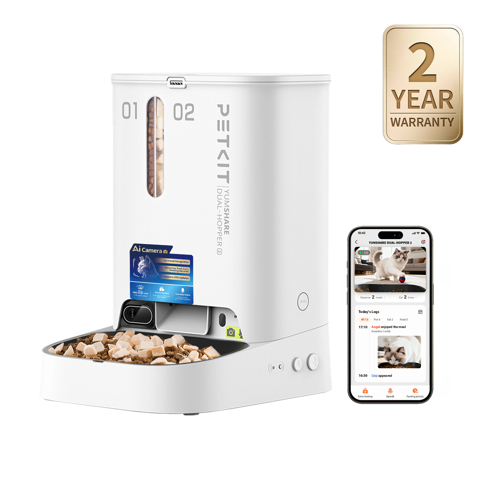
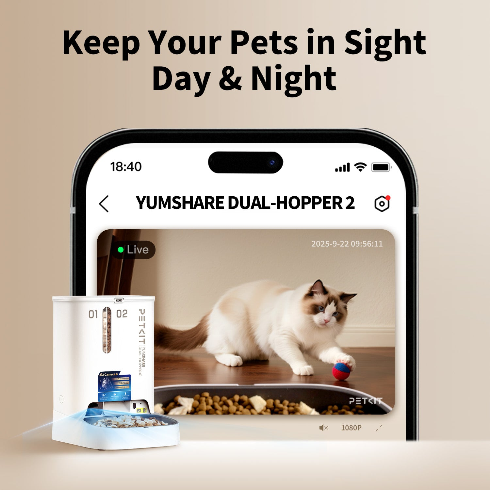
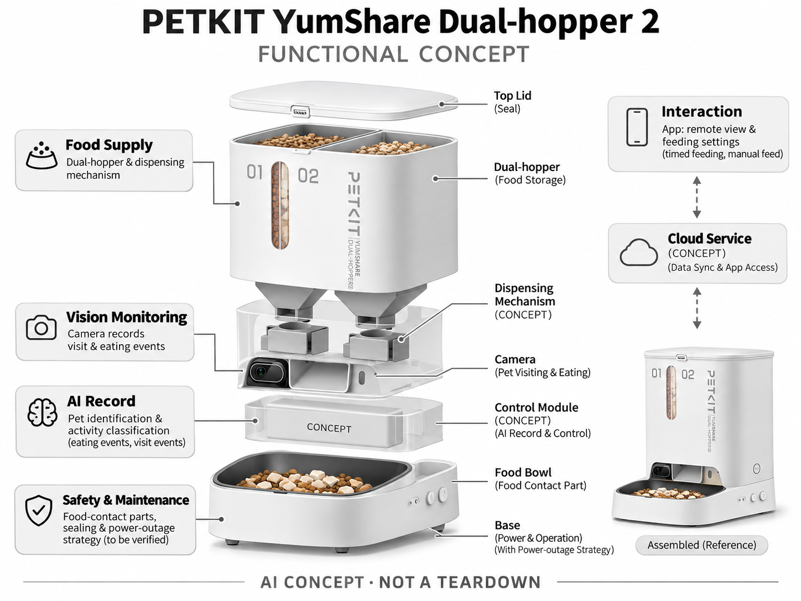

# PETKIT YumShare Dual-hopper 2

**PETKIT** · 宠物照护 · 核查 2026-11-04

把双料仓出粮与AI进食记录放在同一台喂食器

消费渠道：个人零售。

## 产品图片与结构参考

### 产品图

PETKIT YumShare Dual-hopper 2 官方产品外观图 · 来源：[PETKIT · 官方图片](<https://www.petkit.com/products/yumshare-dual-hopper-2-automatic-feeder-with-camera>) · [原始图片](<https://www.petkit.com/cdn/shop/files/petkit-yumshare-dual-hopper-2-cat-feeder-ai-camera-2-year-warranty.png?v=1773383821&width=1500>)

### 参考图

PETKIT YumShare Dual-hopper 2 官方场景或功能参考图 · 来源：[PETKIT · 官方图片](<https://www.petkit.com/products/yumshare-dual-hopper-2-automatic-feeder-with-camera>) · [原始图片](<https://www.petkit.com/cdn/shop/files/petkit-pet-feeder-24h-pet-monitor.jpg?v=1773383821&width=1500>)

### AI 生成爆炸示意

**AI 生成 · 非实物拆机。** 内部为概念推断，不能作为元件布局、BOM 或维修依据。[生成提示词](../../content/hardware/prompts/petkit-yumshare-dual-hopper-2.txt)

> 依据官方外观参考与公开功能生成；未披露的内部布局只作概念模块，不构成BOM或真实结构证据。

> 保留官方图原始内容与出处；画面中的营销声明不视为独立验证。

> 分析为基于公开资料的案头研究与 AI 辅助判断，未经用户访谈、销量审计或实物拆机。需求、画像、竞争冷门度、审美及商业机会均为研究假设，不是投资结论。

## 销售与购买

- 状态：在售。官方商店提供Dual-hopper 2独立型号和Add to cart；不把单料仓、容量或耗材套装另算。

- 地区：美国官方零售；其他地区须分别确认

- 价格：US$145.99。核查日官方页面参考；税运、订阅及优惠条件另计。会员价、服务套餐与硬件买断价不可直接混用。

- 中国大陆：本轮核实国际官方渠道；未核实中国大陆该型号的官方现货、地区服务与保修，不把跨境硬件可送达等同于全部AI功能可用。

- [官方产品 / 商店](<https://www.petkit.com/products/yumshare-dual-hopper-2-automatic-feeder-with-camera>)

## AI 的实际作用

AI相机识别猫及进食事件，整理喂食活动；出粮定时本身不是AI，多猫识别也不等同于阻止其它猫抢食。

服务与联网依赖：App和部分录像历史依赖网络与Care+服务；断网出粮、识别和回看需要按当前固件分别确认。

## 是否冷门

细分专业（研究判断）：家庭宠物照护是细分消费任务，需求取决于宠物习惯、主人投入与长期服务；已有替代产品，冷门不等于低竞争或高利润。

## 需求与市场

需求假设：主人不在家时想确认食物是否真正被吃掉，并区分多只猫的访问。应记录卡粮、实际出粮偏差和身份误分；按时出粮并不能证明营养摄入正确，也不能用画面出现代替吃完。

## 用户画像

画像推断：工作日离家较久、采用干粮且愿意定期补粮清洗的家庭。多宠家庭还需处理抢食，付款人往往高估相机的管理能力；因此应明确观察记录与单猫授权进食是不同需求。

## 竞争与替代

竞争判断：自动喂食器已是成熟品类，双料仓和摄像头都有替代品。差异在能否把访问与进食归到具体宠物，并把异常转化成可操作信息；仅增加摄像头像素未必提高持续付费意愿。

## 供应链

供应链分析：料仓密封、出粮螺旋或叶轮、食品接触碗、相机和控制板都需验证。代工厂和实际BOM未披露；不同颗粒、油脂积累、防潮及可清洗路径会直接影响可靠性，不能只估电子成本。

## 技术路径

官方披露AI活动分类与猫识别。技术判断：碗边遮挡、相似外形和多人移动背景会影响识别；应为漏识保留原始片段和人工更正。算法记录不能替代称量摄入，也不应自动给营养处方。

## 产品审美

审美判断：竖向料仓减少台面占地，相机嵌入机身让设备相对整齐。食盆朝向、猫胡须接触和电线保护比装饰灯更重要，用户日常能否迅速拆洗决定它是否长期留在喂食位置。

## 关键风险

风险判断：卡粮、断电、过度投喂和误识别可能共同影响宠物照护；摄像头还会采集家庭画面。外出较久仍需要可靠的人工照看，不应把云端通知或订阅服务视作不断供的保证。

## 机会与验证

机会假设：先验证多猫家庭对抢食、漏吃和实际摄入的优先级，再决定称重碗、个体门禁或相机哪种组合合适。用饲喂任务完成率和维护时间评价，避免把所有自动喂食统称为AI。

## 功能分层示意

这是功能关系，不是实物拆机、真实空间结构或已核实 BOM。

1. **食物供给**：双料仓与出粮机构。（官方披露）

2. **视觉观察**：摄像头记录访食和进食。（官方披露）

3. **AI记录**：个体识别与活动分类。（官方披露）

4. **交互**：App、远程查看与喂食设置。（官方披露）

5. **安全维护**：食品接触件、密封与断电策略需验证。（分析推断）

## 来源

1. [PETKIT YumShare Dual-hopper 2 官方商店](<https://www.petkit.com/products/yumshare-dual-hopper-2-automatic-feeder-with-camera>) — 已实际打开；核查购物入口、产品形态与AI声明，未完成支付或收货。

2. [PETKIT YumShare 官方功能说明](<https://www.petkit.com/pages/petkit-yumshare-smart-feeder-with-camera>) — 已实际打开的官方技术或服务说明；厂商声明不视为独立性能或疗效验证。

[返回目录](../hardware-market.md) · [网页分析](https://romanagent.github.io/Roman/#hardware/product/petkit-yumshare-dual-hopper-2)
