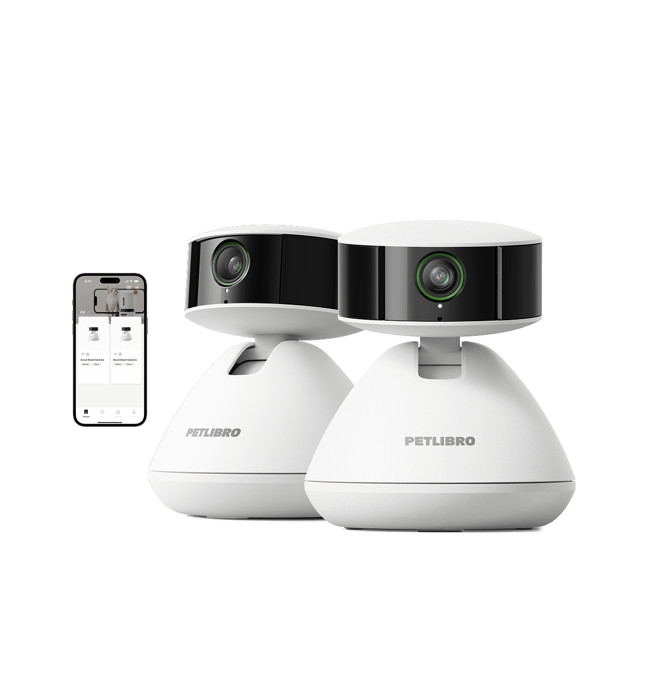
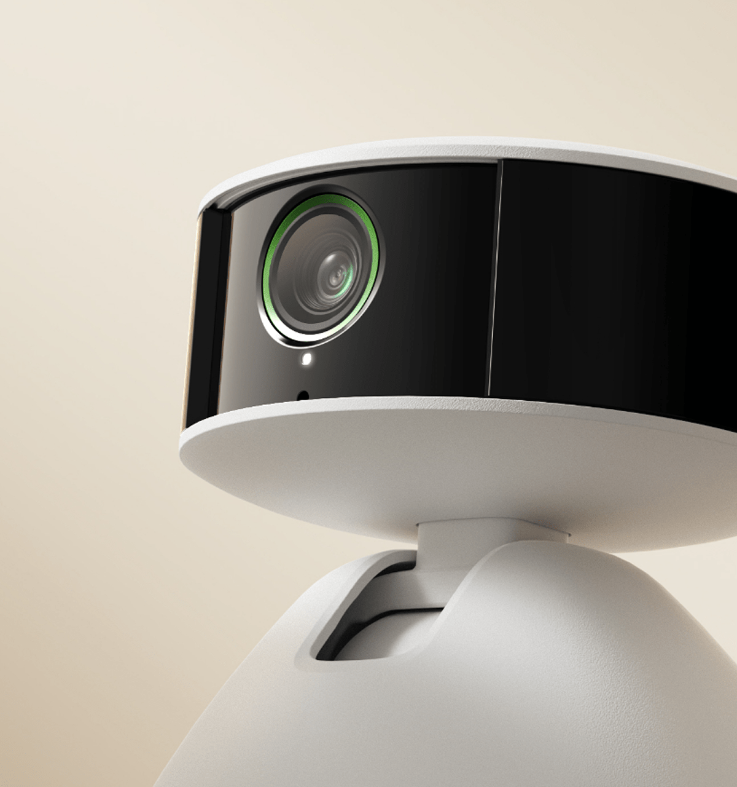
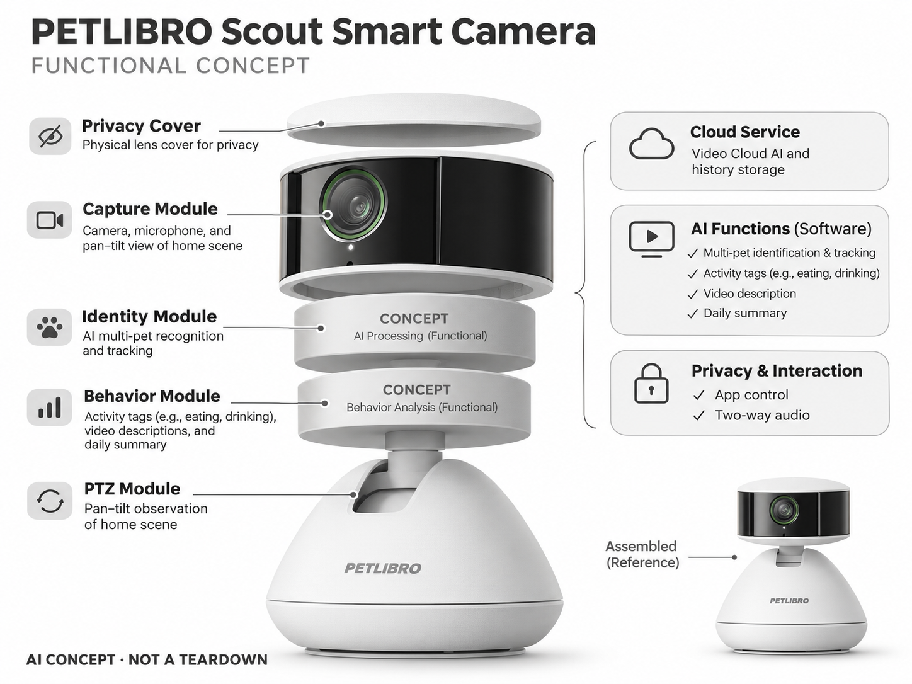

# PETLIBRO Scout Smart Camera

**PETLIBRO** · 宠物照护 · 核查 2026-11-04

按宠物身份整理家庭影像的AI观察相机

消费渠道：个人零售。

## 产品图片与结构参考

### 产品图

PETLIBRO Scout Smart Camera 官方产品外观图 · 来源：[PETLIBRO · 官方图片](<https://petlibro.com/products/scout-smart-camera>) · [原始图片](<https://cdn.shopify.com/s/files/1/0252/5197/1119/files/scout-smart-camera-513103.png?v=1753842850&width=1200>)

### 参考图

PETLIBRO Scout Smart Camera 官方场景或功能参考图 · 来源：[PETLIBRO · 官方图片](<https://petlibro.com/products/scout-smart-camera>) · [原始图片](<https://cdn.shopify.com/s/files/1/0252/5197/1119/files/scout-smart-camera-623590.png?v=1753842850&width=1200>)

### AI 生成爆炸示意

**AI 生成 · 非实物拆机。** 内部为概念推断，不能作为元件布局、BOM 或维修依据。[生成提示词](../../content/hardware/prompts/petlibro-scout.txt)

> 依据官方外观参考与公开功能生成；未披露的内部布局只作概念模块，不构成BOM或真实结构证据。

> 保留官方图原始内容与出处；画面中的营销声明不视为独立验证。

> 主图展示同款双机外观，本条按一个硬件型号收录，不将单机/双机套餐重复计数。

> 分析为基于公开资料的案头研究与 AI 辅助判断，未经用户访谈、销量审计或实物拆机。需求、画像、竞争冷门度、审美及商业机会均为研究假设，不是投资结论。

## 销售与购买

- 状态：在售。官方商品页列Scout单机与购物入口，核查时预计11月6—9日送达；页面同时含未激活的售罄/预售模板，实际SKU库存另外核对。

- 地区：美国官方零售；其他地区须分别确认

- 价格：US$79.99。核查日官方页面参考；税运、订阅及优惠条件另计。会员价、服务套餐与硬件买断价不可直接混用。

- 中国大陆：本轮核实国际官方渠道；未核实中国大陆该型号的官方现货、地区服务与保修，不把跨境硬件可送达等同于全部AI功能可用。

- [官方产品 / 商店](<https://petlibro.com/products/scout-smart-camera>)

## AI 的实际作用

AI区分宠物、标注进食饮水等活动，并生成视频描述与每日摘要；官方提醒相似外貌宠物可能难以区分。

服务与联网依赖：AI活动追踪与回顾依赖Video Cloud AI订阅和网络；官方说明不支持SD卡，基础直播与付费服务需分开评估。

## 是否冷门

竞争密集（研究判断）：宠物摄像头已有多个品牌及普通家庭摄像头替代，竞争集中在识别、通知、互动与订阅体验，不属于空白市场。

## 需求与市场

需求假设：用户不愿翻看全天录像，只想知道某只宠物是否正常活动。应比较摘要误报、找片段所需时间和打开频次，判断AI整理是否真正节省注意力；本轮没有用户访谈和付费留存数据。

## 用户画像

画像推断：养两只以上外貌可区分的猫狗、白天外出且习惯看App的主人。相似毛色宠物家庭和网络不稳定地区要单独测试，不能因为支持多宠就推断每只宠物的历史都可靠。

## 竞争与替代

竞争判断：与Furbo、Petcube及普通家用摄像头竞争，价值在个体活动归档与少打扰通知。硬件售价不是完整成本；若摘要只重复画面表面信息，持续订阅可能比一次购机更难说服用户。

## 供应链

供应链分析：云台电机、图像模组、麦克风、扬声器、隐私盖和网络服务共同交付体验。实际芯片、代工厂及BOM未知；还需计入云存储、视频分析和软件维护，不能只估摄像头硬件毛利。

## 技术路径

官方明确AI多宠识别、活动标签和摘要。技术判断：云台跟随会改变画面分布，可能影响行为分类；应提供原片、纠错和低置信标记。识别饮水或如厕不等于测量摄入量或诊断健康状态。

## 产品审美

审美判断：柔和的低矮机身让它更像家庭用品，手动隐私盖提供明确状态。镜头可见性与摆放高度会影响宠物互动，电线、墙装配件和旋转噪声也应纳入用户长期接受度评价。

## 关键风险

风险判断：无本地卡存储意味着部分体验依赖云端，停订、断网和服务变化影响回顾。画面可能包含家人和访客，宠物身份及行为也会误判；不能用AI总结代替实际探视或照护。

## 机会与验证

机会假设：针对多宠家庭设计可纠正的事件时间线和异常复核，测试通知密度与有效信息比例。若主人只需要确认食盆或睡眠位置，较简单的固定视角方案可能已足够，不必先增加生成式聊天。

## 功能分层示意

这是功能关系，不是实物拆机、真实空间结构或已核实 BOM。

1. **采集**：摄像头、拾音及云台观察家庭场景。（官方披露）

2. **身份**：AI多宠识别与追踪。（官方披露）

3. **行为**：活动标签、文字描述与摘要。（官方披露）

4. **云服务**：Video Cloud AI与历史存储。（官方披露）

5. **隐私交互**：实体隐私盖、App及双向音频。（官方披露）

## 来源

1. [PETLIBRO Scout Smart Camera 官方商店](<https://petlibro.com/products/scout-smart-camera>) — 已实际打开；核查购物入口、产品形态与AI声明，未完成支付或收货。

2. [PETLIBRO Scout 官方使用问答](<https://ca.petlibro.com/pages/camera-1>) — 已实际打开的官方技术或服务说明；厂商声明不视为独立性能或疗效验证。

[返回目录](../hardware-market.md) · [网页分析](https://romanagent.github.io/Roman/#hardware/product/petlibro-scout)
