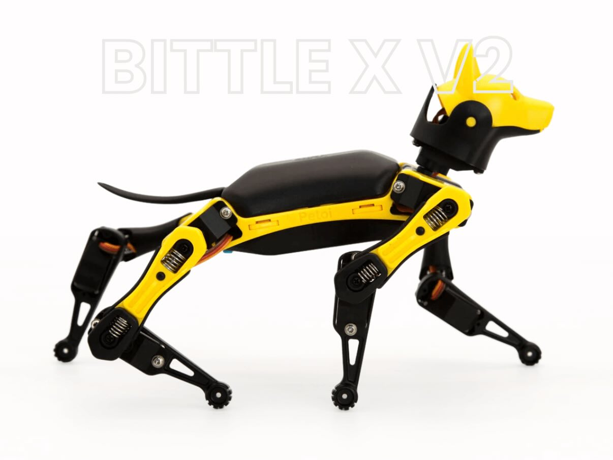
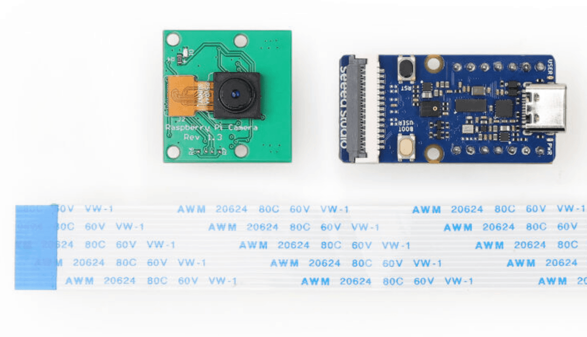
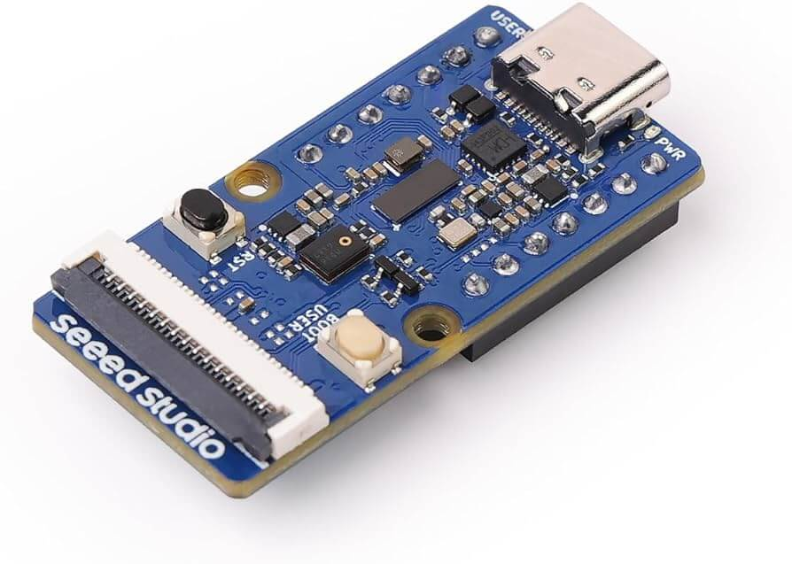
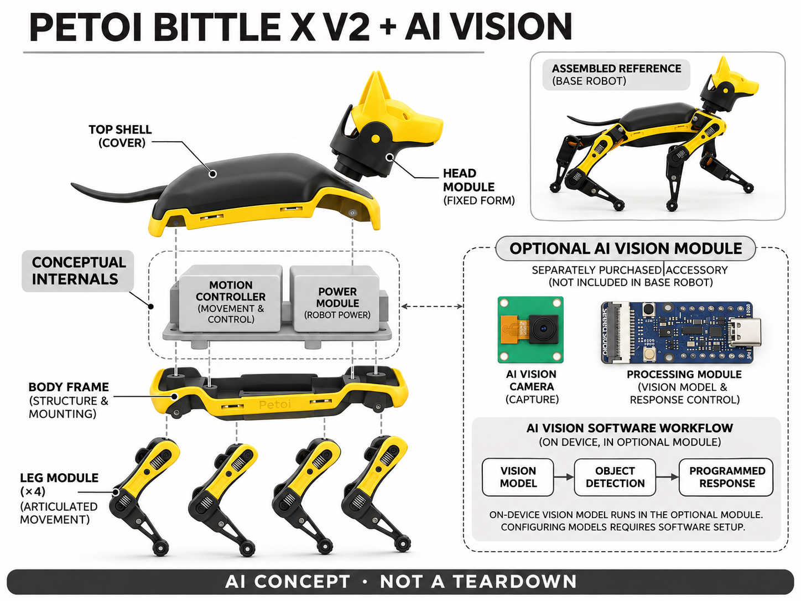

# Bittle X V2 + AI Vision Module

**Petoi** · AI玩具 · 核查 2026-11-06

用另购视觉模块把识别模型接入可编程四足玩法

消费渠道：个人零售。

## 产品图片与结构参考

### 产品图

Bittle X V2 + AI Vision Module 官方产品图（厂商资料） · 来源：[Petoi 官方资料](<https://www.petoi.com/products/petoi-robot-dog-bittle-x-voice-controlled>) · [原始图片](<https://cdn.shopify.com/s/files/1/0550/2015/9160/files/Black_YellowBittleXV2robotdog.jpg?v=1776028399>)

### 参考图

Bittle X V2 + AI Vision Module 官方外形或使用参考（厂商资料） · 来源：[Petoi 官方资料](<https://www.petoi.com/products/petoi-ai-vision-module-for-arduino>) · [原始图片](<https://cdn.shopify.com/s/files/1/0550/2015/9160/files/Screenshot_2024-11-05_at_23.11.59.png?v=1782525606>)

### 官方结构参考

Bittle X V2 + AI Vision Module 官方外形或使用参考（厂商资料） · 来源：[Petoi 官方资料](<https://www.petoi.com/products/petoi-ai-vision-module-for-arduino>) · [原始图片](<https://cdn.shopify.com/s/files/1/0550/2015/9160/files/grove-vision-ai-v2.jpg?v=1775846208>)

### AI 生成爆炸示意

**AI 生成 · 非实物拆机。** 内部为概念推断，不能作为元件布局、BOM 或维修依据。[生成提示词](../../content/hardware/prompts/petoi-bittle-x-ai-vision.txt)

> 主图为Bittle X V2基础本体；参考与模块图为另购AI Vision Module，非默认随箱配置。

> 分析为基于公开资料的案头研究与 AI 辅助判断，未经用户访谈、销量审计或实物拆机。需求、画像、竞争冷门度、审美及商业机会均为研究假设，不是投资结论。

## 销售与购买

- 状态：在售。商品有Add to cart；本轮公开商品数据确认V2轻量舵机预装版US$339可购。只取该配置，机械臂与其他舵机另计且部分缺货。

- 地区：美国、官方国际配送支持地区

- 价格：US$339预装本体 + US$39视觉模块。分别购买，合计参考US$378；运费税费另计，模块需安装配置。组装版与其他舵机配置价格不同。

- 中国大陆：官方有国际配送条款，但未核具体中国大陆结算、渠道与售后；不由品牌或模组产地推断国内现售。

- [官方产品 / 商店](<https://www.petoi.com/products/petoi-robot-dog-bittle-x-voice-controlled>)

## AI 的实际作用

另购AI视觉模块部署分类/检测模型，识别人、姿态或对象，并可通过编程触发机器狗动作；基础整机不默认具备该视觉能力。

服务与联网依赖：需安装兼容视觉模块并配置模型和响应程序；基础套件、现成视觉模型与自定义开发不同。模块不能运行SLAM，不含生成式聊天。

## 是否冷门

新兴竞争（研究判断）：竞争判断应比较轮式教学机器人、纯视觉相机开发套件与封闭式机器宠物。四足运动更具表现力，也需要关节校准和稳定地面；单独相机成本与调试范围可能更小，却缺少身体反馈。真正差异在于把识别与运动程序连接起来，而不是狗形外壳本身。

## 需求与市场

需求判断是个人创作者想看到自己的识别程序影响真实物体的运动，而不是只在电脑里显示结果。小型四足身体能够把追踪、转向和姿态变成直接反馈，但组装与调试也构成门槛；纯粹寻求安静陪伴的用户可能更适合封闭式桌面伙伴。

### 事实与范围 · 官方资料

本档案收录的是Bittle X V2完整机器狗加另购AI视觉模块的明确组合，两个官方商品目前均有可购变体。机器狗本体提供动作和编程，视觉模块才让学习型识别结果进入互动过程；不把遥控、固定动作或基本语音命令单独包装成视觉AI。

依据：[Bittle X V2官方当前商品](<https://www.petoi.com/products/petoi-robot-dog-bittle-x-voice-controlled>) · [Petoi AI视觉模块官方商品](<https://www.petoi.com/products/petoi-ai-vision-module-for-arduino>)

### 判断与差异 · 研究判断

需求判断是个人创作者想看到自己的识别程序影响真实物体的运动，而不是只在电脑里显示结果。小型四足身体能够把追踪、转向和姿态变成直接反馈，但组装与调试也构成门槛；纯粹寻求安静陪伴的用户可能更适合封闭式桌面伙伴。

依据：[Bittle X V2官方当前商品](<https://www.petoi.com/products/petoi-robot-dog-bittle-x-voice-controlled>) · [Petoi AI视觉模块官方商品](<https://www.petoi.com/products/petoi-ai-vision-module-for-arduino>)

### 验证与限制 · 待验证

验证可让成人用户选择一个简单任务，例如让机器狗对一类日常物品作出指定动作，记录模型配置、安装和调试各花多少时间。重点问其是否想继续创造第二个玩法，而非把第一次动作成功视为学习完成，也不以演示视频推断人人都能轻松上手。

依据：[Bittle X V2官方当前商品](<https://www.petoi.com/products/petoi-robot-dog-bittle-x-voice-controlled>) · [Petoi AI视觉模块官方商品](<https://www.petoi.com/products/petoi-ai-vision-module-for-arduino>)

## 用户画像

用户可按对机械和软件的兴趣分别分组：有人喜欢拼装，有人想直接编程，有人只想完成一个视觉小游戏。预装选择降低机械门槛却不会消除模型设置；是否有孩子参与也不能替代成人维护责任，年龄建议不等于已经证明学习成效或普遍安全。

### 事实与范围 · 官方资料

官方同时销售套件与预装版本，当前轻量舵机预装整机可购，机械臂则属于其他配置；商品还说明视觉和物联网扩展需要额外模块。这里以愿意进行设置的成人创客与家庭共同项目为范围，不能将另购配件的功能写成任意基础包装都具备。

依据：[Bittle X V2官方当前商品](<https://www.petoi.com/products/petoi-robot-dog-bittle-x-voice-controlled>) · [Petoi AI视觉模块官方商品](<https://www.petoi.com/products/petoi-ai-vision-module-for-arduino>)

### 判断与差异 · 研究判断

用户可按对机械和软件的兴趣分别分组：有人喜欢拼装，有人想直接编程，有人只想完成一个视觉小游戏。预装选择降低机械门槛却不会消除模型设置；是否有孩子参与也不能替代成人维护责任，年龄建议不等于已经证明学习成效或普遍安全。

依据：[Bittle X V2官方当前商品](<https://www.petoi.com/products/petoi-robot-dog-bittle-x-voice-controlled>) · [Petoi AI视觉模块官方商品](<https://www.petoi.com/products/petoi-ai-vision-module-for-arduino>)

### 验证与限制 · 待验证

招募前应询问是否用过图形化编程、是否愿意接线和调整模型，以及可提供什么活动桌面。让参与者独立检查包装和可选模块，再完成一个官方示例，记录卡在哪里；用实际任务难度衡量适配，不凭专业名称或自报技术爱好决定用户一定能成功。

依据：[Bittle X V2官方当前商品](<https://www.petoi.com/products/petoi-robot-dog-bittle-x-voice-controlled>) · [Petoi AI视觉模块官方商品](<https://www.petoi.com/products/petoi-ai-vision-module-for-arduino>)

## 竞争与替代

竞争判断应比较轮式教学机器人、纯视觉相机开发套件与封闭式机器宠物。四足运动更具表现力，也需要关节校准和稳定地面；单独相机成本与调试范围可能更小，却缺少身体反馈。真正差异在于把识别与运动程序连接起来，而不是狗形外壳本身。

### 事实与范围 · 官方资料

品牌把基础机器狗、机械臂配置和视觉扩展分开出售，本条只选择当前可买的基础预装本体与AI视觉模块。四足步态和可编程动作不等于生成式聊天，也不同于只将手机放在机器人底座上运行应用；不同舵机和套装没有分别增加档案数量。

依据：[Bittle X V2官方当前商品](<https://www.petoi.com/products/petoi-robot-dog-bittle-x-voice-controlled>) · [Petoi AI视觉模块官方商品](<https://www.petoi.com/products/petoi-ai-vision-module-for-arduino>)

### 判断与差异 · 研究判断

竞争判断应比较轮式教学机器人、纯视觉相机开发套件与封闭式机器宠物。四足运动更具表现力，也需要关节校准和稳定地面；单独相机成本与调试范围可能更小，却缺少身体反馈。真正差异在于把识别与运动程序连接起来，而不是狗形外壳本身。

依据：[Bittle X V2官方当前商品](<https://www.petoi.com/products/petoi-robot-dog-bittle-x-voice-controlled>) · [Petoi AI视觉模块官方商品](<https://www.petoi.com/products/petoi-ai-vision-module-for-arduino>)

### 验证与限制 · 待验证

可设置相同的识别任务，对比在屏幕上显示结果和驱动实体动作两种方式，记录理解模型错误的难度以及维护负担。评估需要同时呈现没有完成安装的人，不仅展示优秀创作者作品；公开教程数量和视频热度不能替代付费需求或复用率证据。

依据：[Bittle X V2官方当前商品](<https://www.petoi.com/products/petoi-robot-dog-bittle-x-voice-controlled>) · [Petoi AI视觉模块官方商品](<https://www.petoi.com/products/petoi-ai-vision-module-for-arduino>)

## 供应链

工程判断是模块兼容需要同时满足接口、固定位置、重量和运动时的线缆余量。将相机装进嘴部或附件上会改变视野，身体运动又会使图像出现动态变化；单次识别成功不代表机器人行走时仍稳定，也不能由开放源代码推断任意配件即插即用。

### 事实与范围 · 官方资料

官方图和商品数据公开机身、关节、控制与电源，以及独立视觉模组和相机连接；当前新视觉模块支持学习模型，旧Intelligent Camera则已明确停售。基础机与新旧配件容易混淆，本条采用当前模块的真实照片，不把历史颜色追踪器当成同款物料。

依据：[Bittle X V2官方当前商品](<https://www.petoi.com/products/petoi-robot-dog-bittle-x-voice-controlled>) · [Petoi AI视觉模块官方商品](<https://www.petoi.com/products/petoi-ai-vision-module-for-arduino>)

### 判断与差异 · 研究判断

工程判断是模块兼容需要同时满足接口、固定位置、重量和运动时的线缆余量。将相机装进嘴部或附件上会改变视野，身体运动又会使图像出现动态变化；单次识别成功不代表机器人行走时仍稳定，也不能由开放源代码推断任意配件即插即用。

依据：[Bittle X V2官方当前商品](<https://www.petoi.com/products/petoi-robot-dog-bittle-x-voice-controlled>) · [Petoi AI视觉模块官方商品](<https://www.petoi.com/products/petoi-ai-vision-module-for-arduino>)

### 验证与限制 · 待验证

可以向小型舵机和视觉模组供应公司咨询能力，但选型应先说明机器人负载、镜头位置、数据接口及模型部署条件。试产测试要包括跌落、反复装拆、线缆松动和持续动作温升，所有成本、生产工厂和寿命推断均应等待实际工程及合同证据。

依据：[Bittle X V2官方当前商品](<https://www.petoi.com/products/petoi-robot-dog-bittle-x-voice-controlled>) · [Petoi AI视觉模块官方商品](<https://www.petoi.com/products/petoi-ai-vision-module-for-arduino>)

## 技术路径

技术判断是模型输出必须经过用户编写或配置的响应逻辑才变成动作，识别和运动控制是不同环节。目标类别变化、相机角度及阈值都会影响结果，因此模块能加载模型不等于所有任务已经训练好；品牌示例不能替代特定家庭环境的效果验证。

### 事实与范围 · 官方资料

官方视觉模块商品说明列出可部署的分类和检测模型家族，并说明支持现成或自定义模型以及人体、手势等识别任务。它还明确这块模块不能执行SLAM；本条据此将AI定位为选配模块的视觉推理，不宣传自动理解全屋或默认具有自由对话。

依据：[Bittle X V2官方当前商品](<https://www.petoi.com/products/petoi-robot-dog-bittle-x-voice-controlled>) · [Petoi AI视觉模块官方商品](<https://www.petoi.com/products/petoi-ai-vision-module-for-arduino>) · [Petoi官方模块公开商品资料](<https://www.petoi.com/products/petoi-ai-vision-module-for-arduino.js>)

### 判断与差异 · 研究判断

技术判断是模型输出必须经过用户编写或配置的响应逻辑才变成动作，识别和运动控制是不同环节。目标类别变化、相机角度及阈值都会影响结果，因此模块能加载模型不等于所有任务已经训练好；品牌示例不能替代特定家庭环境的效果验证。

依据：[Bittle X V2官方当前商品](<https://www.petoi.com/products/petoi-robot-dog-bittle-x-voice-controlled>) · [Petoi AI视觉模块官方商品](<https://www.petoi.com/products/petoi-ai-vision-module-for-arduino>) · [Petoi官方模块公开商品资料](<https://www.petoi.com/products/petoi-ai-vision-module-for-arduino.js>)

### 验证与限制 · 待验证

验证可固定相机与模型版本，分别测试静止和行走时识别同一物体，再观察误检如何影响动作。把识别错误、通信失效和动作程序错误分别记录，预设停止方式；若任务需要建图或远程大模型，应额外说明硬件软件依赖，不能挪用基础组合能力。

依据：[Bittle X V2官方当前商品](<https://www.petoi.com/products/petoi-robot-dog-bittle-x-voice-controlled>) · [Petoi AI视觉模块官方商品](<https://www.petoi.com/products/petoi-ai-vision-module-for-arduino>) · [Petoi官方模块公开商品资料](<https://www.petoi.com/products/petoi-ai-vision-module-for-arduino.js>)

## 产品审美

审美判断是外露关节让动作原理较容易理解，也表现出明显的模型和工程玩具风格。它与毛绒伙伴的触感和抱持预期不同，优点可能是可修可改，缺点可能是零件、线缆与维护感更强；对成人创客的吸引力不能直接外推给普通礼物购买者。

### 事实与范围 · 官方资料

当前V2官方照片呈黑黄色四足狗形结构，细长腿部有可见关节，头部有尖耳和嘴部安装区域，后方是短尾。参考图另展示真实相机与处理模块；生成图把可选模块放在独立区域，明确另购，避免让读者误以为主图所示基础机已经装好相机。

依据：[Bittle X V2官方当前商品](<https://www.petoi.com/products/petoi-robot-dog-bittle-x-voice-controlled>) · [Petoi AI视觉模块官方商品](<https://www.petoi.com/products/petoi-ai-vision-module-for-arduino>)

### 判断与差异 · 研究判断

审美判断是外露关节让动作原理较容易理解，也表现出明显的模型和工程玩具风格。它与毛绒伙伴的触感和抱持预期不同，优点可能是可修可改，缺点可能是零件、线缆与维护感更强；对成人创客的吸引力不能直接外推给普通礼物购买者。

依据：[Bittle X V2官方当前商品](<https://www.petoi.com/products/petoi-robot-dog-bittle-x-voice-controlled>) · [Petoi AI视觉模块官方商品](<https://www.petoi.com/products/petoi-ai-vision-module-for-arduino>)

### 验证与限制 · 待验证

外观研究应让用户实际拿起、收纳和装模块，观察有没有误把承重结构当把手或拉扯线缆。再询问希望保留机械裸露还是增加外壳，并检查新增外壳是否遮挡运动；不能仅为图像好看而隐藏选配模组，导致用户低估安装后的真实体积与复杂度。

依据：[Bittle X V2官方当前商品](<https://www.petoi.com/products/petoi-robot-dog-bittle-x-voice-controlled>) · [Petoi AI视觉模块官方商品](<https://www.petoi.com/products/petoi-ai-vision-module-for-arduino>)

## 关键风险

风险判断包括安装错误、供电不匹配、错误识别导致意外运动以及软件升级破坏已有程序。对家庭使用者，还应考虑小零件、活动关节和充电管理；这些是需要评估的工程风险，不表示本轮已经发现实物故障，也不能据此虚构故障发生率。

### 事实与范围 · 官方资料

商品页明确AI视觉为额外配件，机械臂又要求对应能力的舵机版本；当前部分合金舵机变体缺货，因此不能把同页任何型号的能力统一放到可售基础机上。模块的建图限制同样重要，视觉识别和行走控制都不构成可无人看护运行的承诺。

依据：[Bittle X V2官方当前商品](<https://www.petoi.com/products/petoi-robot-dog-bittle-x-voice-controlled>) · [Petoi AI视觉模块官方商品](<https://www.petoi.com/products/petoi-ai-vision-module-for-arduino>)

### 判断与差异 · 研究判断

风险判断包括安装错误、供电不匹配、错误识别导致意外运动以及软件升级破坏已有程序。对家庭使用者，还应考虑小零件、活动关节和充电管理；这些是需要评估的工程风险，不表示本轮已经发现实物故障，也不能据此虚构故障发生率。

依据：[Bittle X V2官方当前商品](<https://www.petoi.com/products/petoi-robot-dog-bittle-x-voice-controlled>) · [Petoi AI视觉模块官方商品](<https://www.petoi.com/products/petoi-ai-vision-module-for-arduino>)

### 验证与限制 · 待验证

购买前应确认两件商品的兼容版本与支架需求，保存恢复固件及校准方法，在可安全停止的空间测试。跨境用户还要分别核运输、税费和维修；国内存在品牌背景并不能证明国际商店对大陆有同样服务，更不能把开发者社区求助等同于厂商保修。

依据：[Bittle X V2官方当前商品](<https://www.petoi.com/products/petoi-robot-dog-bittle-x-voice-controlled>) · [Petoi AI视觉模块官方商品](<https://www.petoi.com/products/petoi-ai-vision-module-for-arduino>)

## 机会与验证

商业判断应把完整成品、可选视觉模块、课程和售后支持分开设计。小团队若只售一个拼装盒却缺少版本一致的教程，会把大量支持成本留到售后；反过来，过度封闭又削弱创作自由。需要验证用户愿意为什么样的成功任务或支持付费。

### 事实与范围 · 官方资料

可研究的机会是提供少量能完成、可解释的视觉游戏，让用户从观察模型输出逐步过渡到控制实体动作。这个方向属于教学与产品设计判断，价值不在承诺无限AI能力，而在让错误也能被看见并修正，帮助创作者理解感知与控制之间的关系。

依据：[Bittle X V2官方当前商品](<https://www.petoi.com/products/petoi-robot-dog-bittle-x-voice-controlled>) · [Petoi AI视觉模块官方商品](<https://www.petoi.com/products/petoi-ai-vision-module-for-arduino>)

### 判断与差异 · 研究判断

商业判断应把完整成品、可选视觉模块、课程和售后支持分开设计。小团队若只售一个拼装盒却缺少版本一致的教程，会把大量支持成本留到售后；反过来，过度封闭又削弱创作自由。需要验证用户愿意为什么样的成功任务或支持付费。

依据：[Bittle X V2官方当前商品](<https://www.petoi.com/products/petoi-robot-dog-bittle-x-voice-controlled>) · [Petoi AI视觉模块官方商品](<https://www.petoi.com/products/petoi-ai-vision-module-for-arduino>)

### 验证与限制 · 待验证

下一步可用几个明确难度的项目开展家庭或成人创客试用，记录完成率、求助环节和项目二次修改情况，询问失败后是否仍愿意继续。结论按过程和作品保存，不把演示中的聪明行为当成普遍学习效果，也不以AI评分预测产品市场成功。

依据：[Bittle X V2官方当前商品](<https://www.petoi.com/products/petoi-robot-dog-bittle-x-voice-controlled>) · [Petoi AI视觉模块官方商品](<https://www.petoi.com/products/petoi-ai-vision-module-for-arduino>)

## 对应供应链公司

能力候选用于选型研究，不代表本产品实际采用；未公开的供货关系不作推断。

- [feetech](../supply-chain/feetech.md) — **能力候选 · 非已采用** / 小型四足执行器能力候选：FEETECH公开小型舵机与总线控制能力，可作为类似四足项目的执行器询样方向。实际接口、动作负载和校准要求必须验证；本档案不认定Petoi现有舵机由它生产或可直接互换。

- [chicony](../supply-chain/chicony.md) — **能力候选 · 非已采用** / 创作视觉模组能力候选：群光相机模组能力可用于比较个人机器人视觉输入的工程路线，但本产品所售模块已有明确外观与部署环境。该关联只供替代设计询样，不宣称替换兼容，也不将其误列为官方模块实际供应商。

[浏览供应链目录](../supply-chain.md)

## 功能分层示意

这是功能关系，不是实物拆机、真实空间结构或已核实 BOM。

1. **基础机器狗**：四足关节、身体与可编程运动平台构成实体反馈。（官方披露）

2. **选配视觉输入**：另购相机与处理模组安装在合适位置。（官方披露）

3. **视觉模型**：模块可部署现成或自定义检测/分类模型。（官方披露）

4. **程序与动作**：识别结果通过用户配置逻辑转化成运动响应。（官方披露）

5. **供电与连接概念**：具体内部走线、供电和控制布局仅作功能示意。（分析推断）

## 来源

1. [Bittle X V2官方当前商品](<https://www.petoi.com/products/petoi-robot-dog-bittle-x-voice-controlled>) — 商品有Add to cart；本轮公开商品数据确认V2轻量舵机预装版US$339可购。只取该配置，机械臂与其他舵机另计且部分缺货。

2. [Petoi AI视觉模块官方商品](<https://www.petoi.com/products/petoi-ai-vision-module-for-arduino>) — 商品模块US$39并有Add to cart，公开商品数据available=true。说明兼容Bittle X，模型部署与相机安装为额外步骤，不能运行SLAM。

3. [Petoi官方模块公开商品资料](<https://www.petoi.com/products/petoi-ai-vision-module-for-arduino.js>) — 实际读取官方商品结构化说明，明确SenseCraft及MobileNet、EfficientNet、YOLO模型路线、Wi-Fi图像传输与兼容限制；不以基础遥控动作证明AI。

[返回目录](../hardware-market.md) · [网页分析](https://romanagent.github.io/Roman/#hardware/product/petoi-bittle-x-ai-vision)
