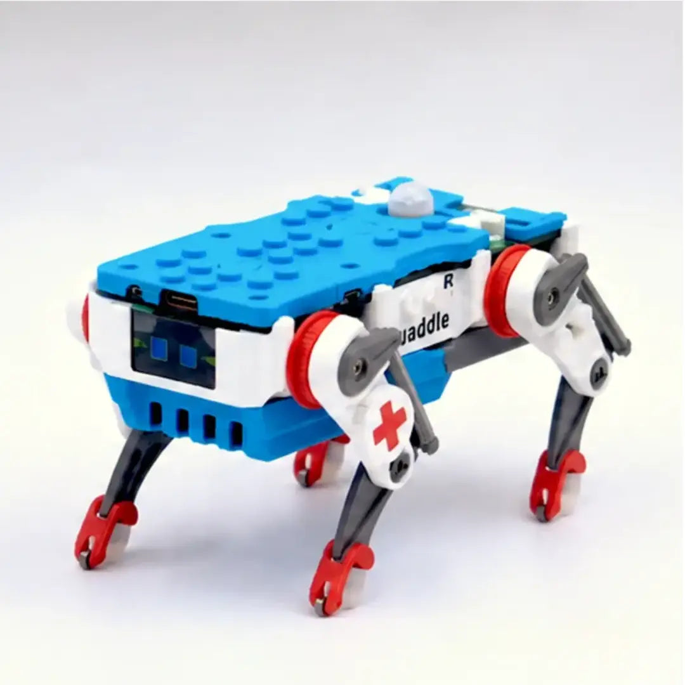
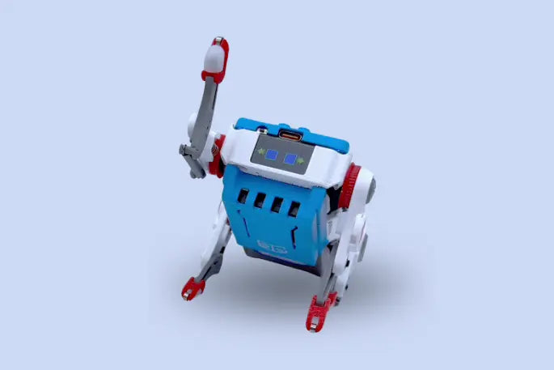
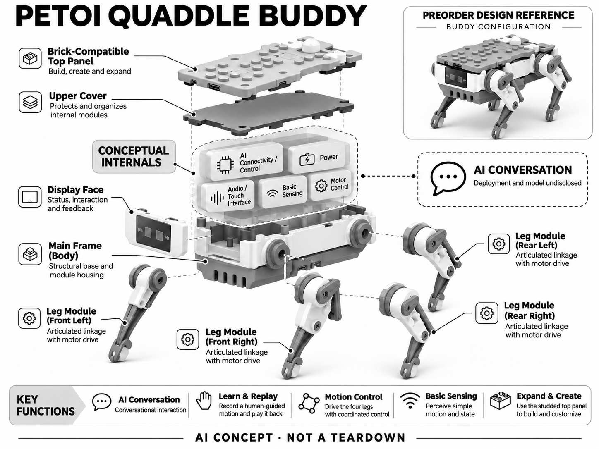

# Quaddle Buddy

**Petoi** · AI玩具 · 核查 2026-11-06

接受正式后期预售的四足对话与手动示教玩具

消费渠道：消费预订。

## 产品图片与结构参考

### 产品图

Quaddle Buddy 官方产品图（厂商资料） · 来源：[Petoi 官方资料](<https://www.petoi.com/pages/quaddle-educational-robot-kit>) · [原始图片](<https://cdn.shopify.com/s/files/1/0550/2015/9160/files/quaddle-blue-medic.webp?v=1784535355&width=2048>)

### 参考图

Quaddle Buddy 官方外形或使用参考（厂商资料） · 来源：[Petoi 官方资料](<https://www.petoi.com/pages/quaddle-educational-robot-kit>) · [原始图片](<https://cdn.shopify.com/s/files/1/0550/2015/9160/files/quaddle-blue-standing-arm-up-v2.webp?v=1784826511&width=2048>)

### AI 生成爆炸示意

**AI 生成 · 非实物拆机。** 内部为概念推断，不能作为元件布局、BOM 或维修依据。[生成提示词](../../content/hardware/prompts/petoi-quaddle-buddy.txt)

> 初稿曾误标云端；最终已修正为部署与模型未披露。初稿仅保留作修图溯源，不作为最终展示。

> 两张真实来源图为厂商预售设计资料，不能证明量产出货外观；生成图另标非实物拆机。

> 分析为基于公开资料的案头研究与 AI 辅助判断，未经用户访谈、销量审计或实物拆机。需求、画像、竞争冷门度、审美及商业机会均为研究假设，不是投资结论。

## 销售与购买

- 状态：预售 / 接受延期订单。本轮实际浏览确认Campaign funded后仍接受Late Pledge；Available KS Special Quaddle Buddy US$189按钮可用，预计Dec2026、Ships anywhere。早鸟回报已禁用；组装服务另加US$6，未提交付款。

- 地区：官方后期支持页所列全球目的地

- 价格：US$189 Buddy后期支持。预计2026年12月交付；组装服务另加US$6，运费税费及目的地以回报结算为准。非现货，早鸟价格不再适用。

- 中国大陆：当前回报写Ships anywhere，但未单独核中国大陆的支付、税费、交期和售后；不能将全球说明等同本地现货。

- [官方产品 / 商店](<https://www.kickstarter.com/projects/petoi/quaddle-open-source-desktop-robot-kit/rewards>)

## AI 的实际作用

Buddy预售配置明确包含开放域AI对话；手动引导动作录制回放是另一种交互，不能当作学习型步态AI。

服务与联网依赖：AI对话的端云分工、模型供应及离线范围尚未充分披露，应以交付版说明为准。Buddy不包含Scout的扩展感知或选配视觉模块。

## 是否冷门

新兴竞争（研究判断）：竞争判断是它试图在封闭聊天玩具和复杂四足开发套件之间找位置：提供角色对话，同时保留编程与手动录制。封闭伙伴可能更省心，复杂套件可能更适合深入运动研究；机构简化并不自动证明成本更低或更可靠，这些仍需量产和使用证据。

## 需求与市场

需求判断是把可改造的四足桌面玩具与语音角色结合，让用户既能说话，也能通过积木和简单动作表达自己的玩法。它可能吸引不想从电路开始搭建的人，但产品仍在预售，实际对话、机械可靠性和长期趣味都尚未由本轮亲身使用验证。

### 事实与范围 · 官方资料

Quaddle Buddy当前通过官方链接的Kickstarter接受后期支持，回报明确包含AI对话与手动示教回放，预期交付在二〇二六年十二月。本条记录可正式预订的实体方案，不把筹款成功当已量产发货，也不将只含基础步态的Builder配置写成相同AI能力。

依据：[Quaddle官方后期支持回报](<https://www.kickstarter.com/projects/petoi/quaddle-open-source-desktop-robot-kit/rewards>) · [Quaddle官方产品与配置](<https://www.petoi.com/pages/quaddle-educational-robot-kit>)

### 判断与差异 · 研究判断

需求判断是把可改造的四足桌面玩具与语音角色结合，让用户既能说话，也能通过积木和简单动作表达自己的玩法。它可能吸引不想从电路开始搭建的人，但产品仍在预售，实际对话、机械可靠性和长期趣味都尚未由本轮亲身使用验证。

依据：[Quaddle官方后期支持回报](<https://www.kickstarter.com/projects/petoi/quaddle-open-source-desktop-robot-kit/rewards>) · [Quaddle官方产品与配置](<https://www.petoi.com/pages/quaddle-educational-robot-kit>)

### 验证与限制 · 待验证

验证计划应先围绕交付样机建立最小任务清单，再让成人和家庭共同参与者实际完成一次对话、一次手动录制和一次外壳改造。观察用户愿不愿意在演示结束后再创造玩法，不拿预售支持者数量推算真实留存，也不提前宣称教学效果。

依据：[Quaddle官方后期支持回报](<https://www.kickstarter.com/projects/petoi/quaddle-open-source-desktop-robot-kit/rewards>) · [Quaddle官方产品与配置](<https://www.petoi.com/pages/quaddle-educational-robot-kit>)

## 用户画像

潜在用户可假设为想尝试机器人制作的成人、愿意一起搭项目的家庭以及喜欢设计外壳的创作者。无需焊接可以降低一个环节的门槛，却不保证用户能够解决所有软件问题；收礼人是否愿意维护和学习，仍比宣传中的适用年龄更值得验证。

### 事实与范围 · 官方资料

官方介绍面向初学者、个人创客和教育使用，套件无需焊接，Buddy在基础配置之上增加AI对话及Learn & Replay。后期支持页面可选套件或额外组装服务，因此购买者需要理解两种交付形式；本档案只选Buddy，不混入Scout专属感知附件。

依据：[Quaddle官方后期支持回报](<https://www.kickstarter.com/projects/petoi/quaddle-open-source-desktop-robot-kit/rewards>) · [Quaddle官方产品与配置](<https://www.petoi.com/pages/quaddle-educational-robot-kit>)

### 判断与差异 · 研究判断

潜在用户可假设为想尝试机器人制作的成人、愿意一起搭项目的家庭以及喜欢设计外壳的创作者。无需焊接可以降低一个环节的门槛，却不保证用户能够解决所有软件问题；收礼人是否愿意维护和学习，仍比宣传中的适用年龄更值得验证。

依据：[Quaddle官方后期支持回报](<https://www.kickstarter.com/projects/petoi/quaddle-open-source-desktop-robot-kit/rewards>) · [Quaddle官方产品与配置](<https://www.petoi.com/pages/quaddle-educational-robot-kit>)

### 验证与限制 · 待验证

招募时可询问用户更喜欢拼装、对话还是编程，给出明确的时间与工具条件，再观察是否能独立读懂回报清单和附加项目。若由家长购买，应分别记录孩子与家长的目标，避免把成人负责调试、孩子短暂观看误判为双方都形成长期兴趣。

依据：[Quaddle官方后期支持回报](<https://www.kickstarter.com/projects/petoi/quaddle-open-source-desktop-robot-kit/rewards>) · [Quaddle官方产品与配置](<https://www.petoi.com/pages/quaddle-educational-robot-kit>)

## 竞争与替代

竞争判断是它试图在封闭聊天玩具和复杂四足开发套件之间找位置：提供角色对话，同时保留编程与手动录制。封闭伙伴可能更省心，复杂套件可能更适合深入运动研究；机构简化并不自动证明成本更低或更可靠，这些仍需量产和使用证据。

### 事实与范围 · 官方资料

官网把Quaddle与Bittle及Nybble比较，强调不同的腿部机构、积木兼容外壳和Buddy内置对话配置。本条不把同系列Builder、Buddy、Scout各计为独立需求，也不把外壳颜色设计当新产品；与视觉扩展Bittle相比，默认交互链路有实际差异。

依据：[Quaddle官方后期支持回报](<https://www.kickstarter.com/projects/petoi/quaddle-open-source-desktop-robot-kit/rewards>) · [Quaddle官方产品与配置](<https://www.petoi.com/pages/quaddle-educational-robot-kit>)

### 判断与差异 · 研究判断

竞争判断是它试图在封闭聊天玩具和复杂四足开发套件之间找位置：提供角色对话，同时保留编程与手动录制。封闭伙伴可能更省心，复杂套件可能更适合深入运动研究；机构简化并不自动证明成本更低或更可靠，这些仍需量产和使用证据。

依据：[Quaddle官方后期支持回报](<https://www.kickstarter.com/projects/petoi/quaddle-open-source-desktop-robot-kit/rewards>) · [Quaddle官方产品与配置](<https://www.petoi.com/pages/quaddle-educational-robot-kit>)

### 验证与限制 · 待验证

比较时应把用户完成一个自定义动作和一段自然对话作为分开的任务，记录所需设置、错误恢复和后续重复意愿。不要将可扩展到研究平台的可能性当成普通消费者都会使用的价值，也不以电机数量少、筹款达到目标就判断竞争优势已经成立。

依据：[Quaddle官方后期支持回报](<https://www.kickstarter.com/projects/petoi/quaddle-open-source-desktop-robot-kit/rewards>) · [Quaddle官方产品与配置](<https://www.petoi.com/pages/quaddle-educational-robot-kit>)

## 供应链

工程判断是少量驱动器通过机构实现动作，可以减少一种复杂度，同时把可靠性要求转移到连杆公差、关节摩擦与装配一致性上。用户在顶部加积木还可能改变重心和负载，不能只根据空载演示认定任何自定义外壳都适合持续活动。

### 事实与范围 · 官方资料

官方披露积木兼容外壳与可打印装饰，但承载关节仍使用注塑件，软件开放不等于全部受力结构开放。预售设计图展示小屏、矩形机身和四腿连杆，内部控制与电源布局未全部公开，生成图中的模块分层只能作为功能概念而非量产拆机。

依据：[Quaddle官方后期支持回报](<https://www.kickstarter.com/projects/petoi/quaddle-open-source-desktop-robot-kit/rewards>) · [Quaddle官方产品与配置](<https://www.petoi.com/pages/quaddle-educational-robot-kit>)

### 判断与差异 · 研究判断

工程判断是少量驱动器通过机构实现动作，可以减少一种复杂度，同时把可靠性要求转移到连杆公差、关节摩擦与装配一致性上。用户在顶部加积木还可能改变重心和负载，不能只根据空载演示认定任何自定义外壳都适合持续活动。

依据：[Quaddle官方后期支持回报](<https://www.kickstarter.com/projects/petoi/quaddle-open-source-desktop-robot-kit/rewards>) · [Quaddle官方产品与配置](<https://www.petoi.com/pages/quaddle-educational-robot-kit>)

### 验证与限制 · 待验证

供应商沟通应先给出动作循环、结构尺寸、材料和装配方案，再评估小型执行与电源能力。预量产验证要覆盖儿童误装的可恢复性、反复示教、关节疲劳和外壳加重，不填未经询样的成本或起订量，也不把同品牌旧款的工厂当新款实际代工。

依据：[Quaddle官方后期支持回报](<https://www.kickstarter.com/projects/petoi/quaddle-open-source-desktop-robot-kit/rewards>) · [Quaddle官方产品与配置](<https://www.petoi.com/pages/quaddle-educational-robot-kit>)

## 技术路径

技术判断中，对话模型、具体端云部署和服务边界尚未由已读资料充分披露，因此不能把on-board的宣传词理解为完整本地大模型。AI对话是预售承诺的明确能力，但其延迟、语言覆盖、数据处理和离线可用范围仍应等交付文档或实际版本核实。

### 事实与范围 · 官方资料

当前官方把开放域AI对话限定在Buddy与Scout，Learn & Replay则是用户用手引导动作后录制回放，两者不能混为学习型运动策略。官网还说明更丰富传感与可选AI视觉属于Scout路线；本档案不将未包含的相机识别或建图写到Buddy配置里。

依据：[Quaddle官方后期支持回报](<https://www.kickstarter.com/projects/petoi/quaddle-open-source-desktop-robot-kit/rewards>) · [Quaddle官方产品与配置](<https://www.petoi.com/pages/quaddle-educational-robot-kit>)

### 判断与差异 · 研究判断

技术判断中，对话模型、具体端云部署和服务边界尚未由已读资料充分披露，因此不能把on-board的宣传词理解为完整本地大模型。AI对话是预售承诺的明确能力，但其延迟、语言覆盖、数据处理和离线可用范围仍应等交付文档或实际版本核实。

依据：[Quaddle官方后期支持回报](<https://www.kickstarter.com/projects/petoi/quaddle-open-source-desktop-robot-kit/rewards>) · [Quaddle官方产品与配置](<https://www.petoi.com/pages/quaddle-educational-robot-kit>)

### 验证与限制 · 待验证

验证应在样机交付后建立联网与断网功能表，并固定固件版本分别测试对话、示教回放和编程动作。对话看起来流畅不代表能够理解所有物理环境，动作回放成功也不能证明学会新策略；具体模型与云服务商应由品牌明示而非研究者猜测。

依据：[Quaddle官方后期支持回报](<https://www.kickstarter.com/projects/petoi/quaddle-open-source-desktop-robot-kit/rewards>) · [Quaddle官方产品与配置](<https://www.petoi.com/pages/quaddle-educational-robot-kit>)

## 产品审美

审美判断是模块化外观有助于鼓励改造，但会减少普通毛绒宠物式的一体感。积木顶部可能让用户从观看转向创造，也可能让装饰遮挡传感或破坏平衡；不同人的趣味来自角色形象还是机械结构，需要在实际手持和改造过程中分别观察。

### 事实与范围 · 官方资料

官方Buddy图像采用低矮矩形身体、顶部积木连接点、小型正面表情屏和外露四腿连杆，参考场景展示可以抬起一侧腿部。它没有传统机器狗的长鼻头，也不是履带底盘；本轮保留官方预售设计素材，并在概念图标注设计参考尚非交付实拍。

依据：[Quaddle官方后期支持回报](<https://www.kickstarter.com/projects/petoi/quaddle-open-source-desktop-robot-kit/rewards>) · [Quaddle官方产品与配置](<https://www.petoi.com/pages/quaddle-educational-robot-kit>)

### 判断与差异 · 研究判断

审美判断是模块化外观有助于鼓励改造，但会减少普通毛绒宠物式的一体感。积木顶部可能让用户从观看转向创造，也可能让装饰遮挡传感或破坏平衡；不同人的趣味来自角色形象还是机械结构，需要在实际手持和改造过程中分别观察。

依据：[Quaddle官方后期支持回报](<https://www.kickstarter.com/projects/petoi/quaddle-open-source-desktop-robot-kit/rewards>) · [Quaddle官方产品与配置](<https://www.petoi.com/pages/quaddle-educational-robot-kit>)

### 验证与限制 · 待验证

可以让参与者用有限装饰件完成一个角色造型，观察其是否理解允许加装位置，并记录改造后仍愿不愿意拆下清洁。视觉评价还应考虑关闭屏幕、充电和桌面收纳状态，不把概念图精致程度当成量产表面质量或材料触感的证据。

依据：[Quaddle官方后期支持回报](<https://www.kickstarter.com/projects/petoi/quaddle-open-source-desktop-robot-kit/rewards>) · [Quaddle官方产品与配置](<https://www.petoi.com/pages/quaddle-educational-robot-kit>)

## 关键风险

风险判断主要是预售交付、配置变更和服务边界尚未完全明确。品牌过去交付其他产品不保证本项目按期完成；开放软件也不能替代硬件售后。对家庭而言，关节、小零件和生成式内容需要分别评估，不能从无需焊接推断无监督使用风险很低。

### 事实与范围 · 官方资料

当前后期支持回报提供可点击的具体金额和预计交付月份，因此是正式预售而非仅登记邮件；但这不证明已发货。官网仍残留早期预约文字及不同阶段价格，档案以当前可用Buddy回报为准，不将失效早鸟价格用于现时成本比较。

依据：[Quaddle官方后期支持回报](<https://www.kickstarter.com/projects/petoi/quaddle-open-source-desktop-robot-kit/rewards>) · [Quaddle官方产品与配置](<https://www.petoi.com/pages/quaddle-educational-robot-kit>)

### 判断与差异 · 研究判断

风险判断主要是预售交付、配置变更和服务边界尚未完全明确。品牌过去交付其他产品不保证本项目按期完成；开放软件也不能替代硬件售后。对家庭而言，关节、小零件和生成式内容需要分别评估，不能从无需焊接推断无监督使用风险很低。

依据：[Quaddle官方后期支持回报](<https://www.kickstarter.com/projects/petoi/quaddle-open-source-desktop-robot-kit/rewards>) · [Quaddle官方产品与配置](<https://www.petoi.com/pages/quaddle-educational-robot-kit>)

### 验证与限制 · 待验证

支持前应核回报包含什么、目的地是否可送、税运费如何收取，以及延期退款和组装服务条款。交付后再确认对话的数据保留、删除、年龄设置和离线限制；研究应记录未达预期的部分，不把众筹页面的未来承诺写成已经通过实测的能力。

依据：[Quaddle官方后期支持回报](<https://www.kickstarter.com/projects/petoi/quaddle-open-source-desktop-robot-kit/rewards>) · [Quaddle官方产品与配置](<https://www.petoi.com/pages/quaddle-educational-robot-kit>)

## 机会与验证

商业判断应把前期支持者与普通礼物购买者分开：前者可能愿意容忍版本变化，后者更要求可靠开箱体验。小团队可先提供少数完成度高的玩法和明确升级边界，再扩充角色与课程，避免为了丰富宣传而增加难以兑现的感知功能与服务成本。

### 事实与范围 · 官方资料

可研究的机会是让用户在同一台硬件上逐步经历说话、手动教动作和修改程序，且每一步都有可看见的结果。这个方向属于产品判断，尚缺真实交付后的行为数据；若用户只喜欢开箱对话，开放编程就可能主要服务小部分创作者。

依据：[Quaddle官方后期支持回报](<https://www.kickstarter.com/projects/petoi/quaddle-open-source-desktop-robot-kit/rewards>) · [Quaddle官方产品与配置](<https://www.petoi.com/pages/quaddle-educational-robot-kit>)

### 判断与差异 · 研究判断

商业判断应把前期支持者与普通礼物购买者分开：前者可能愿意容忍版本变化，后者更要求可靠开箱体验。小团队可先提供少数完成度高的玩法和明确升级边界，再扩充角色与课程，避免为了丰富宣传而增加难以兑现的感知功能与服务成本。

依据：[Quaddle官方后期支持回报](<https://www.kickstarter.com/projects/petoi/quaddle-open-source-desktop-robot-kit/rewards>) · [Quaddle官方产品与配置](<https://www.petoi.com/pages/quaddle-educational-robot-kit>)

### 验证与限制 · 待验证

后续调研应从首批实际交付者中邀请不同经验的人，跟踪首次设置、一周后复用及一个月后的主动创作，询问真正愿意支付的内容和支持。结论按具体任务与失败原因呈现，不以筹款金额、模型评分或品牌历史销量推算本款市场成功概率。

依据：[Quaddle官方后期支持回报](<https://www.kickstarter.com/projects/petoi/quaddle-open-source-desktop-robot-kit/rewards>) · [Quaddle官方产品与配置](<https://www.petoi.com/pages/quaddle-educational-robot-kit>)

## 对应供应链公司

能力候选用于选型研究，不代表本产品实际采用；未公开的供货关系不作推断。

- [feetech](../supply-chain/feetech.md) — **能力候选 · 非已采用** / 桌面四足动作驱动能力候选：FEETECH公开小型舵机与控制技术，可为类似四足连杆产品提供执行能力询样方向。传力结构、示教反馈和耐久要求仍需验证，没有公开证据确认它是Quaddle实际供应商。

- [sunwoda](../supply-chain/sunwoda.md) — **能力候选 · 非已采用** / 小型互动机器人电源能力候选：欣旺达消费电池能力与小型互动机器人的持续供电需求相关，可作为新设计候选。电池形态、连接器与驱动负载必须另行匹配，此关联不指向原机实际采用或承诺直接兼容。

[浏览供应链目录](../supply-chain.md)

## 功能分层示意

这是功能关系，不是实物拆机、真实空间结构或已核实 BOM。

1. **角色与扩展外壳**：矩形小屏身体及积木兼容顶部提供表达与改造空间。（官方披露）

2. **AI对话配置**：Buddy预售回报包含AI core和开放域对话，部署细节待核。（官方披露）

3. **手动示教**：用户手引导动作后录制回放，不等于训练新的运动策略。（官方披露）

4. **四足运动**：连杆和执行机构实现桌面动作，承载关节不等同可打印装饰。（官方披露）

5. **概念内部**：感知、控制与供电的内部布局只作推断，预售设计可能变化。（分析推断）

## 来源

1. [Quaddle官方后期支持回报](<https://www.kickstarter.com/projects/petoi/quaddle-open-source-desktop-robot-kit/rewards>) — 本轮实际浏览确认Campaign funded后仍接受Late Pledge；Available KS Special Quaddle Buddy US$189按钮可用，预计Dec2026、Ships anywhere。早鸟回报已禁用；组装服务另加US$6，未提交付款。

2. [Quaddle官方产品与配置](<https://www.petoi.com/pages/quaddle-educational-robot-kit>) — 核Buddy开放域AI对话、手动示教回放、积木兼容外壳；Builder无同等对话配置，Scout传感及可选AI视觉不移植。端云部署细节未充分披露。

3. [Quaddle官方众筹项目](<https://www.kickstarter.com/projects/petoi/quaddle-open-source-desktop-robot-kit>) — 核项目身份与主众筹已结束，销售判断使用当前rewards后期支持界面，筹款成功不等于发货完成。

[返回目录](../hardware-market.md) · [网页分析](https://romanagent.github.io/Roman/#hardware/product/petoi-quaddle-buddy)
