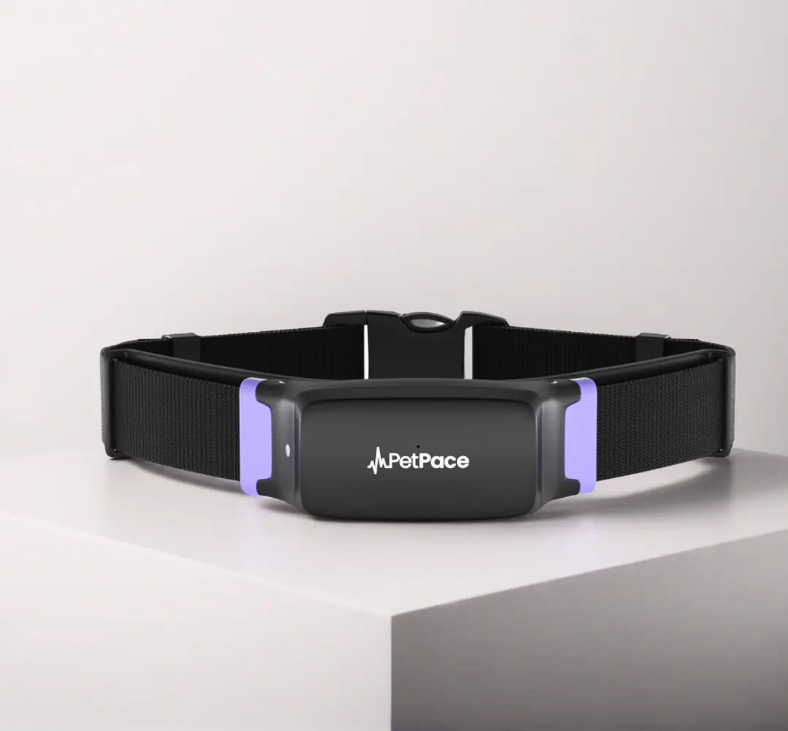
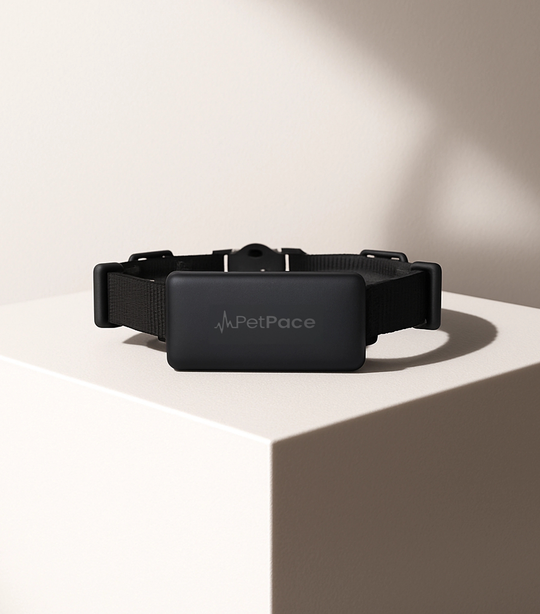
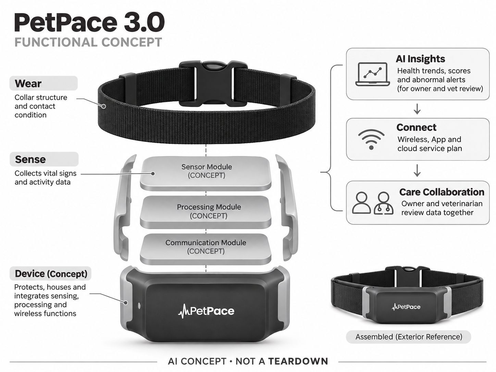

# PetPace 3.0

**PetPace** · 宠物照护 · 核查 2026-11-04

面向家庭宠物主人的连续体征与AI趋势项圈

消费渠道：个人零售。

## 产品图片与结构参考

### 产品图

PetPace 3.0 官方产品外观图 · 来源：[PetPace · 官方图片](<https://petpace.com/product/collar-v3/>) · [原始图片](<https://petpace.com/wp-content/uploads/2025/10/01-1.webp>)

### 参考图

PetPace官方项圈与佩戴尺寸参考图 · 来源：[PetPace · 官方图片](<https://petpace.com/product/collar-v3/>) · [原始图片](<https://petpace.com/wp-content/uploads/2025/10/Frame-16858-3.webp>)

### AI 生成爆炸示意

**AI 生成 · 非实物拆机。** 内部为概念推断，不能作为元件布局、BOM 或维修依据。[生成提示词](../../content/hardware/prompts/petpace-3-collar.txt)

> 依据官方外观参考与公开功能生成；未披露的内部布局只作概念模块，不构成BOM或真实结构证据。

> 保留官方图原始内容与出处；画面中的营销声明不视为独立验证。

> 分析为基于公开资料的案头研究与 AI 辅助判断，未经用户访谈、销量审计或实物拆机。需求、画像、竞争冷门度、审美及商业机会均为研究假设，不是投资结论。

## 销售与购买

- 状态：在售。官方个人宠物主人页面提供尺寸选择、US$299项圈价和Add to cart，并明确与兽医/K9及商业研究版本分开；订阅套餐另选。

- 地区：美国官方零售；其他地区须分别确认

- 价格：US$299（项圈，服务另计）。核查日官方页面参考；税运、订阅及优惠条件另计。会员价、服务套餐与硬件买断价不可直接混用。

- 中国大陆：本轮核实国际官方渠道；未核实中国大陆该型号的官方现货、地区服务与保修，不把跨境硬件可送达等同于全部AI功能可用。

- [官方产品 / 商店](<https://petpace.com/product/collar-v3/>)

## AI 的实际作用

传感数据经AI产生健康趋势、活动和状态洞察，供主人与兽医复核；本目录不将算法评分当作诊断或治疗效果。

服务与联网依赖：长期趋势与提醒依赖App、基站或连接服务及所选订阅；需要核对宠物尺寸、佩戴条件和当地服务覆盖。

## 是否冷门

细分专业（研究判断）：家庭宠物照护是细分消费任务，需求取决于宠物习惯、主人投入与长期服务；已有替代产品，冷门不等于低竞争或高利润。

## 需求与市场

需求假设：老年或需持续观察的宠物，单次就诊难以体现日常变化，主人希望获得连续趋势。应验证佩戴有效时长、可解释告警和后续行动，不能因监测更频繁就假定能减少疾病或医疗支出。

## 用户画像

画像推断：愿与兽医沟通、能坚持佩戴充电且承担服务费用的宠物家庭，特别是长期照护者。需要区分主人需要的安心感与兽医需要的数据质量，健康焦虑较高的人也可能被误报增加负担。

## 竞争与替代

竞争判断：与普通活动项圈、其它健康穿戴和定期人工观察竞争，专业数据能力是差异但并不自动带来消费留存。购买决策同时受佩戴舒适、解释服务和兽医是否愿意使用数据影响。

## 供应链

供应链分析：体征传感、柔性佩戴结构、电池、无线连接和防护壳需要长期接触宠物。具体芯片与代工未知；皮肤接触、毛发、松紧度、抗水和活动伪影的验证比精美仪表盘更关键。

## 技术路径

官方列出AI洞察和多项体征。技术判断：必须区分直接测量、算法估计与组合评分，并说明有效佩戴条件；不同体型、毛长和活动状态可能改变结果，不能将训练集表现泛化为所有宠物。

## 产品审美

审美判断：项圈是持续贴身物件，应优先重量分布、扣具和不易勾挂的外形，而非突出电子感。不同颈围下模块位置可能变化，佩戴舒适与可清洗性比颜色选择更影响使用质量。

## 关键风险

风险判断：误报可能增加焦虑，漏报可能使主人延误观察；设备不替代兽医检查。项圈松紧、充电停用和服务中断还会造成数据缺口，不能把连续曲线误认为完整或无偏的健康记录。

## 机会与验证

机会假设：选择一种明确照护任务，与主人及兽医共同定义何种变化值得通知，再做小规模验证。相比增加指标，数据可解释、佩戴依从和照护沟通可能更有价值，但本轮没有临床结论。

## 功能分层示意

这是功能关系，不是实物拆机、真实空间结构或已核实 BOM。

1. **佩戴**：项圈结构与接触条件。（官方披露）

2. **传感**：公开体征及活动传感能力。（官方披露）

3. **AI洞察**：趋势、评分与异常提示，需复核。（官方披露）

4. **连接**：无线、App与服务方案。（官方披露）

5. **照护协作**：主人与兽医查看数据的工作流。（官方披露）

## 来源

1. [PetPace 3.0 官方商店](<https://petpace.com/product/collar-v3/>) — 已实际打开；核查购物入口、产品形态与AI声明，未完成支付或收货。

2. [PetPace 官方传感与佩戴规格](<https://petpace.com/specs/>) — 已实际打开的官方技术或服务说明；厂商声明不视为独立性能或疗效验证。

[返回目录](../hardware-market.md) · [网页分析](https://romanagent.github.io/Roman/#hardware/product/petpace-3-collar)
