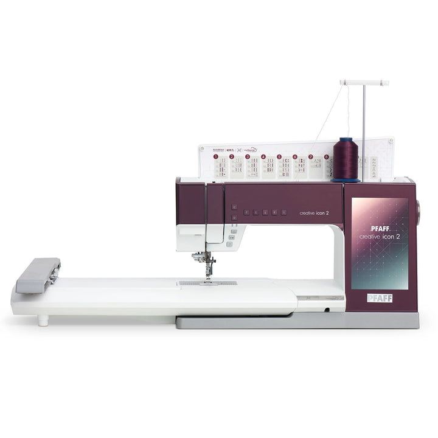
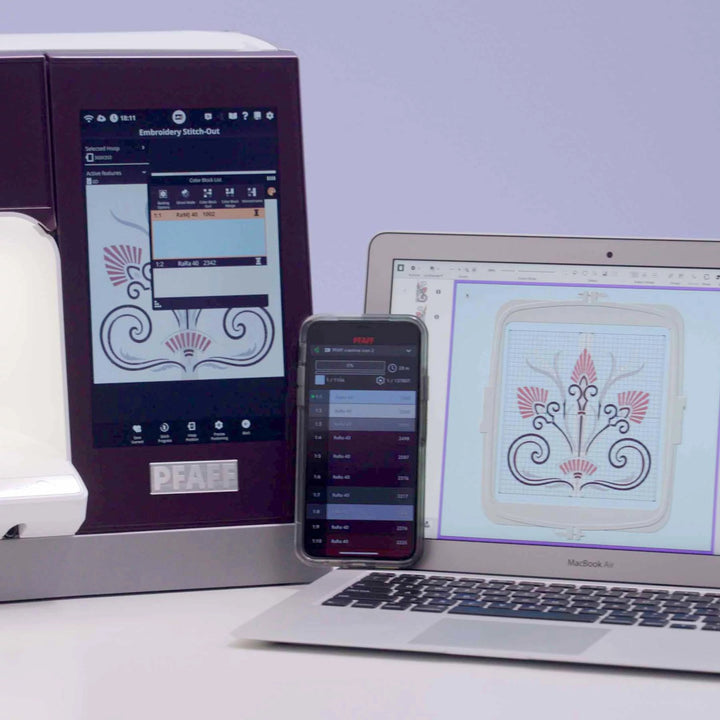
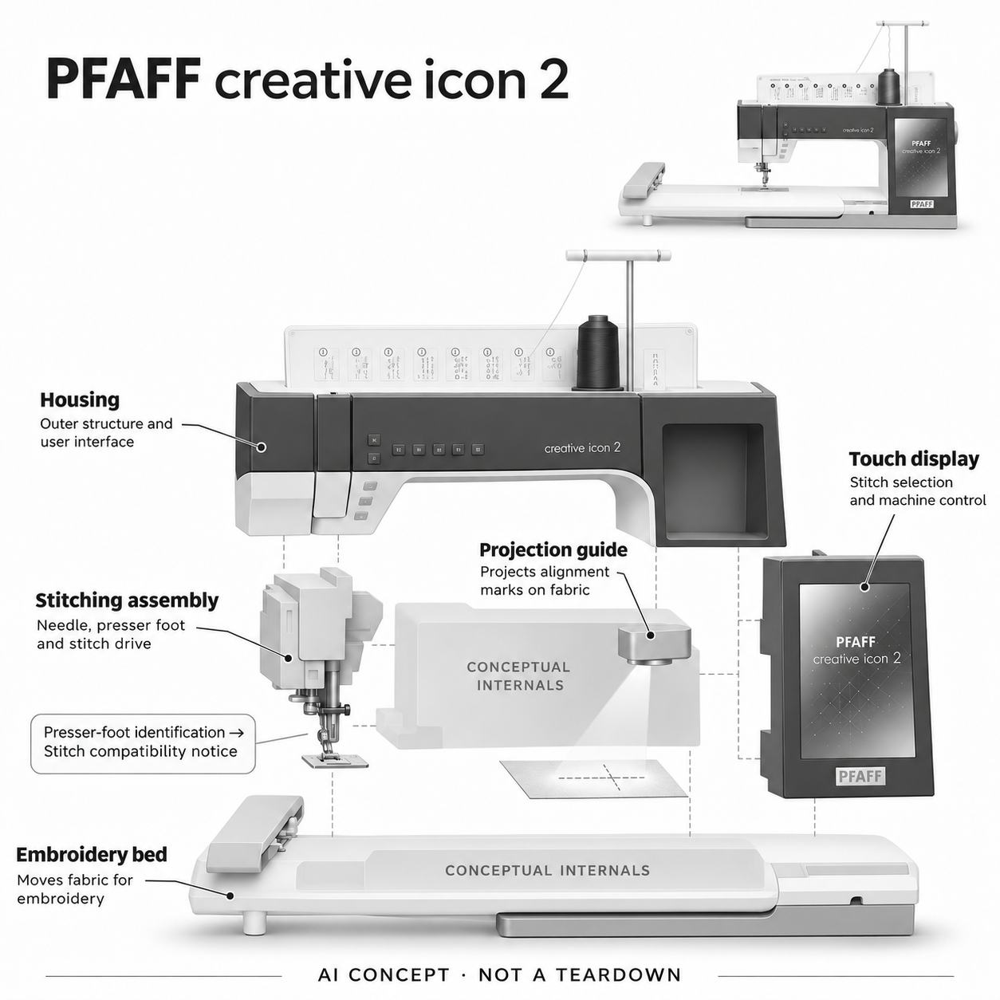

# PFAFF creative icon 2

**PFAFF / SVP Worldwide** · 专业兴趣工具 · 核查 2026-11-05

识别压脚与所选针迹兼容性的家用缝纫刺绣机

消费渠道：个人零售。

## 产品图片与结构参考

### 产品图

PFAFF creative icon 2 官方产品图 · 来源：[PFAFF / SVP Worldwide · 官方资料](<https://europe.singer.com/en-dk/products/pfaff-creative-icon-2-sewing-and-embroidery-machine>) · [原始图片](<https://europe.singer.com/cdn/shop/files/911de48cec33d601a41bd0723e589812f2be402e_16e9d779-b51e-494a-8128-e9632f731afd.jpg?v=1738336308&width=720>)

### 参考图

PFAFF creative icon 2 官方屏幕与联网设计场景（电脑手机另备） · 来源：[PFAFF / SVP Worldwide · 官方资料](<https://europe.singer.com/en-dk/products/pfaff-creative-icon-2-sewing-and-embroidery-machine>) · [原始图片](<https://europe.singer.com/cdn/shop/files/knbikgkwba6v0y3qbweu_ecd0aa15-61bb-49a2-83fe-5e695b446456.jpg?v=1738336308&width=720>)

### AI 生成爆炸示意

**AI 生成 · 非实物拆机。** 内部为概念推断，不能作为元件布局、BOM 或维修依据。[生成提示词](../../content/hardware/prompts/pfaff-creative-icon-2.txt)

> 以已目视核对的官方图片独立生成并完成目视QA；未知内部只作功能概念，不是实际PCB、拆机或供应商BOM。

> 初稿与修正提示词在主prompt按两阶段保留，单独修正prompt见content/hardware/prompts/pfaff-creative-icon-2-repair.txt；初稿图片仅作修图输入溯源。

> 保留官方图片原貌；其中宣传效果或数据不代表本站独立测量。

> 分析为基于公开资料的案头研究与 AI 辅助判断，未经用户访谈、销量审计或实物拆机。需求、画像、竞争冷门度、审美及商业机会均为研究假设，不是投资结论。

## 销售与购买

- 状态：在售。原厂官方定位门店专售。核查日西澳Handcrafters House实际浏览器商品页明确IN STOCK、1 in stock和Add to cart，仅面向Western Australia销售；不把原厂在线不可下单误读为停售。

- 地区：澳大利亚西澳（已核零售库存）

- 价格：西澳店当前展示A$16,990；成交价需确认。实际页面当前促销价16990，但购买控件仍有21990旧金额，本轮未结算。属于门店服务型零售，未使用原厂建议价冒充成交价。

- 中国大陆：未核中国大陆该型号授权销售与维修；已核店铺只服务西澳。高价家用机的培训、配件与维修需按当地渠道确认，不能由品牌全球业务推断国内交付。

- [官方产品 / 商店](<https://www.singer.com/products/pfaff-creative-icon-2-sewing-and-embroidery-machine>)

## AI 的实际作用

原厂明确Artificial Intelligence Detection：安装随附压脚后，机器判断是否与选择的针迹兼容并提示。具体检测传感路线和模型结构未披露。

服务与联网依赖：缝纫、屏幕与兼容检测属于机器工作流，联网设计传输和扩展软件另有条件。投影定位与普通自动送布不是独立AI证据，也不宣称它能生成任意设计或防止全部错误。

## 是否冷门

细分专业（研究判断）：高阶家用缝纫是成熟而窄的兴趣市场，机器、培训与维护成本高；具体检测能力比新品热度更值得验证。

## 需求与市场

案头需求是在复杂缝纫和刺绣项目中减少选错压脚的步骤，并把图案放到布料正确位置。AI作用是具体兼容检测，不是替用户设计整件作品；是否有价值取决于实际换脚频率和错误成本。

### 事实：任务边界 · 官方资料

原厂明确creative icon 2能检测随附压脚是否与所选针迹兼容，并通过机器提示；它还提供布面投影和刺绣功能，但这些不能全部笼统称为AI。当前西澳零售店实际有库存与加购，原厂门店专售不等于停售，本条只记录已核区域交付。

依据：[PFAFF creative icon 2原厂产品说明](<https://www.singer.com/products/pfaff-creative-icon-2-sewing-and-embroidery-machine>) · [PFAFF欧洲官方技术说明](<https://europe.singer.com/en-dk/products/pfaff-creative-icon-2-sewing-and-embroidery-machine>)

### 判断：真实需求 · 研究判断

需求判断是高频更换压脚和针迹的创作者希望减少准备时的误选，让复杂工序更容易核对。AI兼容检测服务一个具体步骤，不是替用户设计衣物或判断所有布料问题；如果用户大多只做直线修补，旗舰机器的额外价值可能很有限。

依据：[PFAFF creative icon 2原厂产品说明](<https://www.singer.com/products/pfaff-creative-icon-2-sewing-and-embroidery-machine>) · [PFAFF欧洲官方技术说明](<https://europe.singer.com/en-dk/products/pfaff-creative-icon-2-sewing-and-embroidery-machine>)

### 验证：任务完成 · 待验证

验证可让个人创作者完成包含多次换脚、定位和刺绣的真实项目，记录提示是否及时、哪些错误仍需人工发现，以及返工发生在哪一步。对照普通电子机加查表流程，不能只展示最终作品精美程度，也不把自动提示当成作品质量保证。

依据：[PFAFF creative icon 2原厂产品说明](<https://www.singer.com/products/pfaff-creative-icon-2-sewing-and-embroidery-machine>) · [PFAFF欧洲官方技术说明](<https://europe.singer.com/en-dk/products/pfaff-creative-icon-2-sewing-and-embroidery-machine>)

## 用户画像

潜在用户是长期做家用缝纫、拼布或高阶刺绣的个人创作者，愿意投入设备与学习。偶尔修补衣物者可能普通机器已足够；本地培训、维护和可用工作台比“旗舰”称号更影响适配。

### 事实：使用条件 · 官方资料

原厂将其定位为家用缝纫刺绣设备，但包含较大工作底座、显示界面和配件，已核店铺也强调只在西澳销售机器以提供服务。购买条件因此不只是能付设备价格，还包括工作台、学习与维护；大陆授权销售和维修渠道没有本轮证据。

依据：[PFAFF creative icon 2原厂产品说明](<https://www.singer.com/products/pfaff-creative-icon-2-sewing-and-embroidery-machine>) · [PFAFF欧洲官方技术说明](<https://europe.singer.com/en-dk/products/pfaff-creative-icon-2-sewing-and-embroidery-machine>) · [Handcrafters House西澳现货商品页](<https://handcraftershouse.com.au/product/pfaff-creative-icon-2/>)

### 判断：人群筛选 · 研究判断

潜在人群是长期做拼布、衣物制作或高阶刺绣的个人爱好者和创作者，能够把功能融入持续项目。职业名称并不能说明适配：小型创作者可能需要灵活打样，偶尔手作者则未必能承受学习成本；应按工序频率和本地支持需求筛选。

依据：[PFAFF creative icon 2原厂产品说明](<https://www.singer.com/products/pfaff-creative-icon-2-sewing-and-embroidery-machine>) · [PFAFF欧洲官方技术说明](<https://europe.singer.com/en-dk/products/pfaff-creative-icon-2-sewing-and-embroidery-machine>) · [Handcrafters House西澳现货商品页](<https://handcraftershouse.com.au/product/pfaff-creative-icon-2/>)

### 验证：参与者差异 · 待验证

访谈可查看用户最近完成和放弃的作品，询问压脚选择、定位、绷框与布料处理分别造成多少困难。试用时观察是否愿意查帮助、参加培训和维护设备，再核对真实台面空间；不能因为原厂称家用，就把机器描述成适合所有家庭。

依据：[PFAFF creative icon 2原厂产品说明](<https://www.singer.com/products/pfaff-creative-icon-2-sewing-and-embroidery-machine>) · [PFAFF欧洲官方技术说明](<https://europe.singer.com/en-dk/products/pfaff-creative-icon-2-sewing-and-embroidery-machine>) · [Handcrafters House西澳现货商品页](<https://handcraftershouse.com.au/product/pfaff-creative-icon-2/>)

## 竞争与替代

替代包括普通电子缝纫机、人工查压脚表和其它联网刺绣机。本轮只选一个家用AI检测代表，不再用Brother或更新代际增加同类数量；比较应聚焦准备错误和返工，而不是针迹总数。

### 事实：方案范围 · 官方资料

普通电子缝纫机、人工压脚兼容表和其它联网刺绣机都能覆盖部分任务，creative icon 2的明确AI差异是机器检测当前压脚与针迹选择。Brother等同类设备也有其它AI路径，但本批不再按代际或品牌堆叠家用刺绣代表，先保留一个证据充分的实现。

依据：[PFAFF creative icon 2原厂产品说明](<https://www.singer.com/products/pfaff-creative-icon-2-sewing-and-embroidery-machine>) · [PFAFF欧洲官方技术说明](<https://europe.singer.com/en-dk/products/pfaff-creative-icon-2-sewing-and-embroidery-machine>)

### 判断：替代关系 · 研究判断

竞争判断应拆开兼容核对、图案设计、布面定位和实际缝制，不能把任何一步的便利当成整体优胜。投影可能减少试摆，自动检测可能减少查表，但熟练用户也可能已经有稳定流程；针迹和内置设计数量多不一定解决最常见的返工问题。

依据：[PFAFF creative icon 2原厂产品说明](<https://www.singer.com/products/pfaff-creative-icon-2-sewing-and-embroidery-machine>) · [PFAFF欧洲官方技术说明](<https://europe.singer.com/en-dk/products/pfaff-creative-icon-2-sewing-and-embroidery-machine>)

### 验证：比较方法 · 待验证

可选择同一个多工序作品，比较普通电子机与该机从准备到完成的操作、查表和重做次数。让熟练与新接触高阶机器的人分别解释哪些提示有帮助，哪些增加干扰；总成本需包含培训与维护，不只比较标价或宣传功能清单。

依据：[PFAFF creative icon 2原厂产品说明](<https://www.singer.com/products/pfaff-creative-icon-2-sewing-and-embroidery-machine>) · [PFAFF欧洲官方技术说明](<https://europe.singer.com/en-dk/products/pfaff-creative-icon-2-sewing-and-embroidery-machine>)

## 供应链

结构包含针杆压脚、送布与刺绣运动、触屏控制、投影和机壳，真实电机、检测器与工厂未披露。候选公司只支持模块能力；未经原厂说明不猜压脚检测一定使用哪种相机或芯片。

### 事实：功能组成 · 官方资料

公开结构包含缝纫针杆和压脚、送布及刺绣运动、触屏、投影、控制与机壳，实际电机、检测传感器和工厂没有披露。尤其压脚AI的传感路线未公开，本条不假设它必然使用某种相机或芯片，也不把联网宣传画面中的电脑列入机器内部。

依据：[PFAFF creative icon 2原厂产品说明](<https://www.singer.com/products/pfaff-creative-icon-2-sewing-and-embroidery-machine>) · [PFAFF欧洲官方技术说明](<https://europe.singer.com/en-dk/products/pfaff-creative-icon-2-sewing-and-embroidery-machine>)

### 判断：交付约束 · 研究判断

工程判断，针线运动、材料处理、投影定位和电子控制需要相互一致，任一层错误都可能造成返工。对个人使用者，配件供应、维护培训和当地维修往往与先进功能同样重要；只分析处理器算力无法解释这类高价设备的交付与长期成本。

依据：[PFAFF creative icon 2原厂产品说明](<https://www.singer.com/products/pfaff-creative-icon-2-sewing-and-embroidery-machine>) · [PFAFF欧洲官方技术说明](<https://europe.singer.com/en-dk/products/pfaff-creative-icon-2-sewing-and-embroidery-machine>)

### 验证：选型缺口 · 待验证

候选选型应围绕刺绣平台的运动需求、触屏可用性和结构稳定性提出条件，再验证制造与维修方案。没有原厂点名之前，目录供应链接只作开发候选；不猜测真实BOM、最小订单或成本，也不依据概念爆炸图推导传动和锁止细节。

依据：[PFAFF creative icon 2原厂产品说明](<https://www.singer.com/products/pfaff-creative-icon-2-sewing-and-embroidery-machine>) · [PFAFF欧洲官方技术说明](<https://europe.singer.com/en-dk/products/pfaff-creative-icon-2-sewing-and-embroidery-machine>)

## 技术路径

原厂明确AI检测压脚与针迹匹配，但公开页面没有完整模型和传感实现。普通张力调节、自动穿针和投影是其它功能，不笼统都叫AI；提示也不等于能保证任何材料和附件的缝制安全。

### 事实：AI机制 · 官方资料

原厂把Artificial Intelligence Detection明确限定到压脚与所选针迹的兼容提示，未披露模型结构或训练方式。自动穿针、张力与送布属于其它功能，不用来额外证明AI；当前地区资料对语音服务和配件有差异，本条未将旧语音宣传作为主要能力。

依据：[PFAFF creative icon 2原厂产品说明](<https://www.singer.com/products/pfaff-creative-icon-2-sewing-and-embroidery-machine>) · [PFAFF欧洲官方技术说明](<https://europe.singer.com/en-dk/products/pfaff-creative-icon-2-sewing-and-embroidery-machine>)

### 判断：系统边界 · 研究判断

分析上，兼容提示的价值在于核对当前配置，不等于机器理解全部材料、针线状态和用户意图。即使匹配正确，也可能因布料准备或其它条件失败；因此界面应能说明检测范围，让用户继续按说明操作，而不是把提示理解成完整安全检查。

依据：[PFAFF creative icon 2原厂产品说明](<https://www.singer.com/products/pfaff-creative-icon-2-sewing-and-embroidery-machine>) · [PFAFF欧洲官方技术说明](<https://europe.singer.com/en-dk/products/pfaff-creative-icon-2-sewing-and-embroidery-machine>)

### 验证：算法与体验 · 待验证

技术验证可在厂商允许范围内更换随附压脚和针迹，记录识别、提示与人工表格是否一致，再观察用户是否理解警告含义。不要用危险错误组合进行极限试验；报告应说明配件、固件与地区条件，不能把某次检测成功扩大到所有第三方附件。

依据：[PFAFF creative icon 2原厂产品说明](<https://www.singer.com/products/pfaff-creative-icon-2-sewing-and-embroidery-machine>) · [PFAFF欧洲官方技术说明](<https://europe.singer.com/en-dk/products/pfaff-creative-icon-2-sewing-and-embroidery-machine>)

## 产品审美

紫色上壳、白色长底座和右侧竖向触屏区分缝纫机与工业多针设备。分析上，工作空间、布料支撑、灯光和触屏切换才决定长时创作；联网场景图中的电脑手机不是机器标配。

### 事实：外观与交互 · 官方资料

真实产品图是紫色上壳、白色长底座和右侧竖向触屏，针杆与压脚位于长臂左侧，顶部线轴支架和刺绣平台清楚可见。官方联网参考图中的手机与电脑是工作情境，不是标配；生成图已将压脚译为缝纫压脚，避免与人体脚部混淆。

依据：[PFAFF creative icon 2原厂产品说明](<https://www.singer.com/products/pfaff-creative-icon-2-sewing-and-embroidery-machine>) · [PFAFF欧洲官方技术说明](<https://europe.singer.com/en-dk/products/pfaff-creative-icon-2-sewing-and-embroidery-machine>)

### 判断：使用中的形态 · 研究判断

审美与交互判断应围绕长时间创作：布料是否有足够支撑、灯光与屏幕切换是否顺手、常用按键能否在手持布料时找到。旗舰外观可能有吸引力，但机体宽度和附件存放会影响家中布局；不能从展示图推断适合任意工作桌。

依据：[PFAFF creative icon 2原厂产品说明](<https://www.singer.com/products/pfaff-creative-icon-2-sewing-and-embroidery-machine>) · [PFAFF欧洲官方技术说明](<https://europe.singer.com/en-dk/products/pfaff-creative-icon-2-sewing-and-embroidery-machine>)

### 验证：日常接受度 · 待验证

观察用户装线、换脚、绷框、触屏定位和收纳配件的全过程，记录需要离开坐姿或反复伸手的位置。让他们在实际布料与灯光下判断投影是否有用，再访谈愿意常驻哪种配置；外观偏好不替代对工作空间和可维护性的验证。

依据：[PFAFF creative icon 2原厂产品说明](<https://www.singer.com/products/pfaff-creative-icon-2-sewing-and-embroidery-machine>) · [PFAFF欧洲官方技术说明](<https://europe.singer.com/en-dk/products/pfaff-creative-icon-2-sewing-and-embroidery-machine>)

## 关键风险

风险在高额购买与本地服务绑定、压脚兼容范围误解及软件条件变化。零售页面价格有新旧显示，应确认实际订单；设备检测不替代阅读附件和布料说明，本条也不承诺减少所有断针或误缝。

### 事实：已知限制 · 官方资料

已核零售页面标明仅面向西澳销售，实际界面有当前促销价，也在购买控件保留旧金额，本条明确需要确认最终报价。原厂的压脚检测范围是随附配件与选择针迹，不代表所有第三方附件；云设计、软件扩展和服务还应按当前条件核对。

依据：[PFAFF creative icon 2原厂产品说明](<https://www.singer.com/products/pfaff-creative-icon-2-sewing-and-embroidery-machine>) · [PFAFF欧洲官方技术说明](<https://europe.singer.com/en-dk/products/pfaff-creative-icon-2-sewing-and-embroidery-machine>) · [Handcrafters House西澳现货商品页](<https://handcraftershouse.com.au/product/pfaff-creative-icon-2/>)

### 判断：失效影响 · 研究判断

风险判断包括高额设备投入与本地维修绑定、对AI兼容提示过度信任，以及期待旧资料中所有联网功能永远可用。自动检测不能保证不发生误缝或断针，用户仍需理解材料与附件说明；本目录不把厂商创新宣传转换成安全或效率认证。

依据：[PFAFF creative icon 2原厂产品说明](<https://www.singer.com/products/pfaff-creative-icon-2-sewing-and-embroidery-machine>) · [PFAFF欧洲官方技术说明](<https://europe.singer.com/en-dk/products/pfaff-creative-icon-2-sewing-and-embroidery-machine>) · [Handcrafters House西澳现货商品页](<https://handcraftershouse.com.au/product/pfaff-creative-icon-2/>)

### 验证：风险处理 · 待验证

购买前应由当地渠道确认实际价格、配件清单、培训与维修条件，再在常规项目中检查提示和操作流程。对联网功能核实账户、传输和后续软件范围，保留可离线工作的边界；这些都是验证计划，未被表述为本站完成的结构或安全测试。

依据：[PFAFF creative icon 2原厂产品说明](<https://www.singer.com/products/pfaff-creative-icon-2-sewing-and-embroidery-machine>) · [PFAFF欧洲官方技术说明](<https://europe.singer.com/en-dk/products/pfaff-creative-icon-2-sewing-and-embroidery-machine>) · [Handcrafters House西澳现货商品页](<https://handcraftershouse.com.au/product/pfaff-creative-icon-2/>)

## 机会与验证

可验证机会是帮助高频换脚与多工序创作者减少准备错误。让用户完成真实项目，记录识别提示、人工核对、定位和返工，比较普通电子机及查表流程，不以AI标签或模型评分推断作品质量。

### 判断：可尝试切口 · 研究判断

机会假设在给已有复杂创作需求的人提供更清楚的准备核对和布面定位，让技术服务具体工序。并不是所有家用缝纫都需要AI，也不必把作品生成作为唯一创新方向；一个可靠而易懂的配置提示，可能比更多预设花样更贴近真实返工原因。

依据：[PFAFF creative icon 2原厂产品说明](<https://www.singer.com/products/pfaff-creative-icon-2-sewing-and-embroidery-machine>) · [PFAFF欧洲官方技术说明](<https://europe.singer.com/en-dk/products/pfaff-creative-icon-2-sewing-and-embroidery-machine>)

### 判断：商业边界 · 研究判断

商业分析应同时考虑高阶爱好者的项目频率、本地培训、配件更新和维修寿命，不能只靠新品热度预测购买。机器价值可能来自长期稳定工作流而非单次功能演示；本轮没有独立销量或利润信息，不从旗舰价格推导市场规模或商业回报。

依据：[PFAFF creative icon 2原厂产品说明](<https://www.singer.com/products/pfaff-creative-icon-2-sewing-and-embroidery-machine>) · [PFAFF欧洲官方技术说明](<https://europe.singer.com/en-dk/products/pfaff-creative-icon-2-sewing-and-embroidery-machine>)

### 验证：下一步调研 · 待验证

建议跟踪数名有持续项目的创作者，记录每次压脚提示、定位调整、人工复核与最终返工，访谈是否真的省下一个常见步骤。结束后比较愿意继续使用的功能和闲置功能，再决定是否值得优化产品或服务；不用模型评分预测作品质量或成功率。

依据：[PFAFF creative icon 2原厂产品说明](<https://www.singer.com/products/pfaff-creative-icon-2-sewing-and-embroidery-machine>) · [PFAFF欧洲官方技术说明](<https://europe.singer.com/en-dk/products/pfaff-creative-icon-2-sewing-and-embroidery-machine>)

## 对应供应链公司

能力候选用于选型研究，不代表本产品实际采用；未公开的供货关系不作推断。

- [dings-motion](../supply-chain/dings-motion.md) — **能力候选 · 非已采用** / 刺绣平台运动开发候选：DINGS的精密运动和线性执行相关能力可作为刺绣平台运动方案的开发候选，但针线时序、材料负载及噪声要求需要整机验证。PFAFF没有披露实际电机来源，本关联不代表现售型号采用DINGS，也不覆盖压脚AI识别算法。

- [tianma](../supply-chain/tianma.md) — **能力候选 · 非已采用** / 竖向触屏模组候选：天马提供中小尺寸显示及触控模组工程能力，可用于评估竖向人机界面的可视性、接口和长期使用条件。creative icon 2实际面板厂没有公开，目录仅列能力候选，不由屏幕外形推断真实供应或任何规格兼容。

- [protolabs](../supply-chain/protolabs.md) — **能力候选 · 非已采用** / 机壳及平台结构样件候选：Protolabs的结构加工和快速样件能力可服务机壳、平台支撑及装配配合验证，缝纫运动精度和长期振动仍需独立测试。没有公开证据说明其参与PFAFF量产，本链接只用于原型选型，不能当作真实机架或工厂信息。

[浏览供应链目录](../supply-chain.md)

## 功能分层示意

这是功能关系，不是实物拆机、真实空间结构或已核实 BOM。

1. **缝纫执行**：针杆、压脚与送布系统完成缝制，具体驱动布局未披露。（官方披露）

2. **AI兼容检测**：判断随附压脚与所选针迹是否匹配；传感和模型实现未公开。（官方披露）

3. **屏幕与投影**：右侧触屏交互，投影在布面提供针迹与图案定位参考。（官方披露）

4. **刺绣运动**：刺绣底座与框架按照图案移动材料。（官方披露）

5. **连接与边界**：联网设计传输和软件扩展另有条件；内部示意不代表真实传动或PCB。（官方披露）

## 来源

1. [PFAFF creative icon 2原厂产品说明](<https://www.singer.com/products/pfaff-creative-icon-2-sewing-and-embroidery-machine>) — 实际打开；门店专售、压脚AI检测、触屏投影及配件边界。未假定旧语音服务在所有地区仍可用。

2. [PFAFF欧洲官方技术说明](<https://europe.singer.com/en-dk/products/pfaff-creative-icon-2-sewing-and-embroidery-machine>) — 实际打开；家用定位、AI压脚兼容检测、送布及刺绣功能，当前地区线上不可下单。

3. [Handcrafters House西澳现货商品页](<https://handcraftershouse.com.au/product/pfaff-creative-icon-2/>) — 实际浏览器核查11月5日IN STOCK、1台库存、Add to cart、当前16990澳元及仅西澳销售；旧抓取价格21990未作为当前价。零售方的一手库存说明，非原厂直售。

[返回目录](../hardware-market.md) · [网页分析](https://romanagent.github.io/Roman/#hardware/product/pfaff-creative-icon-2)
