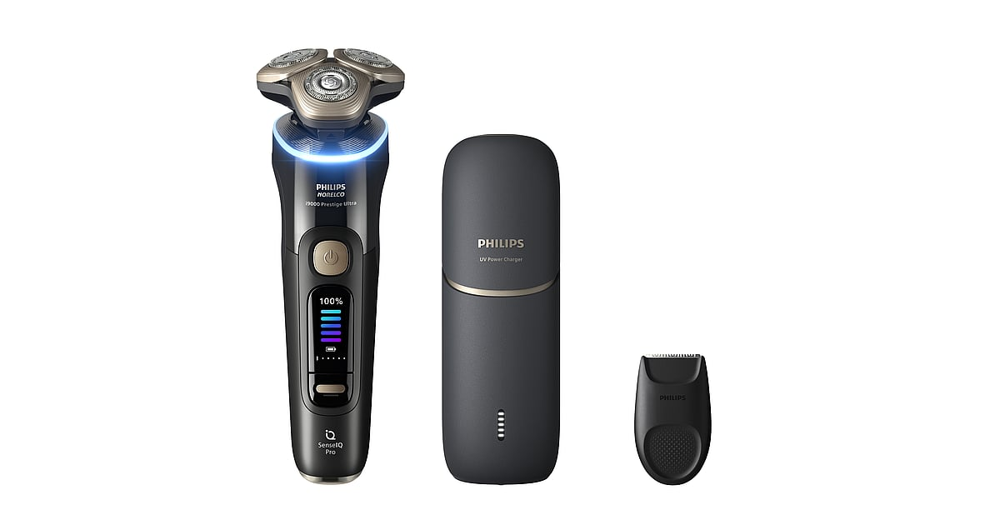
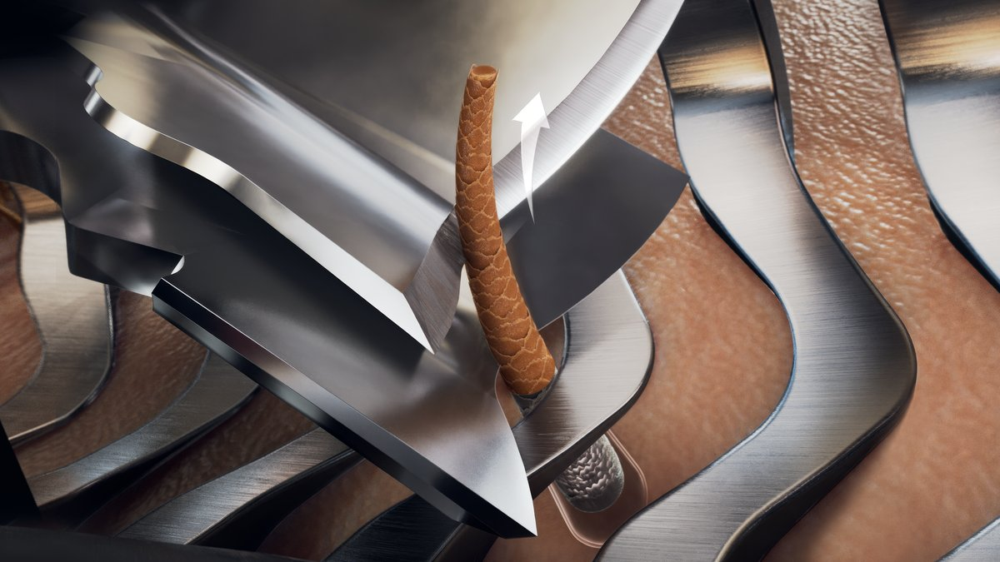
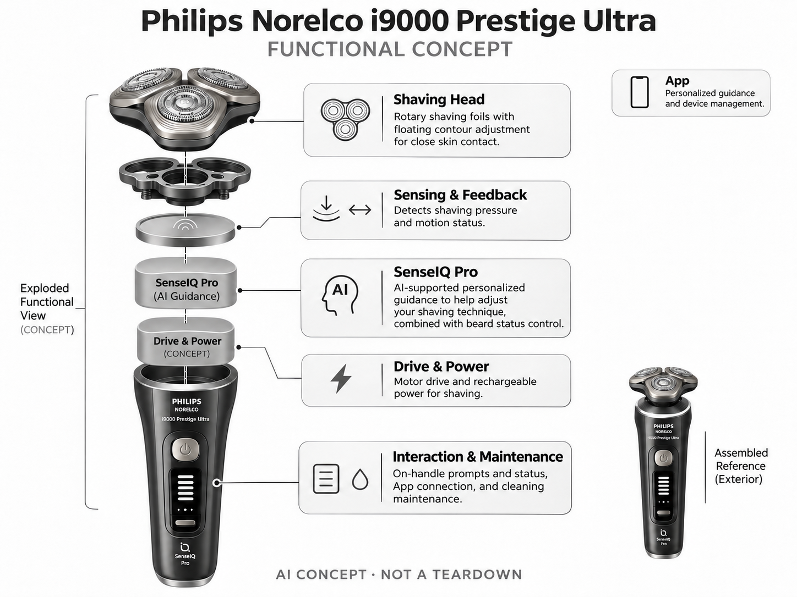

# Philips Norelco i9000 Prestige Ultra

**Philips** · 护理与美容 · 核查 2026-11-04

把压力与动作指导加入高端旋转剃须刀

消费渠道：个人零售。

## 产品图片与结构参考

### 产品图

Philips Norelco i9000 Prestige Ultra 官方产品图 · 来源：[Philips · 官方图片](<https://www.usa.philips.com/c-p/XP9400_89/i9000-prestige-ultra-wet-dry-electric-shaver-with-senseiq-pr>) · [原始图片](<https://images.philips.com/is/image/philipsconsumer/e678bde4286d4688a28ab23a0103d3fd?$png$&wid=1200&hei=630>)

### 参考图

Philips Norelco i9000 Prestige Ultra 官方外观、结构或使用参考 · 来源：[Philips · 官方图片](<https://www.usa.philips.com/c-p/XP9400_89/i9000-prestige-ultra-wet-dry-electric-shaver-with-senseiq-pr>) · [原始图片](<https://images.philips.com/is/image/philipsconsumer/352ab17a36a74fb98c33b22900ff2484?%24png%24=&wid=1200>)

### AI 生成爆炸示意

**AI 生成 · 非实物拆机。** 内部为概念推断，不能作为元件布局、BOM 或维修依据。[生成提示词](../../content/hardware/prompts/philips-i9000-prestige-ultra.txt)

> 依据官方外观参考与公开功能生成；未披露的内部布局只作概念模块，不构成BOM或真实结构证据。

> 本图已局部校正：删除未核实订阅与云服务说明。修订提示词：content/hardware/prompts/philips-i9000-prestige-ultra-revision.txt。

> 保留官方图片原始内容和出处；画面宣传参数不是本轮独立实测。

> 分析为基于公开资料的案头研究与 AI 辅助判断，未经用户访谈、销量审计或实物拆机。需求、画像、竞争冷门度、审美及商业机会均为研究假设，不是投资结论。

## 销售与购买

- 状态：在售。美国官网XP9400/89商品页显示价格与Add to cart；仅计一个i9000 Prestige Ultra机型，不把地区或清洁套装编号重复收录。

- 地区：美国官方商店

- 价格：US$429.96（XP9400/89）。核查时官方地区参考价，保留原币种；订阅、税运、附件及优惠以结账为准，预订定金不等于整机价格。

- 中国大陆：本轮核实所列海外官方渠道；中国大陆同型号现货、保修及服务可用性未确认。进口前需核对供电、网络、配件和地区条款。

- [官方产品 / 商店](<https://www.usa.philips.com/c-p/XP9400_89/i9000-prestige-ultra-wet-dry-electric-shaver-with-senseiq-pr>)

## AI 的实际作用

SenseIQ Pro使用AI支持的压力与动作反馈辅助调整剃须方式，并结合胡须状态控制；旋转刀头和普通定时提醒不等于AI。

服务与联网依赖：本机反馈与可选App指导共同工作；刀头、清洁用品和地区售后需长期维护，不提供皮肤病诊断。

## 是否冷门

竞争密集（研究判断）：高端AI剃须已有大品牌竞争，不是空白赛道；机会更可能来自明确人群的反馈可用性与耗材服务。

## 需求与市场

需求假设：用户希望减少反复来回剃须和不合适用力，尤其难以判断颈部压力时。应验证提示是否被理解、是否减少无效动作，不能直接从AI反馈推断更少皮肤刺激或医疗效果。

### 需求假设：剃须时减少无效来回与用力猜测 · 研究判断

i9000 Prestige Ultra用压力和动作反馈辅助剃须，针对用户不容易判断用力与路径、尤其在难观察部位反复操作的情况。需求应验证提示是否被理解并减少不必要动作，不能把AI存在直接解释为皮肤刺激减少，也不以高端定位推断人人都需要。

依据：[Philips Norelco i9000 Prestige Ultra 官方购买页](<https://www.usa.philips.com/c-p/XP9400_89/i9000-prestige-ultra-wet-dry-electric-shaver-with-senseiq-pr>) · [Philips i9000 Ultra 官方SenseIQ技术](<https://www.usa.philips.com/c-m-pe/face-shavers/wet-dry-electric-shaver-i9000-prestige-ultra-with-sense-iq>)

### 价值判断：实际剃须与提示体验各有作用 · 研究判断

刀头处理胡须、贴合面部与指导动作是不同环节，反馈清楚并不必然说明整体剃须更合意。研究应分开记录刮净感、操作负担与提示采用，不把用户喜欢光环界面当作长期价值，也不将对舒适的个人感受扩大为医疗结果。

依据：[Philips i9000 Ultra 官方SenseIQ技术](<https://www.usa.philips.com/c-m-pe/face-shavers/wet-dry-electric-shaver-i9000-prestige-ultra-with-sense-iq>)

### 验证方案：在原有剃须习惯中观察 · 待验证

让经常使用旋转剃须刀的人按日常方式试用，记录重复处理部位、看提示和实际调整，再与原有设备比较。保持个人使用条件可追溯，不依据单次剃须或厂商评分判断优劣，也不把测试变成针对皮肤问题的治疗实验。

依据：[Philips Norelco i9000 Prestige Ultra 官方购买页](<https://www.usa.philips.com/c-p/XP9400_89/i9000-prestige-ultra-wet-dry-electric-shaver-with-senseiq-pr>) · [Philips i9000 Ultra 官方SenseIQ技术](<https://www.usa.philips.com/c-m-pe/face-shavers/wet-dry-electric-shaver-i9000-prestige-ultra-with-sense-iq>)

## 用户画像

画像推断：经常使用旋转剃须刀、愿意为舒适反馈和高端工艺付费的人群，可能已有Philips生态配件。首次剃须或偏好往复式、手动刀片的用户习惯不同，不应由价格档位推定需求。

### 画像假设：已有旋转剃须习惯且愿意接受反馈 · 研究判断

较匹配者经常使用电动旋转剃须刀，能说清目前用力或反复处理的问题，并愿意为指导与维护投入。偏好往复式或手动刀片的人可能有不同需求，不能用价格档位或品牌忠诚替代画像，也不将首次剃须用户自动视为适合。

依据：[Philips Norelco i9000 Prestige Ultra 官方购买页](<https://www.usa.philips.com/c-p/XP9400_89/i9000-prestige-ultra-wet-dry-electric-shaver-with-senseiq-pr>) · [Philips i9000 Ultra 官方SenseIQ技术](<https://www.usa.philips.com/c-m-pe/face-shavers/wet-dry-electric-shaver-i9000-prestige-ultra-with-sense-iq>)

### 使用约束：个人面部与维护习惯不同 · 研究判断

胡须和面部曲线会改变实际操作，用户对清洗、刀头更换与应用连接的意愿也不同。研究应观察日常维护而非只看上手感受，不能因为已有同品牌产品就推断附件通用，也不把高端工艺外观当作适合所有皮肤或手型。

依据：[Philips Norelco i9000 Prestige Ultra 官方购买页](<https://www.usa.philips.com/c-p/XP9400_89/i9000-prestige-ultra-wet-dry-electric-shaver-with-senseiq-pr>)

### 访谈重点：什么时候会忽略压力与动作提示 · 待验证

请用户复述一次提示和当时采取的动作，说明是否与自身感觉一致，哪些部位仍需要凭经验。按反馈的可执行性划分需求，比询问喜欢AI与否更具体，也能发现用户可能只需要本机指导而不愿查看长期应用报告。

依据：[Philips i9000 Ultra 官方SenseIQ技术](<https://www.usa.philips.com/c-m-pe/face-shavers/wet-dry-electric-shaver-i9000-prestige-ultra-with-sense-iq>)

## 竞争与替代

竞争判断：与Braun、Panasonic高端剃须刀和手动刀片竞争，压力和动作引导是交互差异。刀头贴合、实际胡须处理与耗材费用仍是核心，AI标签不能替代长期剃须体验对比。

### 替代方案：其他高端剃须刀与手动刀片 · 研究判断

i9000 Ultra与不同刀头结构、电动和手动剃须方式竞争，反馈只是其中一项差异，用户还会看实际处理与耗材维护。比较应围绕个人任务，不能只因采用AI就判断优于其他设备，也不将技术路线不同简单等同高低档次。

依据：[Philips Norelco i9000 Prestige Ultra 官方购买页](<https://www.usa.philips.com/c-p/XP9400_89/i9000-prestige-ultra-wet-dry-electric-shaver-with-senseiq-pr>) · [Philips i9000 Ultra 官方SenseIQ技术](<https://www.usa.philips.com/c-m-pe/face-shavers/wet-dry-electric-shaver-i9000-prestige-ultra-with-sense-iq>)

### 差异判断：本机指导可能比应用更常用 · 研究判断

压力与动作信息在使用当下出现，可能比事后报告更容易影响行为，但提示若重复或不合意也可能被关闭。研究应记录机身与应用分别被使用的频率，不把两者叠加为更大价值，也不能从功能完整推断用户愿意长期付费维护。

依据：[Philips i9000 Ultra 官方SenseIQ技术](<https://www.usa.philips.com/c-m-pe/face-shavers/wet-dry-electric-shaver-i9000-prestige-ultra-with-sense-iq>)

### 比较方法：同一用户的完整使用与清理 · 待验证

让用户比较日常剃须、补剃、查看提示和清洁步骤，保持相近个人条件并记录主观偏好，不只展示一次手背或面部演示。耗材与地区支持也要纳入，不以厂商评分或单项动作指标代表全部剃须体验，更不外推医学效果。

依据：[Philips Norelco i9000 Prestige Ultra 官方购买页](<https://www.usa.philips.com/c-p/XP9400_89/i9000-prestige-ultra-wet-dry-electric-shaver-with-senseiq-pr>) · [Philips i9000 Ultra 官方SenseIQ技术](<https://www.usa.philips.com/c-m-pe/face-shavers/wet-dry-electric-shaver-i9000-prestige-ultra-with-sense-iq>)

## 供应链

供应链分析：精密刀网、浮动刀头、电机、感知、密封和充电系统构成整机；具体代工与BOM未披露。刀头一致性、可替换部件、清洁耗材和多年保修履约会明显影响全寿命成本。

### 功能拆分：刀头机械与感知指导并行 · 研究判断

公开结构包含旋转刀网、浮动贴合、压力动作输入和SenseIQ Pro指导，电源与驱动支持日常运行。刀头制造与AI判断属于不同层，具体电机、传感器、刀网供应商和工厂未披露，不能从金属外观推断材料或单机物料成本。

依据：[Philips Norelco i9000 Prestige Ultra 官方购买页](<https://www.usa.philips.com/c-p/XP9400_89/i9000-prestige-ultra-wet-dry-electric-shaver-with-senseiq-pr>) · [Philips i9000 Ultra 官方SenseIQ技术](<https://www.usa.philips.com/c-m-pe/face-shavers/wet-dry-electric-shaver-i9000-prestige-ultra-with-sense-iq>)

### 制造判断：精密切削与湿用维护共同影响体验 · 研究判断

刀头一致性、浮动机构、密封、充电和清洁配件需要长期配合，耗材替换也属于产品交付而非购买后的附带问题。供应评估不应只看算法或电池，本轮没有实际刀网公差、寿命或维修数据，不能凭品牌历史推断这款的具体可靠性。

依据：[Philips Norelco i9000 Prestige Ultra 官方购买页](<https://www.usa.philips.com/c-p/XP9400_89/i9000-prestige-ultra-wet-dry-electric-shaver-with-senseiq-pr>)

### 候选选型：驱动与电源限于公开功能层 · 研究判断

Nidec可作为旋转执行的电机工程候选，Sunwoda可讨论紧凑供电，具体噪声、负载、密封和充电保护必须验证。此处不把一般精密结构企业当作已确认刀网制造商，也没有原机点名供货证据，候选不能作为刀头或电池替换建议。

依据：[Philips Norelco i9000 Prestige Ultra 官方购买页](<https://www.usa.philips.com/c-p/XP9400_89/i9000-prestige-ultra-wet-dry-electric-shaver-with-senseiq-pr>) · [Philips i9000 Ultra 官方SenseIQ技术](<https://www.usa.philips.com/c-m-pe/face-shavers/wet-dry-electric-shaver-i9000-prestige-ultra-with-sense-iq>)

## 技术路径

官方说明SenseIQ Pro由AI支持并提供压力、动作指导。技术判断：动作识别与控制能否适应不同胡须和面部曲线需要实测，提示系统不能测出全部皮肤状况，也不是临床评估工具。

### 已披露能力：SenseIQ Pro压力与动作反馈 · 官方资料

官方说明AI支持的压力和动作指导，并结合胡须相关状态进行控制，普通旋转刀头或计时提醒不是全部AI依据。应区分感知、建议和机械执行，不能将提示灯理解为直接测量全部皮肤状况，也不补写未公开模型和部署位置。

依据：[Philips i9000 Ultra 官方SenseIQ技术](<https://www.usa.philips.com/c-m-pe/face-shavers/wet-dry-electric-shaver-i9000-prestige-ultra-with-sense-iq>)

### 技术判断：提示需要适应个人操作语境 · 研究判断

相同用力或路径在不同部位可能具有不同意义，用户需要理解何时该响应提示、何时需要停止并重新判断。研究应检查可解释与纠正，而不是让人追逐统一分数；动作识别正确也不等于当次剃须对所有个人条件都适合。

依据：[Philips i9000 Ultra 官方SenseIQ技术](<https://www.usa.philips.com/c-m-pe/face-shavers/wet-dry-electric-shaver-i9000-prestige-ultra-with-sense-iq>)

### 验证方案：对应提示、动作与个人反馈 · 待验证

在正常使用范围内记录压力与动作提示出现的部位、用户是否回应及是否需要反复处理，分开讨论声音、握持和界面。不要以一次主观舒适变化证明AI效果，本轮没有独立识别准确率、皮肤状态或长期剃须结果测试。

依据：[Philips Norelco i9000 Prestige Ultra 官方购买页](<https://www.usa.philips.com/c-p/XP9400_89/i9000-prestige-ultra-wet-dry-electric-shaver-with-senseiq-pr>) · [Philips i9000 Ultra 官方SenseIQ技术](<https://www.usa.philips.com/c-m-pe/face-shavers/wet-dry-electric-shaver-i9000-prestige-ultra-with-sense-iq>)

## 产品审美

审美判断：金属质感、刀头结构和光环反馈形成高端个护语言，但湿手握持与清洗便利更加实际。充电和清洁配件的台面空间、旅行收纳和用后干燥方式同样属于产品设计体验。

### 外形判断：金属质感与光环需要服务湿手操作 · 研究判断

高端材料观感、旋转刀头和光环形成鲜明个护形象，但湿手握持、看提示和清洗更决定日常体验。商品图不能说明所有手型都容易控制，也不应只评价机身，充电与清洁配件占地、干燥和旅行收纳同样属于设计。

依据：[Philips Norelco i9000 Prestige Ultra 官方购买页](<https://www.usa.philips.com/c-p/XP9400_89/i9000-prestige-ultra-wet-dry-electric-shaver-with-senseiq-pr>)

### 交互判断：镜中与手柄信息是否容易对应 · 研究判断

剃须者主要看镜子和面部，设备提示如果难与当前动作联系，可能增加来回确认。研究应观察光环、声音或应用哪个真正帮助操作，不把反馈通道多当作专业，也不要求用户为了理解系统而放弃自己对实际感受的判断。

依据：[Philips i9000 Ultra 官方SenseIQ技术](<https://www.usa.philips.com/c-m-pe/face-shavers/wet-dry-electric-shaver-i9000-prestige-ultra-with-sense-iq>)

### 体验验证：完整使用与清洁后再评价 · 待验证

让用户在自己的洗漱空间完成取用、剃须、清洁和收纳，记录容易残留污渍、难看提示或需要移动配件的步骤。经过重复使用再询问外观和触感，比开箱时短时握持更能说明设计是否耐用方便，也避免礼品偏好替代真实操作。

依据：[Philips Norelco i9000 Prestige Ultra 官方购买页](<https://www.usa.philips.com/c-p/XP9400_89/i9000-prestige-ultra-wet-dry-electric-shaver-with-senseiq-pr>)

## 关键风险

风险判断：用户可能把提示灯视为适合所有皮肤的保证，而个体敏感和剃须习惯存在差异。应核对当地刀头供应及保修条款；不同地区套装所含附件不同，不能照搬整套配置和价格。

### 效果边界：反馈灯不保证适合所有皮肤 · 研究判断

用户不能把压力或动作提示当作对个人皮肤的医学判断，出现不适仍需依据实际状况处理。目录只说明消费指导机制，本轮没有医疗或实机验证，也不由厂商宣传推导减少刺激、预防皮肤问题或治疗效果的普遍保证。

依据：[Philips i9000 Ultra 官方SenseIQ技术](<https://www.usa.philips.com/c-m-pe/face-shavers/wet-dry-electric-shaver-i9000-prestige-ultra-with-sense-iq>)

### 拥有风险：刀头与地区配件持续供应 · 研究判断

替换刀头、清洁用品和地区保修会影响多年使用，不同套装附带内容也可能不同，不能照搬另一地区价格与附件。购买者应核对当前型号及配件范围，本轮没有具体维修合同或耗材长期库存证据，不由品牌全球业务推断本地服务。

依据：[Philips Norelco i9000 Prestige Ultra 官方购买页](<https://www.usa.philips.com/c-p/XP9400_89/i9000-prestige-ultra-wet-dry-electric-shaver-with-senseiq-pr>)

### 验证安排：记录不用应用与忽略提示原因 · 待验证

试用应观察用户关闭或不理会指导、减少应用查看或因清洁负担改用其他设备的情况，区分反馈与核心剃须体验。不要只记录满意评价，也不把用户偏好简单模式解释为不懂技术，这些选择能说明哪些智能部分真正值得保留。

依据：[Philips Norelco i9000 Prestige Ultra 官方购买页](<https://www.usa.philips.com/c-p/XP9400_89/i9000-prestige-ultra-wet-dry-electric-shaver-with-senseiq-pr>) · [Philips i9000 Ultra 官方SenseIQ技术](<https://www.usa.philips.com/c-m-pe/face-shavers/wet-dry-electric-shaver-i9000-prestige-ultra-with-sense-iq>)

## 机会与验证

机会假设：对反复剃须和压力控制困难的用户做长期行为研究，记录是否持续使用反馈。若大多数用户忽略App，可把指导留在机身并提升可维护性，避免为了数据报告增加操作负担。

### 研究方向：把低干扰指导留在使用现场 · 研究判断

i9000 Ultra可帮助研究压力和路径提示是否减少具体操作困惑，机会可能在更清楚的本机反馈与易维护，而非增加报告。应先确认用户反复不确定的部位和动作，再讨论新算法，不把高端材质与AI标签当作完整购买理由。

依据：[Philips i9000 Ultra 官方SenseIQ技术](<https://www.usa.philips.com/c-m-pe/face-shavers/wet-dry-electric-shaver-i9000-prestige-ultra-with-sense-iq>)

### 执行计划：连续追踪提示采用与耗材维护 · 待验证

记录数周内用户回应提示、补剃、清洁和查看应用的行为，访谈一次被采纳和一次被忽略的反馈。将个人舒适、实际操作和数据兴趣分开，不以设备评分或单次感受证明健康效果，也不将品牌好感代替长期留存证据。

依据：[Philips Norelco i9000 Prestige Ultra 官方购买页](<https://www.usa.philips.com/c-p/XP9400_89/i9000-prestige-ultra-wet-dry-electric-shaver-with-senseiq-pr>) · [Philips i9000 Ultra 官方SenseIQ技术](<https://www.usa.philips.com/c-m-pe/face-shavers/wet-dry-electric-shaver-i9000-prestige-ultra-with-sense-iq>)

### 决策边界：核心仍是可持续的剃须体验 · 研究判断

智能指导需要与刀头、握持和维护共同形成价值，供应候选只说明部分工程路线，不能证明市场缺少类似产品。当前没有访谈、销量或报价资料，不以功能数量、价格档位或模型评分预测商业成功，也不把不同套装统计为独立需求。

依据：[Philips Norelco i9000 Prestige Ultra 官方购买页](<https://www.usa.philips.com/c-p/XP9400_89/i9000-prestige-ultra-wet-dry-electric-shaver-with-senseiq-pr>) · [Philips i9000 Ultra 官方SenseIQ技术](<https://www.usa.philips.com/c-m-pe/face-shavers/wet-dry-electric-shaver-i9000-prestige-ultra-with-sense-iq>)

## 对应供应链公司

能力候选用于选型研究，不代表本产品实际采用；未公开的供货关系不作推断。

- [nidec](../supply-chain/nidec.md) — **能力候选 · 非已采用** / 旋转剃须执行电机工程候选：Nidec公开小型精密与家电电机能力，可作为i9000 Ultra旋转执行的候选，但负载、振动、噪声、密封和控制须专项验证，不能以相机云台电机规格替代。当前没有Philips该型号采用证据，也不覆盖精密刀网制造或剃须效果。

- [sunwoda](../supply-chain/sunwoda.md) — **能力候选 · 非已采用** / 湿用剃须手柄紧凑电源候选：Sunwoda消费电池业务可用于讨论i9000 Ultra便携供电，但电机负载、充电保护、密封与长期维护需要按设备要求验证，不能从电芯指标推断整机续航。该关联无原机电池供货证据，也不建议通用电池直接替换专用组件。

[浏览供应链目录](../supply-chain.md)

## 功能分层示意

这是功能关系，不是实物拆机、真实空间结构或已核实 BOM。

1. **剃须头**：旋转刀网与浮动贴合结构。（官方披露）

2. **感知反馈**：压力和动作状态输入。（官方披露）

3. **SenseIQ Pro**：AI支持的个性化指导层。（官方披露）

4. **驱动能源**：电机和充电电源，概念功能层。（分析推断）

5. **交互维护**：机身提示、App及清洁维护。（官方披露）

## 来源

1. [Philips Norelco i9000 Prestige Ultra 官方购买页](<https://www.usa.philips.com/c-p/XP9400_89/i9000-prestige-ultra-wet-dry-electric-shaver-with-senseiq-pr>) — 实际打开核查当前购买或预订入口，未实际下单；价格与交付按具体地区。

2. [Philips i9000 Ultra 官方SenseIQ技术](<https://www.usa.philips.com/c-m-pe/face-shavers/wet-dry-electric-shaver-i9000-prestige-ultra-with-sense-iq>) — 实际打开的官方技术与使用资料，宣传效果并非本轮独立实测。

[返回目录](../hardware-market.md) · [网页分析](https://romanagent.github.io/Roman/#hardware/product/philips-i9000-prestige-ultra)
