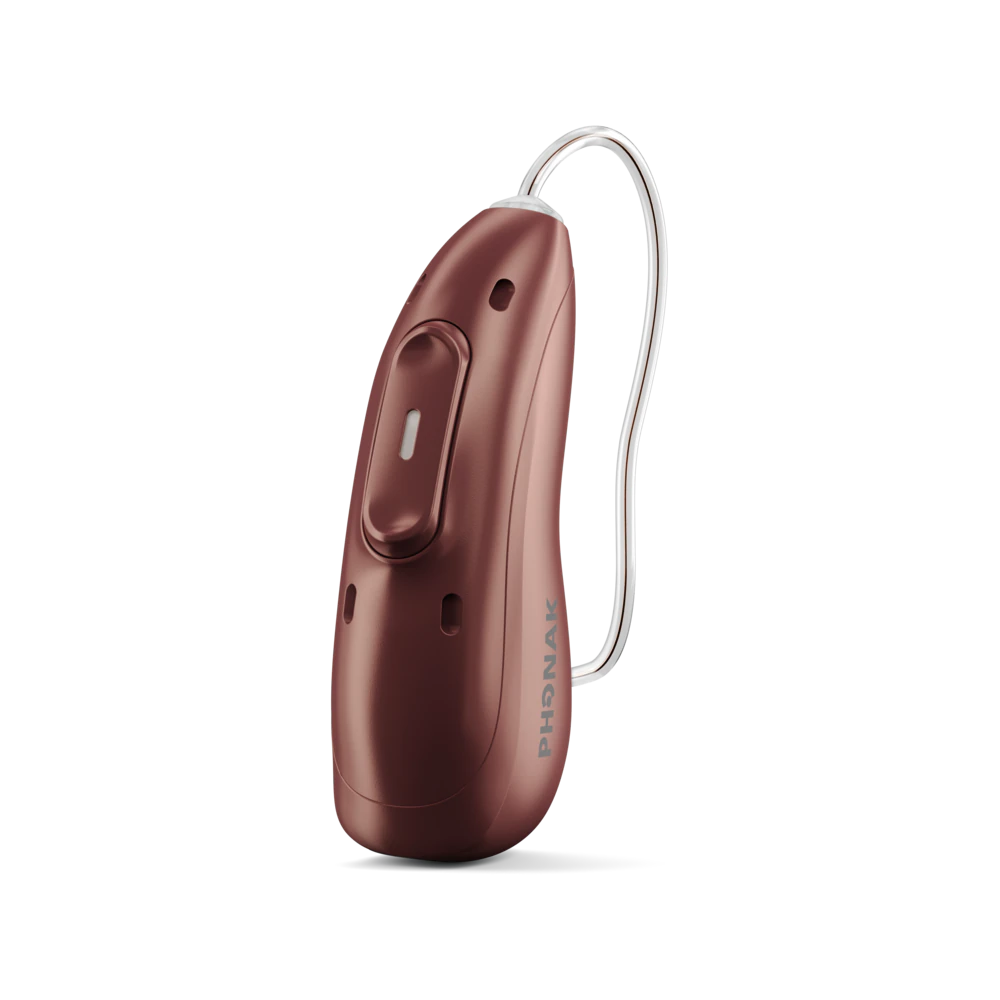
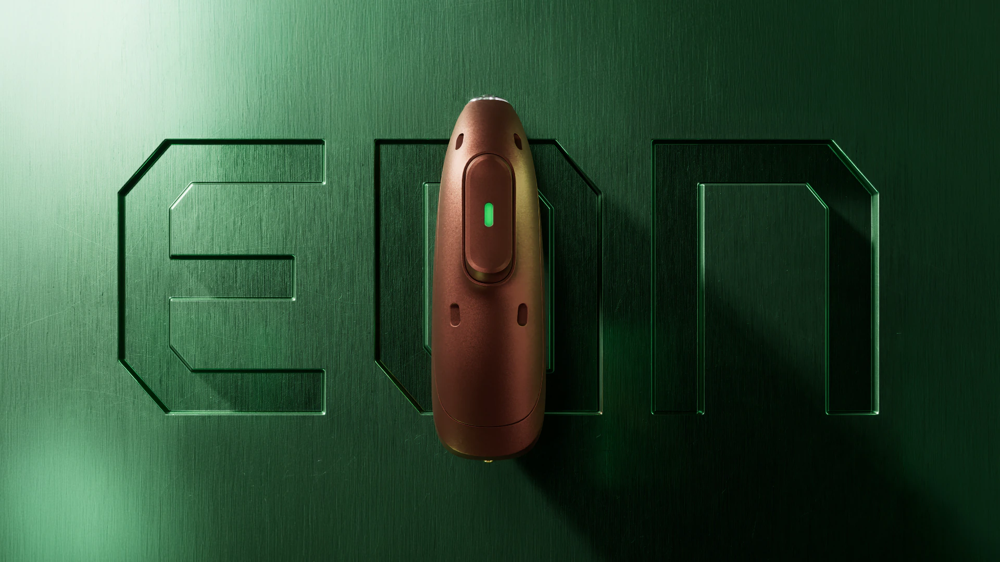
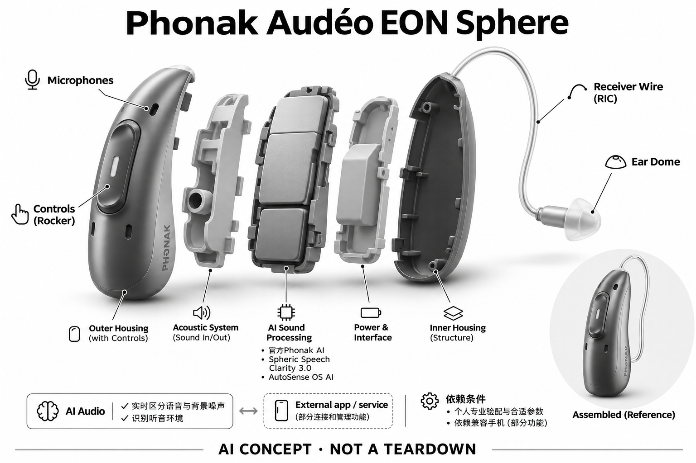

# Phonak Audéo EON Sphere

**Phonak** · 助听与听力 · 核查 2026-11-04

环境识别与语音分离整合到同一日常佩戴设备

消费渠道：个人适配 / 验配。

## 产品图片与结构参考

### 产品图

Phonak Audéo EON Sphere官方产品外形图 · 来源：[Phonak · 官方产品图片](<https://www.phonak.com/en-us/hearing-devices/hearing-aids/audeo-eon-sphere>) · [原始图片](<https://www.phonak.com/content/dam/celum/phonak/master-assets/images/hearing-instruments/eon/audeo-e-sphere/packshots/ph-packshot-audeo-e-sphere-x-receiver-050-1141-8-a/ph-packshot-audeo-e-sphere-x-receiver-050-1141-8-a-1280x1280.png>)

### 参考图

Phonak Audéo EON Sphere官方另一角度或使用场景参考 · 来源：[Phonak · 官方产品图片](<https://www.phonak.com/en-us/hearing-devices/hearing-aids/audeo-eon-sphere>) · [原始图片](<https://www.phonak.com/content/phonak/us/en/hearing-devices/hearing-aids/audeo-eon-sphere/_jcr_content/root/container/parallaxbackgroundse.coreimg.png/1787062146532/ph-pic-keyvisual-eon-audeo-e03-1920x1080-1920x1080.png>)

### AI 生成爆炸示意

**AI 生成 · 非实物拆机。** 内部为概念推断，不能作为元件布局、BOM 或维修依据。[生成提示词](../../content/hardware/prompts/phonak-audeo-eon-sphere.txt)

> 外形依据核验参考图；内部位置、模块形状与装配关系仅作AI概念展示。

> 已逐张查看并核对型号。源图未改色/裁切；场景、界面、附件、优惠及效果文案仅为厂商示意，不作为本目录性能或现价依据。

> 分析为基于公开资料的案头研究与 AI 辅助判断，未经用户访谈、销量审计或实物拆机。需求、画像、竞争冷门度、审美及商业机会均为研究假设，不是投资结论。

## 销售与购买

- 状态：在售。官方当前消费者产品页持续展示该型号，并提供试用/验配或官方门店渠道。属于个人经专业验配获得的消费设备，saleMode为consumer-fitting；不声明具体门店库存。

- 地区：美国及所列官方区域验配网络（具体型号当地确认）

- 价格：未公布统一零售价；按个人验配方案报价。报价通常受单/双耳、技术档位、定制、服务和地区影响；不以历史媒体价格或其他型号拼凑。

- 中国大陆：品牌可能具有中国渠道，但本次未核实该具体型号、技术档位与AI软件在大陆的上市和支持范围；需由国内授权验配渠道确认。

- [官方产品 / 商店](<https://www.phonak.com/en-us/hearing-devices/hearing-aids/audeo-eon-sphere>)

## AI 的实际作用

官方Phonak AI和Spheric Speech Clarity 3.0实时区分语音与背景噪声，AutoSense OS AI识别听音环境。

服务与联网依赖：个人专业验配与合适参数是前提；部分连接和管理功能依赖兼容手机，核心声音处理不等于云端聊天。

## 是否冷门

细分专业（研究判断）：听觉辅助属于专业消费用途，已有成熟供应商；此分类不表示蓝海或疗效优越。

## 需求与市场

需求假设：走动和多人谈话时希望降低频繁手调听音设置的负担。真正的使用价值需要在个人真实交流场景中验证，不能从AI名称或厂商演示推定每个人都获得同样改善。

### 官方｜环境分类与语音分离 · 官方资料

本型号把官方所述的环境识别与语音噪声处理组合在日常助听流程中，目标是随听音环境变化提供支持。需求不是获得一段聊天回答，而是在走动、多人交谈和噪声变化时更容易跟上内容；具体支持仍由个人验配和技术级别确定，目录没有独立实测可以证明每个人都获得同样收益。

依据：[Phonak Phonak Audéo EON Sphere官方产品页](<https://www.phonak.com/en-us/hearing-devices/hearing-aids/audeo-eon-sphere>) · [Phonak官方消费者验配渠道](<https://www.phonak.com/en-us/find-a-provider>)

### 判断｜少切程序的具体含义 · 研究判断

用户从安静座位走入多人讨论时，可能既要继续听话又不想操作设备。自动环境识别有机会减少切换，但设备判断的环境不一定等于用户此刻关注的对象；研究应观察是否减少漏听、追问与手调，而不是仅统计分类模式数量，声音更安静也不必然代表句子理解更完整。

依据：[Phonak Phonak Audéo EON Sphere官方产品页](<https://www.phonak.com/en-us/hearing-devices/hearing-aids/audeo-eon-sphere>)

### 验证｜连续交流任务 · 待验证

可在专业人员确认适配后，让用户记录同一次日常活动中安静、移动与多人谈话的转变，比较原有方案与本款的追问和调节次数。应保留用户主动关闭或修订设置的原因，不能只播放固定噪声片段；当前资料属于产品披露，尚不能证明场景切换时的真实沟通收益。

依据：[Phonak Phonak Audéo EON Sphere官方产品页](<https://www.phonak.com/en-us/hearing-devices/hearing-aids/audeo-eon-sphere>) · [Phonak官方消费者验配渠道](<https://www.phonak.com/en-us/find-a-provider>)

## 用户画像

画像推断：经专业评估适合RIC形态、经常在多声源环境中交流的个人更值得评估。具体是否适配应由听力需求、耳形和操作能力共同决定，本目录不根据年龄、职业或自述症状替人选择医疗产品。

### 判断｜经常改变交谈位置的人 · 研究判断

经常在会议、家庭或公共空间移动交流的人，可能更关心从一个声场到另一个声场时是否需要重新设置。这样的画像由活动和困难建立，而不是由年龄或购买高档型号的意愿决定；如果多数交流发生在固定安静地点，复杂环境处理的增量可能有限，需要结合已有助听经验判断。

依据：[Phonak Phonak Audéo EON Sphere官方产品页](<https://www.phonak.com/en-us/hearing-devices/hearing-aids/audeo-eon-sphere>)

### 判断｜具备随访条件的使用者 · 研究判断

本型号通过专业验配渠道提供，用户需要把常见困难和使用反馈带入调整过程，而非购买后只依赖自动模式。已有设备使用者可能更容易描述切换时的问题，首次用户则需要认识声音变化和佩戴维护；这两类人的学习和支持需求不同，不能只按同一品牌偏好作统一画像。

依据：[Phonak Phonak Audéo EON Sphere官方产品页](<https://www.phonak.com/en-us/hearing-devices/hearing-aids/audeo-eon-sphere>) · [Phonak官方消费者验配渠道](<https://www.phonak.com/en-us/find-a-provider>)

### 验证｜从个人材料建立基线 · 待验证

试用前可让用户列出最希望听清的谈话对象、地点与活动，再记录原方案下最常发生的遗漏。试用后用相同任务复核，而不是问是否觉得新设备更先进；还应确认当地提供的具体技术档位、复查安排和服务范围，官方门店入口本身并不说明每家都具备同样交付条件。

依据：[Phonak Phonak Audéo EON Sphere官方产品页](<https://www.phonak.com/en-us/hearing-devices/hearing-aids/audeo-eon-sphere>) · [Phonak官方消费者验配渠道](<https://www.phonak.com/en-us/find-a-provider>)

## 竞争与替代

案头判断：环境识别与语音分离整合到同一日常佩戴设备形成可比较特征，但消费助听已有多个成熟品牌和验配渠道。没有销量审计、用户访谈或疗效对照，专业细分不意味着竞争稀少。

### 判断｜与其他自动助听方案比较 · 研究判断

本型号的环境识别与语音分离，和其他品牌的场景分类、方向性及个性化处理存在任务重叠。比较应固定个人适配和真实谈话条件，观察少调程序是否同时保留需要的声音；不能把不同算法命名直接排成优劣，也不能由专业定位或新型号身份推断它面对更少竞争。

依据：[Phonak Phonak Audéo EON Sphere官方产品页](<https://www.phonak.com/en-us/hearing-devices/hearing-aids/audeo-eon-sphere>)

### 判断｜旧代不是可借用的规格库 · 研究判断

旧有同类设备可作为用户熟悉的体验基线，但本款是当前EON Sphere，不能借旧Infinio Sphere的芯片、续航、价格或宣传效果补齐未知信息。代际比较要回答具体困难是否减少，既有设备已经解决的任务也应计入；否则新增术语容易被误读为购买新硬件的必要理由。

依据：[Phonak Phonak Audéo EON Sphere官方产品页](<https://www.phonak.com/en-us/hearing-devices/hearing-aids/audeo-eon-sphere>)

### 验证｜同口径比较服务与效果 · 待验证

比较报价时应保持单耳或双耳、技术档位、附件和随访服务范围一致，并核对本地实际交付型号。试用则保留相同场景中的理解、调节和疲劳反馈，不能只比较硬件名义价格；当前没有销量、份额和独立用户研究，目录不能依据官方渠道或营销案例得出市场领先结论。

依据：[Phonak Phonak Audéo EON Sphere官方产品页](<https://www.phonak.com/en-us/hearing-devices/hearing-aids/audeo-eon-sphere>) · [Phonak官方消费者验配渠道](<https://www.phonak.com/en-us/find-a-provider>)

## 供应链

官方可核对耳背主机与耳道受话器连接的RIC形态及相应声音功能；具体麦克风、受话器、电池供应商与整机工厂本次未确认。品牌或法定制造商名称不等于实际装配工厂，也不据此估计BOM与良率。

### 官方｜声音输入到耳道输出 · 官方资料

目录确认本款采用耳背主机连接耳道受话器的形态，声音进入处理链后再提供听音输出，官方说明环境识别和语音噪声处理能力。具体麦克风料号、核心芯片供货、受话器来源和整机工厂并未在本次资料中确认；功能架构只用于划分研究模块，不应被误认为真实拆机物料表。

依据：[Phonak Phonak Audéo EON Sphere官方产品页](<https://www.phonak.com/en-us/hearing-devices/hearing-aids/audeo-eon-sphere>)

### 判断｜佩戴声学与平台约束 · 研究判断

耳背声孔、受话器连接和个人耳道适配共同决定输入输出条件，硬件结构改变后需要重新检查反馈、延迟与声音效果。供应研究不能只按神经网络算力选择主控，也不能由外观相似推断共用工厂；当前缺少装配公差、校准流程、可靠性及良率证据，不作制造成本和产能判断。

依据：[Phonak Phonak Audéo EON Sphere官方产品页](<https://www.phonak.com/en-us/hearing-devices/hearing-aids/audeo-eon-sphere>) · [Phonak官方消费者验配渠道](<https://www.phonak.com/en-us/find-a-provider>)

### 判断｜候选只面向重新设计 · 研究判断

onsemi听觉处理平台和英飞凌麦克风可作为相近功能的新设计候选，前者需验证算法迁移与验配工具，后者需验证声学接口及低噪输入。没有证据说明本款采用这两家公司，也不能将外部平台直接替换品牌现有处理体系；候选研究应先建立功能需求，再索取资料和样机确认限制。

依据：[Phonak Phonak Audéo EON Sphere官方产品页](<https://www.phonak.com/en-us/hearing-devices/hearing-aids/audeo-eon-sphere>)

## 技术路径

官方Phonak AI和Spheric Speech Clarity 3.0实时区分语音与背景噪声，AutoSense OS AI识别听音环境。这是已披露机制；精确模型、内部电路与个体表现未完全公开。普通放大、蓝牙和自动模式本身不单独作为AI收录理由。

### 官方｜本款已确认的AI范围 · 官方资料

官方将Phonak AI、Spheric Speech Clarity 3.0与AutoSense OS AI用于语音噪声区分及环境识别，这是本型号已确认的感知处理路径。它不是云端聊天服务，部分连接和管理功能才涉及兼容手机；目录没有完整模型结构、训练覆盖或独立准确率，不由版本数字推定任意环境中的表现。

依据：[Phonak Phonak Audéo EON Sphere官方产品页](<https://www.phonak.com/en-us/hearing-devices/hearing-aids/audeo-eon-sphere>)

### 判断｜识别环境不等于识别目标 · 研究判断

声场分类可以估计周围发生了什么，却未必知道用户想听哪个人、什么时候需要环境声或是否正等待一句轻声回应。语音分离与环境切换需要共同服务这些意图，而不是只压低背景；研究应把目标语音保留、重要提示声和切换体验分别观察，避免用单项降噪感受解释全部技术价值。

依据：[Phonak Phonak Audéo EON Sphere官方产品页](<https://www.phonak.com/en-us/hearing-devices/hearing-aids/audeo-eon-sphere>)

### 验证｜切换与交叠发言 · 待验证

适配确认后可用真实常见场景比较连续谈话、多人打断和位置变化时的理解情况，并记录用户是否需要手动干预。不同技术档位应分别登记，不把某一次演示代表整系列；测试应区分算法输出、个人偏好与沟通结果，本目录未做这些测试，因此保留效果和泛化范围的判断空间。

依据：[Phonak Phonak Audéo EON Sphere官方产品页](<https://www.phonak.com/en-us/hearing-devices/hearing-aids/audeo-eon-sphere>) · [Phonak官方消费者验配渠道](<https://www.phonak.com/en-us/find-a-provider>)

## 产品审美

图示观察：耳背小主机与细连接线更强调低存在感，实际贴合仍取决于耳形和受话器选择。实际耳内尺寸、舒适感和维护便利仍需验配或试戴确认；宣传图不能证明隐形、无负担或适合所有耳形。

### 判断｜耳背与耳道部件的分工 · 研究判断

RIC外形将主机置于耳后，并由连接部件通向耳道，可能适合接受外露线条且重视维护便利的用户。视觉小巧只是初筛，眼镜镜腿、头发和日常穿戴可能改变体验；本型号产品图不能证明每个人长时佩戴舒适，也不能由轮廓判断声孔布置、内部空间或材料触感。

依据：[Phonak Phonak Audéo EON Sphere官方产品页](<https://www.phonak.com/en-us/hearing-devices/hearing-aids/audeo-eon-sphere>)

### 判断｜自动化与可感知状态 · 研究判断

越强调自动处理，用户越需要在声音不合适时知道如何调整并返回熟悉状态。设计评价应关注控制是否能被理解，以及耳后操作是否适合本人手部能力，而非只看外壳颜色；如果用户必须频繁猜测当前程序，视觉简洁未必等于实际使用简单，这需要结合本款交付配置观察。

依据：[Phonak Phonak Audéo EON Sphere官方产品页](<https://www.phonak.com/en-us/hearing-devices/hearing-aids/audeo-eon-sphere>)

### 验证｜放回日常穿戴中试用 · 待验证

外形试用可覆盖眼镜、头发整理、脱戴衣物和一天内不同姿势，记录压迫、碰触及操作困难。应由用户自己完成取放和日常维护，而不是仅在桌面观看样机；审美和隐蔽程度属于个人偏好，不能代替专业适配，也不能从单张宣传图推断长期佩戴接受度。

依据：[Phonak Phonak Audéo EON Sphere官方产品页](<https://www.phonak.com/en-us/hearing-devices/hearing-aids/audeo-eon-sphere>) · [Phonak官方消费者验配渠道](<https://www.phonak.com/en-us/find-a-provider>)

## 关键风险

功能和技术级别需以验配合同确认，不沿用Infinio Sphere的旧芯片、续航或价格。AI设置辅助与噪声处理不能替代专业适配、随访或对异常听力变化的评估，本研究没有诊断、独立实测或疗效结论。

### 判断｜型号与技术级别混淆 · 研究判断

EON Sphere名称不能被当作旧Sphere设备的同义词，历史价格、硬件或续航条件不应直接复制。交付前需在正式配置中确认当前型号、技术档位和配套服务，否则用户可能为未包含的功能建立预期；品牌提供官方验配渠道只说明购买路径，不证明所有地区已经开放同款能力。

依据：[Phonak Phonak Audéo EON Sphere官方产品页](<https://www.phonak.com/en-us/hearing-devices/hearing-aids/audeo-eon-sphere>) · [Phonak官方消费者验配渠道](<https://www.phonak.com/en-us/find-a-provider>)

### 判断｜安静感和理解效果错位 · 研究判断

背景声音变轻可能带来主观舒适，也可能让某些提示或轻声变得不易注意，实际交流应同时核对需要保留的信息。自动环境判断出错不应被解释为用户不会使用，也不能依赖AI名称掩盖问题；本目录没有医学诊断或疗效证据，对个人适配的讨论应留在专业验配和随访范围。

依据：[Phonak Phonak Audéo EON Sphere官方产品页](<https://www.phonak.com/en-us/hearing-devices/hearing-aids/audeo-eon-sphere>) · [Phonak官方消费者验配渠道](<https://www.phonak.com/en-us/find-a-provider>)

### 验证｜异常与服务中断应对 · 待验证

试用中应记录突然不习惯的声音、连接变化和需要恢复原设置的情况，确认用户能获得帮助并知道回到何种状态。地区软件支持、维修和复查方式应由实际渠道解释，不以海外页面推定大陆服务；验证目的在于让交付边界可理解，而不是由产品营销承诺推定长期稳定可用。

依据：[Phonak Phonak Audéo EON Sphere官方产品页](<https://www.phonak.com/en-us/hearing-devices/hearing-aids/audeo-eon-sphere>) · [Phonak官方消费者验配渠道](<https://www.phonak.com/en-us/find-a-provider>)

## 机会与验证

市场差异在于环境识别与语音分离整合到同一日常佩戴设备。尚待验证的购买理由是其在个人场景中的可感知帮助、操作便利和售后支持，而不是追求更多AI术语或用统一分数替代实际试戴。

### 判断｜减少真实切换负担 · 研究判断

本型号可研究的购买理由是同一个人在不同声场之间交流时，是否减少了调程序和追问的负担。若主要困难未被环境分类与语音处理改善，升级理由就需要重新评估；市场空间应来自有证据的重复任务，而不是新一代平台名称，也不能把现有成熟助听市场简单称为无人覆盖。

依据：[Phonak Phonak Audéo EON Sphere官方产品页](<https://www.phonak.com/en-us/hearing-devices/hearing-aids/audeo-eon-sphere>)

### 判断｜把用户反馈用于适配 · 研究判断

环境切换问题往往发生在离开验配地点之后，若用户能清楚记录地点、目标和失败时刻，更有机会获得针对性的调整。这里的机会是提升已有功能与个人生活之间的匹配，而非承诺算法自动解决全部问题；研究可观察服务沟通是否减负，同时保留用户最后仍偏好旧方案的情况。

依据：[Phonak Phonak Audéo EON Sphere官方产品页](<https://www.phonak.com/en-us/hearing-devices/hearing-aids/audeo-eon-sphere>) · [Phonak官方消费者验配渠道](<https://www.phonak.com/en-us/find-a-provider>)

### 验证｜长期采用而非短时偏好 · 待验证

后续可按周跟踪常见谈话、程序干预、复查次数和实际使用时长，并把服务费用及维护投入纳入比较。需要区分短暂的新声音偏好与长期交流改善，也应记录主动停用原因；当前目录是案头研究，不以在售、新版本或厂商效果宣传宣称市场需求和个人结果已经得到验证。

依据：[Phonak Phonak Audéo EON Sphere官方产品页](<https://www.phonak.com/en-us/hearing-devices/hearing-aids/audeo-eon-sphere>) · [Phonak官方消费者验配渠道](<https://www.phonak.com/en-us/find-a-provider>)

## 对应供应链公司

能力候选用于选型研究，不代表本产品实际采用；未公开的供货关系不作推断。

- [onsemi](../supply-chain/onsemi.md) — **能力候选 · 非已采用** / 语音噪声处理与环境分类的重设计平台候选：本款具有环境识别和语音噪声处理链，onsemi的听觉DSP与神经网络加速可用于同类新架构比较。其平台不能直接替换Phonak现有体系，必须验证模型迁移、增益压缩、延迟和验配工具，也不提供本款专有功能授权；尚无点名供货证据，不能写为现用芯片。

- [infineon](../supply-chain/infineon.md) — **能力候选 · 非已采用** / RIC耳背主机声音输入麦克风候选：耳背声音采集可对照英飞凌模拟或数字MEMS麦克风的输入能力，但消费耳机应用不直接证明适合本款助听用途。需核验自噪声、灵敏度与相位一致性、声孔结构和处理器接口，任何更换均可能要求重新调校；目录未确认本型号采用或能够直接采购替换。

[浏览供应链目录](../supply-chain.md)

## 功能分层示意

这是功能关系，不是实物拆机、真实空间结构或已核实 BOM。

1. **声音输入**：麦克风采集外界声音；为功能架构，非实际拆机。（分析推断）

2. **个体配置**：专业验配确定与个人听音需求相适应的参数。（官方披露）

3. **AI声音处理**：官方Phonak AI和Spheric Speech Clarity 3.0实时区分语音与背景噪声，AutoSense OS AI识别听音环境。（官方披露）

4. **声音输出**：受话器向耳道输出经处理声音；具体物理布局不公开。（分析推断）

5. **管理与随访**：按具体型号使用兼容应用或专业渠道调整和维护。（官方披露）

## 来源

1. [Phonak Phonak Audéo EON Sphere官方产品页](<https://www.phonak.com/en-us/hearing-devices/hearing-aids/audeo-eon-sphere>) — 已打开当前面向消费者的产品介绍及验配/试用入口；没有把医院诊断仪器或B2B订货设备计入。

2. [Phonak官方消费者验配渠道](<https://www.phonak.com/en-us/find-a-provider>) — 已打开官方验配/门店定位渠道，消费者经专业验配购买；不代表每家门店现货或统一价格。

[返回目录](../hardware-market.md) · [网页分析](https://romanagent.github.io/Roman/#hardware/product/phonak-audeo-eon-sphere)
