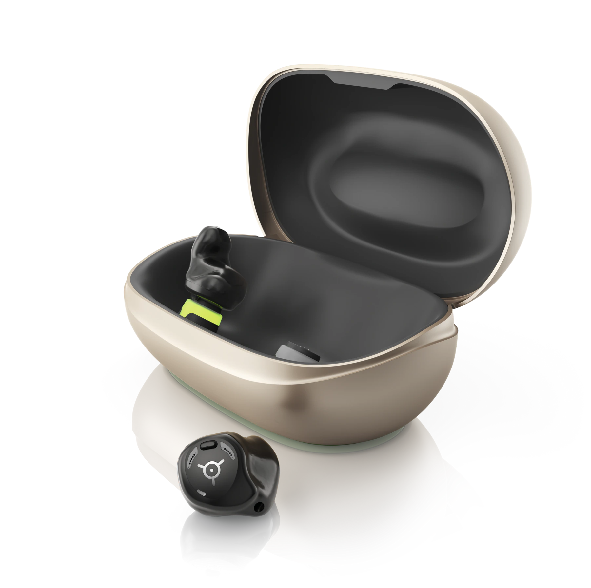
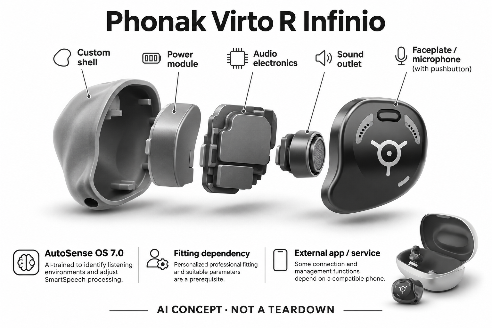

# Phonak Virto R Infinio

**Phonak** · 助听与听力 · 核查 2026-11-04

定制外壳、充电与AI环境分类的组合

消费渠道：个人适配 / 验配。

## 产品图片与结构参考

### 产品图

Phonak Virto R Infinio官方产品外形图 · 来源：[Phonak · 官方产品图片](<https://www.phonak.com/en-us/hearing-devices/hearing-aids/virto-infinio>) · [原始图片](<https://www.phonak.com/content/dam/celum/phonak/master-assets/en/products/infinio/virto-r-i/ph-packshot-virto-i-r-front-06-063-0526-01-ne.png>)

### 参考图

Phonak Virto R Infinio官方另一角度或使用场景参考 · 来源：[Phonak · 官方产品图片](<https://www.phonak.com/en-us/hearing-devices/hearing-aids/virto-infinio>) · [原始图片](<https://www.phonak.com/content/phonak/us/en/hearing-devices/hearing-aids/virto-infinio/_jcr_content/root/container/editorialfeature_cop/image2.coreimg.85.1920.png/1753703770954/ph-packshot-virto-i-r-06-in-and-out-charger-side.png>)

### AI 生成爆炸示意

**AI 生成 · 非实物拆机。** 内部为概念推断，不能作为元件布局、BOM 或维修依据。[生成提示词](../../content/hardware/prompts/phonak-virto-r-infinio.txt)

> 外形依据核验参考图；内部位置、模块形状与装配关系仅作AI概念展示。

> 已逐张查看并核对型号。源图未改色/裁切；场景、界面、附件、优惠及效果文案仅为厂商示意，不作为本目录性能或现价依据。

> 分析为基于公开资料的案头研究与 AI 辅助判断，未经用户访谈、销量审计或实物拆机。需求、画像、竞争冷门度、审美及商业机会均为研究假设，不是投资结论。

## 销售与购买

- 状态：在售。官方当前消费者产品页持续展示该型号，并提供试用/验配或官方门店渠道。属于个人经专业验配获得的消费设备，saleMode为consumer-fitting；不声明具体门店库存。

- 地区：美国及所列官方区域验配网络（具体型号当地确认）

- 价格：未公布统一零售价；按个人验配方案报价。报价通常受单/双耳、技术档位、定制、服务和地区影响；不以历史媒体价格或其他型号拼凑。

- 中国大陆：品牌可能具有中国渠道，但本次未核实该具体型号、技术档位与AI软件在大陆的上市和支持范围；需由国内授权验配渠道确认。

- [官方产品 / 商店](<https://www.phonak.com/en-us/hearing-devices/hearing-aids/virto-infinio>)

## AI 的实际作用

官方明确AutoSense OS 7.0由人工智能训练，用于识别听音环境并调整SmartSpeech相关处理。

服务与联网依赖：个人专业验配与合适参数是前提；部分连接和管理功能依赖兼容手机，核心声音处理不等于云端聊天。

## 是否冷门

细分专业（研究判断）：听觉辅助属于专业消费用途，已有成熟供应商；此分类不表示蓝海或疗效优越。

## 需求与市场

需求假设：希望在定制耳内外形中获得环境自适应，而不只追求更小体积。真正的使用价值需要在个人真实交流场景中验证，不能从AI名称或厂商演示推定每个人都获得同样改善。

### 官方｜定制耳内与自动环境处理 · 官方资料

Virto R Infinio把按个人耳形定制的可充电耳内结构，与由人工智能训练的环境识别和声音处理组合起来。用户得到的是针对复杂交流的助听方案，而非通用耳机上的语音助手；定制外壳与自动设置共同影响使用，但实际功能需依据个人验配及技术档位确认，不能只凭系列名称推断完整能力。

依据：[Phonak Phonak Virto R Infinio官方产品页](<https://www.phonak.com/en-us/hearing-devices/hearing-aids/virto-infinio>) · [Phonak官方消费者验配渠道](<https://www.phonak.com/en-us/find-a-provider>)

### 判断｜外形选择服务同一听清任务 · 研究判断

有些用户希望减少耳后部件，又不愿每到一个环境就调整程序，定制耳内和环境自适应可能同时回应这两个限制。两者属于同一听清需求的实现选择，不应分别计为新市场；需要判断外形偏好是否伴随可接受的取放、充电和清洁流程，避免外观符合期待而日常操作成为负担。

依据：[Phonak Phonak Virto R Infinio官方产品页](<https://www.phonak.com/en-us/hearing-devices/hearing-aids/virto-infinio>)

### 验证｜将日常维护纳入需求 · 待验证

试用不应只问某段谈话是否更清楚，还应观察用户取出设备、放入充电位置、再次佩戴并回到原有状态的全过程。把耳内方案与原来的设备在同类交流中对照，记录遗漏和需要帮助的操作；目前目录没有这样的长期观察，定制和可充电本身不能证明整体生活负担已经减少。

依据：[Phonak Phonak Virto R Infinio官方产品页](<https://www.phonak.com/en-us/hearing-devices/hearing-aids/virto-infinio>) · [Phonak官方消费者验配渠道](<https://www.phonak.com/en-us/find-a-provider>)

## 用户画像

画像推断：经专业评估适合耳内定制、重视佩戴隐蔽性和充电便利的个人更值得评估。具体是否适配应由听力需求、耳形和操作能力共同决定，本目录不根据年龄、职业或自述症状替人选择医疗产品。

### 判断｜偏好耳内佩戴的使用者 · 研究判断

不愿在耳后放置主机的人可能关注本款，但是否适合定制耳内结构，应结合个人耳道、听音需要和实际操作能力确定。不能把外形偏好当作适配结论，也不能假定越小越适合所有人；画像应同时记录用户为何拒绝原方案，以及是否接受定制交付和后续调整所需的过程。

依据：[Phonak Phonak Virto R Infinio官方产品页](<https://www.phonak.com/en-us/hearing-devices/hearing-aids/virto-infinio>) · [Phonak官方消费者验配渠道](<https://www.phonak.com/en-us/find-a-provider>)

### 判断｜已有充电习惯的用户 · 研究判断

愿意把助听设备纳入每日充电习惯的人，可能重视不频繁处理电池的流程，但这也要求稳定的取放与电源安排。对经常跨地点住宿或容易忘记充电的人，应了解真实习惯再比较，不能把可充电直接写成更便利；无线功能与技术档位另有配置条件，不应仅按手机使用熟练度选择。

依据：[Phonak Phonak Virto R Infinio官方产品页](<https://www.phonak.com/en-us/hearing-devices/hearing-aids/virto-infinio>)

### 验证｜个人动作与环境清单 · 待验证

可让用户在专业人员指导下演示自己通常的佩戴、取下、清洁和充电动作，并列出最困难的几类谈话。这样能分别看出外壳适配、操作习惯和声音处理的贡献，避免把所有改善归给人工智能；当地渠道应解释具体交付款式、复查及定制调整安排，官网入口不能代替这些确认。

依据：[Phonak Phonak Virto R Infinio官方产品页](<https://www.phonak.com/en-us/hearing-devices/hearing-aids/virto-infinio>) · [Phonak官方消费者验配渠道](<https://www.phonak.com/en-us/find-a-provider>)

## 竞争与替代

案头判断：定制外壳、充电与AI环境分类的组合形成可比较特征，但消费助听已有多个成熟品牌和验配渠道。没有销量审计、用户访谈或疗效对照，专业细分不意味着竞争稀少。

### 判断｜定制耳内与RIC的取舍 · 研究判断

与耳背主机连接受话器的RIC方案相比，本款把部件集中在定制耳内外壳，改变的是佩戴和维护路径，复杂声场听清的核心任务并未改变。比较应由个人适配与实际生活决定，不能只用隐蔽程度排名；外露部件减少是否值得不同的取放与声学条件，需要同任务试用而非图片比较。

依据：[Phonak Phonak Virto R Infinio官方产品页](<https://www.phonak.com/en-us/hearing-devices/hearing-aids/virto-infinio>)

### 判断｜同系列不同款不能混算 · 研究判断

Virto系列可能包含不同外壳与供电方案，本条仅讨论可充电的Virto R Infinio，不把钛壳或电池款视为同一配置。与其他充电式定制设备比较时，也应确认具体环境处理、连接和技术档位；同品牌EON Sphere的功能不构成本款的默认配置，借用其芯片或表现会扭曲比较基础。

依据：[Phonak Phonak Virto R Infinio官方产品页](<https://www.phonak.com/en-us/hearing-devices/hearing-aids/virto-infinio>)

### 验证｜把定制服务写进比较 · 待验证

同类报价应清楚列出耳数、技术档位、定制、附件与后续服务，而不是用一个没有对应交付内容的起价判断便宜。用户试用则应同时比较交流与维护，记录外壳需要调整的地方；当前没有统一零售价或市场份额证据，目录不能以定制定位、品牌知名度或官方列售判断商业优势。

依据：[Phonak Phonak Virto R Infinio官方产品页](<https://www.phonak.com/en-us/hearing-devices/hearing-aids/virto-infinio>) · [Phonak官方消费者验配渠道](<https://www.phonak.com/en-us/find-a-provider>)

## 供应链

官方可核对按耳形定制的可充电耳内形态及相应声音功能；具体麦克风、受话器、电池供应商与整机工厂本次未确认。品牌或法定制造商名称不等于实际装配工厂，也不据此估计BOM与良率。

### 官方｜定制外壳内的声音链路 · 官方资料

已确认结构是按耳形定制的可充电耳内设备，内部需要完成声音采集、处理、输出和电源管理，官方说明其环境自适应软件能力。具体麦克风、处理器、电池和受话器供应商没有在本次资料中点名，亦未确认制造地点；模块拆分只表示功能需求，不是对真实内部堆叠或工厂工艺的披露。

依据：[Phonak Phonak Virto R Infinio官方产品页](<https://www.phonak.com/en-us/hearing-devices/hearing-aids/virto-infinio>)

### 判断｜个体外壳与声学一致性 · 研究判断

定制结构意味着可用空间和佩戴接触因个人而异，供应研究应把声孔、输出路径、充电接触和维护方式一起考虑。通用芯片满足计算需求并不保证放入各类外壳后效果一致，改动还可能影响反馈和验配；目录没有制造公差、返修比例或定制交期依据，不能用可定制宣传估算量产成本。

依据：[Phonak Phonak Virto R Infinio官方产品页](<https://www.phonak.com/en-us/hearing-devices/hearing-aids/virto-infinio>) · [Phonak官方消费者验配渠道](<https://www.phonak.com/en-us/find-a-provider>)

### 判断｜平台与麦克风分别评估 · 研究判断

onsemi听觉DSP和Syntiant的MEMS麦克风能力可分别用于相近耳内设备的重新设计比较，但不证明已进入本款。处理平台需重新适配算法与验配流程，麦克风需满足个体外壳中的声学和空间条件；两者都不能成为直接替换件，尤其不能把通用器件能力误写成品牌专有软件或定制制造授权。

依据：[Phonak Phonak Virto R Infinio官方产品页](<https://www.phonak.com/en-us/hearing-devices/hearing-aids/virto-infinio>)

## 技术路径

官方明确AutoSense OS 7.0由人工智能训练，用于识别听音环境并调整SmartSpeech相关处理。这是已披露机制；精确模型、内部电路与个体表现未完全公开。普通放大、蓝牙和自动模式本身不单独作为AI收录理由。

### 官方｜AI训练的环境分类 · 官方资料

本型号已确认的AI路径是AutoSense OS 7.0由人工智能训练，识别听音环境并调整相关声音处理。这里的训练来源与运行位置应和手机功能区分，不能把它描述成云端对话助手；官方名称也没有公开完整模型结构、误判率或适配结果，本目录只保留当前型号明确披露的处理范围。

依据：[Phonak Phonak Virto R Infinio官方产品页](<https://www.phonak.com/en-us/hearing-devices/hearing-aids/virto-infinio>)

### 判断｜定制声学与算法相互影响 · 研究判断

相同环境识别结果应用到不同个人参数和外壳条件时，听到的结果并不必然相同。技术价值需要把增益、输出和个人关注目标一起理解，而非只看分类是否正确；定制外壳解决的是佩戴与声学适配的一部分，并不会使算法自动理解每次对话，仍需通过反馈和专业调整形成适合个人的结果。

依据：[Phonak Phonak Virto R Infinio官方产品页](<https://www.phonak.com/en-us/hearing-devices/hearing-aids/virto-infinio>) · [Phonak官方消费者验配渠道](<https://www.phonak.com/en-us/find-a-provider>)

### 验证｜区分处理与佩戴变化 · 待验证

可在适配后记录从安静谈话到复杂环境的变化，同时记录重新佩戴、充电后使用或维护前后是否出现差异。这样可以把算法调整与佩戴位置变化分开讨论，避免把所有声音问题归咎于模型；比较只使用本款已确认的配置，不借其他Sphere型号或同系列不同供电设备的技术数据。

依据：[Phonak Phonak Virto R Infinio官方产品页](<https://www.phonak.com/en-us/hearing-devices/hearing-aids/virto-infinio>) · [Phonak官方消费者验配渠道](<https://www.phonak.com/en-us/find-a-provider>)

## 产品审美

图示观察：外壳依耳形与颜色定制，无法像通用耳机那样只看照片判断大小和隐蔽程度。实际耳内尺寸、舒适感和维护便利仍需验配或试戴确认；宣传图不能证明隐形、无负担或适合所有耳形。

### 判断｜定制不是统一隐形外观 · 研究判断

耳内外壳按个人条件制作，因此最终可见程度、突出程度和取放感受不应由标准宣传图直接推断。用户可能看重减少耳后部件，也可能更在意能够轻松抓取；外形评价需要保留两种偏好，不能以隐藏得更好当作唯一标准，更不能把外观满意等同声音适配或长期舒适已经完成。

依据：[Phonak Phonak Virto R Infinio官方产品页](<https://www.phonak.com/en-us/hearing-devices/hearing-aids/virto-infinio>)

### 判断｜充电让设备与附件成套 · 研究判断

本款的审美与交互不止是耳内外壳，也包括用户每天放置、识别和取出的充电流程。附件是否容易定位、状态是否能理解，应在实际交付配置上观察，而非假设所有可充电设备相同；桌面上看起来整洁的套件，若取放需要协助，未必符合用户希望自主维护的目标。

依据：[Phonak Phonak Virto R Infinio官方产品页](<https://www.phonak.com/en-us/hearing-devices/hearing-aids/virto-infinio>)

### 验证｜穿戴和触达的个人判断 · 待验证

可让用户在镜前和日常活动中确认外观接受度，并自行完成取下、放回、清洁和充电，不仅由销售人员代为演示。还应观察长时间佩戴后是否愿意继续使用，而非只问第一次看到的感受；定制外壳的实际反馈需要进入验配调整，产品照片无法替代触感、动作与日常使用证据。

依据：[Phonak Phonak Virto R Infinio官方产品页](<https://www.phonak.com/en-us/hearing-devices/hearing-aids/virto-infinio>) · [Phonak官方消费者验配渠道](<https://www.phonak.com/en-us/find-a-provider>)

## 关键风险

定制壳体、技术档位和无线功能影响报价；不把同系列钛壳或电池款当成本款。AI设置辅助与噪声处理不能替代专业适配、随访或对异常听力变化的评估，本研究没有诊断、独立实测或疗效结论。

### 判断｜定制款式与权益混淆 · 研究判断

Virto R的定制外壳、技术档位和无线功能共同决定交付内容，若只按系列名称购买，容易把其他材料或电池款能力混入预期。应核对正式方案中的型号与服务范围，不沿用EON Sphere的参数或报价；定制并不代表功能无限可选，具体适配与可交付配置仍由当地渠道确认。

依据：[Phonak Phonak Virto R Infinio官方产品页](<https://www.phonak.com/en-us/hearing-devices/hearing-aids/virto-infinio>) · [Phonak官方消费者验配渠道](<https://www.phonak.com/en-us/find-a-provider>)

### 判断｜形态偏好掩盖操作负担 · 研究判断

用户可能因减少外露部件而忽略耳内取放、清洁或充电的实际动作，直到长期使用才发现难以坚持。这样的限制不应被归为用户不够熟练，也不能用自动环境功能抵消；风险研究应把听音和维护分开记录，确保外观选择不会压过个人需求，本目录不提供个体适配或疗效保证。

依据：[Phonak Phonak Virto R Infinio官方产品页](<https://www.phonak.com/en-us/hearing-devices/hearing-aids/virto-infinio>) · [Phonak官方消费者验配渠道](<https://www.phonak.com/en-us/find-a-provider>)

### 验证｜异常声音与恢复流程 · 待验证

试用应确认当声音突然不习惯、佩戴改变或充电流程中断时，用户知道如何寻求帮助并恢复经过确认的设置。不能把AI环境识别当作所有问题的自动修复，也不应把海外官方页面等同大陆售后承诺；正式使用的边界应来自具体验配及服务方案，而非从产品名称作扩展推断。

依据：[Phonak Phonak Virto R Infinio官方产品页](<https://www.phonak.com/en-us/hearing-devices/hearing-aids/virto-infinio>) · [Phonak官方消费者验配渠道](<https://www.phonak.com/en-us/find-a-provider>)

## 机会与验证

市场差异在于定制外壳、充电与AI环境分类的组合。尚待验证的购买理由是其在个人场景中的可感知帮助、操作便利和售后支持，而不是追求更多AI术语或用统一分数替代实际试戴。

### 判断｜同一任务中的佩戴选择 · 研究判断

本款值得研究的是在需要环境自适应的用户中，定制可充电耳内形态是否带来更可接受的长期使用方式。这里的增量属于同一复杂声场听清任务的适配，不应靠外壳或充电方式夸大独立需求数量；只有佩戴接受、维护可行与真实交流表现同时成立，才形成具体的购买理由。

依据：[Phonak Phonak Virto R Infinio官方产品页](<https://www.phonak.com/en-us/hearing-devices/hearing-aids/virto-infinio>)

### 判断｜减少从配好到用好的落差 · 研究判断

定制交付之后，用户仍要把设备放进自己的生活，可能需要反复理解哪些差异来自场景、佩戴或设置。研究可关注服务是否帮助描述这些问题，以及调整后是否更愿意使用；这样的机会来自适配流程和沟通质量，并不要求新增AI功能，也不能把定制标签直接解释成天然更个性化。

依据：[Phonak Phonak Virto R Infinio官方产品页](<https://www.phonak.com/en-us/hearing-devices/hearing-aids/virto-infinio>) · [Phonak官方消费者验配渠道](<https://www.phonak.com/en-us/find-a-provider>)

### 验证｜以持续佩戴和回访为证据 · 待验证

后续可跟踪真实谈话中的遗漏、佩戴时长、取放困难、充电遗漏和返访原因，并与用户原有方案比较。服务与维护成本需要纳入，而不能只看购买时的外观满意度；当前目录没有长期用户数据，不以可充电、AI训练或官方验配渠道宣称需求和效果已经得到市场验证。

依据：[Phonak Phonak Virto R Infinio官方产品页](<https://www.phonak.com/en-us/hearing-devices/hearing-aids/virto-infinio>) · [Phonak官方消费者验配渠道](<https://www.phonak.com/en-us/find-a-provider>)

## 对应供应链公司

能力候选用于选型研究，不代表本产品实际采用；未公开的供货关系不作推断。

- [onsemi](../supply-chain/onsemi.md) — **能力候选 · 非已采用** / 定制耳内助听器音频处理重设计候选：Virto R需要在定制耳内空间完成环境识别和声音处理，onsemi听觉平台可作为相近新设计的比较路线。必须核验功耗、外部存储、声学延迟和个体验配工具，不能直接替换现有Phonak平台或复制AutoSense软件；未找到本款采用证据，也不把EON系列配置视为可迁移物料。

- [syntiant](../supply-chain/syntiant.md) — **能力候选 · 非已采用** / 定制外壳中的MEMS声音输入候选：Syntiant当前MEMS麦克风产品线可用于比较耳内声音采集，但本款定制外壳带来空间、声孔和个体声学约束。选型应验证噪声、灵敏度匹配、封装与处理接口，历史品牌资料不等于当前供货条件；没有点名采用或直接替换依据，麦克风能力也不包含本款的验配和AI软件。

[浏览供应链目录](../supply-chain.md)

## 功能分层示意

这是功能关系，不是实物拆机、真实空间结构或已核实 BOM。

1. **声音输入**：麦克风采集外界声音；为功能架构，非实际拆机。（分析推断）

2. **个体配置**：专业验配确定与个人听音需求相适应的参数。（官方披露）

3. **AI声音处理**：官方明确AutoSense OS 7.0由人工智能训练，用于识别听音环境并调整SmartSpeech相关处理。（官方披露）

4. **声音输出**：受话器向耳道输出经处理声音；具体物理布局不公开。（分析推断）

5. **管理与随访**：按具体型号使用兼容应用或专业渠道调整和维护。（官方披露）

## 来源

1. [Phonak Phonak Virto R Infinio官方产品页](<https://www.phonak.com/en-us/hearing-devices/hearing-aids/virto-infinio>) — 已打开当前面向消费者的产品介绍及验配/试用入口；没有把医院诊断仪器或B2B订货设备计入。

2. [Phonak官方消费者验配渠道](<https://www.phonak.com/en-us/find-a-provider>) — 已打开官方验配/门店定位渠道，消费者经专业验配购买；不代表每家门店现货或统一价格。

[返回目录](../hardware-market.md) · [网页分析](https://romanagent.github.io/Roman/#hardware/product/phonak-virto-r-infinio)
