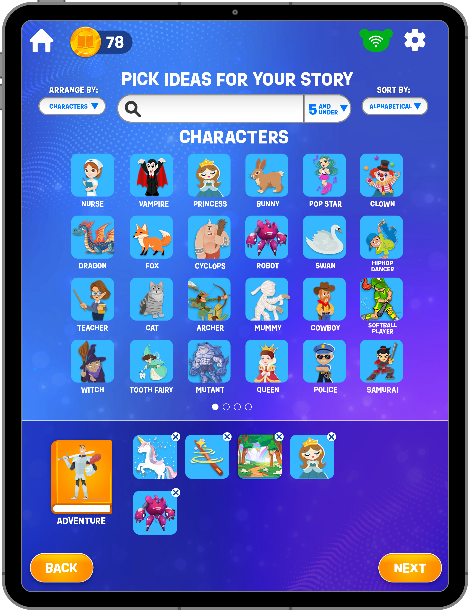
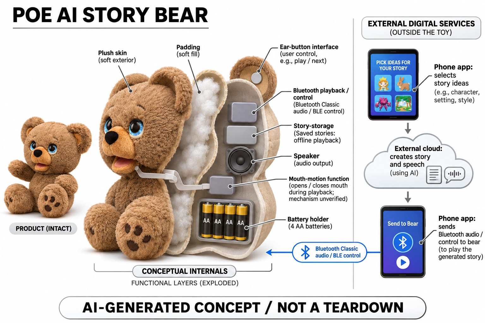

# PLAi Poe the AI Story Bear

**Skyrocket / PLAi** · AI玩具 · 核查 2026-11-06

由应用选择故事元素、云端生成后传给实体熊播放

消费渠道：个人零售。

## 产品图片与结构参考

### 产品图

官方Poe故事熊外观 · 来源：[产品品牌官网](<https://poeaibear.com/>) · [原始图片](<https://poeaibear.com/_astro/poe.D_GJNHBR_Z1BvOXp.webp>)

### 参考图

官方故事创作应用界面，图示故事币不代表当前额度 · 来源：[产品品牌官网](<https://poeaibear.com/>) · [原始图片](<https://poeaibear.com/_astro/Character_Select.CRA_WFi4_Do2I5.webp>)

### AI 生成爆炸示意

**AI 生成 · 非实物拆机。** 内部为概念推断，不能作为元件布局、BOM 或维修依据。[生成提示词](../../content/hardware/prompts/plai-poe.txt)

> 由协作代理使用内置ImageGen独立生成，已检查外形和功能边界；未知内部不能作为BOM或维修依据。

> 图片保留官方原貌；效果、安全与性能宣传不代表本目录独立验证。

> 分析为基于公开资料的案头研究与 AI 辅助判断，未经用户访谈、销量审计或实物拆机。需求、画像、竞争冷门度、审美及商业机会均为研究假设，不是投资结论。

## 销售与购买

- 状态：在售。品牌官网当前Buy Now区域由浏览器核实指向Target和Amazon；已打开对应Target商品显示US$34.99、In Stock与Add to cart。官网和当前FAQ共同支持该Poe型号，未实际购买。

- 地区：美国品牌授权零售渠道

- 价格：US$34.99（官网链接的Target所见）。这是本轮指定零售页价格，地区库存税运另核；官网说明存在基础和高级云AI功能，实际故事额度与应用内付费以当前App为准，不沿用发布时49.99美元作现价。

- 中国大陆：未核实大陆官方销售和应用服务；美国零售库存不代表大陆可配送，多语言故事也不能证明本地服务与售后已开放。

- [官方产品 / 商店](<https://poeaibear.com/>)

## AI 的实际作用

用户在手机或平板App选择预设故事元素，由外部云AI生成故事及朗读，再以Bluetooth传到熊播报；熊可保存部分音频离线重播，不是直接听取儿童自由对话的云聊天玩偶。

服务与联网依赖：创建新故事需要兼容应用与联网云服务，BLE控制和Classic Bluetooth音频连接分开；已下载到熊的故事可独立播放，四节AA供电。

## 是否冷门

细分专业（研究判断）：输入受限的故事创作与离线播报区别于开放式聊天毛绒，仍与故事播放器竞争；专业细分判断不代表销量、教育效果或没有竞品。

## 需求与市场

孩子可能希望听到自己选出的角色和奇怪组合出现在故事里，同时保留实体玩具的陪伴感。价值取决于是否鼓励继续想象和讨论，而不是每次生成一段更长的内容；如果只是不断点击生成而很少倾听，创作参与的假设就需要重新检验。

### 事实｜故事从应用里的图标组合开始 · 官方资料

Poe让用户在配套应用选择角色、题材等预设元素，再由云AI补全故事并提供朗读，熊负责把内容播出来。它与直接接收自由语音对话的毛绒路径不同，输入限制是产品的重要设计；品牌最早发布时的模型合作不应直接当成当前每次生成的确定配置。

依据：[Poe当前品牌官网](<https://poeaibear.com/>) · [Skyrocket发布Poe的原始公告](<https://www.prnewswire.com/news-releases/first-ever-story-creating-and-storytelling-bear-safely-uses-ai-to-turn-kids-ideas-into-one-of-a-kind-stories-302251996.html>)

### 判断｜需求在于参与创作而不只被动收听 · 研究判断

孩子可能希望听到自己选出的角色和奇怪组合出现在故事里，同时保留实体玩具的陪伴感。价值取决于是否鼓励继续想象和讨论，而不是每次生成一段更长的内容；如果只是不断点击生成而很少倾听，创作参与的假设就需要重新检验。

依据：[Poe当前品牌官网](<https://poeaibear.com/>)

### 验证｜观察选择元素与讲述的关系 · 待验证

可以记录孩子怎样挑选元素、是否能解释选择理由，以及听完后会不会修改情节或与家人共讲。应与固定故事和成人即兴讲述比较，不能只统计生成次数；本目录没有儿童试验、销量或长期使用资料，市场需求和成长价值均未得到独立验证。

依据：[Poe当前品牌官网](<https://poeaibear.com/>) · [Poe官方FAQ与操作边界](<https://support.skyrocketon.com/hc/en-us/articles/28823146551959-POE-AI-BEAR-FAQ-Frequently-Asked-Questions>)

## 用户画像

有的家庭可能愿意一起用手机挑选内容，再把熊留给孩子听故事；有的则希望全程不需要任何屏幕。两种需求不同，不应把短暂创作界面与长期看屏幕简单等同或完全忽略；用户研究需要明确家长愿意参与哪一段，而不是只看玩具本身没有屏幕。

### 事实｜新内容创建仍需要手机或平板 · 官方资料

官方说明配套应用承担故事创作，兼容设备通过Bluetooth与熊连接；部分故事可以保存到熊上，之后不带手机也能重播。因此无设备播放只适用于已保存内容，不能把Poe概括成创建和使用全过程完全无屏或独立运行AI的毛绒。

依据：[Poe当前品牌官网](<https://poeaibear.com/>) · [Poe官方FAQ与操作边界](<https://support.skyrocketon.com/hc/en-us/articles/28823146551959-POE-AI-BEAR-FAQ-Frequently-Asked-Questions>)

### 判断｜家庭适配取决于如何安排创作阶段 · 研究判断

有的家庭可能愿意一起用手机挑选内容，再把熊留给孩子听故事；有的则希望全程不需要任何屏幕。两种需求不同，不应把短暂创作界面与长期看屏幕简单等同或完全忽略；用户研究需要明确家长愿意参与哪一段，而不是只看玩具本身没有屏幕。

依据：[Poe当前品牌官网](<https://poeaibear.com/>)

### 验证｜让家长与孩子完成完整循环 · 待验证

试用可从选择元素、生成、播放到保存和再次收听，观察每一步由谁操作、哪里需要帮助。孩子是否能用耳键选对故事也应实际检查；本轮没有安装应用或付费生成，不能依据官网演示声称所有设备和年龄都能顺利独立使用。

依据：[Poe当前品牌官网](<https://poeaibear.com/>) · [Poe官方FAQ与操作边界](<https://support.skyrocketon.com/hc/en-us/articles/28823146551959-POE-AI-BEAR-FAQ-Frequently-Asked-Questions>)

## 竞争与替代

固定内容通常更可预测，开放对话更自由，而Poe以有限输入获得可变化叙事，处在另一种创作方式上。它的差异不是普遍更聪明，而是允许家庭选择如何控制输入；是否吸引孩子，需要看具体故事和使用流程，不能由AI生成标签判断优劣。

### 事实｜实体播放与云生成是分工关系 · 官方资料

Poe既能播当前应用故事，也可从本地保存内容中选择播放，这让它与只能持续在线对话的毛绒形成不同使用条件。已保存音频不因播放离线而变成机内生成模型，应用的故事库也不等于熊内容量；比较时必须保留这两层内容管理区别。

依据：[Poe当前品牌官网](<https://poeaibear.com/>) · [Poe官方FAQ与操作边界](<https://support.skyrocketon.com/hc/en-us/articles/28823146551959-POE-AI-BEAR-FAQ-Frequently-Asked-Questions>)

### 判断｜固定故事机与开放聊天各有取舍 · 研究判断

固定内容通常更可预测，开放对话更自由，而Poe以有限输入获得可变化叙事，处在另一种创作方式上。它的差异不是普遍更聪明，而是允许家庭选择如何控制输入；是否吸引孩子，需要看具体故事和使用流程，不能由AI生成标签判断优劣。

依据：[Poe当前品牌官网](<https://poeaibear.com/>) · [Skyrocket发布Poe的原始公告](<https://www.prnewswire.com/news-releases/first-ever-story-creating-and-storytelling-bear-safely-uses-ai-to-turn-kids-ideas-into-one-of-a-kind-stories-302251996.html>)

### 验证｜统一故事任务和费用口径 · 待验证

比较可采用相同题材与时长，观察孩子是否理解故事、是否需要重做，以及家长完成一次创作的工作。零售折扣不代表云服务永久免费，应用内额度也可能影响使用；本目录没有真实生成账单或家庭留存，不能推断长期成本优势。

依据：[Poe当前品牌官网](<https://poeaibear.com/>) · [品牌官网链接的Target零售商品](<https://www.target.com/p/-/A-91836362>)

## 供应链

家长可能看到灯已连接，却听不到音频，因为控制与播放链路并未同时完成。类似产品需要把这种差异转成可理解的状态，而不是只让用户反复重启；供应设计也应将手机兼容、音频、存储和电源一起验证，单个模块能工作不代表整套流程稳定。

### 事实｜双Bluetooth与AA供电已披露 · 官方资料

官方FAQ明确BLE用于设备通信，Classic Bluetooth负责讲故事音频，两者连接成功并不是同一状态。它还说明使用四节AA电池及耳键操作，这些信息支持功能分层；具体无线芯片、存储、电声器件和装配厂商未公开，不能从协议名反推原机BOM。

依据：[Poe官方FAQ与操作边界](<https://support.skyrocketon.com/hc/en-us/articles/28823146551959-POE-AI-BEAR-FAQ-Frequently-Asked-Questions>)

### 判断｜双连接增加故障解释的必要性 · 研究判断

家长可能看到灯已连接，却听不到音频，因为控制与播放链路并未同时完成。类似产品需要把这种差异转成可理解的状态，而不是只让用户反复重启；供应设计也应将手机兼容、音频、存储和电源一起验证，单个模块能工作不代表整套流程稳定。

依据：[Poe官方FAQ与操作边界](<https://support.skyrocketon.com/hc/en-us/articles/28823146551959-POE-AI-BEAR-FAQ-Frequently-Asked-Questions>)

### 验证｜供应候选按协议和声学分工限定 · 待验证

可分别研究BLE控制和电声器件候选，再确认Classic音频需要的独立支持，不能把只支持低功耗蓝牙的平台当完整替代。目录没有品牌点名采用或代工证据，关联仅服务相近新设计；云端故事与内容审核也不由这些硬件供应公司自动提供。

依据：[Poe当前品牌官网](<https://poeaibear.com/>) · [Poe官方FAQ与操作边界](<https://support.skyrocketon.com/hc/en-us/articles/28823146551959-POE-AI-BEAR-FAQ-Frequently-Asked-Questions>)

## 技术路径

预设图标可以限制输入范围，却仍可能产生情节不连贯、刻板印象或不符合某个家庭期待的内容。技术评价应看元素是否正确进入故事、内容是否可理解以及家长能否提前判断，而不是把输入选项经过筛选等同于每次输出都完全合适。

### 事实｜生成发生在外部服务而非熊内 · 官方资料

品牌说明故事由云AI生成，发布设计没有摄像头或主动麦克风，熊本体不直接访问互联网。联网需求来自外部应用与服务，保存后播放则是另一阶段；目录不会在概念图中给熊增加Wi-Fi摄像头或大模型芯片，也不把普通音频重播算成新的推理。

依据：[Poe当前品牌官网](<https://poeaibear.com/>) · [Skyrocket发布Poe的原始公告](<https://www.prnewswire.com/news-releases/first-ever-story-creating-and-storytelling-bear-safely-uses-ai-to-turn-kids-ideas-into-one-of-a-kind-stories-302251996.html>)

### 判断｜受限输入减少自由度但不保证质量 · 研究判断

预设图标可以限制输入范围，却仍可能产生情节不连贯、刻板印象或不符合某个家庭期待的内容。技术评价应看元素是否正确进入故事、内容是否可理解以及家长能否提前判断，而不是把输入选项经过筛选等同于每次输出都完全合适。

依据：[Poe当前品牌官网](<https://poeaibear.com/>)

### 验证｜检查生成内容和保存版本是否一致 · 待验证

可以用非敏感故事元素测试不同组合，核对应用播放与熊内保存是否一致，并观察传输失败后的状态。不要只挑最好的一次故事展示，也要记录重复和不合适的结果；本轮没有实际调用生成服务，不能验证厂商关于安全或创意质量的绝对宣传。

依据：[Poe当前品牌官网](<https://poeaibear.com/>) · [Poe官方FAQ与操作边界](<https://support.skyrocketon.com/hc/en-us/articles/28823146551959-POE-AI-BEAR-FAQ-Frequently-Asked-Questions>)

## 产品审美

孩子可能更愿意面对一个会讲述的角色，而不是一直看手机；也可能只关注口部动作而忽略故事。审美应与叙事节奏、音量和停止方式一起观察，不能因拟人化就假定更投入或更易学习；毛绒的触感和耐用性也不能由图片独立判断。

### 事实｜耳键和表情动作形成实体叙事感 · 官方资料

官方照片展示坐姿熊和可动口部，FAQ说明耳部用于选择、开始和暂停故事，并提到播放音量会影响口部动作。外观和操作证据不意味着内部驱动布局已公开；概念图可以表达音频与动作关联，但不能画成精确齿轮传动或维修拆机结构。

依据：[Poe当前品牌官网](<https://poeaibear.com/>) · [Poe官方FAQ与操作边界](<https://support.skyrocketon.com/hc/en-us/articles/28823146551959-POE-AI-BEAR-FAQ-Frequently-Asked-Questions>)

### 判断｜实体播放的价值在注意力组织 · 研究判断

孩子可能更愿意面对一个会讲述的角色，而不是一直看手机；也可能只关注口部动作而忽略故事。审美应与叙事节奏、音量和停止方式一起观察，不能因拟人化就假定更投入或更易学习；毛绒的触感和耐用性也不能由图片独立判断。

依据：[Poe当前品牌官网](<https://poeaibear.com/>)

### 验证｜观察重复播放与电池维护 · 待验证

家庭试用可检查耳键是否易按、选故事时是否清楚、成人更换电池及收纳是否方便，并按说明处理长期不用的电池。只看一次动态演示会忽略这些日常环节；本研究没有实物或材料试验，不能从照片证明耐用、抗跌或儿童操作安全。

依据：[Poe官方FAQ与操作边界](<https://support.skyrocketon.com/hc/en-us/articles/28823146551959-POE-AI-BEAR-FAQ-Frequently-Asked-Questions>)

## 关键风险

故事库、设备配对和服务额度可能绑定应用账户或具体手机，家庭换机与分享时需要知道哪些内容能带走。长期云服务变化也可能影响新故事创建，而本地旧故事仍能播放；这类不对称寿命需要在产品研究中说明，不能把硬件可开机当全部功能永久保留。

### 事实｜官方安全用语不能替代输出评估 · 官方资料

品牌用预设图标和家庭内容监控说明其防护，并曾采用百分之百安全的宣传。目录将其理解为设计目标和厂商声明，不作为所有故事都经过独立验证的结论；没有主动麦克风改变输入方式，却不消除应用账号、个性化信息及云服务的管理责任。

依据：[Poe当前品牌官网](<https://poeaibear.com/>) · [Skyrocket发布Poe的原始公告](<https://www.prnewswire.com/news-releases/first-ever-story-creating-and-storytelling-bear-safely-uses-ai-to-turn-kids-ideas-into-one-of-a-kind-stories-302251996.html>)

### 判断｜内容和账户问题仍可能影响体验 · 研究判断

故事库、设备配对和服务额度可能绑定应用账户或具体手机，家庭换机与分享时需要知道哪些内容能带走。长期云服务变化也可能影响新故事创建，而本地旧故事仍能播放；这类不对称寿命需要在产品研究中说明，不能把硬件可开机当全部功能永久保留。

依据：[Poe当前品牌官网](<https://poeaibear.com/>) · [Poe官方FAQ与操作边界](<https://support.skyrocketon.com/hc/en-us/articles/28823146551959-POE-AI-BEAR-FAQ-Frequently-Asked-Questions>)

### 验证｜检查换机和停止服务的可保留内容 · 待验证

FAQ明确从一台设备传到熊的故事不能再下载到另一台设备库，后续应按实际流程核对备份与迁移。家庭还应了解当前额度、删除和取消服务的规则；本目录未处理账户或个人资料，不作法律审计，也不承诺停服后所有故事和功能都可恢复。

依据：[Poe官方FAQ与操作边界](<https://support.skyrocketon.com/hc/en-us/articles/28823146551959-POE-AI-BEAR-FAQ-Frequently-Asked-Questions>)

## 机会与验证

Poe展示了一种不用开放儿童自由聊天也能使用生成式AI的玩法：孩子选择，系统补全，家庭再听与讨论。创业机会可能来自更清楚的创作控制和保存体验，而不是把所有玩偶都变成聊天机器人；需求仍需通过持续使用和家庭付费验证。

### 事实｜当前美国零售证据与首发价分开 · 官方资料

本轮品牌官网仍列Target与Amazon购买入口，Target对应商品显示在库及三十四点九九美元。二零二四年品牌公告的四十九点九九美元仅是历史价格，不能覆盖当前渠道；零售可购也不证明任何海外地址、应用商店或语言都获得相同支持。

依据：[Poe当前品牌官网](<https://poeaibear.com/>) · [品牌官网链接的Target零售商品](<https://www.target.com/p/-/A-91836362>) · [Skyrocket发布Poe的原始公告](<https://www.prnewswire.com/news-releases/first-ever-story-creating-and-storytelling-bear-safely-uses-ai-to-turn-kids-ideas-into-one-of-a-kind-stories-302251996.html>)

### 判断｜机会在可控输入的创作流程 · 研究判断

Poe展示了一种不用开放儿童自由聊天也能使用生成式AI的玩法：孩子选择，系统补全，家庭再听与讨论。创业机会可能来自更清楚的创作控制和保存体验，而不是把所有玩偶都变成聊天机器人；需求仍需通过持续使用和家庭付费验证。

依据：[Poe当前品牌官网](<https://poeaibear.com/>)

### 验证｜用创作质量和复听原因判断价值 · 待验证

可以追踪家庭保留下来的故事、为什么重听或重做，以及孩子是否愿意继续贡献角色和情节。生成数量、零售价格和新奇感不能单独证明市场规模；当前只是公开资料研究，没有独立用户留存、教育效果或销售数据，前景应保持可验证的假设。

依据：[Poe当前品牌官网](<https://poeaibear.com/>) · [Poe官方FAQ与操作边界](<https://support.skyrocketon.com/hc/en-us/articles/28823146551959-POE-AI-BEAR-FAQ-Frequently-Asked-Questions>)

## 对应供应链公司

能力候选用于选型研究，不代表本产品实际采用；未公开的供货关系不作推断。

- [nordic-semiconductor](../supply-chain/nordic-semiconductor.md) — **能力候选 · 非已采用** / 同类故事熊BLE控制链路候选：Nordic低功耗无线平台可用于同类故事熊的BLE控制、状态和下载管理研究，但官方Poe还使用Classic Bluetooth音频，因此单一BLE候选不能被视为完整替代方案。必须另验音频平台协同和手机连接行为；没有Skyrocket点名采用资料，关联仅是新设计能力候选。

- [goertek](../supply-chain/goertek.md) — **能力候选 · 非已采用** / 同类故事播放玩具的电声器件与结构候选：歌尔公开的声学器件及工程能力可作为类似故事熊扬声器和电声结构的研究入口，但毛绒包覆、儿童音量、电池供电和口部动作都需专项验证。当前未发现其为Poe供货或代工的证据，不能将候选扩大为实际装配工厂，也不包含云故事生成服务。

[浏览供应链目录](../supply-chain.md)

## 功能分层示意

这是功能关系，不是实物拆机、真实空间结构或已核实 BOM。

1. **应用输入**：在手机或平板选择预设故事元素，创建任务在外部应用发起。（官方披露）

2. **外部生成**：云AI生成故事及朗读，具体当前模型与高级权益依服务配置。（官方披露）

3. **无线传输**：BLE进行设备控制，Classic Bluetooth负责音频，连接状态需分别确认。（官方披露）

4. **实体播放**：熊内声音播放与存储，耳部按键控制已下载故事，口部可随播放动作；具体驱动未公开。（官方披露）

5. **供电与维护**：使用四节AA电池，电池仓与控制板布局不作为本轮已核实拆机结构。（官方披露）

## 来源

1. [Poe当前品牌官网](<https://poeaibear.com/>) — 已打开并用浏览器确认授权Target/Amazon链接，官网描述图标输入、云AI与本地保存；不采用百分之百安全宣传。

2. [Poe官方FAQ与操作边界](<https://support.skyrocketon.com/hc/en-us/articles/28823146551959-POE-AI-BEAR-FAQ-Frequently-Asked-Questions>) — 已打开BLE/Classic分工、保存/播放、耳键及四节AA供电说明。

3. [品牌官网链接的Target零售商品](<https://www.target.com/p/-/A-91836362>) — 已打开当前34.99美元、In Stock和加购；这是品牌导向的零售商自有库存页面，未付款或确认任意地址。

4. [Skyrocket发布Poe的原始公告](<https://www.prnewswire.com/news-releases/first-ever-story-creating-and-storytelling-bear-safely-uses-ai-to-turn-kids-ideas-into-one-of-a-kind-stories-302251996.html>) — 2024-09-19品牌自行发布，说明无摄像头、主动麦克风及熊本体不直接上网；历史模型合作和49.99美元不当当前版本或现价。

[返回目录](../hardware-market.md) · [网页分析](https://romanagent.github.io/Roman/#hardware/product/plai-poe)
