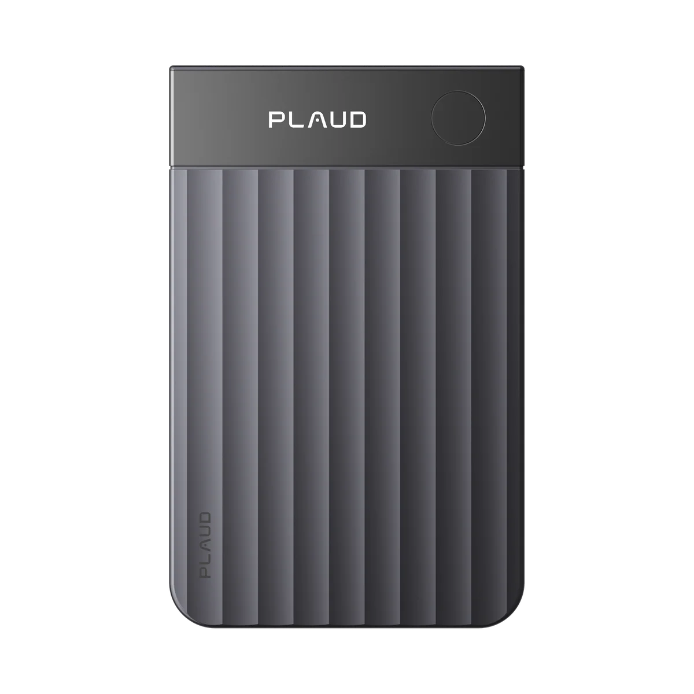
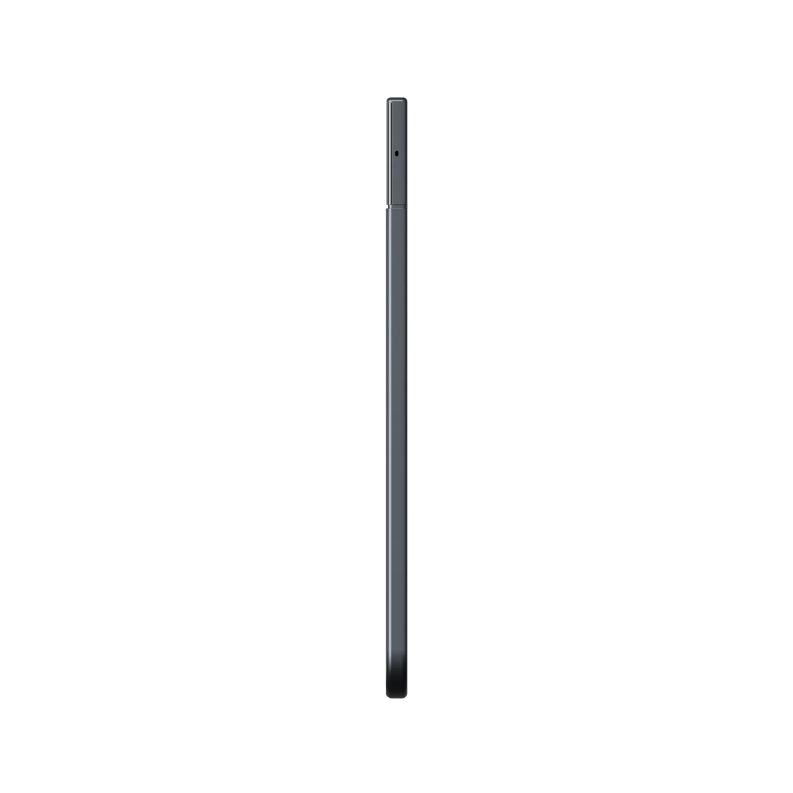
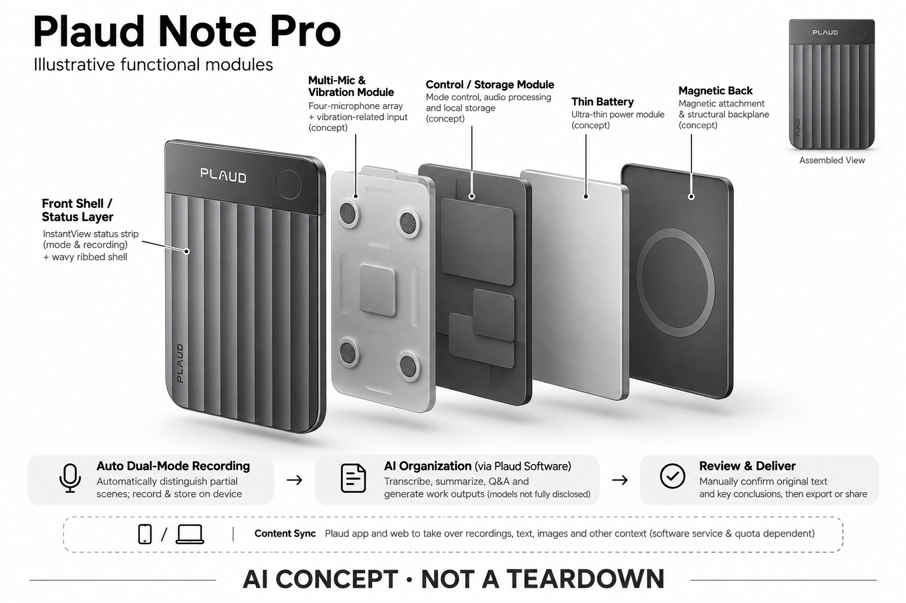

# Plaud Note Pro

**Plaud** · 录音与记忆 · 核查 2026-11-04

以拾音、模式判断和状态反馈服务密集会议

## 产品图片与结构参考

### 产品图

官方 Plaud Note Pro 正面图 · 来源：[Plaud · 官方产品图片](<https://www.plaud.ai/products/plaud-note-pro>) · [原始图片](<https://cdn.shopify.com/s/files/1/0918/0171/5051/files/NotePro-_-2_fdc31980-a483-420d-b385-3723c698c9b7.png?v=1779783768&width=1200>)

### 参考图

官方 Plaud Note Pro 侧面参考 · 来源：[Plaud · 官方产品图片](<https://www.plaud.ai/products/plaud-note-pro>) · [原始图片](<https://cdn.shopify.com/s/files/1/0918/0171/5051/files/Plaud_Note_Pro-side-black_e0ab6b2a-c29f-4906-a5da-4067210906ce.webp?v=1766042075&width=1200>)

### AI 生成爆炸示意

**AI 生成 · 非实物拆机。** 内部为概念推断，不能作为元件布局、BOM 或维修依据。[生成提示词](../../content/hardware/prompts/plaud-note-pro.txt)

> 外形依据核验参考图；内部位置、模块形状与装配关系仅作AI概念展示。

> 图片按源站提供格式保存，未裁切或改色；厂商渲染/场景示意不代表实机测试。

> 分析为基于公开资料的案头研究与 AI 辅助判断，未经用户访谈、销量审计或实物拆机。需求、画像、竞争冷门度、审美及商业机会均为研究假设，不是投资结论。

## 销售与购买

- 状态：在售。官方独立商品页显示 US$189、Shop Now、颜色选项，并标明通常1–2个工作日发货；这属于官网列售证据，实际订单库存仍以结算为准。

- 地区：美国/国际官网、其他地区依当地官方站点与结算确认

- 价格：US$189。核查时硬件所见价，附基础300分钟/月转写；高级计划另计。模式、地区、促销及税费需在当地官网确认。

- 中国大陆：本次确认的是国际商店版本；没有以中国品牌身份推定大陆同型号渠道、服务区域和保修均已开放。

- [官方产品 / 商店](<https://www.plaud.ai/products/plaud-note-pro>)

## AI 的实际作用

自动区分部分录音场景，并以转写、摘要和问答把声音变成可检索笔记。

服务与联网依赖：录音和存储在设备侧；AI整理依赖Plaud软件服务与额度。官方未完整公开所有模型及端云分工。

## 是否冷门

竞争密集（研究判断）：专业录音与AI会议笔记均有成熟替代；Pro属于细分升级而非新空白市场。

## 需求与市场

需求假设：连续会议与重要访谈更在意能否确认录音正常、是否漏切模式、远处声音是否可用。升级价值来自减少采集失败，而不是只多生成一份摘要，需结合真实会议环境判断。

## 用户画像

画像推断：每天频繁在电话和现场会议之间切换、且遗漏记录代价较高的专业人士更匹配。低频用户未必需要升级；不能因产品强调专业就认为它适合所有监管严格的业务。

## 竞争与替代

案头判断：同品牌基础 Note 与 NotePin 会分流需求，手机会议助手也能处理已有音频。此款竞争点偏采集可靠性和状态反馈；没有访谈、独立失败率或销量数据支持溢价合理性。

## 供应链

官方披露四麦克风、振动相关采集和显示屏，但组件供应商、整机工厂与成本未公开。推断超薄结构还需兼顾声学开孔、电池、屏幕与装配公差，不能仅凭售价估计硬件毛利。

## 技术路径

官方区分增强与耐久录音模式，所以30小时和50小时不是同一条件下的冲突参数。自动模式识别属于采集侧便利，摘要属于后续AI处理；具体分类算法与模型部署仍未完整披露。

## 产品审美

图示观察：薄卡片顶部加入显示区域，能在保留商务外形的同时展示录音和电量状态。它让设备状态更易被看见，但屏幕可读性、手机附着后的手感和磁吸稳定性尚未实际测试。

## 关键风险

远距离拾音、噪声和多人交叠会共同影响文字质量，屏幕显示正在录音并不保证内容可用。还需考虑订阅成本、敏感音频权限及生成摘要的事实遗漏，重要结论应回到原录音复核。

## 机会与验证

市场差异在于把专业用户对采集确定性的要求做成可见硬件升级。尚待验证的购买理由是失败减少与会后节省时间是否覆盖差价，以及用户是否真正需要自动模式和更长录音时长。

## 功能分层示意

这是功能关系，不是实物拆机、真实空间结构或已核实 BOM。

1. **多路拾音**：四麦克风和振动相关输入；概念功能架构，非真实拆机。（官方披露）

2. **模式与状态**：自动双模式、录音状态显示和本地存储。（官方披露）

3. **内容同步**：Plaud应用和网页承接录音、文字、图片等上下文。（官方披露）

4. **AI整理**：转写、摘要、问答与生成工作成果；具体模型服务未完全公开。（官方披露）

5. **复查与交付**：人工确认原文与关键结论后导出或分享。（分析推断）

## 来源

1. [Plaud · Note Pro 官方商店](<https://www.plaud.ai/products/plaud-note-pro>) — 已打开；明确区分30小时增强与50小时耐久模式，标称数据未经实测。

2. [Plaud · 官方设备比较](<https://www.plaud.ai/pages/plaud-device-comparison>) — 已打开；用于比较不同采集形态，不代表同品牌软件永久免费。

[返回目录](../hardware-market.md) · [网页分析](https://romanagent.github.io/Roman/#hardware/product/plaud-note-pro)
