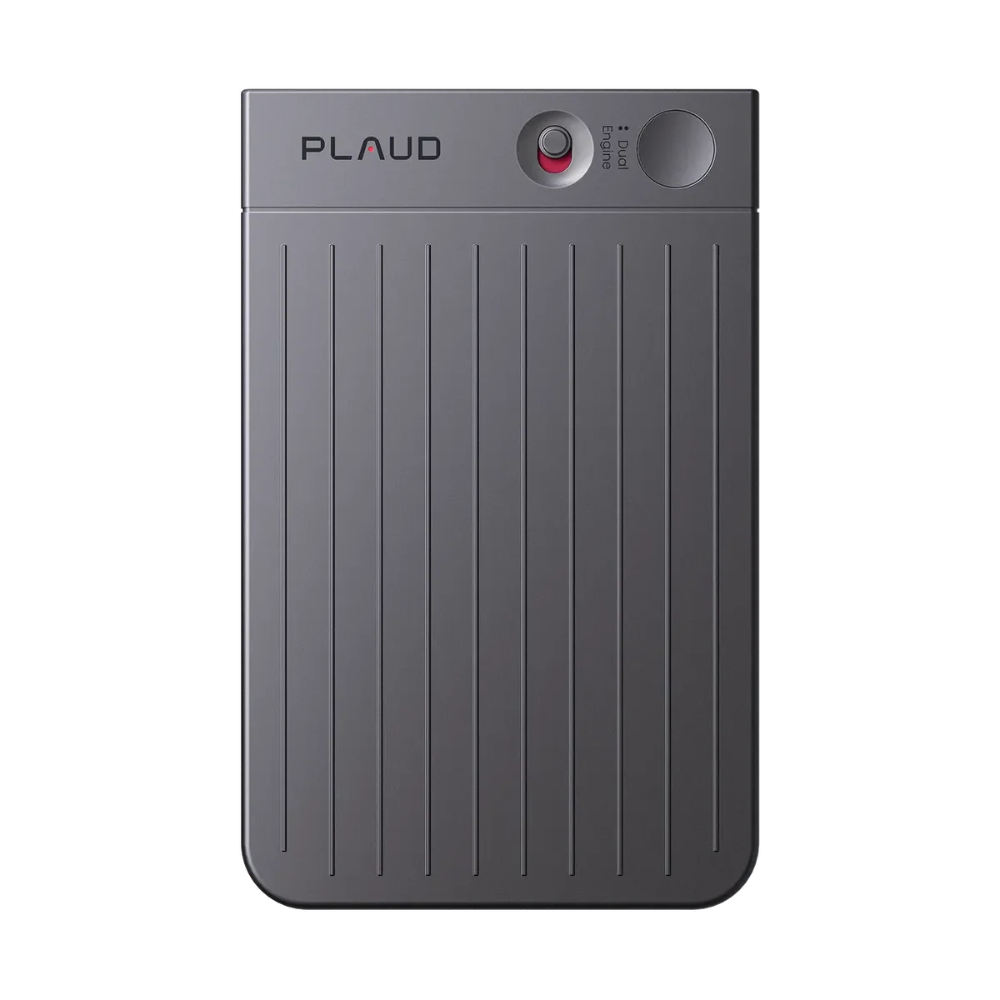
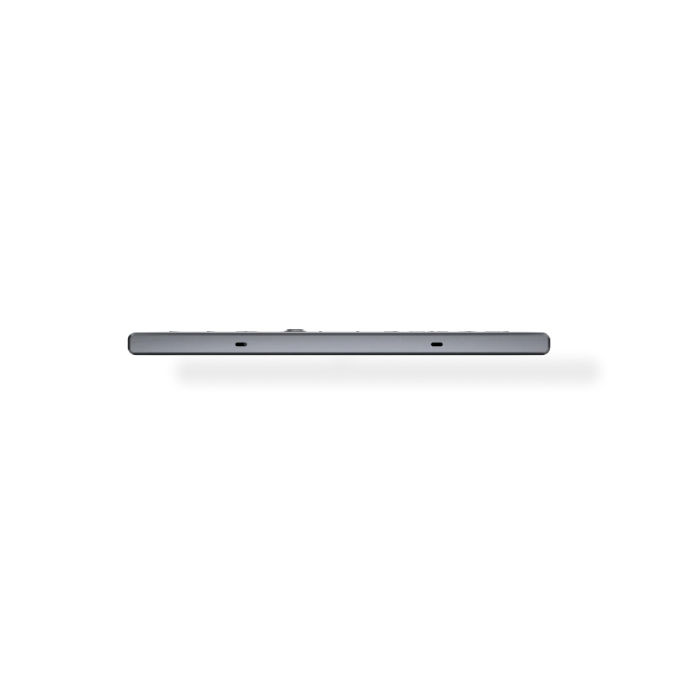
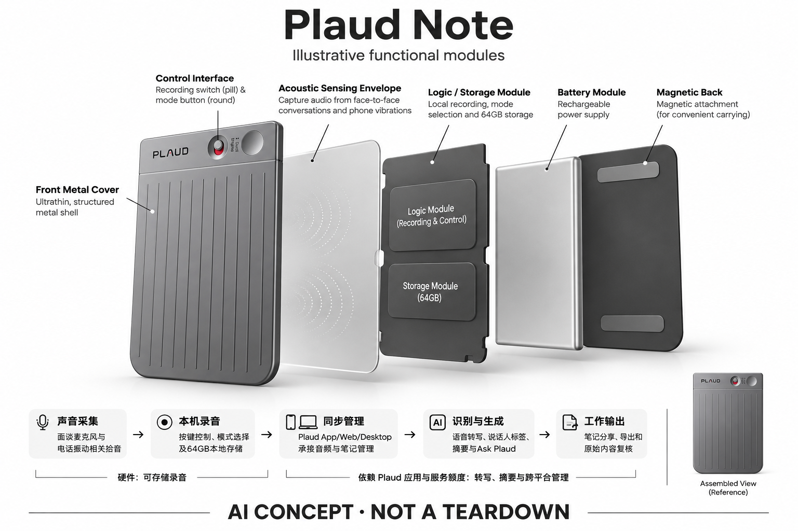

# Plaud Note

**Plaud** · 录音与记忆 · 核查 2026-11-04

贴在手机背面的双模式 AI 录音卡片

## 产品图片与结构参考

### 产品图

官方 Plaud Note 基础款正面图 · 来源：[Plaud · 官方产品图片](<https://www.plaud.ai/products/plaud-note-ai-voice-recorder>) · [原始图片](<https://cdn.shopify.com/s/files/1/0918/0171/5051/files/BL-plaud-note-052526.webp?v=1779709941&width=1200>)

### 参考图

官方 Plaud Note 侧面薄度参考 · 来源：[Plaud · 官方产品图片](<https://www.plaud.ai/products/plaud-note-ai-voice-recorder>) · [原始图片](<https://cdn.shopify.com/s/files/1/0918/0171/5051/files/4_e10f8969-6ac3-4641-971f-2514b6c6b3c1.png?v=1774430233&width=1200>)

### AI 生成爆炸示意

**AI 生成 · 非实物拆机。** 内部为概念推断，不能作为元件布局、BOM 或维修依据。[生成提示词](../../content/hardware/prompts/plaud-note.txt)

> 外形依据核验参考图；内部位置、模块形状与装配关系仅作AI概念展示。

> 图片按源站提供格式保存，未裁切或改色；厂商渲染/场景示意不代表实机测试。

> 分析为基于公开资料的案头研究与 AI 辅助判断，未经用户访谈、销量审计或实物拆机。需求、画像、竞争冷门度、审美及商业机会均为研究假设，不是投资结论。

## 销售与购买

- 状态：在售。已打开国际官方商店，Note 独立商品页显示 US$159、Shop Now、颜色选择及配送说明；页面同时列出新款，未将 Note Pro 的参数算入本款。

- 地区：美国/国际官网、其他地区依当地官方站点与结算确认

- 价格：US$159。硬件含每月300分钟基础转写额度；超额或高级服务可能需订阅。税费、促销与当地版本以地区官网为准。

- 中国大陆：本次核实国际版产品，未取得同款大陆正式购买与数据服务所在地的官方证据；品牌来源或中文识别能力不作为大陆销售证明。

- [官方产品 / 商店](<https://www.plaud.ai/products/plaud-note-ai-voice-recorder>)

## AI 的实际作用

录音经过语音识别、说话人标记，再由 AI 生成摘要并支持检索问答。

服务与联网依赖：硬件可存储录音；转写、摘要与跨平台管理依赖 Plaud 应用和服务额度，不应视作完整离线 AI。

## 是否冷门

竞争密集（研究判断）：卡片录音器和会议摘要服务已有直接竞品，手机软件替代也强；为案头判断。

## 需求与市场

需求假设：通话或会议密集的人，愿意为少一步启动录音和会后整理付费。真实需求应以查回原话、完成跟进的频率检验，不能只用生成摘要数量证明设备有价值。

## 用户画像

画像推断：销售、访谈者、顾问和经常需要会后复盘的人较匹配。对偶发录音者，手机可能已足够；对高度保密团队，则需要先评估数据流程，而不是只比较硬件外形。

## 竞争与替代

案头判断：与手机录音、软件会议助手、同品牌 Note Pro 及其他卡片录音器直接竞争，属于拥挤方向。没有用户访谈、销量或转化数据，不能把官网用户规模宣传当成需求验证。

## 供应链

官网披露拾音器件类型与本地存储，但麦克风厂商、整机代工、材料成本和良率未公开。推断卡片机身中的电池布局、手机振动耦合与磁吸外壳，是区别于普通录音笔的制造重点。

## 技术路径

官方明确面谈与电话模式、MEMS 与振动相关拾音组件，软件提供转写和生成摘要。底层模型版本与云端路由未完整披露；物理采集成功、转写准确和摘要可靠是三个不同环节。

## 产品审美

图示观察：扁平金属感卡片和纵向纹理接近商务配件，附着手机减少额外携带动作。手机厚度、握持与充电配件冲突需要实测；低调外观不应被理解成可以不告知就录音。

## 关键风险

需关注通话拾音受机型、手机壳和摆位影响，转写中人名金额可能错误，摘要也可能遗漏条件。基础额度不足时会增加持续费用；敏感谈话的告知、访问权限和导出能力同样重要。

## 机会与验证

市场差异在于电话与面谈共用一块随身硬件，以及录音后的整理服务。尚待验证的购买理由是操作和复盘是否持续比手机方便，而不是卡片本身能否录音或能够调用通用大模型。

## 功能分层示意

这是功能关系，不是实物拆机、真实空间结构或已核实 BOM。

1. **声音采集**：面谈麦克风与电话振动相关拾音；功能架构，非拆机图。（官方披露）

2. **本机录音**：按键控制、模式选择及64GB本地存储。（官方披露）

3. **同步管理**：Plaud App/Web/Desktop承接音频与笔记管理。（官方披露）

4. **识别与生成**：语音转写、说话人标签、摘要与Ask Plaud；具体模型路由未披露。（官方披露）

5. **工作输出**：笔记分享、导出和原始内容复核构成最终工作流。（官方披露）

## 来源

1. [Plaud · Note 官方商店](<https://www.plaud.ai/products/plaud-note-ai-voice-recorder>) — 已打开，价格、Shop Now、双模式和本地存储可见；未测试结算或实机。

2. [Plaud · 官方设备比较](<https://www.plaud.ai/pages/plaud-device-comparison>) — 已打开，用于区分Note、Note Pro和NotePin，未推断未披露供应商。

[返回目录](../hardware-market.md) · [网页分析](https://romanagent.github.io/Roman/#hardware/product/plaud-note)
