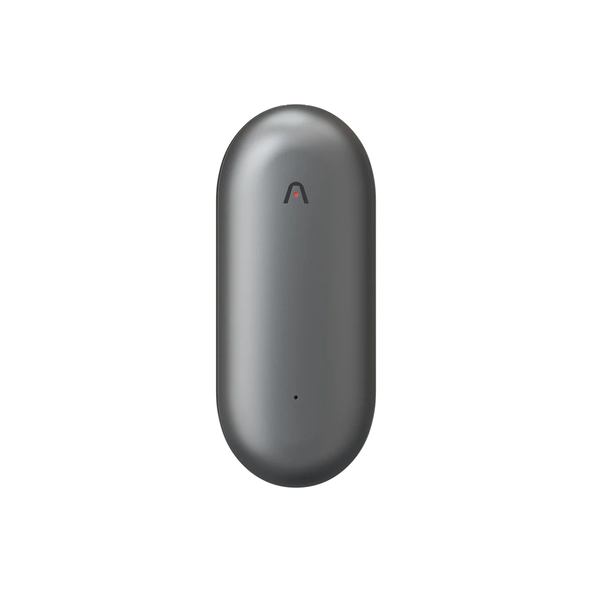
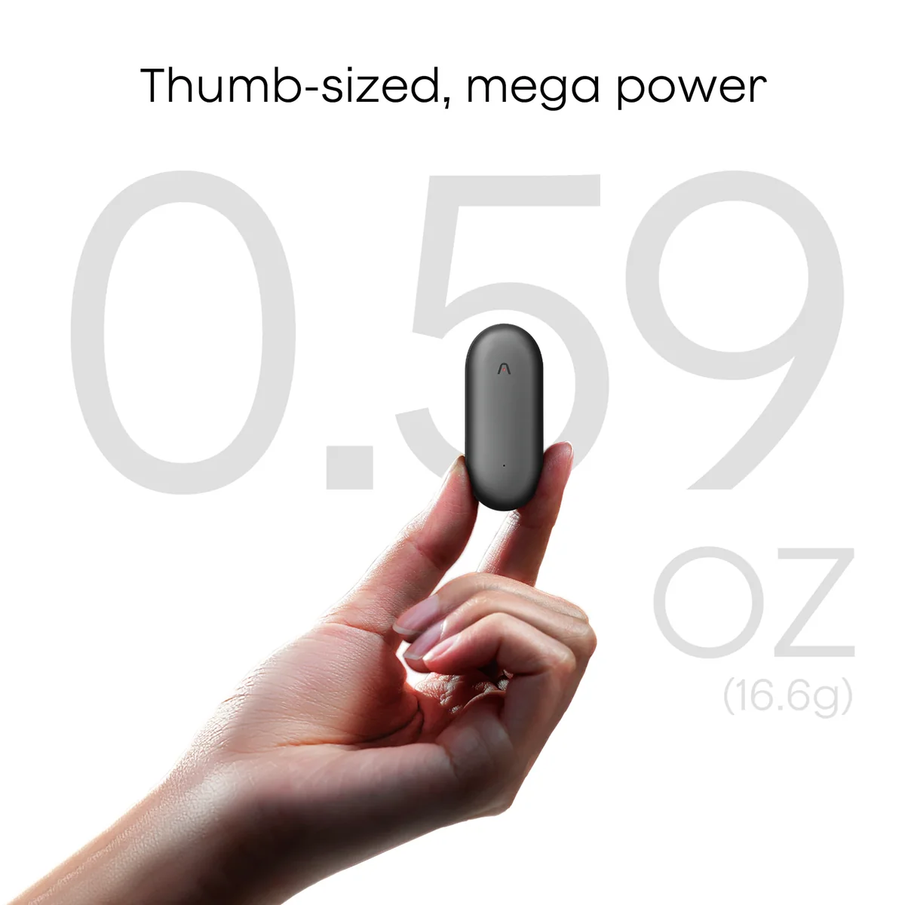
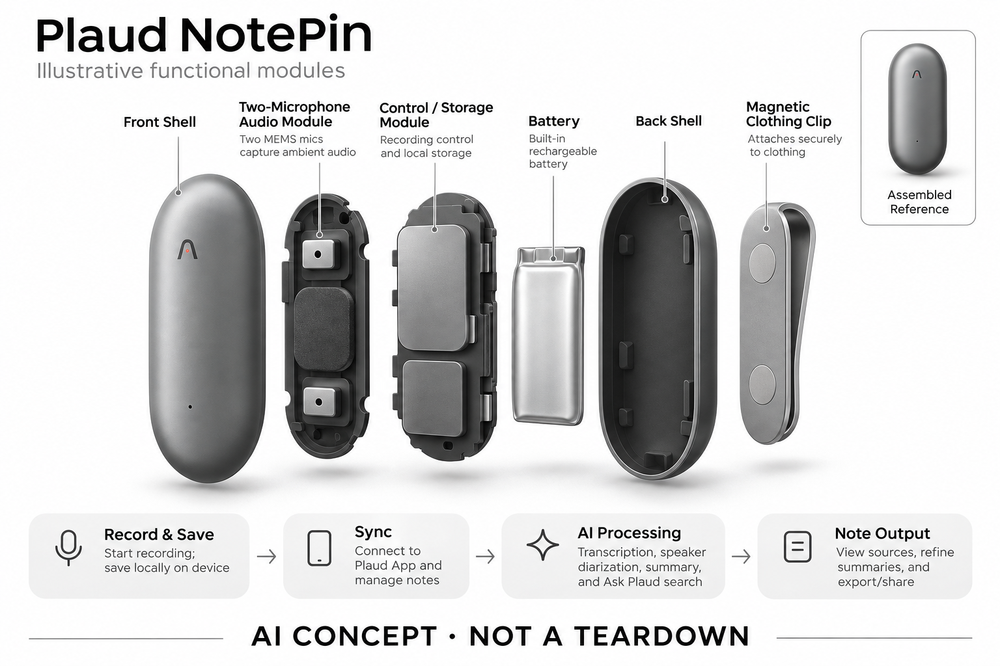

# Plaud NotePin

**Plaud** · 录音与记忆 · 核查 2026-11-04

面向走动交谈的可佩戴 AI 录音胶囊

消费渠道：个人零售。

## 产品图片与结构参考

### 产品图

官方 Plaud NotePin 胶囊录音器产品图 · 来源：[Plaud · 官方产品图片](<https://www.plaud.ai/products/plaud-notepin>) · [原始图片](<https://cdn.shopify.com/s/files/1/0918/0171/5051/files/plaud-notepin-gray-0225.webp?v=1774430287&width=1200>)

### 参考图

官方手持比例示意图，图中文字为厂商宣传 · 来源：[Plaud · 官方产品图片](<https://www.plaud.ai/products/plaud-notepin>) · [原始图片](<https://cdn.shopify.com/s/files/1/0918/0171/5051/files/plaud-notepin-weight-0225.webp?v=1774430287&width=1200>)

### AI 生成爆炸示意

**AI 生成 · 非实物拆机。** 内部为概念推断，不能作为元件布局、BOM 或维修依据。[生成提示词](../../content/hardware/prompts/plaud-notepin.txt)

> 外形依据核验参考图；内部位置、模块形状与装配关系仅作AI概念展示。

> 图片按源站提供格式保存，未裁切或改色；厂商渲染/场景示意不代表实机测试。

> 分析为基于公开资料的案头研究与 AI 辅助判断，未经用户访谈、销量审计或实物拆机。需求、画像、竞争冷门度、审美及商业机会均为研究假设，不是投资结论。

## 销售与购买

- 状态：在售。官方NotePin页面显示 US$159、Shop Now及通常1–2个工作日发货说明；与另列的NotePin S区分，不能把S款按钮或售价算入本款。

- 地区：美国/国际官网、其他地区依当地官方站点与结算确认

- 价格：US$159。核查时基础NotePin价格，含磁吸扣、夹子及基础300分钟/月转写额度；腕带等具体配件需查看所选套装。

- 中国大陆：未核实本型号大陆官方销售与服务承诺；本次价格和功能基于国际版NotePin，不等同其他地区版本。

- [官方产品 / 商店](<https://www.plaud.ai/products/plaud-notepin>)

## AI 的实际作用

现场语音转写、说话人区分、摘要与对记录的检索问答。

服务与联网依赖：需Plaud应用处理和管理笔记；可本地录音不等于离线生成摘要。官网明确本款没有电话振动传感器，不支持相应电话录音模式。

## 是否冷门

新兴竞争（研究判断）：佩戴式工作记录仍在探索稳定习惯，但已有多款直接竞品，不能把新形态等同低竞争。

## 需求与市场

需求假设：走动讲解、现场接待或随手口述时，固定佩戴比反复摆放手机更方便。价值取决于收音距离和启动动作是否稳定，不能因为设备一直带在身上就推断它会自动记录一切。

## 用户画像

画像推断：工作中频繁移动的顾问、讲解者、现场协调人员更匹配；主要做电话访谈的用户应比较Note系列。具体职业只是待验证情境，不能直接据官网行业案例推导该职业普遍需求。

## 竞争与替代

案头判断：与Omi、Bee、胸前麦克风和手机录音争夺现场采集任务。佩戴方式是差异，但摘要服务趋同；此处没有用户访谈、使用留存或销量证据，不能据小型外观称之为蓝海。

## 供应链

官方披露两颗MEMS和本地存储，佩戴配件涉及夹具与磁吸结构；实际工厂、麦克风厂商与良率不明。推断衣料摩擦、固定可靠性和充电触点寿命会影响长期体验及售后成本。

## 技术路径

官网明确没有电话振动传导传感器，因此不能用Note的电话录音能力描述NotePin。设备侧负责采集与保存，软件侧负责转写摘要；精准算法、模型供应商与部署边界未完整公开。

## 产品审美

图示观察：圆角胶囊比传统录音笔更像衣物配件，灰色与简洁表面有利于日常佩戴。不同衣料、夹放位置和挂绳会改变外观与收音；图片无法证明运动中不晃动或不会产生摩擦音。

## 关键风险

最容易误购的风险是把现场录音当成手机通话录音。佩戴位置、衣物遮挡和旁人知情也影响使用；磁性配件需遵守官方使用说明，转写与摘要中的金额、姓名等内容仍需人工复核。

## 机会与验证

市场差异在于把输入入口从手机背面移到身体，服务移动对话。尚待验证的是用户是否愿意每天佩戴、是否记得开启，以及佩戴录音相比手机能否明显提高可用记录的比例。

## 功能分层示意

这是功能关系，不是实物拆机、真实空间结构或已核实 BOM。

1. **现场拾音**：两颗MEMS采集现场声音；功能结构示意，非拆机图。（官方披露）

2. **录音与保存**：用户启动录音，设备本地存储；不包含电话振动拾音模式。（官方披露）

3. **同步层**：连接Plaud App并在网页等平台管理。（官方披露）

4. **AI处理**：转写、说话人标签、摘要、Ask Plaud检索。（官方披露）

5. **笔记输出**：查看来源、调整摘要并导出分享。（官方披露）

## 来源

1. [Plaud · NotePin 官方商店与FAQ](<https://www.plaud.ai/products/plaud-notepin>) — 已打开，FAQ明确无V.C.S、不支持电话录音；未引用NotePin S规格。

2. [Plaud · 官方设备比较](<https://www.plaud.ai/pages/plaud-device-comparison>) — 已打开，区分可佩戴采集与卡片双模式录音。

[返回目录](../hardware-market.md) · [网页分析](https://romanagent.github.io/Roman/#hardware/product/plaud-notepin)
