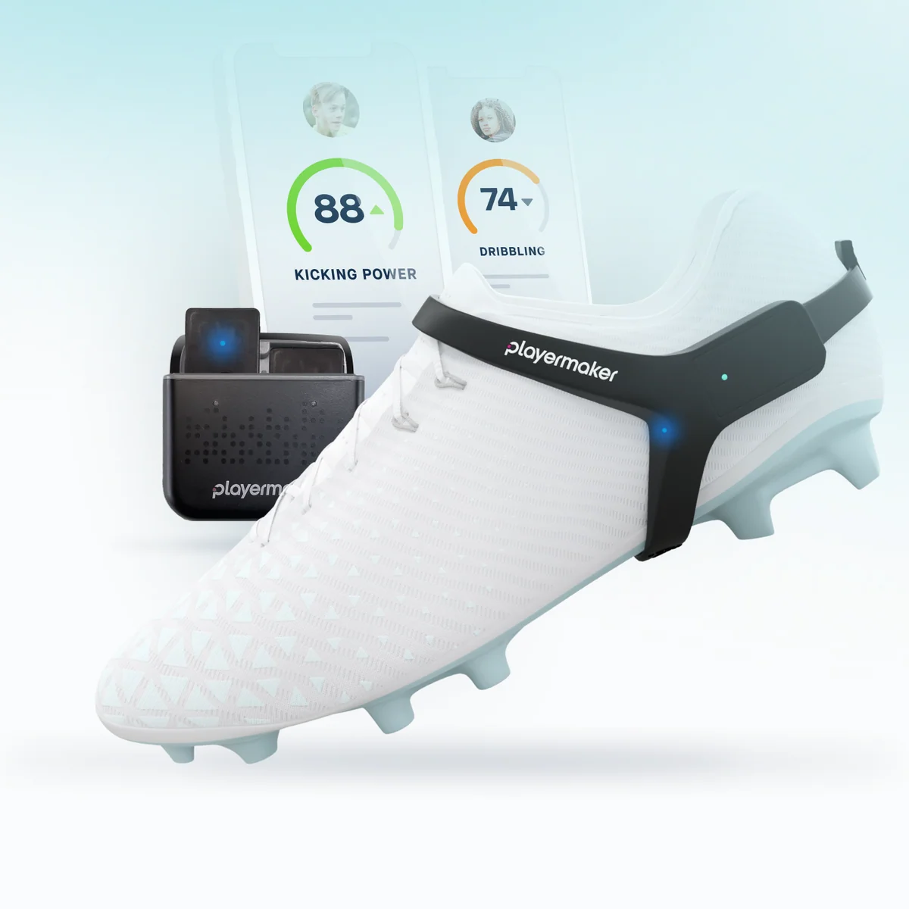
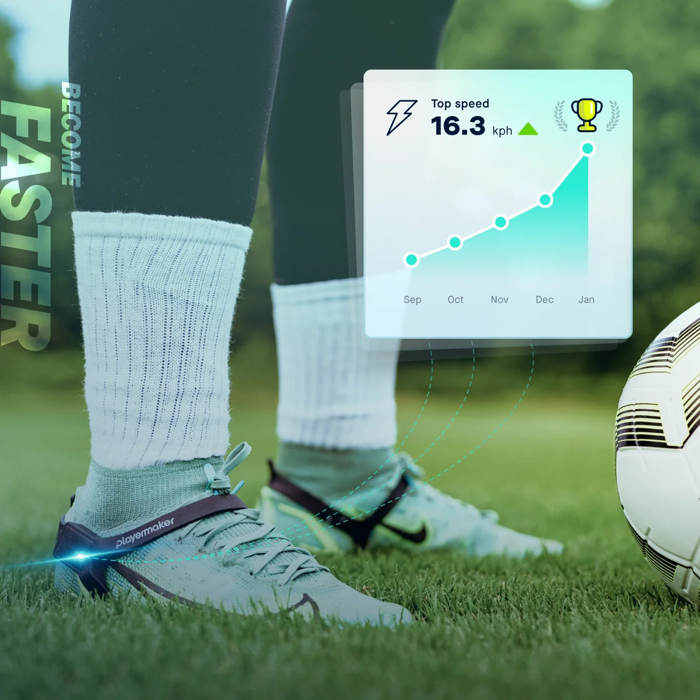
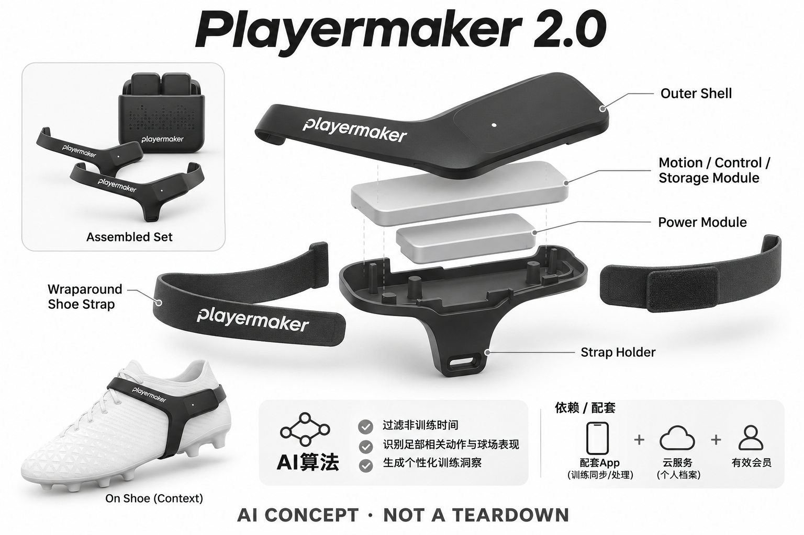

# Playermaker 2.0

**Playermaker** · 运动与训练 · 核查 2026-11-04

把双脚运动变成个人足球训练记录

消费渠道：个人零售。

## 产品图片与结构参考

### 产品图

Playermaker 2.0官方产品外形图 · 来源：[Playermaker · 官方产品图片](<https://www.playermaker.com/products/playermaker>) · [原始图片](<https://cdn.shopify.com/s/files/1/0418/6823/0811/files/Slide_1-desktop.png?v=1769151110&width=1200>)

### 参考图

Playermaker 2.0官方另一角度或使用场景参考 · 来源：[Playermaker · 官方产品图片](<https://www.playermaker.com/products/playermaker>) · [原始图片](<https://cdn.shopify.com/s/files/1/0418/6823/0811/files/Slide_2-desktop.png?v=1769151110&width=1200>)

### AI 生成爆炸示意

**AI 生成 · 非实物拆机。** 内部为概念推断，不能作为元件布局、BOM 或维修依据。[生成提示词](../../content/hardware/prompts/playermaker-2.txt)

> 外形依据核验参考图；内部位置、模块形状与装配关系仅作AI概念展示。

> 已逐张查看并核对型号。源图未改色/裁切；场景、界面、附件、优惠及效果文案仅为厂商示意，不作为本目录性能或现价依据。

> 分析为基于公开资料的案头研究与 AI 辅助判断，未经用户访谈、销量审计或实物拆机。需求、画像、竞争冷门度、审美及商业机会均为研究假设，不是投资结论。

## 销售与购买

- 状态：在售。官方个人产品页明确In stock、Worldwide shipping和购买Continue入口，列双脚传感器、绑带与充电盒；不是球队专用采购方案。

- 地区：国际官网支持配送地区（逐地址结算确认）

- 价格：US$199。所见套件含首年跟踪权益；官方FAQ列续费方案，具体费用与账号条件按结算。CITYPLAY使用同类硬件，不重复计数。

- 中国大陆：本次核实海外官方渠道，未确认同型号中国大陆官方销售、安装和完整软件服务。支持中文或品牌来自中国均不等同大陆可购买。

- [官方产品 / 商店](<https://www.playermaker.com/products/playermaker>)

## AI 的实际作用

AI算法过滤非训练时间、识别足部相关动作与球场表现，并生成个性化训练洞察。

服务与联网依赖：需配套App及有效会员进行新训练同步/处理；可先在传感器记录再接近手机同步，云服务与个人档案仍是依赖。

## 是否冷门

细分专业（研究判断）：依据用途与替代品的案头分类；不是销量、市场份额或用户访谈结论。

## 需求与市场

需求假设：个人足球训练缺少可持续的技术记录，脚部传感器能把触球与移动转成复盘线索。应验证这些线索是否可理解并指导下一次练习，而不是把指标越多视为球技改善越快。

## 用户画像

画像推断：规律训练的业余球员和有监护人参与的青少年家庭更匹配。年龄、位置与训练内容会改变数据意义；个人报告不应被当成选拔结论或证明某个孩子具备确定职业潜力。

## 竞争与替代

案头判断：与GPS背心、教练录像、手机分析和其他鞋部传感器竞争，属于足球专业细分。没有销量审计或访谈支撑需求规模；官方说明CITYPLAY主要是内容体验变化，因此不重复计算。

## 供应链

官网披露足部传感器、固定绑带和充电盒，具体惯性器件、主控与整机工厂未公开。推断可靠性集中在冲击、固定、左右配对与数据标定，不能由职业球队使用宣传推算制造标准。

## 技术路径

可核实AI包括过滤无关时间、动作分析和训练建议；数据来自足部运动而非球内传感器。不同指标属于算法估算，不能把每个统计都理解为直接测量，也不补写未公开模型和误差率。

## 产品审美

图示观察：传感器通过鞋外绑带佩戴，避免额外背心，但也改变鞋面外观和触球感受。实际固定稳定性与不同鞋型适配需试用，商品图片不能证明跑动与对抗中完全无感。

## 关键风险

风险包括绑带佩戴错误、设备损坏、会员失效导致无法记录新会话，以及对评分和排名的过度解读。涉及未成年人的训练数据需要由家庭合理管理，本研究未评估任何竞技提升效果。

## 机会与验证

市场差异是从脚部而非身体中心采集足球动作。尚待验证的购买理由是球员能否利用报告调整训练、教练是否愿意解释指标，以及佩戴和同步流程能否在日常练习中长期持续。

## 功能分层示意

这是功能关系，不是实物拆机、真实空间结构或已核实 BOM。

1. **双脚感知**：左右脚运动传感器记录动作，功能示意非拆机。（官方披露）

2. **本机会话**：离盒开始、入盒结束，保存训练会话。（官方披露）

3. **手机同步**：靠近手机后同步到App与个人账户。（官方披露）

4. **AI分析**：过滤无关时间并形成技术指标和训练建议。（官方披露）

5. **用户复盘**：App显示个人报告，使用者与教练解释数据。（官方披露）

## 来源

1. [Playermaker 2.0官方个人商店](<https://www.playermaker.com/products/playermaker>) — 已打开，明确在库与个人套件组成；未采用球队采购页面。

2. [Playermaker官方FAQ](<https://www.playermaker.com/pages/faq>) — 已打开，AI过滤、会员要求与CITYPLAY相同硬件路线均有说明。

[返回目录](../hardware-market.md) · [网页分析](https://romanagent.github.io/Roman/#hardware/product/playermaker-2)
