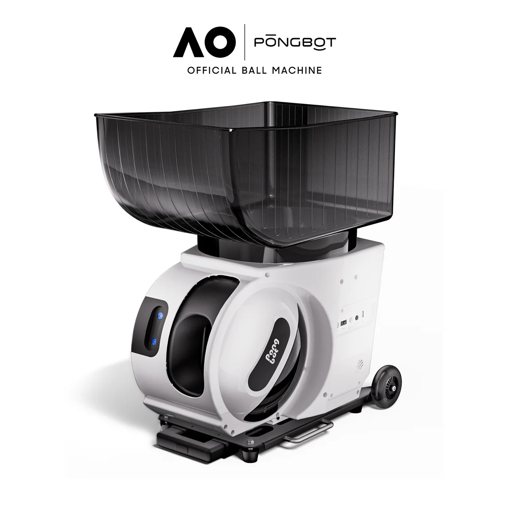
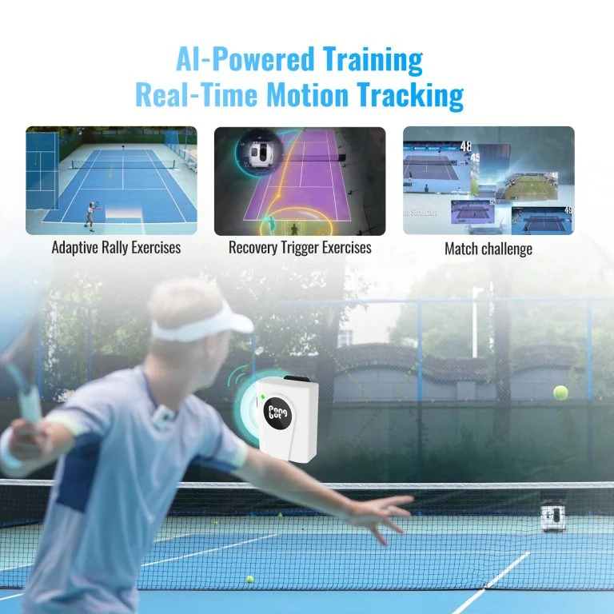
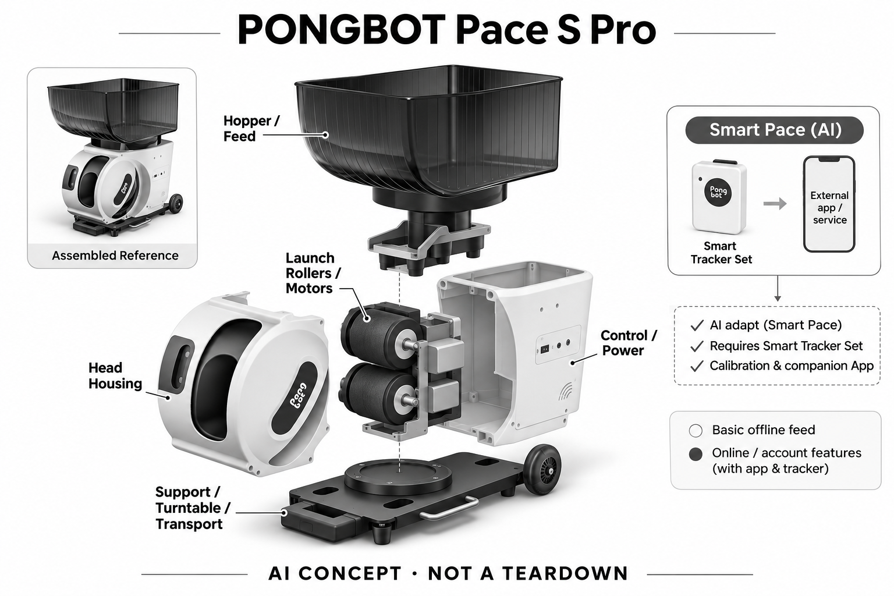

# PONGBOT Pace S Pro

**PONGBOT** · 运动与训练 · 核查 2026-11-04

根据球员位置变化调整出球策略的训练球机

消费渠道：个人零售。

## 产品图片与结构参考

### 产品图

PONGBOT Pace S Pro官方产品外形图 · 来源：[PONGBOT · 官方产品图片](<https://store.pongbotsports.com/products/pace-s-pro>) · [原始图片](<https://cdn.shopify.com/s/files/1/0773/9867/1613/files/sku-Pace_S_Pro_X_AO.png?v=1790597735&width=1200>)

### 参考图

PONGBOT Pace S Pro官方另一角度或使用场景参考 · 来源：[PONGBOT · 官方产品图片](<https://store.pongbotsports.com/products/pace-s-pro>) · [原始图片](<https://cdn.shopify.com/s/files/1/0773/9867/1613/files/1-3-768x768.jpg?v=1770373549&width=1200>)

### AI 生成爆炸示意

**AI 生成 · 非实物拆机。** 内部为概念推断，不能作为元件布局、BOM 或维修依据。[生成提示词](../../content/hardware/prompts/pongbot-pace-s-pro.txt)

> 外形依据核验参考图；内部位置、模块形状与装配关系仅作AI概念展示。

> 已逐张查看并核对型号。源图未改色/裁切；场景、界面、附件、优惠及效果文案仅为厂商示意，不作为本目录性能或现价依据。

> 分析为基于公开资料的案头研究与 AI 辅助判断，未经用户访谈、销量审计或实物拆机。需求、画像、竞争冷门度、审美及商业机会均为研究假设，不是投资结论。

## 销售与购买

- 状态：在售。官方具体Pace S Pro页明确In Stock and Ready to Ship、48小时内发货与Add to Cart；普通Pace S与附件包未另计。

- 地区：所列官方区域或授权零售渠道；配送地址与服务支持需结算确认

- 价格：核查日基本配置 US$1,219.99。核查日所见单机或基本配置价；币种、促销、税费、镜片、附件及服务依地区结算，不把颜色或套装重复计数。

- 中国大陆：本次未核实该具体型号在中国大陆的官方销售和完整服务支持；海外在售不等于国内可直接启用全部功能。

- [官方产品 / 商店](<https://store.pongbotsports.com/products/pace-s-pro>)

## AI 的实际作用

Smart Pace采用厂商自研AI算法，根据Smart Tracker的球员位置与移动轨迹调整落点和出球节奏

服务与联网依赖：高级自适应功能需要Smart Tracker Set、校准和配套App；手册区分基础离线出球与联网/账号功能，不假设仅有球机就具备所有跟踪能力

## 是否冷门

新兴竞争（研究判断）：按任务与形态作案头分类，无访谈、销量或市场份额证据。

## 需求与市场

需求假设：独自练球时希望机器在自己回位或移动后调整节奏，而不是持续固定间隔喂球。价值应由实际使用频率、任务完成与操作负担验证，不能把AI功能存在或演示流畅当作需求已得到满足。

### 需求假设：单人练球希望节奏跟着自己变化 · 研究判断

Pace S Pro的Smart Pace针对固定间隔发球不顾球员是否回位的问题，希望机器根据位置与移动调整下一次出球。需求应验证球员是否更容易完成原练习，而不是机器能否不断改变落点；随机变化和适应个人状态也不是同一个任务。

依据：[PONGBOT Pace S Pro官方商店](<https://store.pongbotsports.com/products/pace-s-pro>) · [PACE S系列厂家用户手册](<https://www.pong-bot.de/wp-content/uploads/2025/11/PACE-S-SERIES-User-Manual_V1.2.pdf>)

### 价值判断：更自动不一定更像有效陪练 · 研究判断

自动调整节奏可能减少走回机器的次数，但球员仍需选择练习目标、理解出球并收集散球，设备不能自动承担全部陪练角色。研究应观察哪些步骤被减少、哪些仍需人工，不能把位置反馈当成对击球质量或战术意图的完整理解。

依据：[PACE S系列厂家用户手册](<https://www.pong-bot.de/wp-content/uploads/2025/11/PACE-S-SERIES-User-Manual_V1.2.pdf>)

### 验证方案：比较固定与自适应练习 · 待验证

让规律球员用相同场地和练习目标分别尝试固定程序与Smart Pace，记录回位、等待、追球和人工调整。不要只看出球频率变化，应询问节奏是否符合练习意图，并保留不合适调整，避免在为演示而安排的路线中验证需求。

依据：[PONGBOT Pace S Pro官方商店](<https://store.pongbotsports.com/products/pace-s-pro>) · [PACE S系列厂家用户手册](<https://www.pong-bot.de/wp-content/uploads/2025/11/PACE-S-SERIES-User-Manual_V1.2.pdf>)

## 用户画像

画像推断：拥有稳定球场使用条件、愿意携带球机和穿戴定位器的业余进阶球员。个人的语言、操作习惯、环境和预算会改变适配结果，本次只有案头研究，没有用户访谈或长期使用观察。

### 画像假设：有稳定球场与搬运条件的球员 · 研究判断

较匹配者有规律个人练球需求，能获取合适球场并愿意搬运机器、球和定位配件。偶尔打球或主要依赖双人对练者可能更重视简单准备，画像应包含场地、交通与收纳，而不只是球技水平或对AI的兴趣。

依据：[PONGBOT Pace S Pro官方商店](<https://store.pongbotsports.com/products/pace-s-pro>) · [PACE S系列厂家用户手册](<https://www.pong-bot.de/wp-content/uploads/2025/11/PACE-S-SERIES-User-Manual_V1.2.pdf>)

### 使用约束：定位套件是完整体验的一部分 · 研究判断

高级自适应需要Smart Tracker套件与校准，球机本体可出球不代表所有位置功能可用。用户需要接受穿戴、配置和手机管理，研究应核对实际购买组合及操作能力，不能用基础机价格描述完整自适应方案，也不把套件当作无成本附件。

依据：[PONGBOT Pace S Pro官方商店](<https://store.pongbotsports.com/products/pace-s-pro>) · [PACE S系列厂家用户手册](<https://www.pong-bot.de/wp-content/uploads/2025/11/PACE-S-SERIES-User-Manual_V1.2.pdf>)

### 访谈重点：何时需要机器等待自己 · 待验证

请球员描述上次单人训练中哪些球来得太早、太晚或位置不合意，以及如何调整机器。再观察其是否愿意为减少这些情况佩戴定位器，按真实训练中断划分需求，比简单询问喜欢自动还是手动，更能说明产品价值。

依据：[PACE S系列厂家用户手册](<https://www.pong-bot.de/wp-content/uploads/2025/11/PACE-S-SERIES-User-Manual_V1.2.pdf>)

## 竞争与替代

案头判断：与固定程序球机、陪练和视觉球机竞争；传感定位路线与摄像机识别不同，不把预置随机出球称为机器学习。这只是用途与替代品比较，不是市场份额或销量结论；专业细分和较少曝光也不代表没有成熟竞争者。

### 替代方案：固定程序球机与真人陪练 · 研究判断

Pace S Pro面对预设或随机程序球机、教练和球友陪练，定位反馈是与部分方案不同的输入路线。比较应明确目标是连续击球、移动练习还是技术指导，不能把机器能跟随位置当作真人陪练的全部替代，也不将随机出球直接称为AI。

依据：[PONGBOT Pace S Pro官方商店](<https://store.pongbotsports.com/products/pace-s-pro>) · [PACE S系列厂家用户手册](<https://www.pong-bot.de/wp-content/uploads/2025/11/PACE-S-SERIES-User-Manual_V1.2.pdf>)

### 差异判断：穿戴定位与摄像识别各有代价 · 研究判断

位置套件不等于视觉理解整场击球，它可能减少某些摄像条件依赖，也增加佩戴和校准步骤。研究应比较真实流程，不预先断言哪种路线更精准；球员若不愿佩戴或常换场地，系统的新增准备成本可能抵消自动节奏收益。

依据：[PACE S系列厂家用户手册](<https://www.pong-bot.de/wp-content/uploads/2025/11/PACE-S-SERIES-User-Manual_V1.2.pdf>)

### 比较方法：按完成练习的总负担 · 待验证

在同一练习安排中记录装机、校准、发球、捡球、调整和收纳，比较自适应与现有方案的时间和偏好。不要只统计命中或出球数量，也不能由一次愉快练习推断进步，真正需要说明的是用户能否持续完成想练的任务。

依据：[PONGBOT Pace S Pro官方商店](<https://store.pongbotsports.com/products/pace-s-pro>) · [PACE S系列厂家用户手册](<https://www.pong-bot.de/wp-content/uploads/2025/11/PACE-S-SERIES-User-Manual_V1.2.pdf>)

## 供应链

公开资料可核对球斗、滚轮发球机构、转向/仰角执行机构、可拆电池和穿戴定位组件，具体整机工厂、关键模块供应商与BOM本次未确认。制造重点可从形态推断，但不能把品牌所在地、外观相似或营销合作等同代工关系。

### 功能拆分：发球机械与位置输入协同 · 研究判断

公开结构包括球斗、滚轮发球、转向与仰角执行、可拆电池和定位组件，Smart Pace位于感知到出球策略之间。不能从球机外观推断摄像头或未公开芯片，位置输入也不等于球内感知，功能示意仍不是原机拆解与物料表。

依据：[PONGBOT Pace S Pro官方商店](<https://store.pongbotsports.com/products/pace-s-pro>) · [PACE S系列厂家用户手册](<https://www.pong-bot.de/wp-content/uploads/2025/11/PACE-S-SERIES-User-Manual_V1.2.pdf>)

### 制造判断：球路和机械重复性影响反馈价值 · 研究判断

算法决定节奏之后，滚轮与角度机构仍需按预期出球，球状态、供球通路和电源也会影响结果。供应评估应同时检查出球一致性和定位校准，不只看算法名称，本轮没有实际磨损、堵球或机械寿命测试，不能据演示推断长期可靠。

依据：[PACE S系列厂家用户手册](<https://www.pong-bot.de/wp-content/uploads/2025/11/PACE-S-SERIES-User-Manual_V1.2.pdf>)

### 候选选型：运动与电源按发球任务确认 · 研究判断

Nidec可作为旋转执行的工程候选，DINGS可讨论转向或仰角所需定位路线，Grepow可研究可拆电池方案。实际转速、负载、冲击和控制接口必须专项确认，不能把通用电机直接换入球机，也没有任何一家被公开点名为该型号供应商。

依据：[PONGBOT Pace S Pro官方商店](<https://store.pongbotsports.com/products/pace-s-pro>) · [PACE S系列厂家用户手册](<https://www.pong-bot.de/wp-content/uploads/2025/11/PACE-S-SERIES-User-Manual_V1.2.pdf>)

## 技术路径

Smart Pace采用厂商自研AI算法，根据Smart Tracker的球员位置与移动轨迹调整落点和出球节奏。这是厂商披露的功能机制；模型版本、准确率及内部结构未完整公开。架构只表示输入、处理和输出关系，不作为真实拆机或性能实测。

### 已披露能力：位置和轨迹驱动Smart Pace · 官方资料

厂家手册明确Pro的Smart Tracker与Smart Pace算法，根据球员位置及移动调整落点和节奏，基础出球与高级功能有不同依赖。这里的AI依据是反馈驱动策略，不是普通定时或随机程序，也不表示机器能够评价全部击球动作与战术选择。

依据：[PACE S系列厂家用户手册](<https://www.pong-bot.de/wp-content/uploads/2025/11/PACE-S-SERIES-User-Manual_V1.2.pdf>)

### 技术判断：位置准确仍需符合练习意图 · 研究判断

球员移动到某个位置不一定表示准备好接下一球，也可能在捡球或调整装备，位置与训练状态不能简单等同。研究应观察策略是否可理解、何时需要暂停或接管，不能只用定位轨迹平滑说明训练合适，也不推断未披露模型如何判断意图。

依据：[PACE S系列厂家用户手册](<https://www.pong-bot.de/wp-content/uploads/2025/11/PACE-S-SERIES-User-Manual_V1.2.pdf>)

### 验证方案：分开测定位与实际出球 · 待验证

在支持条件下记录定位状态、系统选择和实际出球，再比较球员原本希望的节奏，区分输入、策略与机械执行。每次只改变一个训练条件，不超出厂商允许范围，保留失败记录；本轮没有实测定位精度、落点误差或训练效果。

依据：[PACE S系列厂家用户手册](<https://www.pong-bot.de/wp-content/uploads/2025/11/PACE-S-SERIES-User-Manual_V1.2.pdf>)

## 产品审美

图示观察：箱式球机上方突出球斗，轮子和提手优先服务球场搬运而非家庭装饰。宣传图片只能帮助理解外观和摆放方式，不能证明每个人的舒适度、长时使用体验或实际材料触感。

### 外形判断：搬运工具属性明显 · 研究判断

箱体、球斗、轮子和提手服务球场搬运，真实体验还包括电池、球和穿戴套件一起携带。照片中的紧凑不能说明上下台阶、放入车辆或穿过场地是否方便，审美应连接到准备和收纳，而不是只看机身是否像专业运动设备。

依据：[PONGBOT Pace S Pro官方商店](<https://store.pongbotsports.com/products/pace-s-pro>) · [PACE S系列厂家用户手册](<https://www.pong-bot.de/wp-content/uploads/2025/11/PACE-S-SERIES-User-Manual_V1.2.pdf>)

### 交互判断：场上应能清楚停止与切换 · 研究判断

球员离机器较远时，需要理解当前模式与定位状态，并在不合适时容易停止或调整。应用和穿戴配件的反馈应服务场上使用，不能把手机功能丰富视为便利，若每次修改都需要中断训练和走回设备，自动化价值会被削弱。

依据：[PACE S系列厂家用户手册](<https://www.pong-bot.de/wp-content/uploads/2025/11/PACE-S-SERIES-User-Manual_V1.2.pdf>)

### 体验验证：完成一次独自出门练球 · 待验证

让用户从存放处装车、到场布置、校准、训练、收球到返家完整操作，记录需要额外帮助的环节。访谈时讨论下一次是否愿意重复，而不只在设备已经放好且校准完的球场体验，搬运和维护是这类产品的重要真实成本。

依据：[PONGBOT Pace S Pro官方商店](<https://store.pongbotsports.com/products/pace-s-pro>) · [PACE S系列厂家用户手册](<https://www.pong-bot.de/wp-content/uploads/2025/11/PACE-S-SERIES-User-Manual_V1.2.pdf>)

## 关键风险

出球速度、球场清空、供球堵塞与定位误差都需按说明处理；训练建议不保证进步或防止受伤。还需核对地区功能、软件更新与售后边界；本目录未进行实机、医学或可靠性测试，不把厂商演示当作结果保证。

### 使用风险：出球与场地要求仍需人工管理 · 研究判断

出球速度、方向、场地清空和供球堵塞应按说明处理，AI节奏不能保证球员准备充分或避免受伤。定位误差也可能改变策略，用户需要明确接管路径，本轮没有实机与安全验证，不将自适应描述为可在任何环境无人管理。

依据：[PACE S系列厂家用户手册](<https://www.pong-bot.de/wp-content/uploads/2025/11/PACE-S-SERIES-User-Manual_V1.2.pdf>)

### 配置风险：没有套件不等于完整自适应 · 研究判断

Smart Tracker、校准与应用属于高级功能条件，购买者需要核对套餐和当前软件权益，基础离线出球不能替代全部功能。可拆电池、运输与维护也影响总成本，官网商店可购不代表所有地区交付和售后相同，本轮未取得完整地区合同。

依据：[PONGBOT Pace S Pro官方商店](<https://store.pongbotsports.com/products/pace-s-pro>) · [PONGBOT官方支持中心](<https://store.pongbotsports.com/pages/support>) · [PACE S系列厂家用户手册](<https://www.pong-bot.de/wp-content/uploads/2025/11/PACE-S-SERIES-User-Manual_V1.2.pdf>)

### 验证安排：记录暂停与误调节原因 · 待验证

试用应记录定位失效、策略不合意、球路异常或用户主动关闭自适应的情形，区分机械、输入与练习目标。不要只收集连续顺畅发球片段，也不把不喜欢自动模式归因于球员水平，用户控制感本身是需要观察的结果。

依据：[PACE S系列厂家用户手册](<https://www.pong-bot.de/wp-content/uploads/2025/11/PACE-S-SERIES-User-Manual_V1.2.pdf>)

## 机会与验证

市场差异主要在于根据球员位置变化调整出球策略的训练球机。值得进一步验证的购买理由是它能否减少既有任务中的具体步骤，以及硬件、服务与维护的总成本是否符合个人使用频率。

### 研究方向：让反馈节奏更符合练习目标 · 研究判断

Pace S Pro提供了研究球员位置与发球策略之间关系的样本，机会可能在更清楚的模式、校准和暂停流程。应先确认用户何时希望机器等待或变化，而不是继续增加随机程序，也不把位置感知等同完整智能教练。

依据：[PACE S系列厂家用户手册](<https://www.pong-bot.de/wp-content/uploads/2025/11/PACE-S-SERIES-User-Manual_V1.2.pdf>)

### 执行计划：跟踪固定场地与换场地用户 · 待验证

观察多次真实练习中搬运、校准、自适应启用和人工调整，比较固定场地与经常换场地的人所承担的成本。访谈围绕一次不合意出球追问原因，记录重复任务收益，不用短期击球成绩或厂商演示推断训练效果与长期付费。

依据：[PONGBOT Pace S Pro官方商店](<https://store.pongbotsports.com/products/pace-s-pro>) · [PACE S系列厂家用户手册](<https://www.pong-bot.de/wp-content/uploads/2025/11/PACE-S-SERIES-User-Manual_V1.2.pdf>)

### 决策边界：专业球机也有成熟替代 · 研究判断

自适应输入形成具体差异，但球机、陪练和训练计划都已有替代，冷门曝光不代表容易获取客户。候选供应商只能说明执行与供电路线，本轮没有访谈、销量或成本报价，不以功能分数、训练分数或样本少判断创业成功。

依据：[PONGBOT Pace S Pro官方商店](<https://store.pongbotsports.com/products/pace-s-pro>) · [PACE S系列厂家用户手册](<https://www.pong-bot.de/wp-content/uploads/2025/11/PACE-S-SERIES-User-Manual_V1.2.pdf>)

## 对应供应链公司

能力候选用于选型研究，不代表本产品实际采用；未公开的供货关系不作推断。

- [nidec](../supply-chain/nidec.md) — **能力候选 · 非已采用** / 滚轮发球旋转执行工程候选：Nidec公开多类型电机研发制造能力，可作为Pace S Pro滚轮发球执行层候选，但实际转速、持续负载、控制和热要求须专项确认，不能用相机云台电机规格套用。当前无本型号点名供货证据，具体料号还需审核质量与变更记录。

- [dings-motion](../supply-chain/dings-motion.md) — **能力候选 · 非已采用** / 转向与仰角定位机构备选：DINGS公开旋转和线性定位方案，可用于讨论Pace S Pro角度机构的执行路线，但需先确认实际运动结构、行程和负载，不能把所有角度机构假设成丝杆。该关联不表示原机采用DINGS，也不涵盖Smart Pace算法或定位套件。

- [grepow](../supply-chain/grepow.md) — **能力候选 · 非已采用** / 可拆球机电池系统候选：Grepow公开高倍率及定制电池路线，与Pace S Pro滚轮和角度机构的可拆供电任务有关，仍需验证实际负载、保护、外壳与连接。候选关系不构成原机电池来源或兼容替换建议，也不保证任何现有航模电池可用于该球机。

[浏览供应链目录](../supply-chain.md)

## 功能分层示意

这是功能关系，不是实物拆机、真实空间结构或已核实 BOM。

1. **实体输入**：球斗、滚轮发球机构、转向/仰角执行机构、可拆电池和穿戴定位组件；仅功能层示意，非拆机。（官方披露）

2. **采集与控制**：设备把输入转为可处理的信息并接收用户操作；具体内部布局未知。（分析推断）

3. **AI功能**：Smart Pace采用厂商自研AI算法，根据Smart Tracker的球员位置与移动轨迹调整落点和出球节奏（官方披露）

4. **服务依赖**：高级自适应功能需要Smart Tracker Set、校准和配套App；手册区分基础离线出球与联网/账号功能，不假设仅有球机就具备所有跟踪能力（官方披露）

5. **用户反馈**：用户通过声音、屏幕或配套应用接收结果，并对重要信息复核。（分析推断）

## 来源

1. [PONGBOT Pace S Pro官方商店](<https://store.pongbotsports.com/products/pace-s-pro>) — 已打开一手页面；产品能力为厂商披露，未进行实机或效果验证。

2. [PONGBOT官方支持中心](<https://store.pongbotsports.com/pages/support>) — 已打开一手页面；产品能力为厂商披露，未进行实机或效果验证。

3. [PACE S系列厂家用户手册](<https://www.pong-bot.de/wp-content/uploads/2025/11/PACE-S-SERIES-User-Manual_V1.2.pdf>) — 已打开完整厂家手册，明确Pro独有Smart Tracker、位置反馈和Smart Pace AI算法。

[返回目录](../hardware-market.md) · [网页分析](https://romanagent.github.io/Roman/#hardware/product/pongbot-pace-s-pro)
