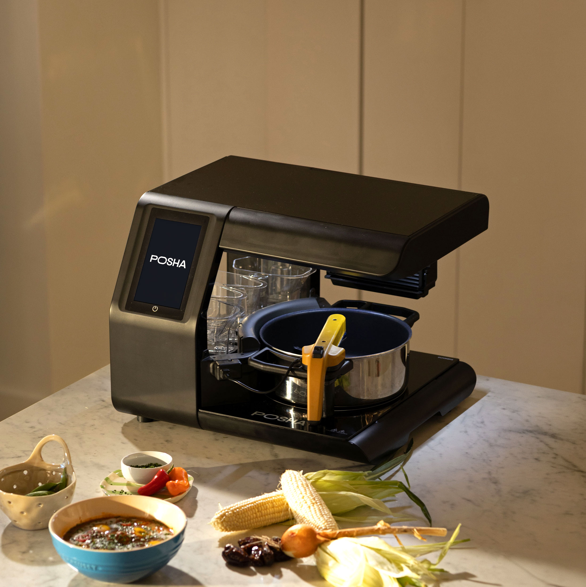
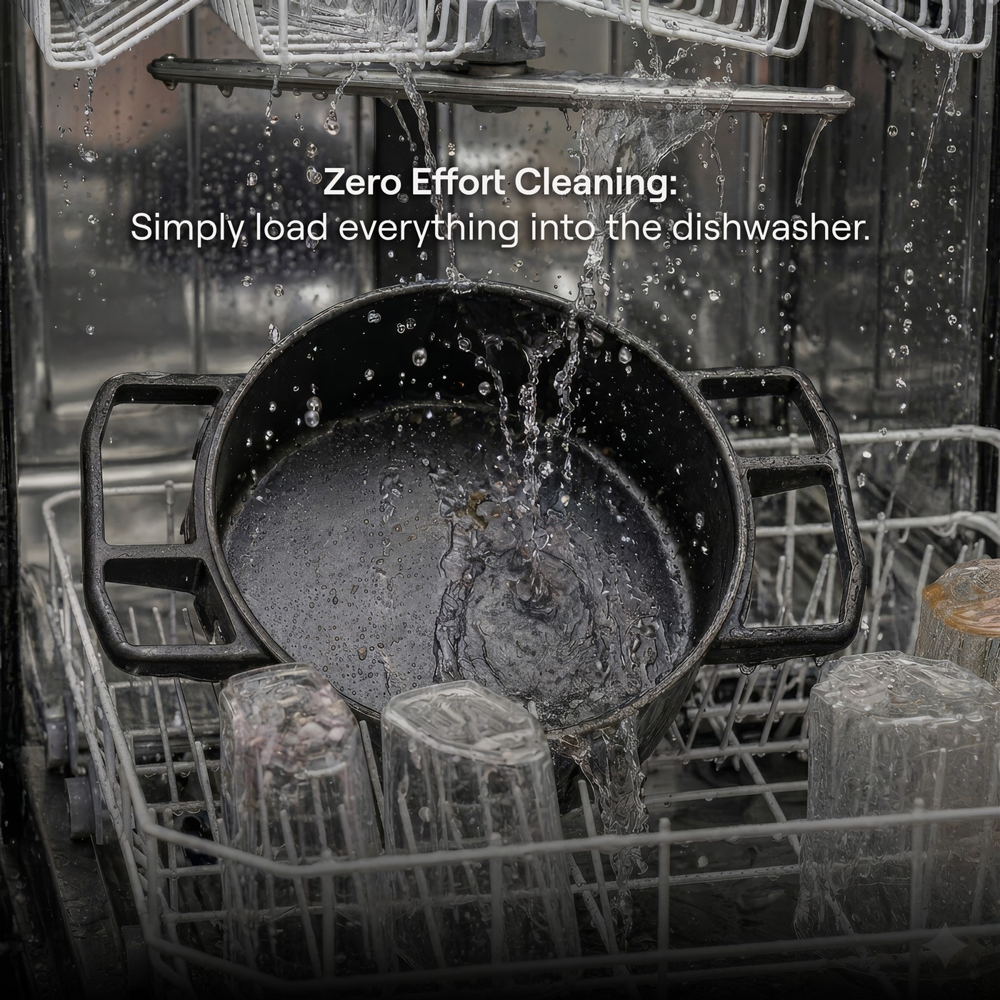
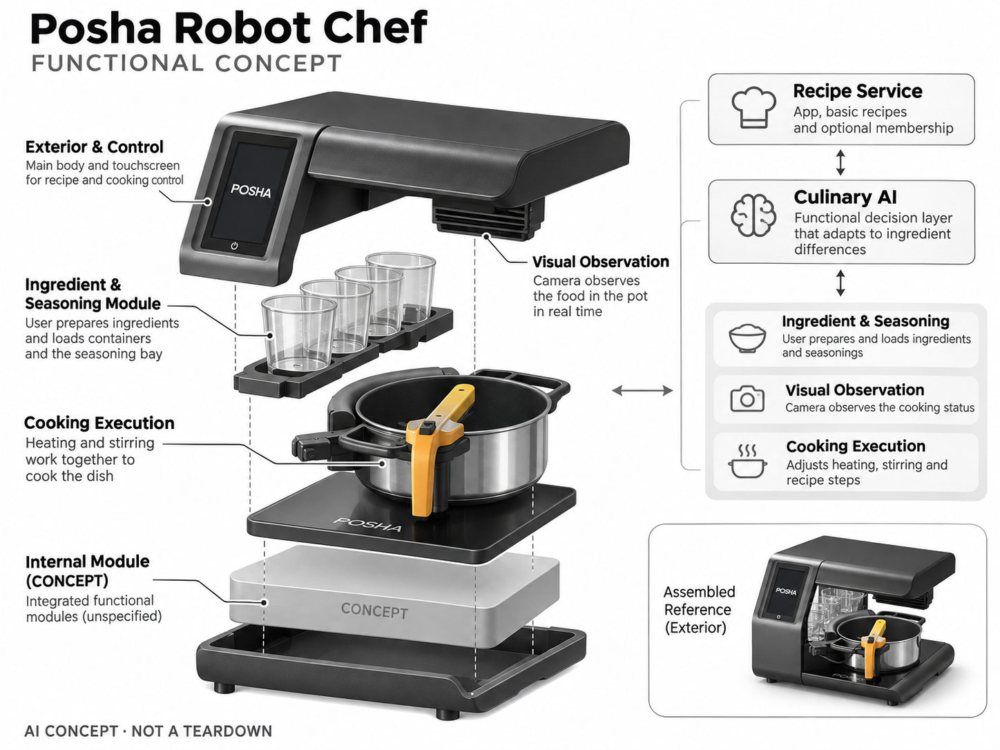

# Posha Robot Chef

**Posha** · 厨房与烹饪 · 核查 2026-11-04

用视觉反馈控制家庭一锅烹饪的台面机器人

消费渠道：消费预订。

## 产品图片与结构参考

### 产品图

Posha Robot Chef 官方产品图 · 来源：[Posha · 官方图片](<https://www.posha.com/private-chef>) · [原始图片](<https://cdn.posha.com/pre-order%20page/main%20slider/1-posha%20product%20shot.jpg>)

### 参考图

Posha Robot Chef 官方外观、结构或使用参考 · 来源：[Posha · 官方图片](<https://www.posha.com/private-chef>) · [原始图片](<https://cdn.posha.com/pre-order%20page/main%20slider/2-posha%20cleaning.jpg>)

### AI 生成爆炸示意

**AI 生成 · 非实物拆机。** 内部为概念推断，不能作为元件布局、BOM 或维修依据。[生成提示词](../../content/hardware/prompts/posha-robot-chef.txt)

> 保留官方图片原始内容和出处；画面宣传参数不是本轮独立实测。

> 分析为基于公开资料的案头研究与 AI 辅助判断，未经用户访谈、销量审计或实物拆机。需求、画像、竞争冷门度、审美及商业机会均为研究假设，不是投资结论。

## 销售与购买

- 状态：预售 / 接受延期订单。官方接受US$25可退预订，余款发货时支付；核查页面写新订单等待6—8个月、下一批May 2027，按预售收录。

- 地区：美国预订

- 价格：US$1,500限时整机价；US$25预订定金。核查时官方地区参考价，保留原币种；订阅、税运、附件及优惠以结账为准，预订定金不等于整机价格。

- 中国大陆：本轮核实所列海外官方渠道；中国大陆同型号现货、保修及服务可用性未确认。进口前需核对供电、网络、配件和地区条款。

- [官方产品 / 商店](<https://www.posha.com/private-chef>)

## AI 的实际作用

Culinary AI通过相机观察锅中食物状态，调整加热、搅拌及配方执行；用户先处理并装好原料，不是自动采购和切菜机器人。

服务与联网依赖：需App与可用食谱；整机含基础食谱，无限食谱Circle会员页面为US$14.95/月，备料和清洗仍由用户负责。

## 是否冷门

细分专业（研究判断）：家庭自动一锅烹饪较少见但存在料理机和外卖强替代，硬件与菜谱适配构成交付门槛。

## 需求与市场

需求假设：忙碌家庭愿意保留自己选食材的控制感，同时减少守锅和翻炒时间。应把切配、装盒、洗锅与收纳一起计时，只有完整做饭流程节省劳动，才可能替代外卖或传统锅具。

## 用户画像

画像推断：美国有足够台面空间、经常在家吃饭且接受固定食谱体系的家庭，可能重视个性化口味。高频炒菜和多菜同时出锅的用户需求不同，不能把所有不爱做饭的人视为目标。

## 竞争与替代

竞争判断：与Nosh、智能料理机、普通电锅和备餐服务竞争。视觉闭环和自动投料是具体区别，但菜式适配、清洗及交付等待同样重要；机器人外观并不能直接形成稳定的订阅意愿。

## 供应链

供应链分析：食物容器、调味仓、搅拌臂、加热面、相机和食品接触件协同工作，具体工厂和BOM未披露。耐油污、过热保护、清洁拆装和长期耗材供应比原型演示更决定量产质量。

## 技术路径

官方说明用摄像头观察锅中变化并适应备料差异。技术判断：水汽遮挡、食物颜色和原料份量会影响视觉，应设计低置信处置；观察食物状态不等于能保证任意自创配方安全熟透。

## 产品审美

审美判断：台面机器人必须与厨房长期共存，锅与配料盒的摆放、擦拭死角和开盖空间影响真实体验。简洁外观可以降低机器感，但不能牺牲对热区、运动部件与清洁步骤的清晰提示。

## 关键风险

风险判断：当前新订单等待数月，预订不是即买即用；页面食谱会员费用需与硬件分开评估。食品过敏、原料存放和烹饪完成检查仍需用户负责，AI不能代替日常食品安全判断。

## 机会与验证

机会假设：先验证一个家庭每周重复做的少数菜式，比较守锅分钟、清洗时间和愿意复做的比例。若真实需求是省备料，单纯加深视觉控制未必足够，应把食材准备服务作为对照。

## 功能分层示意

这是功能关系，不是实物拆机、真实空间结构或已核实 BOM。

1. **食材调味**：用户备料后装入容器和调味仓。（官方披露）

2. **视觉观察**：相机观察锅中烹饪状态。（官方披露）

3. **烹饪执行**：加热与搅拌配合。（官方披露）

4. **Culinary AI**：适配原料差异的功能决策层。（官方披露）

5. **食谱服务**：App、基础食谱及可选会员。（官方披露）

## 来源

1. [Posha Robot Chef 官方购买页](<https://www.posha.com/private-chef>) — 实际打开核查当前购买或预订入口，未实际下单；价格与交付按具体地区。

2. [Posha 官方使用与清洁说明](<https://www.posha.com/how-posha-works>) — 实际打开的官方技术与使用资料，宣传效果并非本轮独立实测。

[返回目录](../hardware-market.md) · [网页分析](https://romanagent.github.io/Roman/#hardware/product/posha-robot-chef)
