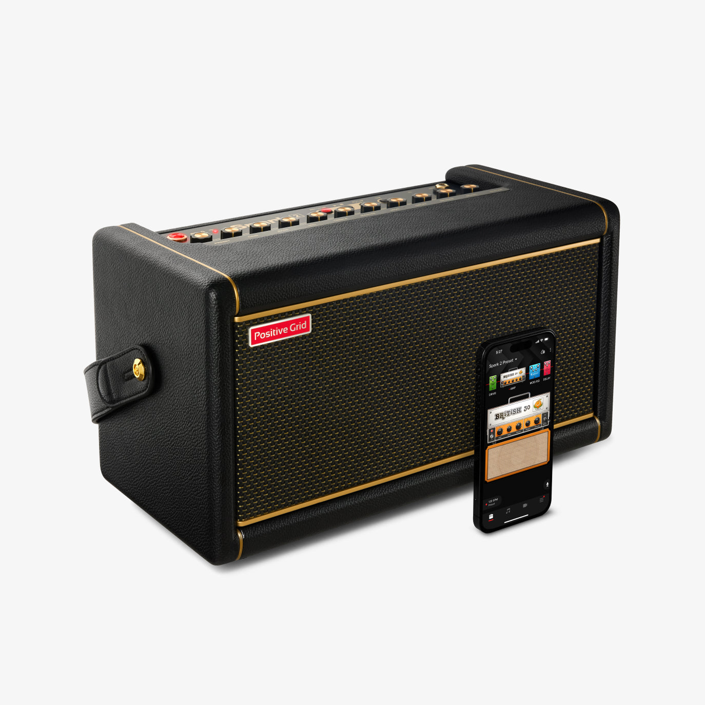
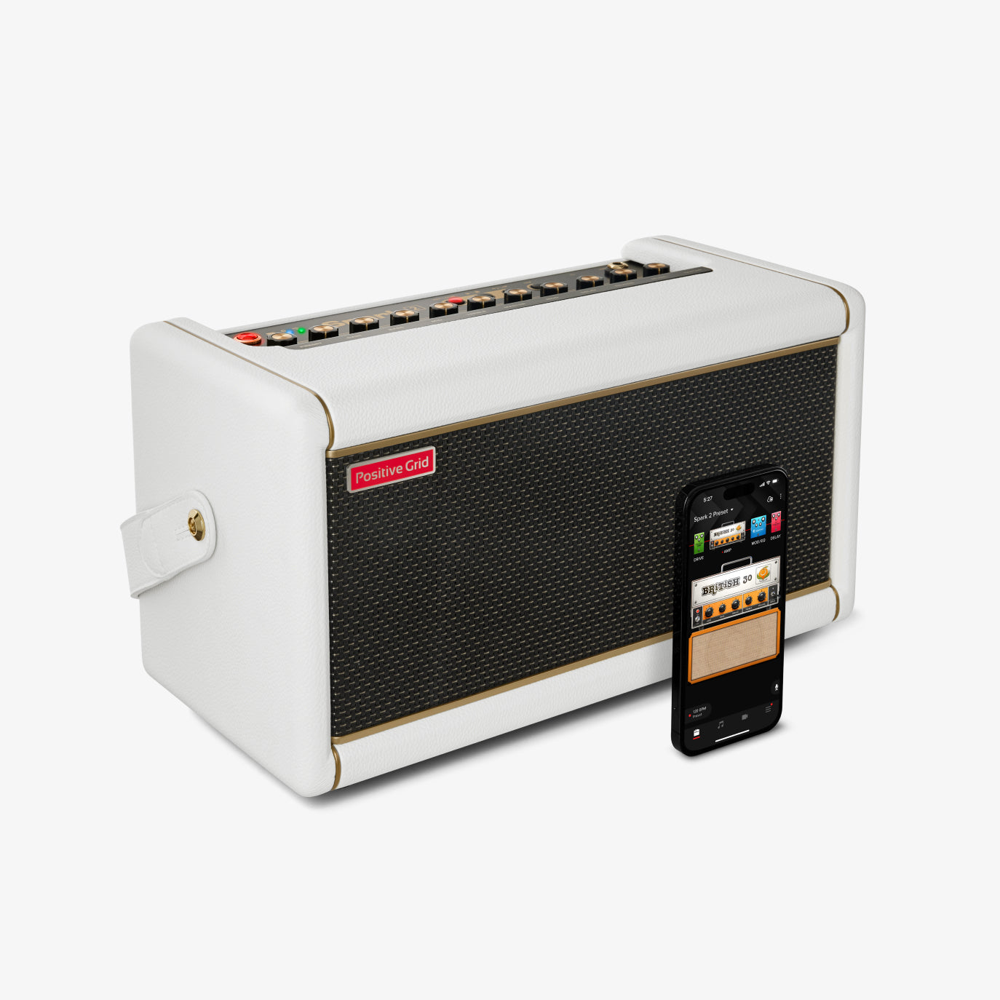
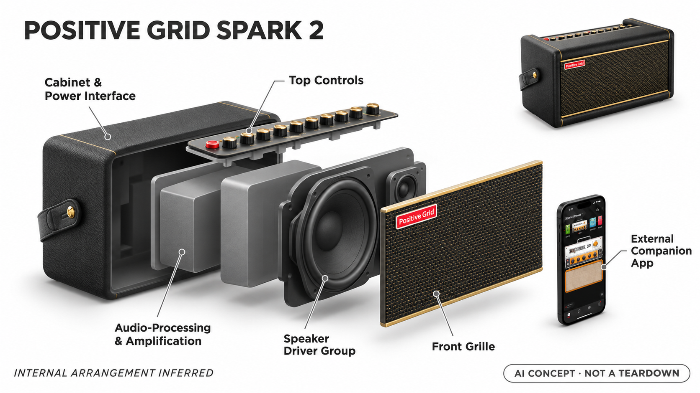

# Positive Grid Spark 2

**Positive Grid** · 音乐与乐器 · 核查 2026-11-04

将文字音色描述与居家练琴音箱连接

消费渠道：个人零售。

## 产品图片与结构参考

### 产品图

Positive Grid Spark 2 · 官方产品图 · 来源：[Positive Grid · 官方图片](<https://www.positivegrid.com/products/spark-2>) · [原始图片](<https://cdn.shopify.com/s/files/1/1094/6716/files/2_ab40273d-69a0-40d8-964a-28aaf734dad2_1.jpg?v=1726176703>)

### 参考图

Positive Grid Spark 2 · 官方参考图 · 来源：[Positive Grid · 官方图片](<https://www.positivegrid.com/products/spark-2>) · [原始图片](<https://cdn.shopify.com/s/files/1/1094/6716/files/02_8a1a37a9-f36b-4a92-bfd5-caf478196b53_1.jpg?v=1726176703>)

### AI 生成爆炸示意

**AI 生成 · 非实物拆机。** 内部为概念推断，不能作为元件布局、BOM 或维修依据。[生成提示词](../../content/hardware/prompts/positive-grid-spark-2.txt)

> 已目视核对外形、标签与非拆机声明；不代表内部结构经实测验证。

> 主图与参考图为同款不同颜色，不作为两个产品计数。

> 分析为基于公开资料的案头研究与 AI 辅助判断，未经用户访谈、销量审计或实物拆机。需求、画像、竞争冷门度、审美及商业机会均为研究假设，不是投资结论。

## 销售与购买

- 状态：在售。官方商品页列价格和配送；页面结构化商品数据将标准款标为InStock。核查的是标准Spark 2，不重复计颜色或翻新款。

- 地区：美国官网

- 价格：标准款官网 US$244。所见促销快照；颜色、翻新SKU、税费及配送不同，按当前结算确认。

- 中国大陆：本轮核实所列区域官方商店；未确认中国大陆官方现货、账户及完整服务，不把境外可购等同大陆可用。

- [官方产品 / 商店](<https://www.positivegrid.com/products/spark-2>)

## AI 的实际作用

Spark App可按文字描述匹配音色，并以Smart Jam分析演奏提供伴奏；不是将普通音箱放大或每种DSP效果都称为AI。

服务与联网依赖：智能音色与伴奏功能依赖兼容手机、Spark App及账户，音箱本地音效播放与云端匹配应分开理解。

## 是否冷门

竞争密集（研究判断）：居家练琴设备竞争充分，语言音色匹配是流程差异。

## 需求与市场

需求假设：家中练琴者希望更快找到某首歌的感觉，减少反复调旋钮的时间。应比较从描述到愿意保留的音色需要几轮修改，并观察智能伴奏是否增加真实练习时长，而不是只看首次演示。

## 用户画像

画像推断：已有电吉他、在居家空间练习且愿意配合手机操作的人较匹配。对专业现场音量或完全脱离应用的要求应另行评估，初学者还需要能理解音量、增益和听力保护的基本使用方式。

## 竞争与替代

竞争判断：居家数字练琴音箱已有多品牌，手机音效软件加音频接口也能替代部分功能。此款的差异是音箱、手机音色匹配与伴奏流程连贯，不代表接入自然语言后就形成没有竞争的新品类。

## 供应链

供应链推断：扬声器、音频转换、功放、旋钮和外壳需要共同控制底噪与一致性。官方本轮未披露整机工厂及完整物料清单；可选电池、固件维护和应用支持也属于长期交付的一部分。

## 技术路径

官方说明文字音色匹配和跟随演奏的伴奏能力。技术判断应将语言匹配、伴奏分析和本地音效处理分开测试；匹配到一个社区预设与生成全新音频不是同一件事，不能混用宣传术语。

## 产品审美

审美判断：传统音箱比例和织物面网适合放在居家书桌或乐器角，实体旋钮保留直觉操作。手机仍是部分功能入口，线缆、摆位和通知干扰会影响整体体验，不能只凭产品照片评估便利性。

## 关键风险

风险判断：云端匹配、账户或应用变化可能影响智能功能，演奏录音还需注意个人内容的处理方式。预设之间音量和增益可能不同，应人工试听；官方音色形容不构成对音质或学习效果的保证。

## 机会与验证

市场观察：它更适合与现有练琴流程比较，而非按模型名称排列高低。后续验证可记录每次找音色的耗时、修改次数和实际练习频率，确定智能功能是否解决了经常发生的问题。

## 功能分层示意

这是功能关系，不是实物拆机、真实空间结构或已核实 BOM。

1. **演奏输入**：吉他信号进入音箱与练习流程。（官方披露）

2. **智能应用**：文字音色匹配和Smart Jam在Spark应用中呈现。（官方披露）

3. **本地声音处理**：已选音色与效果由音箱音频系统播放。（官方披露）

4. **声学反馈**：扬声器和实体控制形成练琴反馈。（官方披露）

## 来源

1. [Spark 2官方商店](<https://www.positivegrid.com/products/spark-2>) — 已打开；结构化商品Offer为InStock。

2. [Spark App官方能力](<https://www.positivegrid.com/pages/spark-app>) — 已打开，说明文字匹配音色与Smart Jam，不声称全部端侧运行。

[返回目录](../hardware-market.md) · [网页分析](https://romanagent.github.io/Roman/#hardware/product/positive-grid-spark-2)
