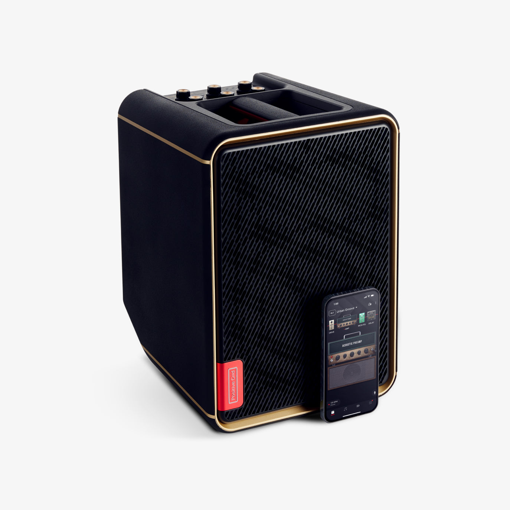
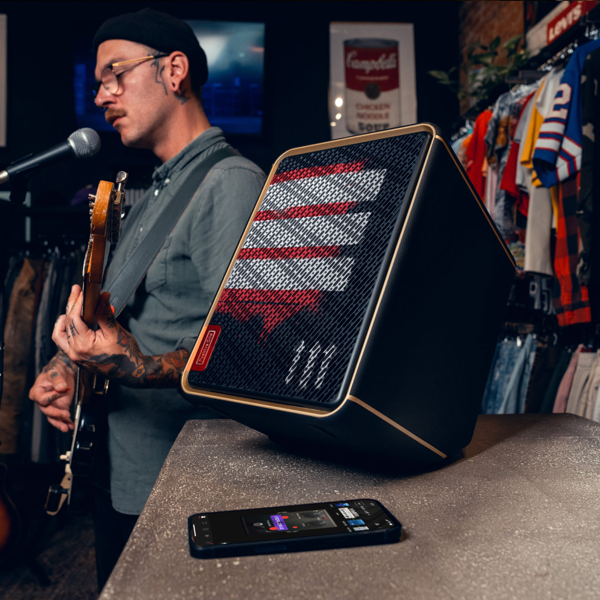
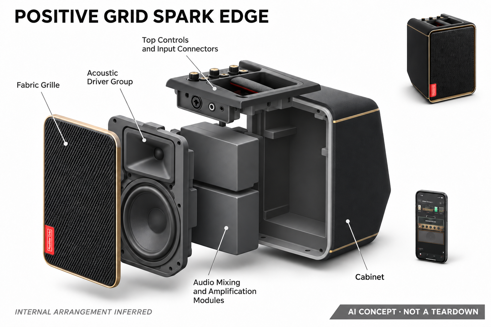

# Positive Grid Spark EDGE

**Positive Grid** · 音乐与乐器 · 核查 2026-11-04

面向街头与小型演出的AI音色扩声设备

消费渠道：个人零售。

## 产品图片与结构参考

### 产品图

Positive Grid Spark EDGE · 官方产品图 · 来源：[Positive Grid · 官方图片](<https://www.positivegrid.com/products/spark-edge>) · [原始图片](<https://cdn.shopify.com/s/files/1/1094/6716/files/01_eb9d93ce-90e1-45a1-bc63-e15d8fbfdf7e.jpg?v=1727809744>)

### 参考图

Positive Grid Spark EDGE · 官方参考图 · 来源：[Positive Grid · 官方图片](<https://www.positivegrid.com/products/spark-edge>) · [原始图片](<https://cdn.shopify.com/s/files/1/1094/6716/files/02_d155eb9b-606b-4e0f-b6d2-61a6e9e351d8.jpg?v=1727809744>)

### AI 生成爆炸示意

**AI 生成 · 非实物拆机。** 内部为概念推断，不能作为元件布局、BOM 或维修依据。[生成提示词](../../content/hardware/prompts/positive-grid-spark-edge-repair.txt)

> 已目视核对外形、标签与非拆机声明；不代表内部结构经实测验证。

> 分析为基于公开资料的案头研究与 AI 辅助判断，未经用户访谈、销量审计或实物拆机。需求、画像、竞争冷门度、审美及商业机会均为研究假设，不是投资结论。

## 销售与购买

- 状态：在售。官方商品页当前列售，结构化Offer为InStock，所见价格US$359；它是多通道扩声设备，与单人耳机和桌面练琴用途不同。

- 地区：美国官网

- 价格：官网 US$359。促销快照；可选电池另售，不能把带电池演示当作基础套装全部包含。

- 中国大陆：本轮核实所列区域官方商店；未确认中国大陆官方现货、账户及完整服务，不把境外可购等同大陆可用。

- [官方产品 / 商店](<https://www.positivegrid.com/products/spark-edge>)

## AI 的实际作用

Spark App提供基于提示的音色选项、Smart Jam及自动和弦分析；硬件负责多通道音频混合与扩声。

服务与联网依赖：AI匹配与自动分析使用手机应用；基本扩声与应用服务分开，外出电池是另购配件。

## 是否冷门

细分专业（研究判断）：个人移动演出需求明确，便携扩声替代仍多。

## 需求与市场

需求假设：街头表演者或小型聚会乐手希望一台设备连接乐器和人声，并快速准备演出音色。验证重点是搭建时间、通道平衡和实际覆盖场景，不能由AI匹配功能推断它适用于任意场地。

## 用户画像

画像推断：个人弹唱者、家庭小乐队和需要移动扩声的内容创作者较匹配。他们通常同时关注搬运、供电和接口；只在卧室用耳机练琴的用户可能不需要多通道扩声及相应体积。

## 竞争与替代

竞争判断：便携扩声系统、传统电池音箱和小型调音台组合都能满足部分需求。此款通过应用音色和伴奏整合形成区别，但演出者仍会把可靠性、声压体验及维护放在模型名称之前。

## 供应链

供应链推断：低音与高音单元、功放、混音接口、提手和可选电池需一起验证运输及使用可靠性。官方未披露整机工厂和物料成本；电池另售会影响库存、售后及完整购入预算。

## 技术路径

官方明确多通道、智能音色、伴奏和和弦分析路径。技术判断应将实时扩声与依赖应用的智能功能分开，在断网或手机退到后台时验证基本演出链路，而不是把全部功能归为云端AI。

## 产品审美

审美判断：竖直箱体和顶部控制强调可搬运的小型扩声工具属性，适合放在表演者旁边。线缆走向、提手和控制可见性比装饰更关键，外观照片无法说明搬运疲劳或现场操作便利。

## 关键风险

风险判断：场地噪声、供电、可选电池和无线连接会改变演出体验。AI建议音色仍需排练验证；基础套装、另购配件与广告中完整演示配置应分别核实，避免购入后才发现关键附件缺失。

## 机会与验证

市场观察：该产品代表从个人练习向小型公开演出延伸的硬件路径。应记录一场演出的准备与撤场时间、通道调整次数和备用方案，判断一体化是否真实减少随身设备和操作负担。

## 功能分层示意

这是功能关系，不是实物拆机、真实空间结构或已核实 BOM。

1. **多路输入**：乐器与人声进入独立输入通道。（官方披露）

2. **应用智能**：提示音色、智能伴奏及和弦分析。（官方披露）

3. **混音处理**：本地混音和效果处理控制输出。（官方披露）

4. **移动扩声**：扬声器与可选电池支持不同场地。（官方披露）

## 来源

1. [Spark EDGE官方商店与规格](<https://www.positivegrid.com/products/spark-edge>) — 已打开；Offer标InStock，注明电池另售。

2. [Spark App官方说明](<https://www.positivegrid.com/pages/spark-app>) — 已打开，说明AI匹配、伴奏与和弦分析。

[返回目录](../hardware-market.md) · [网页分析](https://romanagent.github.io/Roman/#hardware/product/positive-grid-spark-edge)
