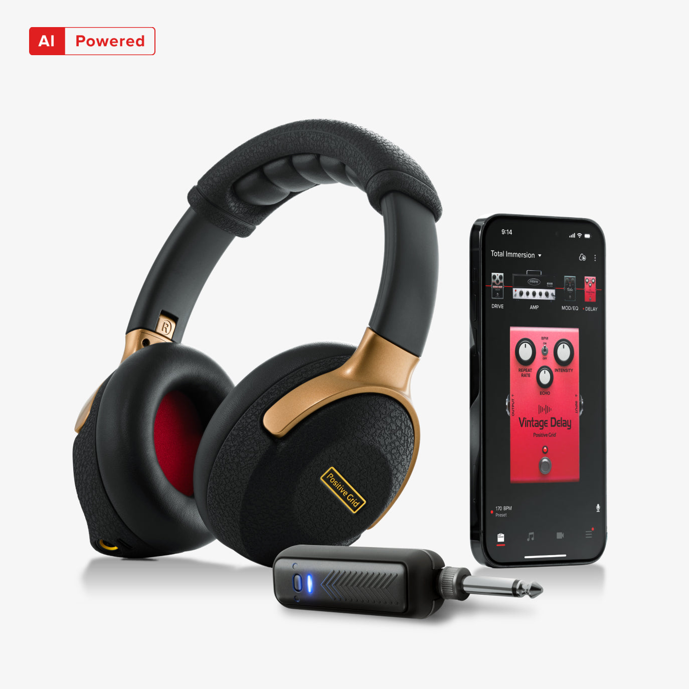
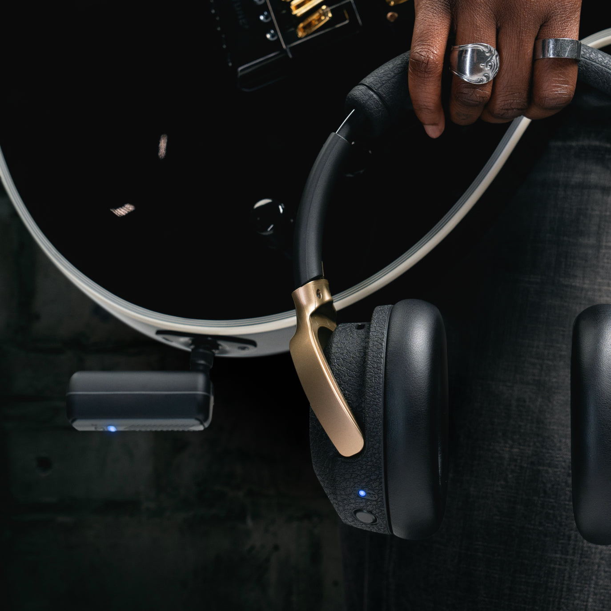
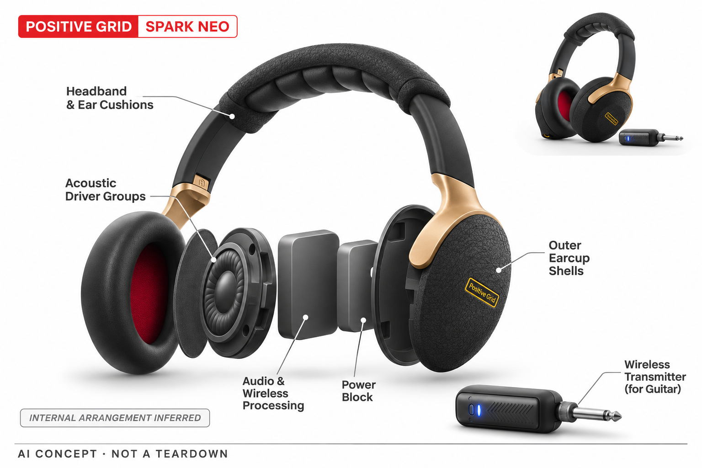

# Positive Grid Spark NEO

**Positive Grid** · 音乐与乐器 · 核查 2026-11-04

将AI音色探索放进安静练琴的耳机形态

消费渠道：个人零售。

## 产品图片与结构参考

### 产品图

Positive Grid Spark NEO · 官方产品图 · 来源：[Positive Grid · 官方图片](<https://www.positivegrid.com/products/spark-neo>) · [原始图片](<https://cdn.shopify.com/s/files/1/1094/6716/files/01_d0cda8ec-6fc0-4668-9f34-a9d3a3c4a6a9.jpg?v=1738693469>)

### 参考图

Positive Grid Spark NEO · 官方参考图 · 来源：[Positive Grid · 官方图片](<https://www.positivegrid.com/products/spark-neo>) · [原始图片](<https://cdn.shopify.com/s/files/1/1094/6716/files/03_6c94cdbc-e9d3-438e-93d0-e402d65309f9.jpg?v=1739404966>)

### AI 生成爆炸示意

**AI 生成 · 非实物拆机。** 内部为概念推断，不能作为元件布局、BOM 或维修依据。[生成提示词](../../content/hardware/prompts/positive-grid-spark-neo.txt)

> 已目视核对外形、标签与非拆机声明；不代表内部结构经实测验证。

> 分析为基于公开资料的案头研究与 AI 辅助判断，未经用户访谈、销量审计或实物拆机。需求、画像、竞争冷门度、审美及商业机会均为研究假设，不是投资结论。

## 销售与购买

- 状态：在售。官方商品页显示US$174及预计配送，结构化商品Offer为InStock；本条仅计原Spark NEO，不重复计其他颜色或套装。

- 地区：美国官网

- 价格：官网 US$174。促销快照，实际含税金额和配送以官方结算为准。

- 中国大陆：本轮核实所列区域官方商店；未确认中国大陆官方现货、账户及完整服务，不把境外可购等同大陆可用。

- [官方产品 / 商店](<https://www.positivegrid.com/products/spark-neo>)

## AI 的实际作用

耳机连接Spark App进行AI音色探索、练习与伴奏；AI用于音色选择及练习流程，耳机声学驱动本身不是生成模型。

服务与联网依赖：需手机Spark App及账户访问AI功能；无线乐器连接与应用音频功能的条件不同，应按手册核对。

## 是否冷门

细分专业（研究判断）：安静吉他练习较聚焦，但普通耳机与小型耳放替代明确。

## 需求与市场

需求假设：共享住宅或夜间练琴的人需要不外放的完整吉他音色，并希望快速尝试不同风格。应验证无线准备步骤、佩戴时间和找音色效率是否优于普通耳机加接口，不能仅以小体积推定方便。

## 用户画像

画像推断：有电吉他且需要安静练习的学生、租住者及旅行乐手较匹配。耳机同时承担乐器监听和日常听音，但头部尺寸、眼镜、耳压与佩戴时间会改变接受度，需通过试戴具体确认。

## 竞争与替代

竞争判断：普通监听耳机搭配小型耳放、无线吉他系统和手机音效应用都构成替代。耳机一体化属于明确场景，但已有同类个人监听产品，不能将无线与AI两个标签叠加后称为蓝海。

## 供应链

供应链推断：耳机声学单元、无线接收、头梁转轴与电池需要同时兼顾延迟和舒适。官方未公开完整工厂和成本资料，耳垫磨损、无线配对及固件兼容将影响长期维护与用户退换。

## 技术路径

官方将智能音箱技术和应用AI功能放入耳机使用流程。技术判断应分别测试无线链路、音色参数和应用匹配，耳机播放模型化声音并不意味着所有语言理解都在耳机内部完成。

## 产品审美

审美判断：封闭式耳机外形让产品自然融入居家和差旅场景，也减少音箱与线缆的可见负担。头梁、耳罩和无线发射器仍需形成一致体验，外观简洁不能替代长时佩戴和收纳实测。

## 关键风险

风险判断：无线环境与手机后台限制可能影响连接，AI音色也可能出现不合预期的增益。听音音量、长时佩戴以及账户功能变化应纳入评估，不能把语义推荐当作适合每个人的声学结论。

## 机会与验证

市场观察：本款与桌面Spark音箱的区别是个人安静监听，而非颜色或容量变化。比较时应记录练习地点、连接成功率和连续佩戴时间，明确一体式耳机是否比已有分体方案省事。

## 功能分层示意

这是功能关系，不是实物拆机、真实空间结构或已核实 BOM。

1. **乐器连接**：无线乐器输入进入个人监听链路。（官方披露）

2. **音色控制**：Spark应用提供音色控制与AI探索。（官方披露）

3. **本地音频**：耳机内声学与音频处理用于监听。（官方披露）

4. **佩戴反馈**：头梁耳罩和耳机单元形成个人声音体验。（官方披露）

## 来源

1. [Spark NEO官方商店](<https://www.positivegrid.com/products/spark-neo>) — 已打开；有配送信息及InStock结构化Offer。

2. [Spark NEO官方用户手册](<https://assets.positivegrid.com/support/files/spark_neo_user_manual_v1_0_0.pdf>) — 官方手册说明Spark AI与应用连接账户要求。

3. [Spark应用能力](<https://www.positivegrid.com/pages/spark-app>) — 说明智能音色和练琴流程。

[返回目录](../hardware-market.md) · [网页分析](https://romanagent.github.io/Roman/#hardware/product/positive-grid-spark-neo)
