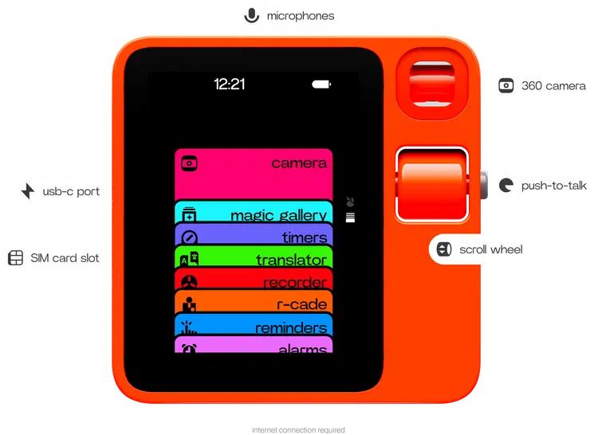
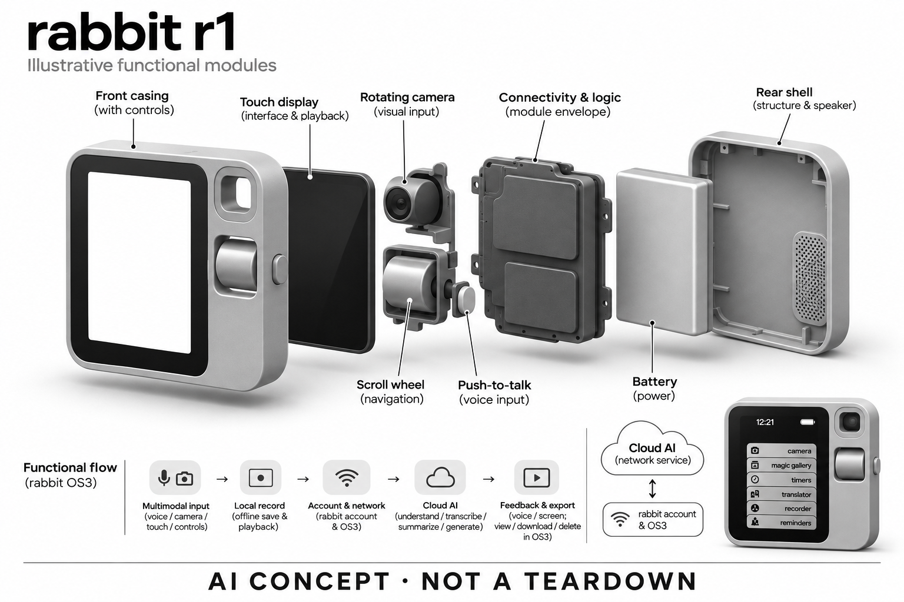

# rabbit r1

**rabbit** · 手机与 AI PC · 核查 2026-11-04

用独立口袋终端访问对话、视觉与记录能力

消费渠道：个人零售。

## 产品图片与结构参考

### 产品图

rabbit 官方 r1 正面与控制部件标注图 · 来源：[rabbit · 官方产品图片](<https://www.rabbit.tech/rabbit-r1>) · [原始图片](<https://www.rabbit.tech/_next/image?url=%2Fmedia%2Fr1%2Fr1_hardwarespec.png&w=750&q=75>)

### 参考图

rabbit 官方 r1 手持背面与侧面参考 · 来源：[rabbit · 官方产品图片](<https://www.rabbit.tech/rabbit-r1>) · [原始图片](<https://www.rabbit.tech/_next/image?url=%2Fmedia%2Fr1%2Fr1_inhand_mobile.webp&w=1080&q=75>)

### AI 生成爆炸示意

**AI 生成 · 非实物拆机。** 内部为概念推断，不能作为元件布局、BOM 或维修依据。[生成提示词](../../content/hardware/prompts/rabbit-r1.txt)

> 外形依据核验参考图；内部位置、模块形状与装配关系仅作AI概念展示。

> 图片按源站提供格式保存，未裁切或改色；厂商渲染/场景示意不代表实机测试。

> 分析为基于公开资料的案头研究与 AI 辅助判断，未经用户访谈、销量审计或实物拆机。需求、画像、竞争冷门度、审美及商业机会均为研究假设，不是投资结论。

## 销售与购买

- 状态：在售。核查日官方r1产品页仍显示US$199、buy now及3个工作日发货。可确认当前列售，不能据此确认仍持续生产；未用论坛停产传闻将官方库存销售改成停售。

- 地区：国际官网支持配送地区（逐地结算确认）

- 价格：US$199。官网r1购置价并标示核心服务无订阅；网络流量、第三方模型、代理或其他外部服务的费用不能据此推定全部包含。

- 中国大陆：未核实中国大陆官方销售、激活、云端连接与售后保障。具备中文翻译示例不等同大陆已正式支持。

- [官方产品 / 商店](<https://www.rabbit.tech/rabbit-r1>)

## AI 的实际作用

语音和相机理解、翻译、录音转写摘要及生成式个性化，当前官方以rabbit OS3说明。

服务与联网依赖：需rabbit账户与联网激活；核心AI需网络。录音可离线保存，但回网后才上传并生成标题、摘要与转写；第三方代理另有依赖。

## 是否冷门

新兴竞争（研究判断）：独立口袋AI终端仍在探索，但面临手机和软件助手强替代；不以形态稀少推断需求。

## 需求与市场

需求假设：用户可能希望有一个不被手机消息打断的独立AI入口，用实体按键快速提问或记录。核心问题是独立设备是否减少操作负担，还是增加充电、联网和随身携带的成本。

### 官方｜独立的口袋 AI 入口 · 官方资料

当前 r1 页面将其作为 OS3 的实体入口，结合屏幕、相机、滚轮与按键提供问答、翻译、记录和生成式个性化。需求可能是减少手机消息干扰，用独立控制快速开始任务，但它仍需账户和联网；官网列售与发货说明只能证明当前销售，不能证明硬件仍在持续生产。

依据：[rabbit · r1当前官方商品页](<https://www.rabbit.tech/rabbit-r1>) · [rabbit · r1用户指南（2026-09-22更新）](<https://www.rabbit.tech/r1-user-guide>)

### 判断｜独立设备是否减少负担 · 研究判断

用户可能喜欢与手机不同的交互，把一次提问或记录从复杂应用中分离，但也要多带、充电和联网一台设备。价值应看完整任务是否更简单，而不是只评价按键或外观新鲜；如果多数结果仍需要回到手机电脑，独立入口可能增加管理，必须与现有设备对照。

依据：[rabbit · r1当前官方商品页](<https://www.rabbit.tech/rabbit-r1>)

### 验证｜真实随身任务比较 · 待验证

可让用户用 r1 和手机完成相同的短问答、视觉询问、翻译与录音回顾，记录启动、等待、失败和复核。需要按当前 OS3 功能测试，不用首发演示或早期评论替代；当前目录没有实机与长期留存研究，不能从独立形态推断更专注、操作更少或所有任务更可靠。

依据：[rabbit · r1用户指南（2026-09-22更新）](<https://www.rabbit.tech/r1-user-guide>)

## 用户画像

画像推断：愿意体验独立交互形态、使用语音或视觉工具的技术爱好者更匹配；需要成熟手机应用全覆盖的人不应默认适合。研究不能用早期关注度代替长期留存或日常任务成功率。

### 判断｜愿意探索交互的个人用户 · 研究判断

对独立控制、视觉工具和生成式体验感兴趣，愿意接受软件变化的人可能更匹配。需要成熟手机应用全覆盖或稳定专业流程的人不应默认适合，画像应看实际任务与容忍度；早期关注和社交热度不能代替持续使用，也不能证明用户愿意长期多携带一个终端。

依据：[rabbit · r1当前官方商品页](<https://www.rabbit.tech/rabbit-r1>)

### 判断｜网络与账户管理意愿 · 研究判断

用户需要理解激活、联网和外部服务的条件，独立设备并没有消除软件管理。若希望所有任务离线或不愿维护额外账户，实际体验可能不匹配；研究应区分探索者和只想快速完成固定任务的人，不能因为核心服务无订阅就忽略学习、连接和长期依赖。

依据：[rabbit · r1用户指南（2026-09-22更新）](<https://www.rabbit.tech/r1-user-guide>)

### 验证｜首次设置和故障恢复 · 待验证

测试应从开箱、激活、连接到第一次任务完成，记录权限、网络与帮助文档使用，再加入一次断连恢复。不同语言、地区和已有设备习惯应分别观察，不能只测试预配置演示机；当前海外购买入口不证明大陆激活、云服务和售后完整，适配需要按实际条件核对。

依据：[rabbit · r1用户指南（2026-09-22更新）](<https://www.rabbit.tech/r1-user-guide>)

## 竞争与替代

案头判断：外形相近的产品较少，但手机助手、录音器和浏览器AI都是强替代。属于新形态探索不代表低竞争；没有访谈、销量审计或实际任务测试，不能仅凭独特设计判断市场空间。

### 判断｜与手机共享的核心任务 · 研究判断

手机已经具备相机、麦克风、屏幕和助手，r1 的区别主要是独立入口与交互流程，不能因为换了外壳就算全新需求。竞争比较应看它减少了哪些干扰或步骤，以及付出了多少携带和连接成本；模型名称或生成能力相近时，完整体验比功能列表更有判断价值。

依据：[rabbit · r1当前官方商品页](<https://www.rabbit.tech/rabbit-r1>)

### 判断｜与专用录音和翻译设备比较 · 研究判断

录音器或翻译终端可能专注更窄任务，r1 覆盖更多入口但需要证明每项足够可靠。不能用一个成功演示替代长会议或真实跨语言交流，也不能以功能多认定可替代所有专用设备；比较应先明确用户最常用的任务，而不是把所有可能用途相加成购买理由。

依据：[rabbit · r1用户指南（2026-09-22更新）](<https://www.rabbit.tech/r1-user-guide>) · [rabbit · Magic Recorder使用与离线边界](<https://www.rabbit.tech/support/article/rabbit-r1-voice-recorder>)

### 验证｜当前销售与全周期成本 · 待验证

官网仍有购买和发货说明，不应仅凭论坛停产传闻改成停售，也不能把库存销售推断为持续生产。核心服务无订阅不代表网络、外部模型或代理全部免费，实际地区与第三方条件需核对；当前没有销量和留存证据，目录不由价格或历史热度判断商业成功与失败。

依据：[rabbit · r1当前官方商品页](<https://www.rabbit.tech/rabbit-r1>)

## 供应链

官方明确teenage engineering参与工业设计，但设计合作不等于整机代工；当前工厂、备件和继续生产安排未披露。推断带屏、相机与独立网络使可靠性和软件维护范围大于单纯录音吊坠。

### 官方｜已披露主控与工业设计 · 官方资料

rabbit当前支持页明确r1采用MediaTek Helio P35，产品页另点名teenage engineering参与工业设计，两个关系的角色不同。主控与设计合作并不说明实际装配工厂、相机或备件供应，不能从芯片厂家或设计品牌推断整机代工；概念图也不构成完整装配证据。

依据：[rabbit · r1当前官方商品页](<https://www.rabbit.tech/rabbit-r1>) · [rabbit当前r1规格与连接说明](<https://www.rabbit.tech/support/article/what-is-rabbit-r1>) · [rabbit r1首发公告中的工业设计合作](<https://www.rabbit.tech/newsroom/introducing-r1>)

### 判断｜带屏相机与独立连接约束 · 研究判断

屏幕、相机、声音和网络共同工作，使电源、热与软件维护范围大于单纯录音设备。实体滚轮和按键还需要长期耐久与状态一致，但当前没有良率和维修详证；供应链研究应把这些作为核对问题，不依据复古外观、设计合作或售价推算制造成本和可持续供货。

依据：[rabbit · r1用户指南（2026-09-22更新）](<https://www.rabbit.tech/r1-user-guide>)

### 判断｜已知应用平台与声音候选 · 研究判断

Helio P35属于已点名的应用平台，英飞凌麦克风仍只是同类新设计的声音输入候选，二者不能混为同等确定关系。重新设计还需验证相机、屏幕、系统与功耗，公开主控不提供rabbit OS3或外部模型服务，也不意味着可用芯片通用能力恢复任何历史功能承诺。

依据：[rabbit · r1用户指南（2026-09-22更新）](<https://www.rabbit.tech/r1-user-guide>) · [rabbit当前r1规格与连接说明](<https://www.rabbit.tech/support/article/what-is-rabbit-r1>)

## 技术路径

当前文档区分本地录音与联网后的AI生成，并提供OS3账户、相机与多种输入。不能沿用首发时所有承诺描述现状；第三方代理与自带模型连接也不代表硬件本机拥有对应模型算力。

### 官方｜当前系统与离线录音 · 官方资料

当前指南按 OS3 说明账户、相机和多种输入，录音帮助明确本地可先保存，联网后才上传并生成转写、标题和摘要。离线采集不能等同离线人工智能，第三方模型或代理也有独立依赖；目录不沿用首发所有承诺，也不把连接外部模型理解为硬件拥有同样本地算力。

依据：[rabbit · r1用户指南（2026-09-22更新）](<https://www.rabbit.tech/r1-user-guide>) · [rabbit · Magic Recorder使用与离线边界](<https://www.rabbit.tech/support/article/rabbit-r1-voice-recorder>)

### 判断｜广泛入口需要清楚边界 · 研究判断

问答、相机理解、生成界面和外部任务可能走不同路径，用户需要知道当前内容来自哪里以及是否真的执行成功。自然对话不能替代最终结果确认，尤其多步骤任务可能部分完成；技术评价应按任务拆分，并检查权限和失败恢复，而不是用 OS3 的整体名称概括可靠性。

依据：[rabbit · r1用户指南（2026-09-22更新）](<https://www.rabbit.tech/r1-user-guide>)

### 验证｜离线到联网的交接 · 待验证

可先录制一段离线内容，再恢复网络检查上传、转写与摘要是否完整，加入中断和低电量条件。其他视觉和语音任务则分别核对输入与结果，不能借录音成功证明所有功能可靠；当前没有独立性能测试，官方使用指南只支持流程边界，不保证所有环境下的任务效果。

依据：[rabbit · Magic Recorder使用与离线边界](<https://www.rabbit.tech/support/article/rabbit-r1-voice-recorder>)

## 产品审美

图示观察：高辨识度橙色、实体滚轮与小屏幕具有复古电子产品气质，容易形成记忆点。视觉独特性并不证明任务效率；单手操作、屏幕信息密度和公开场景语音使用仍需实测。

### 判断｜鲜明实体交互的吸引 · 研究判断

相机、滚轮、按键和屏幕形成区别于普通手机的外观，可能吸引喜欢专用工具的人，也可能只带来短期新鲜感。审美研究应观察真实携带与使用，而不只看工业设计评价；外形辨识度不能证明任务更简单、握持更舒适或用户愿意长期保留第二台设备。

依据：[rabbit · r1当前官方商品页](<https://www.rabbit.tech/rabbit-r1>)

### 判断｜控制与系统状态的关系 · 研究判断

实体输入可能减少寻找界面的步骤，但用户仍要理解不同模式和反馈，软件更新后流程也可能变化。设计评价应看滚轮、按键和屏幕是否让任务状态清楚，以及失败时能否回退；物理控制不自动等于直观，更不能用演示者熟练操作代表首次用户体验。

依据：[rabbit · r1用户指南（2026-09-22更新）](<https://www.rabbit.tech/r1-user-guide>)

### 验证｜口袋携带与一天使用 · 待验证

试用应包含取出、提问、拍摄输入、录音与充电，记录遗漏设备、网络等待和返回手机的次数。不同环境光与噪声要分别观察，不能只在安静桌面评价；长期便利需要交互、连接和电量共同稳定，官方图像与设计合作不能替代个人使用反馈。

依据：[rabbit · r1当前官方商品页](<https://www.rabbit.tech/rabbit-r1>) · [rabbit · r1用户指南（2026-09-22更新）](<https://www.rabbit.tech/r1-user-guide>)

## 关键风险

官方录音帮助页提示续航与联网、亮度等相关，长会需外接电源；功能持续演进也可能改变熟悉流程。云服务、账户及第三方代理增加依赖，核心服务免订阅不能解释成永久服务保证。

### 判断｜服务变化与历史预期 · 研究判断

软件持续演进可能改变用户熟悉的流程，首发宣传、当前指南和第三方代理不能混为同一能力清单。核心服务无订阅也不是永久运营保证，账号和外部服务仍有条件；目录按当前来源说明，不由旧评论或新演示单独推断整个产品成功、失败或所有任务可用。

依据：[rabbit · r1用户指南（2026-09-22更新）](<https://www.rabbit.tech/r1-user-guide>)

### 判断｜记录与生成内容的可信度 · 研究判断

录音摘要、翻译与视觉回答可能误解输入或扩大原意，重要内容需要回查原音和原图。官方录音说明也提示续航受连接和显示等影响，不能按理想条件安排所有长任务；当前目录没有独立准确率或隐私审计，不把独立设备和流畅回答当作可靠与私密的保证。

依据：[rabbit · Magic Recorder使用与离线边界](<https://www.rabbit.tech/support/article/rabbit-r1-voice-recorder>)

### 验证｜外部任务与权限确认 · 待验证

应测试网络中断、外部服务不可用和任务部分完成时的提示，确认用户能核对结果并停止或恢复。涉及重要文件或外部动作时需要保留人工确认，不能只信任助手口头完成；验证目标是减少总负担并保持可控，而不是让更多模型与代理连接掩盖新的依赖和错误。

依据：[rabbit · r1用户指南（2026-09-22更新）](<https://www.rabbit.tech/r1-user-guide>)

## 机会与验证

市场差异是以独立终端承载对话和视觉任务，而非手机里的一个应用。尚待验证的购买理由是实体控制与低干扰体验能否形成稳定使用习惯，并覆盖额外携带、充电和连接管理的成本。

### 判断｜独立入口需要额外理由 · 研究判断

本型号值得研究的是它是否让某些随身任务比手机更容易启动和完成，而不是仅因为它是独立人工智能硬件。若用户仍频繁回到手机，额外携带可能没有足够收益；场景分组应与便携多模态助手复用核心需求，外形和滚轮本身不自动形成新的独立场景。

依据：[rabbit · r1当前官方商品页](<https://www.rabbit.tech/rabbit-r1>)

### 判断｜软件演进能否形成持续使用 · 研究判断

新功能可能增加探索乐趣，也可能让用户不断重新学习，研究应记录真正留下的重复任务，而不是发布次数。当前 OS3 的价值需要在真实工作与生活中验证，不能用早期热度或历史承诺代替；持续收益应超过充电、网络和账户管理，才可能支持长期购买理由。

依据：[rabbit · r1用户指南（2026-09-22更新）](<https://www.rabbit.tech/r1-user-guide>)

### 验证｜长期任务与服务成本 · 待验证

后续可跟踪有效问答、录音回查、视觉错误、外部服务和返回手机的次数，并核算网络与维护成本。销售、持续生产和长期支持应分别核查，不以库存或传闻互相替代；当前目录是案头研究，不以官方列售、免订阅或设计辨识度宣称需求与效果已经验证。

依据：[rabbit · r1当前官方商品页](<https://www.rabbit.tech/rabbit-r1>) · [rabbit · r1用户指南（2026-09-22更新）](<https://www.rabbit.tech/r1-user-guide>) · [rabbit · Magic Recorder使用与离线边界](<https://www.rabbit.tech/support/article/rabbit-r1-voice-recorder>)

## 对应供应链公司

能力候选用于选型研究，不代表本产品实际采用；未公开的供货关系不作推断。

- [mediatek](../supply-chain/mediatek.md) — **公开披露关系** / 已披露MediaTek Helio P35应用处理器：rabbit当前官方支持页明确将r1芯片列为MediaTek Helio P35，联发科技产品页可核对该平台角色，因此采用关系已有点名依据。证据不覆盖整机工厂、其他器件和所有批次，也不证明OS3或生成式模型全部本地运行；不能将公司Genio系列的能力混入这一具体平台。

- [infineon](../supply-chain/infineon.md) — **能力候选 · 非已采用** / 手持语音终端的声音输入候选：r1 以语音作为输入之一，英飞凌麦克风可用于同类新设计比较，但需验证手持方向、环境噪声、回声和主控接口。当前没有供货点名，不能由外形或设计合作推断采用；器件输入质量不等于云端问答、翻译或外部任务执行可靠，也不证明全部处理本地完成。

- [teenage-engineering](../supply-chain/teenage-engineering.md) — **公开披露关系** / 已披露rabbit r1工业设计合作：rabbit官方首发公告明确点名teenage engineering参与r1工业设计，与当前产品外形和已有合作描述相符，因此可建立公开设计关系。证据只覆盖工业设计角色，不证明该公司承担整机装配、所有结构工程、软件或完整物料采购，也不能把首发软件承诺当成当前功能。

[浏览供应链目录](../supply-chain.md)

## 功能分层示意

这是功能关系，不是实物拆机、真实空间结构或已核实 BOM。

1. **多模态输入**：相机、麦克风、触屏、滚轮与按键；功能架构，非拆机。（官方披露）

2. **本机界面与记录**：设备可离线录音、保存和播放，显示当前交互状态。（官方披露）

3. **账户与网络**：通过网络连接rabbit账户和OS3；激活及AI功能依赖网络。（官方披露）

4. **理解与生成**：云端或关联服务处理问答、视觉、转写摘要；第三方代理独立配置。（官方披露）

5. **反馈与导出**：设备语音/屏幕反馈，OS3中查看、下载或删除记录。（官方披露）

## 来源

1. [rabbit · r1当前官方商品页](<https://www.rabbit.tech/rabbit-r1>) — 已打开，US$199和3工作日发货；仅确认销售而非持续生产。

2. [rabbit · r1用户指南（2026-09-22更新）](<https://www.rabbit.tech/r1-user-guide>) — 已打开，按当前OS3说明，不把首发宣传直接视为现有功能。

3. [rabbit · Magic Recorder使用与离线边界](<https://www.rabbit.tech/support/article/rabbit-r1-voice-recorder>) — 已打开，明确本地录音、联网后转写摘要与电池限制。

[返回目录](../hardware-market.md) · [网页分析](https://romanagent.github.io/Roman/#hardware/product/rabbit-r1)
