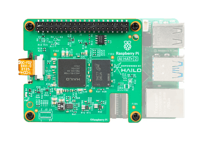
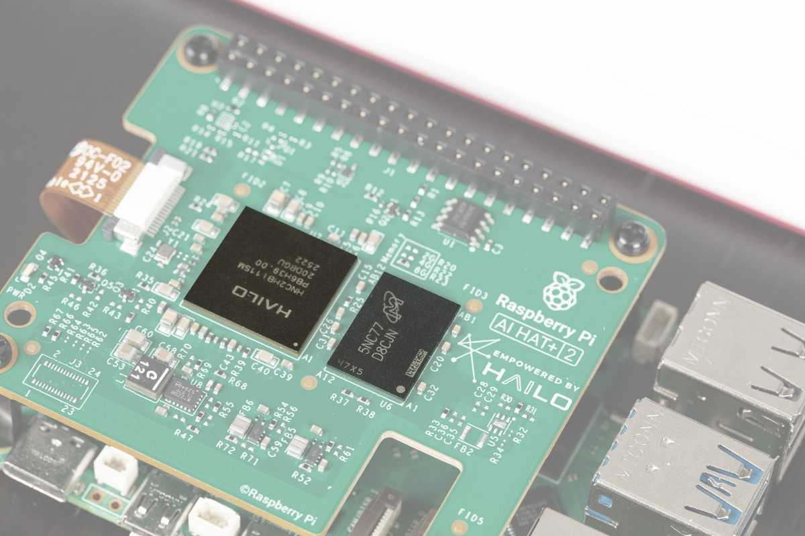
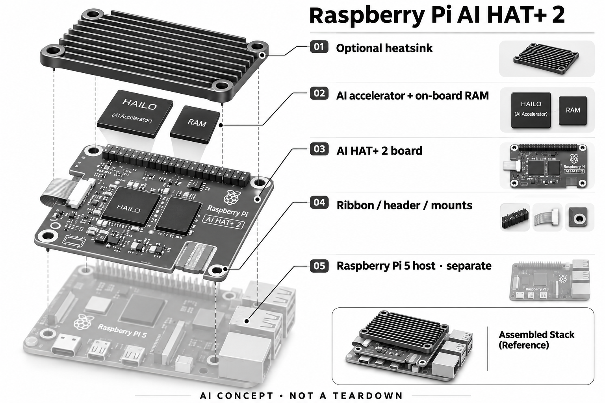

# Raspberry Pi AI HAT+ 2

**Raspberry Pi / Hailo** · 开发与制造 · 核查 2026-11-04

为 Raspberry Pi 5 增加本地生成式和视觉推理能力的扩展板。

## 产品图片与结构参考

### 产品图

AI HAT+ 2 官方主图（叠装 Raspberry Pi 5 参考） · 来源：[Raspberry Pi](<https://www.raspberrypi.com/products/ai-hat-plus-2/>) · [原始图片](<https://assets.raspberrypi.com/static/f0d909cef0e7e6609acf92ae2921a60d/f2024/hero.png>)

### 参考图

AI HAT+ 2 官方板载内存与芯片参考 · 来源：[Raspberry Pi](<https://www.raspberrypi.com/products/ai-hat-plus-2/>) · [原始图片](<https://assets.raspberrypi.com/static/92df577a5d419ed0b4d57a3b16fe59a2/8dbcc/ram.jpg>)

### AI 生成爆炸示意

**AI 生成 · 非实物拆机。** 内部为概念推断，不能作为元件布局、BOM 或维修依据。[生成提示词](../../content/hardware/prompts/raspberry-pi-ai-hat-plus-2.txt)

> 分析为基于公开资料的案头研究与 AI 辅助判断，未经用户访谈、销量审计或实物拆机。需求、画像、竞争冷门度、审美及商业机会均为研究假设，不是投资结论。

## 销售与购买

- 状态：待复核。官方产品页有地区经销商购买组件，但该组件需要 JavaScript，本轮未核实具体地区经销商的可下单库存。先列观察，不计入可购产品。

- 地区：按授权经销商地区

- 价格：待地区经销商核价。不将发布时价格或不同代AI HAT的报价套用；另需 Raspberry Pi 5、电源、存储与可能的散热部件。

- 中国大陆：官方提供地区经销商选择，尚未核实中国大陆具体库存和保修。本条仅确认产品与功能存在，不确认国内可购。

- [官方产品 / 商店](<https://www.raspberrypi.com/products/ai-hat-plus-2/>)

## AI 的实际作用

官方披露 Hailo-10H、8GB板载RAM和40 TOPS INT4，支持兼容的生成式模型与视觉处理，属于需要集成的开发硬件。

服务与联网依赖：模型需经过兼容工具链部署；支持某类模型不代表任意模型可直接运行。可离线推理的范围取决于模型和应用实现。

## 是否冷门

细分专业（研究判断）：AI 扩展板属于技术用户细分市场，竞争集中在适配成本和软件支持，不以大众知名度判断蓝海。

## 需求与市场

需求假设：已有树莓派项目希望扩展本地语音、视觉和轻量生成式能力，避免换整个平台。需求应从可运行的模型和外设链路出发验证，而不是把加速板视作万能AI升级。

## 用户画像

画像推断：创客、嵌入式工程师、课程开发者及低成本原型团队。购买者可能已有 Raspberry Pi 5，但首次使用者还需理解主板、扩展板和完整系统成本的区别。

## 竞争与替代

市场判断：与 Jetson、USB 加速器和迷你 PC 竞争，价格、软件兼容及社区支持会影响选择。树莓派生态有吸引力，但特殊模型转换可能增加工程成本，本轮未做开发者访谈。

## 供应链

官方披露 Hailo-10H 与板载内存。分析关注加速器、内存、电源完整性、连接器和热管理；未核查整板代工厂与采购合同，不能给出确定 BOM 或产能判断。

## 技术路径

技术重点是模型编译、算子覆盖与树莓派摄像头软件集成。40 TOPS 属 INT4 口径，官方也区分计算机视觉性能；不应直接与另一平台 INT8 算力数字排序。

## 产品审美

设计观察：扩展板延续模块化工具形态，利于观察和组合硬件。堆叠高度、散热片和连接空间会影响外壳设计；面向非技术用户的产品还需要完整封装与明确的运行状态反馈。

## 关键风险

主要风险是兼容模型限制、供电散热和实际采购可达性。对嵌入式项目而言，官方长期生产承诺不等于每个经销商随时有货，需要单独核查供期和替代料策略。

## 机会与验证

可验证的购买理由是复用已有树莓派系统，并在可接受功耗内运行目标模型。建议用真实音视频任务比较总系统成本和调试时间；本轮没有相同条件下的性能实测数据。

## 功能分层示意

这是功能关系，不是实物拆机、真实空间结构或已核实 BOM。

1. **应用与模型**：运行 Hailo 工具链支持的视觉和生成式模型。（官方披露）

2. **AI 加速器**：Hailo-10H 提供官方标称40 TOPS INT4。（官方披露）

3. **内存**：板载8GB RAM服务兼容模型推理。（官方披露）

4. **主机与接口**：作为 Raspberry Pi 5 的扩展板集成。（官方披露）

5. **散热与装配**：官方提供可选散热片和叠装附件说明。（官方披露）

## 来源

1. [Raspberry Pi AI HAT+ 2 官方产品页](<https://www.raspberrypi.com/products/ai-hat-plus-2/>) — 产品与购买组件存在，但本轮未确认具体经销商库存。

[返回目录](../hardware-market.md) · [网页分析](https://romanagent.github.io/Roman/#hardware/product/raspberry-pi-ai-hat-plus-2)
