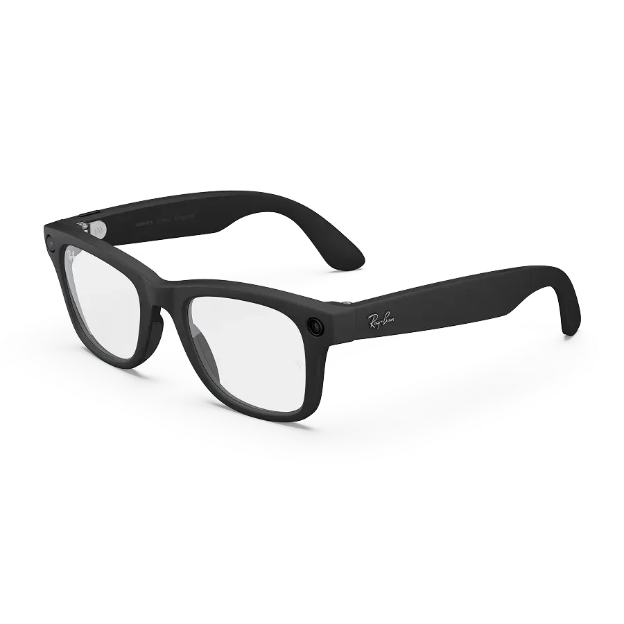
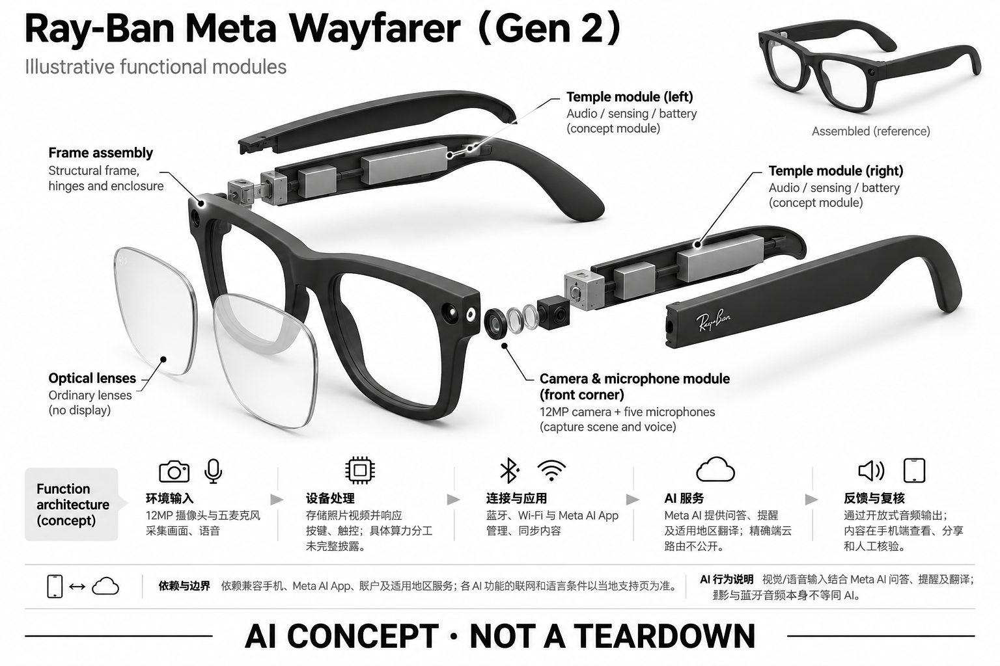

# Ray-Ban Meta Wayfarer（Gen 2）

**Ray-Ban × Meta** · AI 眼镜 · 核查 2026-11-04

把拍摄、通话和视觉问答装进日常眼镜

## 产品图片与结构参考

### 产品图

官方 Wayfarer Gen 2 正面斜视图（黑框透明镜片） · 来源：[Ray-Ban × Meta · 官方产品图片](<https://www.meta.com/ai-glasses/ray-ban-meta-wayfarer-gen-2/>) · [原始图片](<https://lookaside.fbsbx.com/elementpath/media/?media_id=1424958092109664&resize_height=1600&resize_width=1600&transcode_extension=webp&version=1777898936>)

### 参考图

官方 Wayfarer Gen 2 后侧视图 · 来源：[Ray-Ban × Meta · 官方产品图片](<https://www.meta.com/ai-glasses/ray-ban-meta-wayfarer-gen-2/>) · [原始图片](<https://lookaside.fbsbx.com/elementpath/media/?media_id=1825608818050904&resize_height=1600&resize_width=1600&transcode_extension=webp&version=1777898936>)

### AI 生成爆炸示意

**AI 生成 · 非实物拆机。** 内部为概念推断，不能作为元件布局、BOM 或维修依据。[生成提示词](../../content/hardware/prompts/ray-ban-meta-gen-2.txt)

> 外形依据核验参考图；内部位置、模块形状与装配关系仅作AI概念展示。

> 图片按源站提供格式保存，未裁切或改色；厂商渲染/场景示意不代表实机测试。

> 分析为基于公开资料的案头研究与 AI 辅助判断，未经用户访谈、销量审计或实物拆机。需求、画像、竞争冷门度、审美及商业机会均为研究假设，不是投资结论。

## 销售与购买

- 状态：在售。核查时美国官方 SKU 页显示 $379、Add to bag 和配送入口；页面同时引导选购 Gen 3，故确认旧款仍列售，不等同所有配色均有库存。

- 地区：美国、加拿大、英国、澳大利亚、欧洲部分国家

- 价格：US$379 起。美国官网 Wayfarer Gen 2 所见价格；镜片、度数、税费和地区会改变总价，不与 Gen 3 或 Headliner 的价格混用。

- 中国大陆：已核查页面未提供中国大陆官方销售与完整 Meta AI 服务保障。支持中文功能不等于大陆渠道已开放；跨境购买的激活、服务与保修需单独确认。

- [官方产品 / 商店](<https://www.meta.com/ai-glasses/ray-ban-meta-wayfarer-gen-2/>)

## AI 的实际作用

视觉/语音输入结合 Meta AI 问答、提醒及翻译；摄影与蓝牙音频本身不等同 AI。

服务与联网依赖：依赖兼容手机、Meta AI App、账户及适用地区服务；各 AI 功能的联网和语言条件以当地支持页为准。

## 是否冷门

竞争密集（研究判断）：日常相机 AI 眼镜已有多品牌直接竞品和手机替代；这是案头竞争判断，不是市场份额结论。

## 需求与市场

需求假设：拍孩子、做饭或步行时，拿手机会打断动作。第一视角采集能降低启动成本，但真正值得验证的是用户是否持续拍摄与调用问答，而不是初次体验的新鲜感。

## 用户画像

画像推断：已经日常戴眼镜、经常旅行或创作短内容的人更容易接受这一形态；只偶尔需要 AI 问答的人可能继续使用手机。应区分配镜刚需与为了技术额外戴镜两类用户。

## 竞争与替代

案头判断：与同品牌 Gen 3、Rokid Style、手机和耳机争夺同一使用时刻，属于拥挤方向。品牌、配镜和售后渠道构成门槛；此判断没有销量统计、用户访谈或份额证据。

## 供应链

官方能确认 Ray-Ban 与 Meta 的产品协作及 EssilorLuxottica 保修角色；本次未取得整机代工厂、摄像头供应商或成本资料。推断难点在镜腿集成、装配一致性与配镜售后。

## 技术路径

官方披露摄像头、五麦克风、蓝牙、Wi-Fi 与存储；生成式能力通过 Meta AI 呈现。端侧降噪与云端问答如何细分并未完整公开，不能由功能列表反推出精确芯片或模型部署。

## 产品审美

官网图示延续 Wayfarer 的日常眼镜比例，能减少明显的设备感；镜腿体积和摄像头仍会影响他人的感知。外观判断来自图片，鼻梁压力、滑落和长时佩戴舒适度尚未实测。

## 关键风险

主要风险是拍摄对旁人的影响、不同地区 AI 功能差异，以及照片导出和账号服务的长期依赖。语音回答仍需核验；有摄像头并不意味着设备适合持续记录所有工作或生活场景。

## 机会与验证

市场差异在于第一视角输入、日常框型和成熟配镜渠道共同降低使用门槛。尚待验证的购买理由是用户是否频繁调用这些能力，以及Gen 2相对较低价格能否覆盖旧代设备的取舍。

## 功能分层示意

这是功能关系，不是实物拆机、真实空间结构或已核实 BOM。

1. **环境输入**：12MP 摄像头与五麦克风采集画面、语音；以下为功能架构，非拆机图。（官方披露）

2. **设备处理**：存储照片视频并响应按键、触控；具体算力分工未完整披露。（官方披露）

3. **连接与应用**：蓝牙、Wi-Fi 与 Meta AI App 管理、同步内容。（官方披露）

4. **AI 服务**：Meta AI 提供问答、提醒及适用地区翻译；精确端云路由不公开。（官方披露）

5. **反馈与复核**：通过开放式音频输出；内容在手机端查看、分享和人工核验。（官方披露）

## 来源

1. [Meta Store · Wayfarer Gen 2 SKU](<https://www.meta.com/ai-glasses/ray-ban-meta-wayfarer-gen-2/>) — 已打开，包含价格、加入购物袋、规格与 App 说明；未实际下单。

2. [Meta Store · Ray-Ban Meta 产品比较](<https://www.meta.com/ai-glasses/ray-ban-meta/>) — 已打开，当前并列展示 Gen 2 与 Gen 3；避免跨代混用参数。

[返回目录](../hardware-market.md) · [网页分析](https://romanagent.github.io/Roman/#hardware/product/ray-ban-meta-gen-2)
