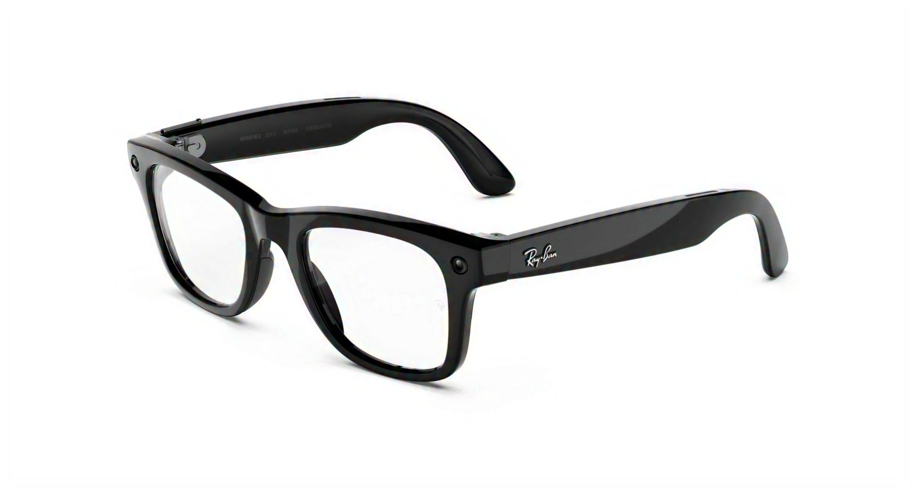
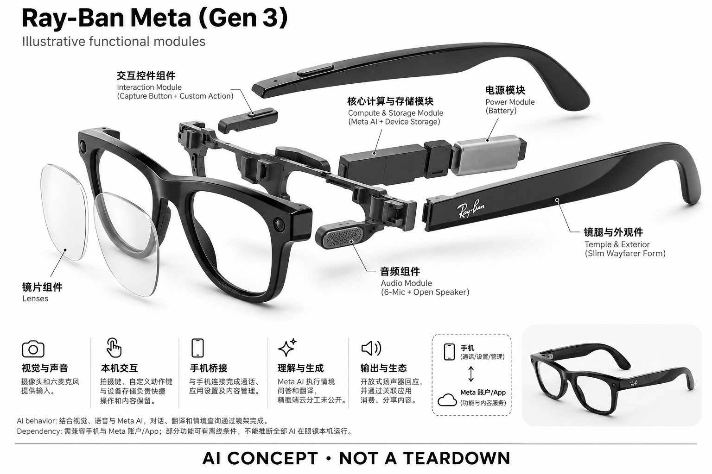

# Ray-Ban Meta（Gen 3）

**Ray-Ban × Meta** · AI 眼镜 · 核查 2026-11-04

用佩戴与交互的迭代争取全天使用

## 产品图片与结构参考

### 产品图

官方 Wayfarer Gen 3 主展示图（亮黑框变色镜片款） · 来源：[Ray-Ban × Meta · 官方产品图片](<https://www.meta.com/in/ai-glasses/ray-ban-meta-gen-3-wayfarer-shiny-black-grey-transitions/>) · [原始图片](<https://lookaside.fbsbx.com/elementpath/media/?cb=v2&media_id=2549805485445447&resize_height=2048&resize_width=2048&version=2549804535445542&vp=1>)

### 参考图

官方 Wayfarer Gen 3 后视图，变色镜片呈深色状态 · 来源：[Ray-Ban × Meta · 官方产品图片](<https://www.meta.com/in/ai-glasses/ray-ban-meta-gen-3-wayfarer-shiny-black-grey-transitions/>) · [原始图片](<https://lookaside.fbsbx.com/elementpath/media/?media_id=1041308381833715&resize_height=1600&resize_width=1600&transcode_extension=webp&version=1790189413>)

### AI 生成爆炸示意

**AI 生成 · 非实物拆机。** 内部为概念推断，不能作为元件布局、BOM 或维修依据。[生成提示词](../../content/hardware/prompts/ray-ban-meta-gen-3.txt)

> 外形依据核验参考图；内部位置、模块形状与装配关系仅作AI概念展示。

> 图片按源站提供格式保存，未裁切或改色；厂商渲染/场景示意不代表实机测试。

> 分析为基于公开资料的案头研究与 AI 辅助判断，未经用户访谈、销量审计或实物拆机。需求、画像、竞争冷门度、审美及商业机会均为研究假设，不是投资结论。

## 销售与购买

- 状态：在售。当前美国官方系列页显示 Gen 3、US$449 起与 Shop；另已打开瑞士 Wayfarer Gen 3 变色镜片 SKU，显示 CHF559 与 Add to bag。不同地区配置价格分开记录。

- 地区：美国、瑞士、其他开放销售市场（以当地官网为准）

- 价格：美国官网 US$449 起。这是系列起价；已核查的瑞士变色镜片 SKU 为 CHF559，不能按汇率视作同一配置。税费、镜片和配镜另依地区结算。

- 中国大陆：未核实中国大陆官方购买入口或完整服务承诺。海外商品页、中文翻译能力与大陆官方可用性是不同事项。

- [官方产品 / 商店](<https://www.meta.com/ai-glasses/ray-ban-meta/>)

## AI 的实际作用

结合视觉、语音与 Meta AI，对话、翻译和情境查询通过镜架完成。

服务与联网依赖：需兼容手机与 Meta 账户/App；部分功能可有离线条件，不能推断全部 AI 在眼镜本机运行。

## 是否冷门

竞争密集（研究判断）：同品牌多代并售，外部无显示 AI 眼镜也直接竞争；不是无人进入的细分市场。

## 需求与市场

需求假设：用户需要的可能是更少充电、更容易触发和更适合长期佩戴，而非新的功能名称。第三代适合研究一个问题：小幅体验改进能否让偶尔戴镜变成稳定习惯。

## 用户画像

画像推断：重度第一视角创作者、已有上一代设备且遇到续航或贴合问题的人，是值得访谈的对象。首次用户仍需证明额外设备的价值，不能把代际升级人群等同全部潜在用户。

## 竞争与替代

案头判断：除外部品牌，还面对仍在售且较便宜的 Gen 2。竞争焦点偏向框型、舒适度、交互与渠道，而非单一模型指标；未依据销量、用户访谈或价格弹性调查判定市场规模。

## 供应链

品牌与渠道协作可以从官方确认，但第三代整机代工、传感器型号、良率和采购价格均不明。推断更细镜腿与可调整结构，会增加电子布局、热管理及光学门店调整的协同要求。

## 技术路径

官网披露六麦克风、动作按键、3K 拍摄与续航改进；这些是硬件交互事实，不足以证明模型质量提升。对生成式 AI 的推理位置、所用模型版本和性能边界，应继续保持未披露状态。

## 产品审美

图示观察：Wayfarer、Aviator 与 Zena 扩大框型选择，技术逐渐依附服饰风格。审美价值在于适合不同脸型和日常搭配；官网渲染不能代替试戴，也不能证明镜腿更细就一定更舒适。

## 关键风险

需注意代际宣传与个人实际体验的差距，标称续航并非连续拍摄时长。应用、账号与地区差异仍然存在；购买时还应区分标准镜片、变色镜片和处方镜片，避免用起价误算总成本。

## 机会与验证

市场差异主要体现为佩戴、动作按键与续航的迭代。尚待验证的购买理由是这些变化是否解决上一代的真实痛点，以及首次用户是否愿意为同一类核心任务承担更高的购置成本。

## 功能分层示意

这是功能关系，不是实物拆机、真实空间结构或已核实 BOM。

1. **视觉与声音**：摄像头和六麦克风提供输入；此为官网功能抽象，非物理拆机。（官方披露）

2. **本机交互**：拍摄键、自定义动作键与设备存储负责快捷操作和内容保留。（官方披露）

3. **手机桥接**：与手机连接完成通话、应用设置及内容管理。（官方披露）

4. **理解与生成**：Meta AI 执行情境问答和翻译，精确端云分工未公开。（官方披露）

5. **输出与生态**：开放式扬声器回应，并通过关联应用消费、分享内容。（官方披露）

## 来源

1. [Meta Store · Ray-Ban Meta Gen 3](<https://www.meta.com/ai-glasses/ray-ban-meta/>) — 已打开美国系列页，显示 Gen 3、US$449 起和 Shop 入口。

2. [Meta Store 瑞士 · Gen 3 Wayfarer 变色镜片](<https://www.meta.com/ch/en/ai-glasses/ray-ban-meta-gen-3-wayfarer-shiny-black-grey-transitions/>) — 已打开，CHF559 与 Add to bag；仅证明该地区、该配置列售。

[返回目录](../hardware-market.md) · [网页分析](https://romanagent.github.io/Roman/#hardware/product/ray-ban-meta-gen-3)
