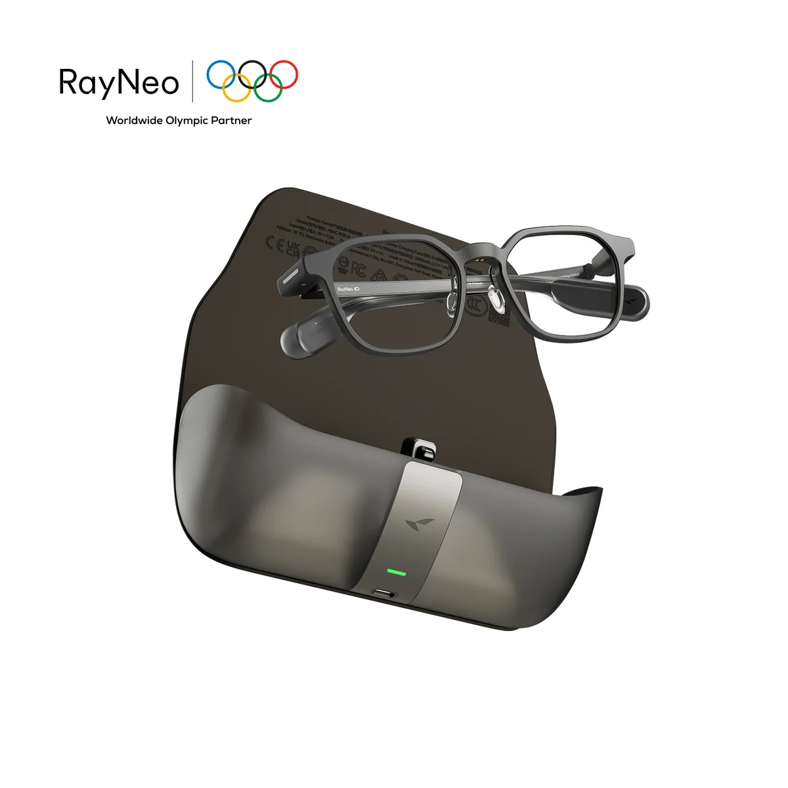
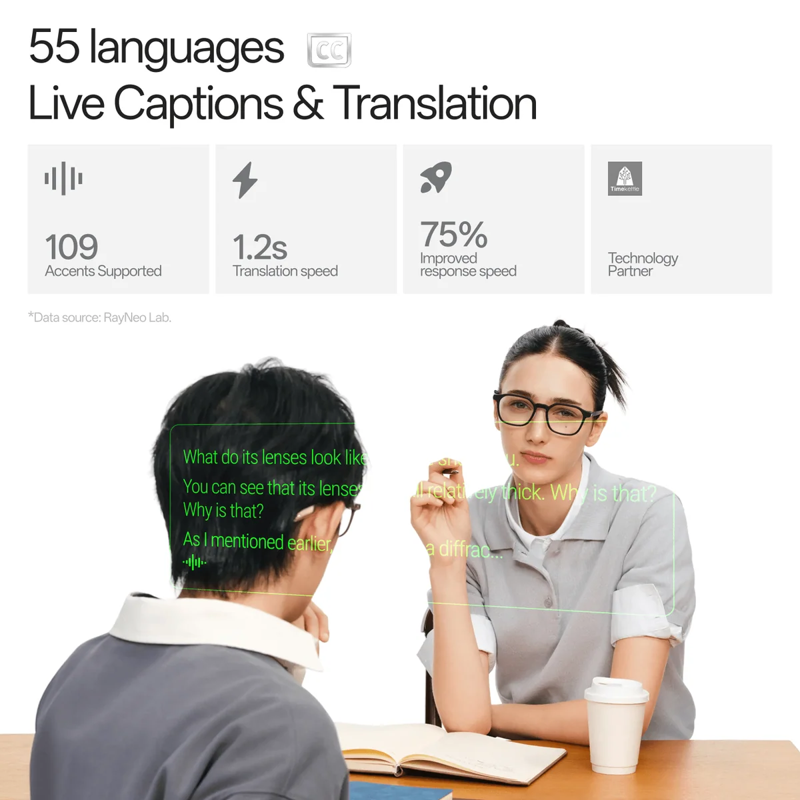
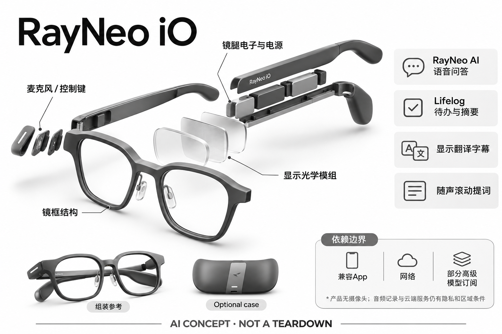

# RayNeo iO

**RayNeo** · AI 眼镜 · 核查 2026-11-04

轻量无相机显示眼镜中的语音记忆与字幕

消费渠道：个人零售。

## 产品图片与结构参考

### 产品图

RayNeo iO官方眼镜与可选充电盒展示 · 来源：[RayNeo · 官方产品图片](<https://www.rayneo.com/products/rayneo-io-ai-glasses>) · [原始图片](<https://cdn.shopify.com/s/files/1/0688/8642/9983/files/iO_35d556fc-4a3b-459f-838b-dd37aad44fc3.png?v=1788345969&width=1200>)

### 参考图

RayNeo iO官方另一角度或使用场景参考 · 来源：[RayNeo · 官方产品图片](<https://www.rayneo.com/products/rayneo-io-ai-glasses>) · [原始图片](<https://cdn.shopify.com/s/files/1/0688/8642/9983/files/4_25b77f35-f2d5-47ca-8aa1-d13869d3dc2e.png?v=1788345969&width=1200>)

### AI 生成爆炸示意

**AI 生成 · 非实物拆机。** 内部为概念推断，不能作为元件布局、BOM 或维修依据。[生成提示词](../../content/hardware/prompts/rayneo-io.txt)

> 外形依据核验参考图；内部位置、模块形状与装配关系仅作AI概念展示。

> 已逐张查看并核对型号。源图未改色/裁切；场景、界面、附件、优惠及效果文案仅为厂商示意，不作为本目录性能或现价依据。

> 分析为基于公开资料的案头研究与 AI 辅助判断，未经用户访谈、销量审计或实物拆机。需求、画像、竞争冷门度、审美及商业机会均为研究假设，不是投资结论。

## 销售与购买

- 状态：在售。官方商品页明确Polar Night Grey Standard为In Stock并可Add To Cart；金色配置Sold Out未作为可购依据，充电盒套装不另计。

- 地区：所列官方区域或授权零售渠道；配送地址与服务支持需结算确认

- 价格：灰色Standard US$499。核查日所见单机或基本配置价；币种、促销、税费、镜片、附件及服务依地区结算，不把颜色或套装重复计数。

- 中国大陆：本次未核实该具体型号在中国大陆的官方销售和完整服务支持；海外在售不等于国内可直接启用全部功能。

- [官方产品 / 商店](<https://www.rayneo.com/products/rayneo-io-ai-glasses>)

## AI 的实际作用

RayNeo AI及可选大模型处理语音问答，Lifelog提取待办与摘要，显示翻译字幕和随声滚动的提词内容

服务与联网依赖：兼容App、网络及部分高级模型订阅；产品无摄像头，音频记录与云端服务仍有隐私和区域条件

## 是否冷门

新兴竞争（研究判断）：按任务与形态作案头分类，无访谈、销量或市场份额证据。

## 需求与市场

需求假设：需要轻量的镜内字幕和记录功能，但不希望为拍摄相机增加重量和社交负担。价值应由实际使用频率、任务完成与操作负担验证，不能把AI功能存在或演示流畅当作需求已得到满足。

## 用户画像

画像推断：经常阅读提示、做演示或整理个人对话笔记，愿意管理记录权限的用户。个人的语言、操作习惯、环境和预算会改变适配结果，本次只有案头研究，没有用户访谈或长期使用观察。

## 竞争与替代

案头判断：与Halliday、Even以及手机转录竞争，细分优势来自显示与轻量佩戴取舍。这只是用途与替代品比较，不是市场份额或销量结论；专业细分和较少曝光也不代表没有成熟竞争者。

## 供应链

公开资料可核对透明显示光学、镜腿麦克风、Smart Crown与轻量镜框，具体整机工厂、关键模块供应商与BOM本次未确认。制造重点可从形态推断，但不能把品牌所在地、外观相似或营销合作等同代工关系。

## 技术路径

RayNeo AI及可选大模型处理语音问答，Lifelog提取待办与摘要，显示翻译字幕和随声滚动的提词内容。这是厂商披露的功能机制；模型版本、准确率及内部结构未完整公开。架构只表示输入、处理和输出关系，不作为真实拆机或性能实测。

## 产品审美

图示观察：较细的镜框和圆润镜形接近日常眼镜，按键冠形交互形成辨识。宣传图片只能帮助理解外观和摆放方式，不能证明每个人的舒适度、长时使用体验或实际材料触感。

## 关键风险

无摄像头不代表没有音频隐私风险；会员、模型更替和字幕错误会影响实际可用性，处方配镜另需核对。还需核对地区功能、软件更新与售后边界；本目录未进行实机、医学或可靠性测试，不把厂商演示当作结果保证。

## 机会与验证

市场差异主要在于轻量无相机显示眼镜中的语音记忆与字幕。值得进一步验证的购买理由是它能否减少既有任务中的具体步骤，以及硬件、服务与维护的总成本是否符合个人使用频率。

## 功能分层示意

这是功能关系，不是实物拆机、真实空间结构或已核实 BOM。

1. **实体输入**：透明显示光学、镜腿麦克风、Smart Crown与轻量镜框；仅功能层示意，非拆机。（官方披露）

2. **采集与控制**：设备把输入转为可处理的信息并接收用户操作；具体内部布局未知。（分析推断）

3. **AI功能**：RayNeo AI及可选大模型处理语音问答，Lifelog提取待办与摘要，显示翻译字幕和随声滚动的提词内容（官方披露）

4. **服务依赖**：兼容App、网络及部分高级模型订阅；产品无摄像头，音频记录与云端服务仍有隐私和区域条件（官方披露）

5. **用户反馈**：用户通过声音、屏幕或配套应用接收结果，并对重要信息复核。（分析推断）

## 来源

1. [RayNeo iO官方在售配置](<https://www.rayneo.com/products/rayneo-io-ai-glasses>) — 已打开一手页面；产品能力为厂商披露，未进行实机或效果验证。

2. [RayNeo官方AI眼镜分类](<https://www.rayneo.com/collections/ai-glasses>) — 已打开一手页面；产品能力为厂商披露，未进行实机或效果验证。

3. [RayNeo官方配送政策](<https://www.rayneo.com/policies/shipping-policy>) — 已打开一手页面；产品能力为厂商披露，未进行实机或效果验证。

[返回目录](../hardware-market.md) · [网页分析](https://romanagent.github.io/Roman/#hardware/product/rayneo-io)
