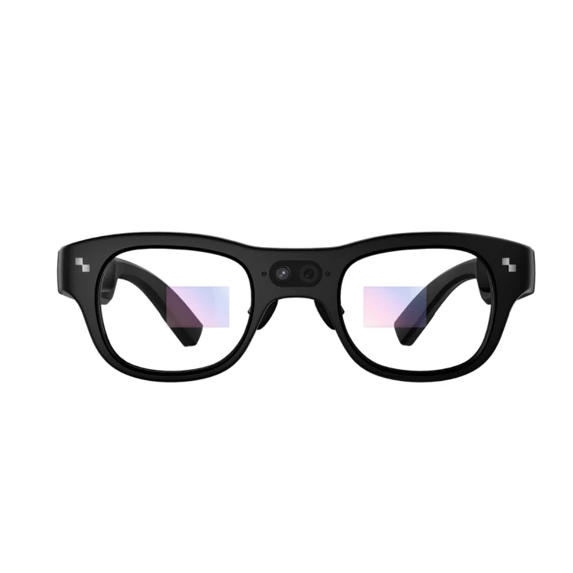
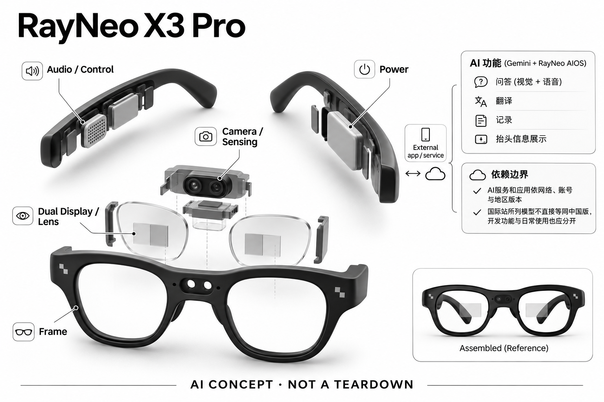

# RayNeo X3 Pro

**RayNeo** · AI 眼镜 · 核查 2026-11-04

相机与全彩AR显示结合的AI眼镜

消费渠道：个人零售。

## 产品图片与结构参考

### 产品图

RayNeo X3 Pro官方产品外形图 · 来源：[RayNeo · 官方产品图片](<https://www.rayneo.com/products/x3-pro-ai-display-glasses>) · [原始图片](<https://cdn.shopify.com/s/files/1/0688/8642/9983/files/51475.png?v=1774235866&width=1200>)

### 参考图

RayNeo X3 Pro官方另一角度或使用场景参考 · 来源：[RayNeo · 官方产品图片](<https://www.rayneo.com/products/x3-pro-ai-display-glasses>) · [原始图片](<https://cdn.shopify.com/s/files/1/0688/8642/9983/files/PP3_a3d321d5-bcc7-429b-b53b-8d7d9add5dbc.png?v=1786523230&width=1200>)

### AI 生成爆炸示意

**AI 生成 · 非实物拆机。** 内部为概念推断，不能作为元件布局、BOM 或维修依据。[生成提示词](../../content/hardware/prompts/rayneo-x3-pro.txt)

> 外形依据核验参考图；内部位置、模块形状与装配关系仅作AI概念展示。

> 已逐张查看并核对型号。源图未改色/裁切；场景、界面、附件、优惠及效果文案仅为厂商示意，不作为本目录性能或现价依据。

> 分析为基于公开资料的案头研究与 AI 辅助判断，未经用户访谈、销量审计或实物拆机。需求、画像、竞争冷门度、审美及商业机会均为研究假设，不是投资结论。

## 销售与购买

- 状态：在售。官方具体X3 Pro商品页显示US$1,299及Add To Cart；当前AI系列页区分X3 Pro可购与X2售罄，不计入X2。

- 地区：所列官方区域或授权零售渠道；配送地址与服务支持需结算确认

- 价格：US$1,299。核查日所见单机或基本配置价；币种、促销、税费、镜片、附件及服务依地区结算，不把颜色或套装重复计数。

- 中国大陆：本次未核实该具体型号在中国大陆的官方销售和完整服务支持；海外在售不等于国内可直接启用全部功能。

- [官方产品 / 商店](<https://www.rayneo.com/products/x3-pro-ai-display-glasses>)

## AI 的实际作用

Gemini支持结合视觉与语音的问答，配合RayNeo AIOS提供翻译、记录和抬头信息展示

服务与联网依赖：AI服务和应用依网络、账号与地区版本；国际站所列模型不直接等同中国版，开发功能与日常使用也应分开

## 是否冷门

新兴竞争（研究判断）：按任务与形态作案头分类，无访谈、销量或市场份额证据。

## 需求与市场

需求假设：希望随身查看环境相关答案、翻译和导航，不反复在相机与手机界面之间切换。价值应由实际使用频率、任务完成与操作负担验证，不能把AI功能存在或演示流畅当作需求已得到满足。

## 用户画像

画像推断：愿意接受较厚镜腿、充电与软件配置的个人科技爱好者和跨语言交流用户。个人的语言、操作习惯、环境和预算会改变适配结果，本次只有案头研究，没有用户访谈或长期使用观察。

## 竞争与替代

案头判断：与轻量音频眼镜、无相机显示眼镜和外接屏AR设备竞争，后者不能仅因有显示就算AI。这只是用途与替代品比较，不是市场份额或销量结论；专业细分和较少曝光也不代表没有成熟竞争者。

## 供应链

公开资料可核对前向相机、双目全彩显示光学、镜腿音频与计算模块，具体整机工厂、关键模块供应商与BOM本次未确认。制造重点可从形态推断，但不能把品牌所在地、外观相似或营销合作等同代工关系。

## 技术路径

Gemini支持结合视觉与语音的问答，配合RayNeo AIOS提供翻译、记录和抬头信息展示。这是厂商披露的功能机制；模型版本、准确率及内部结构未完整公开。架构只表示输入、处理和输出关系，不作为真实拆机或性能实测。

## 产品审美

图示观察：宽镜腿和明显镜桥区域强调集成光学与相机，设备感强于普通眼镜。宣传图片只能帮助理解外观和摆放方式，不能证明每个人的舒适度、长时使用体验或实际材料触感。

## 关键风险

视野内信息可能干扰出行，拍摄及环境识别涉及旁人；续航、应用兼容性和地区模型限制需实际确认。还需核对地区功能、软件更新与售后边界；本目录未进行实机、医学或可靠性测试，不把厂商演示当作结果保证。

## 机会与验证

市场差异主要在于相机与全彩AR显示结合的AI眼镜。值得进一步验证的购买理由是它能否减少既有任务中的具体步骤，以及硬件、服务与维护的总成本是否符合个人使用频率。

## 功能分层示意

这是功能关系，不是实物拆机、真实空间结构或已核实 BOM。

1. **实体输入**：前向相机、双目全彩显示光学、镜腿音频与计算模块；仅功能层示意，非拆机。（官方披露）

2. **采集与控制**：设备把输入转为可处理的信息并接收用户操作；具体内部布局未知。（分析推断）

3. **AI功能**：Gemini支持结合视觉与语音的问答，配合RayNeo AIOS提供翻译、记录和抬头信息展示（官方披露）

4. **服务依赖**：AI服务和应用依网络、账号与地区版本；国际站所列模型不直接等同中国版，开发功能与日常使用也应分开（官方披露）

5. **用户反馈**：用户通过声音、屏幕或配套应用接收结果，并对重要信息复核。（分析推断）

## 来源

1. [RayNeo X3 Pro官方商店](<https://www.rayneo.com/products/x3-pro-ai-display-glasses>) — 已打开一手页面；产品能力为厂商披露，未进行实机或效果验证。

2. [RayNeo官方AI眼镜系列与功能](<https://www.rayneo.com/collections/ai-glasses>) — 已打开一手页面；产品能力为厂商披露，未进行实机或效果验证。

3. [RayNeo官方配送政策](<https://www.rayneo.com/policies/shipping-policy>) — 已打开一手页面；产品能力为厂商披露，未进行实机或效果验证。

[返回目录](../hardware-market.md) · [网页分析](https://romanagent.github.io/Roman/#hardware/product/rayneo-x3-pro)
