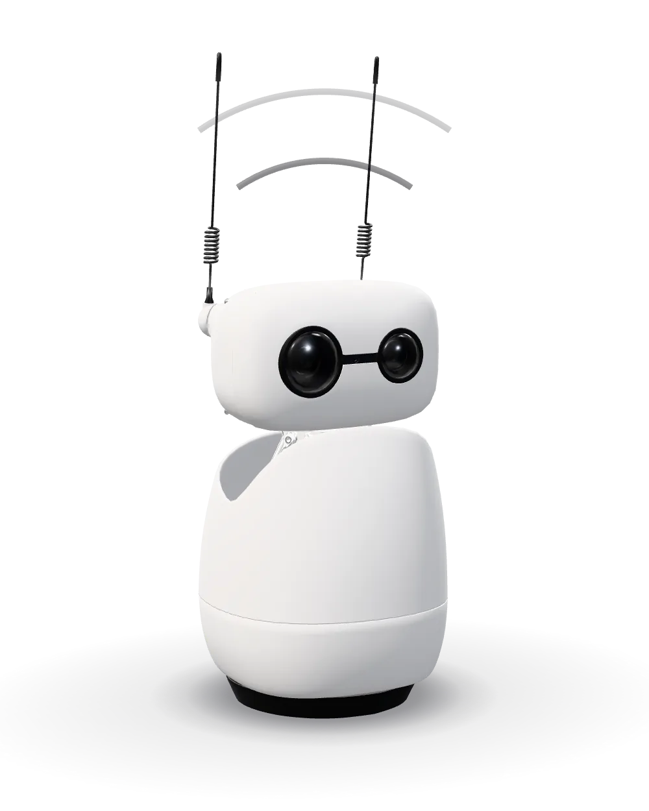
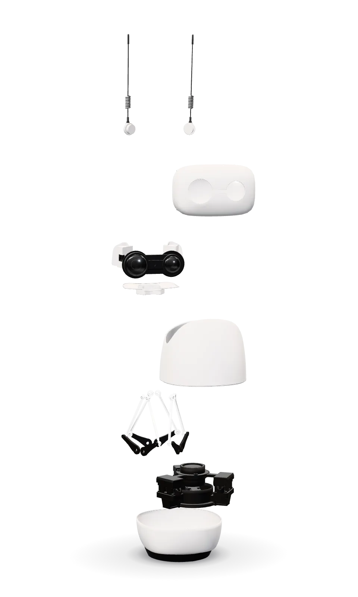
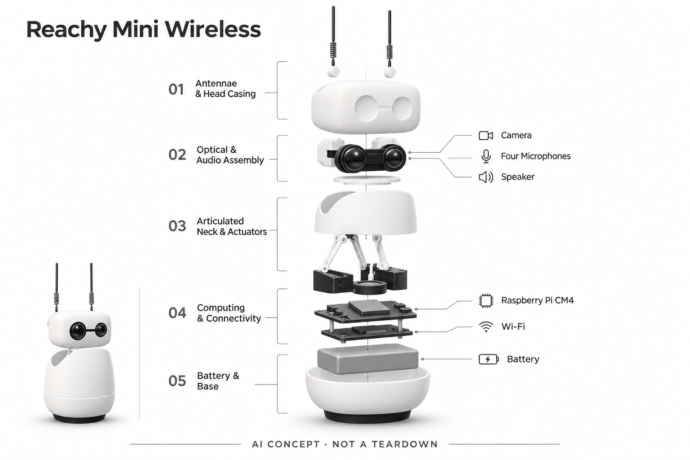

# Reachy Mini Wireless

**Pollen Robotics / Hugging Face** · AI玩具 · 核查 2026-11-06

个人爱好者可自行装配、用手机开启对话与社区应用的独立桌面机器人。

消费渠道：消费预订。

## 产品图片与结构参考

### 产品图

Reachy Mini 官方产品外观图 · 来源：[Pollen Robotics / Hugging Face](<https://pollen-robotics.com/reachy-mini/>) · [原始图片](<https://pollen-robotics.com/assets/talk/reachy-3d-still-facing-right.webp>)

### 官方结构参考

官方装配部件参考图 · 来源：[Pollen Robotics / Hugging Face](<https://pollen-robotics.com/reachy-mini/>) · [原始图片](<https://pollen-robotics.com/assets/build/reachy-mini-plate.webp>)

### AI 生成爆炸示意

**AI 生成 · 非实物拆机。** 内部为概念推断，不能作为元件布局、BOM 或维修依据。[生成提示词](../../content/hardware/prompts/reachy-mini-wireless.txt)

> 分析为基于公开资料的案头研究与 AI 辅助判断，未经用户访谈、销量审计或实物拆机。需求、画像、竞争冷门度、审美及商业机会均为研究假设，不是投资结论。

## 销售与购买

- 状态：预售 / 接受延期订单。当前Wireless官方商品可加购，并明确建议非开发者使用；仍为DIY套件，最长90天交付，因此按有明确订单与交期的预订记录，不标现货。

- 地区：欧盟 / 英国、美国 / 加拿大、其他地区经指定 Seeed 渠道

- 价格：US$499 / 欧洲店 €435。Wireless官网美元参考价499、欧洲商品价435欧元；运费、税费与地区结算条件需以具体订单确认。Lite与另购底座、帽子等配件价格不并入本体。

- 中国大陆：Pollen官方把欧盟/英国、美国/加拿大以外订单导向Seeed；本轮Seeed具体商店页读取超时，未确认大陆库存、含税价与保修，不能因中国制造推定国内现货。

- [官方产品 / 商店](<https://store.pollen-robotics.com/products/reachy-mini-wireless-version>)

## AI 的实际作用

当前官方提供内置对话与可安装的语音、视觉和动作应用；Wireless内置CM4，手机完成常规设置，实体相机、音频与运动机构承载交互。不同应用的智能能力与数据路径需分别核对。

服务与联网依赖：先自行装配，再通过手机App、Wi-Fi与Hugging Face账户使用；无需外接电脑不等于全部AI离线，社区应用可能有外部服务和费用。旧固件或故障恢复可能仍需电脑，移动底座及NFC帽子另购。

## 是否冷门

细分专业（研究判断）：主要面向愿意动手装配和尝试应用的个人爱好者；零编程入口扩大用途，但仍有套件维护门槛与多种替代方案。

## 需求与市场

Wireless当前提供内置语音对话和手机应用入口，装配完成后个人爱好者可以先体验机器人回应，再逐步尝试社区玩法。需求因此不再限于编写底层程序，可能来自想亲手完成实体机器人并持续探索的人；但这不意味着它已成为无需维护的家用助手，购买价值仍要落到实际反复参与的任务。

### 从开发载体到个人玩法 · 研究判断

Wireless当前提供内置语音对话和手机应用入口，装配完成后个人爱好者可以先体验机器人回应，再逐步尝试社区玩法。需求因此不再限于编写底层程序，可能来自想亲手完成实体机器人并持续探索的人；但这不意味着它已成为无需维护的家用助手，购买价值仍要落到实际反复参与的任务。

依据：[Reachy Mini Wireless当前官方商品](<https://store.pollen-robotics.com/products/reachy-mini-wireless-version>) · [Reachy Mini当前官方产品介绍](<https://pollen-robotics.com/reachy-mini/>) · [Reachy Mini当前上手流程](<https://pollen-robotics.com/reachy-mini/getting-started/>)

### 装配也是体验成本 · 研究判断

套件约需两个半小时组装，对喜欢动手的人可能是体验的一部分，对只想开箱聊天的人却是门槛。电机、接线和外壳让软件交互变得可触及，同时也带来排障任务；需求研究应区分装配乐趣、创意学习与长期陪伴，不能把成功完成一次演示当成所有用户都需要的日用品。

依据：[Reachy Mini Wireless当前官方商品](<https://store.pollen-robotics.com/products/reachy-mini-wireless-version>) · [Reachy Mini当前官方产品介绍](<https://pollen-robotics.com/reachy-mini/>) · [Reachy Mini当前上手流程](<https://pollen-robotics.com/reachy-mini/getting-started/>)

### 需求验证 · 待验证

可让具有基本动手能力的个人完成一次装配和手机设置，再连续体验一个对话应用与一个动作玩法，记录独立完成率、求助次数和后续主动使用。与手机语音助手及自制开发板套件比较，确认实体运动和整合交付带来的价值，而不是用社区应用数量替代真实个人需求。

依据：[Reachy Mini Wireless当前官方商品](<https://store.pollen-robotics.com/products/reachy-mini-wireless-version>) · [Reachy Mini当前官方产品介绍](<https://pollen-robotics.com/reachy-mini/>) · [Reachy Mini当前上手流程](<https://pollen-robotics.com/reachy-mini/getting-started/>)

## 用户画像

当前官方商店明确建议非开发者选择Wireless，本条因此定位为愿意装配与管理应用的个人爱好者，而非仅有机构采购用途。用户仍需手机、网络及账户，并能跟随说明连接部件；这与没有技术维护能力的低龄儿童独立使用不同，不能把无需编程解释为没有任何使用条件。

### 个人爱好者的边界 · 研究判断

当前官方商店明确建议非开发者选择Wireless，本条因此定位为愿意装配与管理应用的个人爱好者，而非仅有机构采购用途。用户仍需手机、网络及账户，并能跟随说明连接部件；这与没有技术维护能力的低龄儿童独立使用不同，不能把无需编程解释为没有任何使用条件。

依据：[Reachy Mini Wireless当前官方商品](<https://store.pollen-robotics.com/products/reachy-mini-wireless-version>) · [Reachy Mini当前官方产品介绍](<https://pollen-robotics.com/reachy-mini/>) · [Reachy Mini当前上手流程](<https://pollen-robotics.com/reachy-mini/getting-started/>)

### 两种学习路径 · 研究判断

一类用户先安装现成应用，通过对话、动作录制和游戏了解机器人；另一类会继续写程序或修改外观。两者可以共用硬件，却对教程、故障恢复和应用质量有不同要求，因此画像不能只用开发者或普通消费者二分，也不应把自带电脑的Lite版门槛套到Wireless。

依据：[Reachy Mini Wireless当前官方商品](<https://store.pollen-robotics.com/products/reachy-mini-wireless-version>) · [Reachy Mini当前官方产品介绍](<https://pollen-robotics.com/reachy-mini/>) · [Reachy Mini当前上手流程](<https://pollen-robotics.com/reachy-mini/getting-started/>)

### 画像验证 · 待验证

建议分别观察零编程但喜欢装配的成人、有经验的创客以及有人辅导的学习者，检查能否区分本体、移动底座和帽子扩展等另购项目。记录他们能否自行安装与移除应用、解释相机麦克风用途，以及处理简单网络问题，不以年龄或职业标签代替真实能力判断。

依据：[Reachy Mini Wireless当前官方商品](<https://store.pollen-robotics.com/products/reachy-mini-wireless-version>) · [Reachy Mini当前官方产品介绍](<https://pollen-robotics.com/reachy-mini/>) · [Reachy Mini当前上手流程](<https://pollen-robotics.com/reachy-mini/getting-started/>)

## 竞争与替代

Wireless与封闭陪伴机器人、手机角色应用和自制舵机套件竞争，差异是独立本机计算、可装社区应用与可修改结构同时存在。它提供比较完整的硬件基础，却仍需要动手装配，不能把开放性自动当成优点；只想稳定聊天的人可能更看重封闭设备的一致体验和清楚售后。

### 比较对象 · 研究判断

Wireless与封闭陪伴机器人、手机角色应用和自制舵机套件竞争，差异是独立本机计算、可装社区应用与可修改结构同时存在。它提供比较完整的硬件基础，却仍需要动手装配，不能把开放性自动当成优点；只想稳定聊天的人可能更看重封闭设备的一致体验和清楚售后。

依据：[Reachy Mini Wireless当前官方商品](<https://store.pollen-robotics.com/products/reachy-mini-wireless-version>) · [Reachy Mini当前官方产品介绍](<https://pollen-robotics.com/reachy-mini/>) · [Reachy Mini当前上手流程](<https://pollen-robotics.com/reachy-mini/getting-started/>)

### Lite与配件不混用 · 研究判断

Lite依赖外部电脑，Wireless内置计算和电池，官方还说明两者不能直接改装升级，因此价格和门槛必须分开。可选轮式底座和NFC帽子也不是默认整机能力，本条不把这些配件加购后的移动或角色切换算成基础套件已附送，避免比较时出现不相等的总成本。

依据：[Reachy Mini Wireless当前官方商品](<https://store.pollen-robotics.com/products/reachy-mini-wireless-version>) · [Reachy Mini当前官方产品介绍](<https://pollen-robotics.com/reachy-mini/>) · [Reachy Mini当前上手流程](<https://pollen-robotics.com/reachy-mini/getting-started/>)

### 比较验证 · 待验证

应以相同对话、视觉跟随和动作创作任务比较首次运行时间、稳定性与维护劳动，并分别记录使用现成应用和自行开发的结果。对自制套件要计算集成时间，对封闭产品要计算功能限制；不能仅以自由度、应用数或开源标签推导所有个人用户都会选择Wireless。

依据：[Reachy Mini Wireless当前官方商品](<https://store.pollen-robotics.com/products/reachy-mini-wireless-version>) · [Reachy Mini当前官方产品介绍](<https://pollen-robotics.com/reachy-mini/>) · [Reachy Mini当前上手流程](<https://pollen-robotics.com/reachy-mini/getting-started/>)

## 供应链

官方商店列出CM4、相机、麦克风、扬声器、电机、结构件与供电，Seeed资料明确其参与Reachy Mini系列优化制造。公开合作可以支持系列层面的关系说明，却不是完整物料清单，也不能证明每个批次中所有器件都由同一家公司提供；现有媒体仍按原有资料保留来源。

### 已公开的模块和协作 · 官方资料

官方商店列出CM4、相机、麦克风、扬声器、电机、结构件与供电，Seeed资料明确其参与Reachy Mini系列优化制造。公开合作可以支持系列层面的关系说明，却不是完整物料清单，也不能证明每个批次中所有器件都由同一家公司提供；现有媒体仍按原有资料保留来源。

依据：[Reachy Mini Wireless当前官方商品](<https://store.pollen-robotics.com/products/reachy-mini-wireless-version>) · [Seeed Reachy Mini制造与入门资料](<https://wiki.seeedstudio.com/reachymini_getting_started/>)

### 套件交付约束 · 研究判断

用户自行安装意味着包装分组、备件、说明和线材标识会直接影响成功率，松动接线可能被误认为电机故障。多个舵机动作需要供电、机械公差和软件限位协同，不能把内置计算板的采购价格当成整套机器人成本；实际工厂配置、良率与售后成本没有公开可核数据。

依据：[Reachy Mini Wireless当前官方商品](<https://store.pollen-robotics.com/products/reachy-mini-wireless-version>) · [Reachy Mini当前官方产品介绍](<https://pollen-robotics.com/reachy-mini/>) · [Reachy Mini当前上手流程](<https://pollen-robotics.com/reachy-mini/getting-started/>)

### 候选选型与证据边界 · 研究判断

飞特公开的总线舵机和反馈控制能力可作为类似桌面多轴机构的重新选型候选，但本轮没有核到其被本型号点名采用。Seeed保留已披露系列制造关系，飞特只保留能力匹配；选择替代件还要核尺寸、接口、供电、噪声及寿命，不表示原厂零件可直接换成任意候选。

依据：[Reachy Mini Wireless当前官方商品](<https://store.pollen-robotics.com/products/reachy-mini-wireless-version>) · [Reachy Mini当前官方产品介绍](<https://pollen-robotics.com/reachy-mini/>) · [Reachy Mini当前上手流程](<https://pollen-robotics.com/reachy-mini/getting-started/>)

## 技术路径

Wireless内置计算机并自动运行控制服务，手机用于设置、连接和选择玩法；对话、视觉或远程操作由具体应用组织。无需外接电脑并不等于所有模型都在本机离线运行，厂商当前网页也不能代表每个社区应用的云端依赖、账户资格和费用完全相同，应按应用逐项核查。

### 端侧控制与应用分工 · 研究判断

Wireless内置计算机并自动运行控制服务，手机用于设置、连接和选择玩法；对话、视觉或远程操作由具体应用组织。无需外接电脑并不等于所有模型都在本机离线运行，厂商当前网页也不能代表每个社区应用的云端依赖、账户资格和费用完全相同，应按应用逐项核查。

依据：[Reachy Mini Wireless当前官方商品](<https://store.pollen-robotics.com/products/reachy-mini-wireless-version>) · [Reachy Mini当前官方产品介绍](<https://pollen-robotics.com/reachy-mini/>) · [Reachy Mini当前上手流程](<https://pollen-robotics.com/reachy-mini/getting-started/>)

### 实体同步难点 · 研究判断

语音理解、相机输入与头部天线动作需要在同一交互时序中配合，回答自然并不保证动作及时或方向正确。桌面反光、房间噪声和网络隔离都会影响实际表现，开放接口给用户修改空间，也让错误配置更容易出现；技术评价要关注稳定的整机行为而非单一模型效果。

依据：[Reachy Mini Wireless当前官方商品](<https://store.pollen-robotics.com/products/reachy-mini-wireless-version>) · [Reachy Mini当前官方产品介绍](<https://pollen-robotics.com/reachy-mini/>) · [Reachy Mini当前上手流程](<https://pollen-robotics.com/reachy-mini/getting-started/>)

### 技术验证 · 待验证

建议先运行厂商提供的基本对话，再安装一个视觉应用和动作录制应用，分别测试断网、后台恢复和重复启动。记录哪些步骤由手机完成、哪些异常仍需电脑恢复，并观察声音与动作不同步的情况；本轮没有实物测试，不宣称所有社区应用都通过兼容性验证。

依据：[Reachy Mini Wireless当前官方商品](<https://store.pollen-robotics.com/products/reachy-mini-wireless-version>) · [Reachy Mini当前官方产品介绍](<https://pollen-robotics.com/reachy-mini/>) · [Reachy Mini当前上手流程](<https://pollen-robotics.com/reachy-mini/getting-started/>)

## 产品审美

简洁白色外壳、两只圆形眼部结构和可动天线减少工业设备的距离感，用户能通过头部姿态感知回应。其表情更多来自动作而非复杂屏幕动画，适合放在桌面陪伴创作；但机械运动和停机姿态也可能显得突兀，不能只凭宣传图中的可爱造型推断长期接受度。

### 外观与角色表达 · 研究判断

简洁白色外壳、两只圆形眼部结构和可动天线减少工业设备的距离感，用户能通过头部姿态感知回应。其表情更多来自动作而非复杂屏幕动画，适合放在桌面陪伴创作；但机械运动和停机姿态也可能显得突兀，不能只凭宣传图中的可爱造型推断长期接受度。

依据：[Reachy Mini Wireless当前官方商品](<https://store.pollen-robotics.com/products/reachy-mini-wireless-version>) · [Reachy Mini当前官方产品介绍](<https://pollen-robotics.com/reachy-mini/>) · [Reachy Mini当前上手流程](<https://pollen-robotics.com/reachy-mini/getting-started/>)

### 装配可理解性 · 研究判断

公开结构与装配步骤使用户有机会理解自己的机器人，也让外观不再只是不可拆的壳。线材走向、部件缝隙和动作空间会影响完成后的整洁感，个性外壳又可能改变散热或遮挡；审美评价应同时关注装配后的可维护性，不鼓励为了视觉效果随意改动安全相关结构。

依据：[Reachy Mini Wireless当前官方商品](<https://store.pollen-robotics.com/products/reachy-mini-wireless-version>) · [Reachy Mini当前官方产品介绍](<https://pollen-robotics.com/reachy-mini/>) · [Reachy Mini当前上手流程](<https://pollen-robotics.com/reachy-mini/getting-started/>)

### 桌面体验验证 · 待验证

可以在真实书桌上记录机器人与显示器、台灯和麦克风的位置关系，观察电机声音、充电线和动作范围是否干扰工作。比较用户装配前后的外观预期，以及长期使用后是否仍愿意摆放；现有照片与概念图仅辅助理解，不当作噪声、材质或耐久的实测证据。

依据：[Reachy Mini Wireless当前官方商品](<https://store.pollen-robotics.com/products/reachy-mini-wireless-version>) · [Reachy Mini当前官方产品介绍](<https://pollen-robotics.com/reachy-mini/>) · [Reachy Mini当前上手流程](<https://pollen-robotics.com/reachy-mini/getting-started/>)

## 关键风险

官方购买入口接受订单，但注明最长九十天交付，本条保留预订口径而非保证现货。个人用户还需要完成装配和必要排障，官方所称无需焊接并不消除接线或扭矩错误；购买前应同时考虑等待、安装与售后条件，而不能只看到内置对话就把它当成拆箱即用的普通玩偶。

### 套件和交期风险 · 研究判断

官方购买入口接受订单，但注明最长九十天交付，本条保留预订口径而非保证现货。个人用户还需要完成装配和必要排障，官方所称无需焊接并不消除接线或扭矩错误；购买前应同时考虑等待、安装与售后条件，而不能只看到内置对话就把它当成拆箱即用的普通玩偶。

依据：[Reachy Mini Wireless当前官方商品](<https://store.pollen-robotics.com/products/reachy-mini-wireless-version>) · [Reachy Mini当前官方产品介绍](<https://pollen-robotics.com/reachy-mini/>) · [Reachy Mini当前上手流程](<https://pollen-robotics.com/reachy-mini/getting-started/>)

### 应用与数据风险 · 研究判断

社区应用可能访问摄像头、麦克风或外部服务，开放源代码不代表每个用户都会审查，也不保证全部应用采用相同隐私设置。某些旧文档关于本地处理的表述不能直接覆盖新应用生态，需要按实际安装内容确认数据去向、费用与停用方式，避免把平台能力当作统一承诺。

依据：[Reachy Mini Wireless当前官方商品](<https://store.pollen-robotics.com/products/reachy-mini-wireless-version>) · [Reachy Mini当前官方产品介绍](<https://pollen-robotics.com/reachy-mini/>) · [Reachy Mini当前上手流程](<https://pollen-robotics.com/reachy-mini/getting-started/>)

### 维护与使用验证 · 待验证

应验证应用卸载、账户退出、相机麦克风停用和系统恢复路径，确认出现机械或网络异常时用户能找到清楚帮助。官方FAQ提到极旧固件恢复可能需要电脑，因此正常手机使用与故障维护边界要分开；本轮不代表独立安全认证，也没有证据支持儿童无人监督使用。

依据：[Reachy Mini Wireless当前官方商品](<https://store.pollen-robotics.com/products/reachy-mini-wireless-version>) · [Reachy Mini当前官方产品介绍](<https://pollen-robotics.com/reachy-mini/>) · [Reachy Mini当前上手流程](<https://pollen-robotics.com/reachy-mini/getting-started/>)

## 机会与验证

Wireless通过本机计算和手机入口，把实体AI体验从必须编写代码扩展到先玩现成应用、再逐步创作的个人路径。可验证的机会是减少从兴趣到第一次成功互动的距离，而不是单纯增加更多动作或配件；装配、应用质量和持续支持需要一起成立，才能形成重复使用价值。

### 机会判断 · 研究判断

Wireless通过本机计算和手机入口，把实体AI体验从必须编写代码扩展到先玩现成应用、再逐步创作的个人路径。可验证的机会是减少从兴趣到第一次成功互动的距离，而不是单纯增加更多动作或配件；装配、应用质量和持续支持需要一起成立，才能形成重复使用价值。

依据：[Reachy Mini Wireless当前官方商品](<https://store.pollen-robotics.com/products/reachy-mini-wireless-version>) · [Reachy Mini当前官方产品介绍](<https://pollen-robotics.com/reachy-mini/>) · [Reachy Mini当前上手流程](<https://pollen-robotics.com/reachy-mini/getting-started/>)

### 服务与学习方向 · 研究判断

清楚的应用权限说明、适合初学者的玩法组合和简单的故障定位，可能比不断展示技术参数更能服务个人爱好者。开放外观和动作创作也有教学潜力，但不能从教程存在推导学习成果；后续可针对具体创作任务评估，而不是把所有社区内容都称为已验证教育产品。

依据：[Reachy Mini Wireless当前官方商品](<https://store.pollen-robotics.com/products/reachy-mini-wireless-version>) · [Reachy Mini当前官方产品介绍](<https://pollen-robotics.com/reachy-mini/>) · [Reachy Mini当前上手流程](<https://pollen-robotics.com/reachy-mini/getting-started/>)

### 商业验证 · 待验证

可比较个人爱好者使用Wireless、Lite加电脑与自制套件的总支出和维护时间，区分首次装配成就感和一个月后的持续玩法。记录应用退装、闲置、备件需求与付费服务依赖，确认用户愿意为哪些整合能力付费，不从开发者社区人数或展示视频观看量推算消费市场规模。

依据：[Reachy Mini Wireless当前官方商品](<https://store.pollen-robotics.com/products/reachy-mini-wireless-version>) · [Reachy Mini当前官方产品介绍](<https://pollen-robotics.com/reachy-mini/>) · [Reachy Mini当前上手流程](<https://pollen-robotics.com/reachy-mini/getting-started/>)

## 对应供应链公司

能力候选用于选型研究，不代表本产品实际采用；未公开的供货关系不作推断。

- [seeed-studio](../supply-chain/seeed-studio.md) — **公开披露关系** / Reachy Mini系列优化制造与指定经销：Seeed本轮打开的官方资料明确其优化和制造Reachy Mini，Pollen产品页也列其为部分地区购买渠道；此关系限定系列协作与经销，不代表完整BOM、每个批次的器件来源或所有地区库存。

- [feetech](../supply-chain/feetech.md) — **能力候选 · 非已采用** / 桌面多轴机构的总线舵机选型：飞特公开总线舵机、状态反馈和工程资料，与桌面机器人多轴动作的需求相符，但本轮未核到Reachy Mini Wireless的点名采用证据；尺寸、电压、协议、噪声和持续负载仍需确认，不能据候选能力直接替换原机部件。

[浏览供应链目录](../supply-chain.md)

## 功能分层示意

这是功能关系，不是实物拆机、真实空间结构或已核实 BOM。

1. **表情与外壳**：官方装配资料列出天线、头部、机身等结构。（官方披露）

2. **视觉与音频**：相机、四麦克风与扬声器为交互提供输入输出。（官方披露）

3. **本机计算**：Wireless 内置 Raspberry Pi CM4、Wi-Fi 与电池。（官方披露）

4. **运动机构**：头颈、电机和底座参与实体动作，参见官方装配图。（官方披露）

5. **应用与模型**：应用生态可连接模型；每个应用的云依赖需要分别核查。（官方披露）

## 来源

1. [Reachy Mini Wireless当前官方商品](<https://store.pollen-robotics.com/products/reachy-mini-wireless-version>) — 本轮打开，明确Suggested for non-developers、可加购、CM4、电池、套件内容和最长90天交期；不将促销或税费表述推广到所有地区。

2. [Reachy Mini当前官方产品介绍](<https://pollen-robotics.com/reachy-mini/>) — 本轮打开，内置对话、手机使用、Wireless与Lite差别、应用和可选配件；未实测对话质量或全部应用。

3. [Reachy Mini当前上手流程](<https://pollen-robotics.com/reachy-mini/getting-started/>) — 本轮打开，明确无需编程，Wireless通过iOS/Android应用配网、登录Hugging Face并交谈；仍需先装配套件。

4. [Reachy Mini官方FAQ](<https://pollen-robotics.com/reachy-mini/faq/>) — 本轮打开，安装难点、网络隔离、自动运行后台、版本架构、恢复系统、电池和维护限制；不把社区应用权限等同厂商统一承诺。

5. [Seeed Reachy Mini制造与入门资料](<https://wiki.seeedstudio.com/reachymini_getting_started/>) — 本轮再次打开，明确Seeed优化与制造Reachy Mini系列；该页仍含旧价格与旧软件路线，仅引用制造协作与基础功能，不用于当前报价或完整隐私承诺。

[返回目录](../hardware-market.md) · [网页分析](https://romanagent.github.io/Roman/#hardware/product/reachy-mini-wireless)
