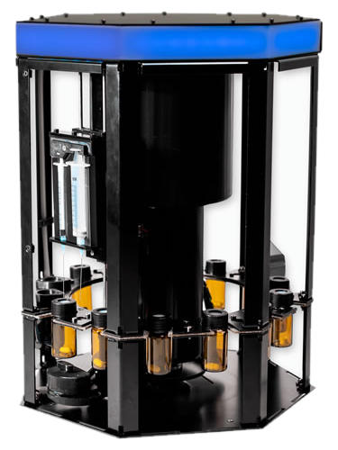
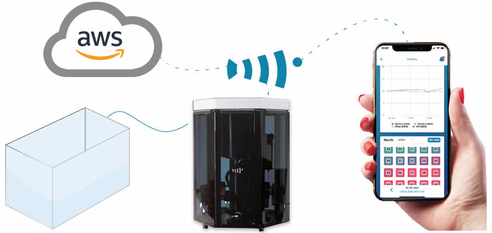
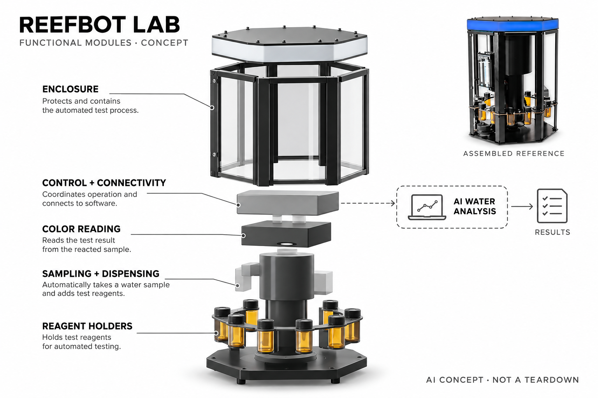

# Reef Kinetics ReefBot Lab

**Reef Kinetics** · 宠物照护 · 核查 2026-11-04

把家用水族试剂检测接入有历史依据的AI解释

消费渠道：个人零售。

## 产品图片与结构参考

### 产品图

官方ReefBot Lab整机 · 来源：[Reef Kinetics · 官方图片](<https://www.reefkinetics.com/product/reefbot-lab/>) · [原始图片](<https://www.reefkinetics.com/wp-content/uploads/2022/09/Reefbot-Lab-Standalone.png>)

### 参考图

官方水缸与应用连接说明 · 来源：[Reef Kinetics · 官方图片](<https://www.reefkinetics.com/product/reefbot-lab/>) · [原始图片](<https://www.reefkinetics.com/wp-content/uploads/2022/09/lab-easy-connect.jpg>)

### AI 生成爆炸示意

**AI 生成 · 非实物拆机。** 内部为概念推断，不能作为元件布局、BOM 或维修依据。[生成提示词](../../content/hardware/prompts/reefkinetics-reefbot-lab.txt)

> 依据已核验官方外形与公开功能生成；未知内部仅为概念功能块，不代表原机电路板、芯片或实际布局。

> 实际查看并核对对应型号，官方原图未改色或语义编辑；营销文字不代表本研究独立验证。

> 分析为基于公开资料的案头研究与 AI 辅助判断，未经用户访谈、销量审计或实物拆机。需求、画像、竞争冷门度、审美及商业机会均为研究假设，不是投资结论。

## 销售与购买

- 状态：在售。官方产品可加购，列US$1,599、一周内发货和全球直邮；官方AI应用明确可读取ReefBot自动测量，非把同名第三方App混入。

- 地区：美国、加拿大、欧洲部分市场、中东部分市场、官方称支持40多个国家

- 价格：US$1,599。试剂另购；官方App处于公开Beta，高级功能免费至2026-12-31，之后计划及硬件用户权益按官网。

- 中国大陆：官方称40多个国家直邮，但本轮未确认大陆具体收货与国内授权；需核对试剂、电压、关税和应用可达性，不推断中国已售。

- [官方产品 / 商店](<https://www.reefkinetics.com/product/reefbot-lab/>)

## AI 的实际作用

硬件自动进行试剂水质测试；官方应用读取测量历史、维护与生物信息，用AI解释趋势并提供可核对的对话与照片识别。机械采样和阈值告警不全部算AI，AI服务仍在Beta。

服务与联网依赖：需要适配第三方试剂、取样/清水/废液安排和应用连接；AI不是每次化学读数本身，也不自动执行加药或保证水族健康。

## 是否冷门

细分专业（研究判断）：家庭海水水族自动试剂测试是明显专业兴趣场景，AI历史解释区别于普通水温计，但高维护与价格限制用户范围。

## 需求与市场

需求假设：进阶水族家庭希望减少重复试剂测试并理解多项数据变化，而非只收到超阈值通知。应记录校准、试剂补充和复核劳动，不能把更多测量或AI解释直接等同珊瑚健康、避免损失或完全无需照护。

### 产品任务与边界 · 研究判断

需求假设：进阶水族家庭希望减少重复试剂测试并理解多项数据变化，而非只收到超阈值通知。应记录校准、试剂补充和复核劳动，不能把更多测量或AI解释直接等同珊瑚健康、避免损失或完全无需照护。

依据：[ReefBot Lab官方购买与试剂说明](<https://www.reefkinetics.com/product/reefbot-lab/>) · [Reef Kinetics官方AI应用](<https://www.reefkinetics.com/app/?rk_cta=pdp-under-cart>)

### 需求判断 · 研究判断

水族主人常需要把多次试剂结果放在同一时间线上理解，而不是只看单个数字是否变红。自动取样能减少重复手工操作，但补充试剂、清洗和复核仍存在；需求研究应分开评估采集可靠与读懂趋势，不把两者混成同一种智能收益。

依据：[ReefBot Lab官方购买与试剂说明](<https://www.reefkinetics.com/product/reefbot-lab/>) · [Reef Kinetics官方AI应用](<https://www.reefkinetics.com/app/?rk_cta=pdp-under-cart>)

### 需求验证 · 待验证

可用同一水缸的手工记录与自动设备历史做并行观察，记录漏测、维护、异常复核及最终人工决定。所有调整仍由有能力的主人独立判断，本研究不能以观赏生物的短期状态反推设备或AI建议有效，也不做未经控制的加药实验。

依据：[ReefBot Lab官方购买与试剂说明](<https://www.reefkinetics.com/product/reefbot-lab/>) · [Reef Kinetics官方AI应用](<https://www.reefkinetics.com/app/?rk_cta=pdp-under-cart>)

## 用户画像

画像推断：有观赏水族箱、愿维护试剂与废液并能理解测量边界的爱好者更适合。小型简单鱼缸未必需要高投入，主人仍需核对结果与动物状态，不能只因关心鱼类就推定需要自动实验设备。

### 适用行为与条件 · 研究判断

画像推断：有观赏水族箱、愿维护试剂与废液并能理解测量边界的爱好者更适合。小型简单鱼缸未必需要高投入，主人仍需核对结果与动物状态，不能只因关心鱼类就推定需要自动实验设备。

依据：[ReefBot Lab官方购买与试剂说明](<https://www.reefkinetics.com/product/reefbot-lab/>) · [Reef Kinetics官方AI应用](<https://www.reefkinetics.com/app/?rk_cta=pdp-under-cart>)

### 人群取舍 · 研究判断

更匹配的是愿意把水缸当作长期爱好的进阶家庭，已经购买多种试剂并知道测量局限。多缸、经常出差与偶尔观察鱼类的人有不同需求；画像必须包含台面空间、废液维护和网络条件，不能只按水族箱价格推定购买理由。

依据：[ReefBot Lab官方购买与试剂说明](<https://www.reefkinetics.com/product/reefbot-lab/>) · [Reef Kinetics官方AI应用](<https://www.reefkinetics.com/app/?rk_cta=pdp-under-cart>)

### 画像验证 · 待验证

画像验证应让潜在用户独立完成补瓶、标签选择和异常结果复查，观察是否理解试剂品牌与检测项目对应。对缺乏维护意愿的人如实记录负担，不把对AI聊天的好奇或对动物的关心等同需要自动实验装置，更不能替代专业照护判断。

依据：[ReefBot Lab官方购买与试剂说明](<https://www.reefkinetics.com/product/reefbot-lab/>) · [Reef Kinetics官方AI应用](<https://www.reefkinetics.com/app/?rk_cta=pdp-under-cart>)

## 竞争与替代

竞争判断：与手工试剂、连续传感器和其他自动检测设备竞争，新增官方AI历史解释形成软件差异。需要比较测量可靠、维护和可解释性，不把聊天或综合评分当作取代基础水质方法，也不混入同名第三方ReefBot应用。

### 比较对象与差异 · 研究判断

竞争判断：与手工试剂、连续传感器和其他自动检测设备竞争，新增官方AI历史解释形成软件差异。需要比较测量可靠、维护和可解释性，不把聊天或综合评分当作取代基础水质方法，也不混入同名第三方ReefBot应用。

依据：[ReefBot Lab官方购买与试剂说明](<https://www.reefkinetics.com/product/reefbot-lab/>) · [Reef Kinetics官方AI应用](<https://www.reefkinetics.com/app/?rk_cta=pdp-under-cart>)

### 竞争判断 · 研究判断

本机用可选择的第三方试剂支持较广任务，和只持续测某一指标的探头不是直接替代。官方新应用增加历史解释，但机械取样成熟度与生成回答可靠性应分别对比；第三方同名应用或独立摄影识别服务不能当成这台硬件的实际功能。

依据：[ReefBot Lab官方购买与试剂说明](<https://www.reefkinetics.com/product/reefbot-lab/>) · [Reef Kinetics官方AI应用](<https://www.reefkinetics.com/app/?rk_cta=pdp-under-cart>)

### 竞争验证 · 待验证

竞争验证应锁定用户常测项目，比较手工、连续传感与自动试剂方式的维护和可解释性。为AI历史分析单独设置验证，不把试剂检测项目数直接当成适合所有水缸的证据；也应核对Beta结束后的使用权限及其他方案已有的软件能力。

依据：[ReefBot Lab官方购买与试剂说明](<https://www.reefkinetics.com/product/reefbot-lab/>) · [Reef Kinetics官方AI应用](<https://www.reefkinetics.com/app/?rk_cta=pdp-under-cart>)

## 供应链

供应链分析：试剂容器、移液执行、检测、电源和网络需适应水汽及腐蚀环境，实际工厂和BOM未全面披露。耗材兼容、校准、清洗和废液安排是持续交付，不应把设备外壳和一块控制板视作完整成本。

### 功能模块拆分 · 研究判断

系统包含试剂瓶、取样与混合执行、显色读取、清洗废液路径、联网控制及历史分析服务。官方展示可维护透明机身，但隐藏的密封与液路布局未完整披露，不能依据照片猜工厂、精密元件或针筒成本，湿区可靠性是独立工程任务。

依据：[ReefBot Lab官方购买与试剂说明](<https://www.reefkinetics.com/product/reefbot-lab/>) · [Reef Kinetics官方AI应用](<https://www.reefkinetics.com/app/?rk_cta=pdp-under-cart>)

### 制造与供应约束 · 研究判断

供应链分析：试剂容器、移液执行、检测、电源和网络需适应水汽及腐蚀环境，实际工厂和BOM未全面披露。耗材兼容、校准、清洗和废液安排是持续交付，不应把设备外壳和一块控制板视作完整成本。

依据：[ReefBot Lab官方购买与试剂说明](<https://www.reefkinetics.com/product/reefbot-lab/>) · [Reef Kinetics官方AI应用](<https://www.reefkinetics.com/app/?rk_cta=pdp-under-cart>)

### 候选与证据缺口 · 研究判断

伟创力可作为精密机电及电子整合候选，HLH可用于外壳与维护空间原型验证，均无本型号实际采用证据。试剂兼容、耐腐蚀、清洗与显色读取需要专项经验，通用制造或加工能力不能直接证明整套水族检测装置已满足预期准确度。

依据：[ReefBot Lab官方购买与试剂说明](<https://www.reefkinetics.com/product/reefbot-lab/>) · [Reef Kinetics官方AI应用](<https://www.reefkinetics.com/app/?rk_cta=pdp-under-cart>)

## 技术路径

技术判断：官方明确自动试剂检测结果可以进入AI应用，模型结合历史解释并提示引用数据。当前Beta与机械测试能力需要分开，照片识别和建议可能错误，不能把文字可靠感当作检测精度或专业水族处置保证。

### 已披露技术边界 · 研究判断

技术判断：官方明确自动试剂检测结果可以进入AI应用，模型结合历史解释并提示引用数据。当前Beta与机械测试能力需要分开，照片识别和建议可能错误，不能把文字可靠感当作检测精度或专业水族处置保证。

依据：[ReefBot Lab官方购买与试剂说明](<https://www.reefkinetics.com/product/reefbot-lab/>) · [Reef Kinetics官方AI应用](<https://www.reefkinetics.com/app/?rk_cta=pdp-under-cart>)

### 系统难点判断 · 研究判断

测试结果进入历史分析后，模型需要知道时间、项目、试剂方法和人工输入是否可比，否则容易把更换试剂导致的偏移解释成水质变化。引用数据能提高可追查性，却不自动消除错误；应保留原始读数与不确定，而非只给一个综合健康分。

依据：[ReefBot Lab官方购买与试剂说明](<https://www.reefkinetics.com/product/reefbot-lab/>) · [Reef Kinetics官方AI应用](<https://www.reefkinetics.com/app/?rk_cta=pdp-under-cart>)

### 技术验证 · 待验证

技术验证应在正常操作范围内记录缺失项目、方法变化和异常输入时的回答，检查能否定位到真实历史。机械层另做重复样本与手工复核，不能把AI文本自信当作测量校准，也不复述官网存在单位矛盾的微量精度宣传为确认事实。

依据：[ReefBot Lab官方购买与试剂说明](<https://www.reefkinetics.com/product/reefbot-lab/>) · [Reef Kinetics官方AI应用](<https://www.reefkinetics.com/app/?rk_cta=pdp-under-cart>)

## 产品审美

审美判断：台面实验设备形态强调透明试剂与可维护空间，水管、电源和废液容器同样影响观感。清楚标签、易补充和防误插比科技灯效重要，不能只看干净产品图而忽略鱼缸旁潮湿拥挤环境。

### 外观与交互语言 · 研究判断

审美判断：台面实验设备形态强调透明试剂与可维护空间，水管、电源和废液容器同样影响观感。清楚标签、易补充和防误插比科技灯效重要，不能只看干净产品图而忽略鱼缸旁潮湿拥挤环境。

依据：[ReefBot Lab官方购买与试剂说明](<https://www.reefkinetics.com/product/reefbot-lab/>) · [Reef Kinetics官方AI应用](<https://www.reefkinetics.com/app/?rk_cta=pdp-under-cart>)

### 使用中审美判断 · 研究判断

透明立式仪器让试剂位置和运动可见，适合愿意维护的爱好者，也会暴露标签混乱与残液。真实家庭布置还需要管路、清水和废液容器，审美不只是主机灯色；可达性和防误接提示比隐藏全部接口更有长期使用价值。

依据：[ReefBot Lab官方购买与试剂说明](<https://www.reefkinetics.com/product/reefbot-lab/>) · [Reef Kinetics官方AI应用](<https://www.reefkinetics.com/app/?rk_cta=pdp-under-cart>)

### 设计验证 · 待验证

设计验证应在鱼缸旁有限空间中检查补瓶、取样管整理与清洁，不只在空旷摄影台上评价外观。观察老化标签、反光与水汽是否让用户难分位置，并确认灯光与应用状态没有被误读成所有测量都准确或生物状况已经安全。

依据：[ReefBot Lab官方购买与试剂说明](<https://www.reefkinetics.com/product/reefbot-lab/>) · [Reef Kinetics官方AI应用](<https://www.reefkinetics.com/app/?rk_cta=pdp-under-cart>)

## 关键风险

风险判断：试剂过期、交叉污染、校准和网络会影响结果，AI还可能误解趋势。任何加药与换水行动需独立复核，设备不替代日常照护；Beta结束后的权限及跨境试剂供应需要核对，不能把全球宣传当作大陆保证。

### 主要失效与依赖 · 研究判断

风险判断：试剂过期、交叉污染、校准和网络会影响结果，AI还可能误解趋势。任何加药与换水行动需独立复核，设备不替代日常照护；Beta结束后的权限及跨境试剂供应需要核对，不能把全球宣传当作大陆保证。

依据：[ReefBot Lab官方购买与试剂说明](<https://www.reefkinetics.com/product/reefbot-lab/>) · [Reef Kinetics官方AI应用](<https://www.reefkinetics.com/app/?rk_cta=pdp-under-cart>)

### 风险传播判断 · 研究判断

试剂过期或交叉污染会先改变原始结果，AI可能再给出貌似合理的趋势解释，形成错误叠加。任何涉及改变水体的行动均需人工复核；网络服务、公开Beta结束和进口耗材中断也可能使设备只完成部分任务，不能由硬件在售推出服务永久不变。

依据：[ReefBot Lab官方购买与试剂说明](<https://www.reefkinetics.com/product/reefbot-lab/>) · [Reef Kinetics官方AI应用](<https://www.reefkinetics.com/app/?rk_cta=pdp-under-cart>)

### 风险验证 · 待验证

风险验证应核查保质期、废液处置与结果来源，演练网络失败和数据缺项的提示，遵循厂商维护要求。购买层面另确认实际收货地区与进口条件，不能把全球直邮字样当成大陆售后保证，更不能用一次无异常报告替代日常观察。

依据：[ReefBot Lab官方购买与试剂说明](<https://www.reefkinetics.com/product/reefbot-lab/>) · [Reef Kinetics官方AI应用](<https://www.reefkinetics.com/app/?rk_cta=pdp-under-cart>)

## 机会与验证

机会假设：围绕最常测的项目和历史解释建立对照，记录是否减少漏测与错误操作。若真正痛点是读懂数据，软件可能先有价值；若试剂维护仍繁琐，则应优先改进机械与耗材，而不是增加更多AI评分。

### 可能的机会入口 · 研究判断

机会假设：围绕最常测的项目和历史解释建立对照，记录是否减少漏测与错误操作。若真正痛点是读懂数据，软件可能先有价值；若试剂维护仍繁琐，则应优先改进机械与耗材，而不是增加更多AI评分。

依据：[ReefBot Lab官方购买与试剂说明](<https://www.reefkinetics.com/product/reefbot-lab/>) · [Reef Kinetics官方AI应用](<https://www.reefkinetics.com/app/?rk_cta=pdp-under-cart>)

### 机会成立条件 · 研究判断

机会在于把实验式维护变得更容易理解和追溯，而不是让所有家庭拥有更多检测项目。若使用者的瓶颈是解释历史，可以先验证软件；若漏测来自试剂维护，应优先改善补充与操作，再决定是否加入生成模型及持续订阅。

依据：[ReefBot Lab官方购买与试剂说明](<https://www.reefkinetics.com/product/reefbot-lab/>) · [Reef Kinetics官方AI应用](<https://www.reefkinetics.com/app/?rk_cta=pdp-under-cart>)

### 下一步验证 · 待验证

下一步可以跟踪多个真实维护周期，比较自动检测、结构化趋势和AI解释分别减少了什么工作。记录不采纳建议的原因与人工纠错，依据可持续的维护收益判断产品方向，不把动物状态、模型回答数量或高价水缸数量直接作为市场成功证据。

依据：[ReefBot Lab官方购买与试剂说明](<https://www.reefkinetics.com/product/reefbot-lab/>) · [Reef Kinetics官方AI应用](<https://www.reefkinetics.com/app/?rk_cta=pdp-under-cart>)

## 对应供应链公司

能力候选用于选型研究，不代表本产品实际采用；未公开的供货关系不作推断。

- [flex](../supply-chain/flex.md) — **能力候选 · 非已采用** / 试剂自动化机电与控制整合评估：Flex公开工程制造及复杂机电整合能力可对应取样执行、控制和可靠性导入，但耐腐蚀液路、试剂兼容及显色验证必须单独确认；未见ReefBot Lab点名供货证据，当前仅为能力候选。

- [hlh-prototypes](../supply-chain/hlh-prototypes.md) — **能力候选 · 非已采用** / 可维护透明机身与结构原型评估：HLH Prototypes的原型与低量制造服务可支持外壳、瓶位和维护可达性测试，但不能据此推定精密液路、试剂卫生或测量准确度合格；本次未发现Reef Kinetics点名实际采用，保持候选关系。

- [knf-flodos](../supply-chain/knf-flodos.md) — **能力候选 · 非已采用** / 同类取样液路的隔膜泵工程候选：ReefBot的家庭试剂检测需要稳定取样与液体转移，KNF Flodos公开液体泵及定制工程可作为新设计的执行件候选。必须另外验证盐水、试剂、清洗和气泡条件；没有Reef Kinetics点名采用证据，也不能把标准泵直接视为原机兼容件。

- [takasago-electric](../supply-chain/takasago-electric.md) — **能力候选 · 非已采用** / 同类多路试剂分发与流量反馈候选：高砂公开微型管泵、阀和带流量反馈的分液模块，适合评估多试剂切换、残液与计量控制的原型方案。食品或盐水及化学试剂接触条件仍需项目确认；本链接用于同类新产品选型，并不说明ReefBot实际采用该公司或此分液模块。

[浏览供应链目录](../supply-chain.md)

## 功能分层示意

这是功能关系，不是实物拆机、真实空间结构或已核实 BOM。

1. **样品与试剂**：水族取样、兼容试剂与清水废液接口。（官方披露）

2. **机械测试**：执行加样和试剂检测，具体内部机构不作拆机还原。（官方披露）

3. **结果记录**：设备测量进入官方应用和历史。（官方披露）

4. **AI解释**：结合历史与维护上下文生成可复核分析。（官方披露）

5. **人工照护**：试剂补充、校准、清洁及实际水族处置由用户负责。（官方披露）

## 来源

1. [ReefBot Lab官方购买与试剂说明](<https://www.reefkinetics.com/product/reefbot-lab/>) — 已打开，当前加购、发货与第三方试剂支持明确，不用旧V2照片替代Lab。

2. [Reef Kinetics官方AI应用](<https://www.reefkinetics.com/app/?rk_cta=pdp-under-cart>) — 已打开，明确ReefBot自动测量历史接入、AI对话与Beta期限。

3. [Reef Kinetics官方AI助手边界](<https://www.reefkinetics.com/app/assistant/>) — 已打开，历史上下文、引用和不确定性说明；示例加药建议不作为本研究指引。

4. [ReefBot官方配送与授权店](<https://www.reefkinetics.com/dealers/>) — 已打开，40多国直邮及部分经销地区，未确认大陆。

[返回目录](../hardware-market.md) · [网页分析](https://romanagent.github.io/Roman/#hardware/product/reefkinetics-reefbot-lab)
