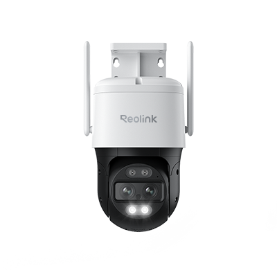
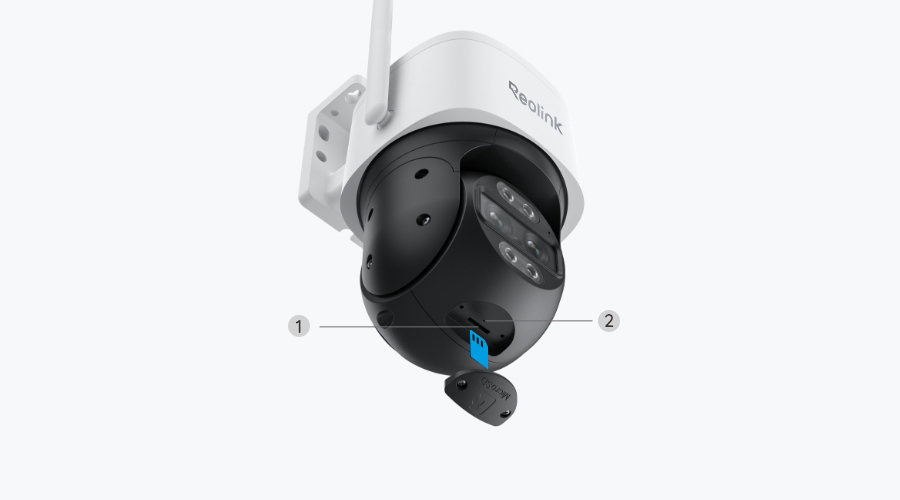
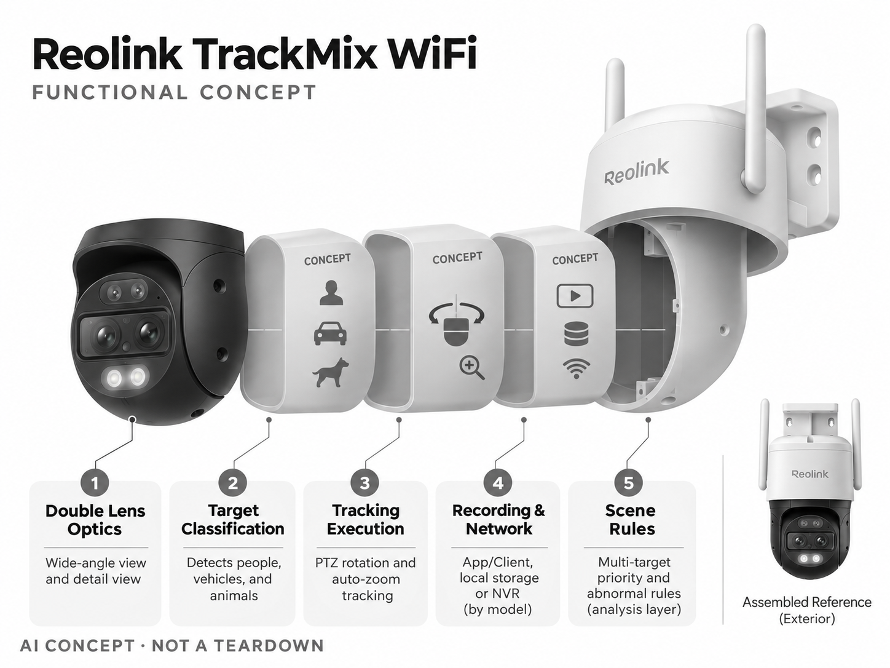

# Reolink TrackMix WiFi

**Reolink** · 家庭安防 · 核查 2026-11-04

同时保留全景与目标细节的双镜头自动追踪摄像头

消费渠道：个人零售。

## 产品图片与结构参考

### 产品图

官方商品图：TrackMix WiFi 双镜头云台机身 · 来源：[Reolink · 官方图片](<https://reolink.com/us/product/reolink-trackmix-wifi/>) · [原始图片](<https://home-cdn.reolink.us/wp-content/uploads/2022/06/280627421656397662.0035.png>)

### 参考图

官方底部与接口标注图，非拆机图 · 来源：[Reolink · 官方图片](<https://reolink.com/us/product/reolink-trackmix-wifi/>) · [原始图片](<https://home-cdn.reolink.us/wp-content/assets/trackmix-wifi-specs-2.jpg>)

### AI 生成爆炸示意

**AI 生成 · 非实物拆机。** 内部为概念推断，不能作为元件布局、BOM 或维修依据。[生成提示词](../../content/hardware/prompts/reolink-trackmix-wifi.txt)

> 依据官方外观参考与公开功能生成；未披露的内部布局只作概念模块，不构成BOM或真实结构证据。

> 图片版权归原权利人；用于产品研究并保留出处。未改变图片色彩或内容。

> 分析为基于公开资料的案头研究与 AI 辅助判断，未经用户访谈、销量审计或实物拆机。需求、画像、竞争冷门度、审美及商业机会均为研究假设，不是投资结论。

## 销售与购买

- 状态：待复核。官方功能页和 TrackMix 系列商店仍存在；搜索索引显示购买入口，但本次打开美国商店返回 No Product Found，无法确认当前具体 SKU 的库存与成交入口，暂不计入已确认在售。

- 地区：美国（销售状态待复核）

- 价格：待地区商店确认。未将搜索摘要的欧元价格与美国站型号混用；需要按 WiFi、PoE、电池和 AI 新旧版本重新核对。

- 中国大陆：本轮未核实中国大陆官方同型号销售与售后入口；海外官网存在不等于国内可购买。

- [官方产品 / 商店](<https://reolink.com/us/product/reolink-trackmix-wifi/>)

## AI 的实际作用

人物、车辆和动物分类配合云台与双镜头追踪，减少背景运动触发；本条未把新版本 AI 搜索能力混入所有版本。

服务与联网依赖：官方说明 App/Client 基本服务不强制订阅；远程查看需要网络，本地录像方式按具体 SKU 和存储设备核对。

## 是否冷门

竞争密集（研究判断）：安防云台属于成熟市场，双镜追踪是细分功能，现有竞品和传统方案都构成替代。

## 需求与市场

需求假设：车道、院子和小店门口用户希望保留全貌又看清移动目标。应测试目标遮挡、多人分叉和夜间追踪的失败情况，额外镜头是否减少盲区比静态分辨率更值得关注。

### 产品任务与边界 · 研究判断

TrackMix WiFi 通过双镜头与云台跟踪，尝试同时保留较宽场景和移动目标细节，适合研究家庭车道或院子的事件查看。需求重点是是否少丢失关键片段，而不是额外镜头本身；跟随一个对象仍可能漏掉其他方向的活动。

依据：[Reolink TrackMix WiFi 官方功能与规格页](<https://reolink.com/us/product/reolink-trackmix-wifi/>) · [Reolink TrackMix 美国官方商店](<https://store.reolink.com/us/trackmix-series-cameras/>)

### 需求判断 · 研究判断

固定供电和本地录像选择吸引希望长期记录的用户，但安装与网络配置需要投入。若家庭只需要偶尔查看门口，复杂云台未必值得；应比较有效片段和操作负担，不能把工具感强或参数多直接等同更适合家庭。

依据：[Reolink TrackMix WiFi 官方功能与规格页](<https://reolink.com/us/product/reolink-trackmix-wifi/>) · [Reolink TrackMix 美国官方商店](<https://store.reolink.com/us/trackmix-series-cameras/>)

### 需求验证 · 待验证

可用院内真实事件记录双视角与固定广角各自保留的信息，特别观察目标分叉、遮挡和夜间。让用户完成查找任务，统计需手动转向和丢失片段的情况，确认自动跟踪是否减少而非增加后续查看工作。

依据：[Reolink TrackMix WiFi 官方功能与规格页](<https://reolink.com/us/product/reolink-trackmix-wifi/>) · [Reolink TrackMix 美国官方商店](<https://store.reolink.com/us/trackmix-series-cameras/>)

## 用户画像

画像假设：愿安装固定供电、重视本地录像或已有 NVR 的房主和小店经营者。其购买逻辑更接近安防工具；不愿配置网络或无法布电的租房用户可能不适合这一形态。

### 适用行为与条件 · 研究判断

较匹配能安装固定电源、愿意配置网络并重视本地记录的房主，已有 NVR 使用经验可能降低门槛。不能布电或不愿维护系统的租住用户条件不同，不能仅因同样希望看宠物或车道就视作适合。

依据：[Reolink TrackMix WiFi 官方功能与规格页](<https://reolink.com/us/product/reolink-trackmix-wifi/>) · [Reolink TrackMix 美国官方商店](<https://store.reolink.com/us/trackmix-series-cameras/>)

### 人群取舍 · 研究判断

对技术熟悉的用户，客户端与录像设备选择是灵活性；对首次安装者，同样选项可能变成配置负担。画像应包含已有网络、存储和维护习惯，当前目录以家庭使用分析为主，不把商业场所需求直接外推为消费市场。

依据：[Reolink TrackMix WiFi 官方功能与规格页](<https://reolink.com/us/product/reolink-trackmix-wifi/>) · [Reolink TrackMix 美国官方商店](<https://store.reolink.com/us/trackmix-series-cameras/>)

### 画像验证 · 待验证

画像验证应从布电、安装和存储选择开始观察，记录用户在哪一步需要帮助，再检查日常回看是否独立完成。区分喜欢自行管理录像的人和只希望手机即时提醒的人，以免用同一套功能表覆盖不同使用逻辑。

依据：[Reolink TrackMix WiFi 官方功能与规格页](<https://reolink.com/us/product/reolink-trackmix-wifi/>) · [Reolink TrackMix 美国官方商店](<https://store.reolink.com/us/trackmix-series-cameras/>)

## 竞争与替代

竞争判断：PTZ 摄像头与目标识别并不冷门，双镜头组合是一种功能细分。新团队可以研究容易误报的业务场景，但应同时比较固定多摄像头、普通云台和专业安防系统的总成本。

### 比较对象与差异 · 研究判断

TrackMix 面对普通 PTZ、固定多摄像头和其他双镜方案，双视角是一种细分设计而非无竞争赛道。比较应涵盖全景保留、目标细节、存储和维护，不能仅用自动跟随或名义分辨率推断系统优于所有固定视角。

依据：[Reolink TrackMix WiFi 官方功能与规格页](<https://reolink.com/us/product/reolink-trackmix-wifi/>) · [Reolink TrackMix 美国官方商店](<https://store.reolink.com/us/trackmix-series-cameras/>)

### 竞争判断 · 研究判断

不强制订阅的基本客户端服务可能吸引重视本地管理的人，但设备版本和录像方式仍需核对。竞争优势要来自可重复的记录体验，若多目标时经常转错方向，双镜头和云台复杂度可能无法获得足够回报。

依据：[Reolink TrackMix WiFi 官方功能与规格页](<https://reolink.com/us/product/reolink-trackmix-wifi/>) · [Reolink TrackMix 美国官方商店](<https://store.reolink.com/us/trackmix-series-cameras/>)

### 竞争验证 · 待验证

可在相同院子比较一台 TrackMix 类设备与固定多摄像头方案，记录覆盖、布线和回看成本。必须锁定具体硬件版本，不把新版 AI 搜索或无线能力混入旧款比较，当前库存待复核也应与技术分析分开。

依据：[Reolink TrackMix WiFi 官方功能与规格页](<https://reolink.com/us/product/reolink-trackmix-wifi/>) · [Reolink TrackMix 美国官方商店](<https://store.reolink.com/us/trackmix-series-cameras/>)

## 供应链

供应链推断：双光学模组、云台电机、传动件、补光、电源和防水外壳共同决定成本与可靠性。具体制造商、芯片供应链与 BOM 未披露；双镜标定和长期转动寿命需要验证。

### 功能模块拆分 · 研究判断

功能层包括广角与细节镜头、人物车辆动物分类、云台及变焦跟踪、补光与固定供电、应用和本地录像路径。公开资料没有完整芯片和工厂信息，多目标优先规则也不能从功能示意推断为已承诺的具体能力。

依据：[Reolink TrackMix WiFi 官方功能与规格页](<https://reolink.com/us/product/reolink-trackmix-wifi/>) · [Reolink TrackMix 美国官方商店](<https://store.reolink.com/us/trackmix-series-cameras/>)

### 制造与供应约束 · 研究判断

制造约束是双镜标定、云台传动、密封、补光和长期供电共同保持稳定。转动中的内部线缆与机械寿命需要验证，安装角度变化还可能影响两个视角的对应关系，不能把两路画面各自清晰当成整机跟踪质量合格。

依据：[Reolink TrackMix WiFi 官方功能与规格页](<https://reolink.com/us/product/reolink-trackmix-wifi/>) · [Reolink TrackMix 美国官方商店](<https://store.reolink.com/us/trackmix-series-cameras/>)

### 候选与证据缺口 · 研究判断

龙旗可作为联网视觉控制工程候选，Protolabs 可支持云台与支架结构样件。没有 TrackMix 点名合作证据，录像协议、分类模型和户外寿命需项目级确认；候选只说明公开能力可能匹配，不推定实际制造或部件来源。

依据：[Reolink TrackMix WiFi 官方功能与规格页](<https://reolink.com/us/product/reolink-trackmix-wifi/>) · [Reolink TrackMix 美国官方商店](<https://store.reolink.com/us/trackmix-series-cameras/>)

## 技术路径

官方披露双视角、自动追踪及分类检测。技术判断：跟随一个对象时仍可能丢失其他区域信息，需评估转向时延与多目标策略。不同硬件版本的 Wi-Fi 和 AI 搜索能力不能混为一谈。

### 已披露技术边界 · 研究判断

官方披露双视角、人物车辆动物分类和自动追踪，基础应用服务与可选存储方式需要按 SKU 理解。不同版本的 AI 搜索和无线能力不能混用，普通云台转动也不应单独作为人工智能证据。

依据：[Reolink TrackMix WiFi 官方功能与规格页](<https://reolink.com/us/product/reolink-trackmix-wifi/>) · [Reolink TrackMix 美国官方商店](<https://store.reolink.com/us/trackmix-series-cameras/>)

### 系统难点判断 · 研究判断

技术难点是目标离开、遮挡及多目标分叉时如何维持有用画面，转向时延可能导致短暂事件丢失。广角与细节视角应共同保留上下文，不能只追求目标放大；识别对象也不代表理解其行为或意图。

依据：[Reolink TrackMix WiFi 官方功能与规格页](<https://reolink.com/us/product/reolink-trackmix-wifi/>) · [Reolink TrackMix 美国官方商店](<https://store.reolink.com/us/trackmix-series-cameras/>)

### 技术验证 · 待验证

验证应安排多个目标交叉、离开视野和夜间经过，记录跟踪切换、恢复及两路录像信息。还应检查本地存储与远程访问中断后的状态，所有结果需绑定硬件和固件版本，不以品牌全系列功能推断本型号能力。

依据：[Reolink TrackMix WiFi 官方功能与规格页](<https://reolink.com/us/product/reolink-trackmix-wifi/>) · [Reolink TrackMix 美国官方商店](<https://store.reolink.com/us/trackmix-series-cameras/>)

## 产品审美

审美判断：突出的云台和双镜头传达明显安防属性，有威慑感但较难融入精简住宅立面。线缆、支架与夜间补光属于整体外观；小店功能性和家庭隐蔽性可能需要不同方案。

### 外观与交互语言 · 研究判断

突出的云台和双镜头呈现明确安防属性，适合功能导向的院落但未必自然融入简洁住宅立面。线缆、支架和夜间补光都是整体外观，审美评价需要把安装后的体积与邻近空间关系纳入，而不只看相机正面。

依据：[Reolink TrackMix WiFi 官方功能与规格页](<https://reolink.com/us/product/reolink-trackmix-wifi/>) · [Reolink TrackMix 美国官方商店](<https://store.reolink.com/us/trackmix-series-cameras/>)

### 使用中审美判断 · 研究判断

明显设备可能增强可见性，也可能让邻居或访客不自在，设计需要使视野和状态可理解。安装位置若为了隐藏机身而限制转动，会削弱功能；若为追踪覆盖选得过高，又会增加清洁和维护难度。

依据：[Reolink TrackMix WiFi 官方功能与规格页](<https://reolink.com/us/product/reolink-trackmix-wifi/>) · [Reolink TrackMix 美国官方商店](<https://store.reolink.com/us/trackmix-series-cameras/>)

### 设计验证 · 待验证

设计验证可在真实外墙检查线材、转动空间和维护动作，并观察家庭成员是否理解当前拍摄方向。夜间补光需要同时评估目标画面和周边干扰，避免用无遮挡的产品图推断所有安装点都能保持整洁与低打扰。

依据：[Reolink TrackMix WiFi 官方功能与规格页](<https://reolink.com/us/product/reolink-trackmix-wifi/>) · [Reolink TrackMix 美国官方商店](<https://store.reolink.com/us/trackmix-series-cameras/>)

## 关键风险

风险判断：本次库存尚未验证，不宜直接给出购买建议；远程访问、局域网设置与镜头覆盖邻居均有使用边界。运动分类不能代替安防事件确认，录像保留和设备安全更新也需持续关注。

### 主要失效与依赖 · 研究判断

当前原目录库存仍待复核，技术资料存在不能被写成明确可立即购买。使用风险还包括远程访问配置、录像保留、邻近空间覆盖及误报漏报，运动分类只是辅助查阅，不构成对家庭安全或事件性质的保证。

依据：[Reolink TrackMix WiFi 官方功能与规格页](<https://reolink.com/us/product/reolink-trackmix-wifi/>) · [Reolink TrackMix 美国官方商店](<https://store.reolink.com/us/trackmix-series-cameras/>)

### 风险传播判断 · 研究判断

自动跟踪可能让用户误以为一台设备覆盖全部院子，而多事件同时发生时仍有信息取舍。若状态和录像路径不清，用户还可能以为本地存储一直有效，因此产品需要明确记录与连接异常，而不是只展示实时画面。

依据：[Reolink TrackMix WiFi 官方功能与规格页](<https://reolink.com/us/product/reolink-trackmix-wifi/>) · [Reolink TrackMix 美国官方商店](<https://store.reolink.com/us/trackmix-series-cameras/>)

### 风险验证 · 待验证

风险验证应演练存储不可用、网络中断和目标分叉，检查用户是否能发现缺失并恢复。采购状态应另向当前官方渠道核实，不能由规格页存在推断库存，也不能把不强制订阅误解为所有功能无需任何服务条件。

依据：[Reolink TrackMix WiFi 官方功能与规格页](<https://reolink.com/us/product/reolink-trackmix-wifi/>) · [Reolink TrackMix 美国官方商店](<https://store.reolink.com/us/trackmix-series-cameras/>)

## 机会与验证

可验证机会：针对小店收货区或车道设计明确事件规则与回看工具，先用现成摄像头验证需求。若价值主要在工作流，软件集成可能比自建整套云台硬件更合适。

### 可能的机会入口 · 研究判断

机会在于车道或收货位置的明确事件规则和回看工具，让双视角信息更易使用。新项目可以先基于现有摄像头验证用户任务，若价值主要来自检索与流程，未必需要自建整套云台和光学硬件。

依据：[Reolink TrackMix WiFi 官方功能与规格页](<https://reolink.com/us/product/reolink-trackmix-wifi/>) · [Reolink TrackMix 美国官方商店](<https://store.reolink.com/us/trackmix-series-cameras/>)

### 机会成立条件 · 研究判断

机会成立需要减少查找和误判，同时不会因追踪增加盲区。如果用户实际更需要固定覆盖，多摄像头或稳定广角可能更合适；应由真实事件和维护记录决定形态，而不是将双镜自动跟随当作普遍升级方向。

依据：[Reolink TrackMix WiFi 官方功能与规格页](<https://reolink.com/us/product/reolink-trackmix-wifi/>) · [Reolink TrackMix 美国官方商店](<https://store.reolink.com/us/trackmix-series-cameras/>)

### 下一步验证 · 待验证

下一步可用家庭车道事件建立回看任务，比较固定、普通云台和双视角的有效信息及操作。分析哪些失败来自算法、转动还是安装后，再选择软件或硬件改进，避免把复杂设备本身误当成需求创新。

依据：[Reolink TrackMix WiFi 官方功能与规格页](<https://reolink.com/us/product/reolink-trackmix-wifi/>) · [Reolink TrackMix 美国官方商店](<https://store.reolink.com/us/trackmix-series-cameras/>)

## 对应供应链公司

能力候选用于选型研究，不代表本产品实际采用；未公开的供货关系不作推断。

- [longcheer](../supply-chain/longcheer.md) — **能力候选 · 非已采用** / 双视角户外联网视觉控制工程：龙旗的智能硬件工程能力可对应摄像、计算和联网控制整合，但云台、双镜标定和录像协议需专门确认；没有 TrackMix WiFi 点名合作证据，当前仅作为工程候选，不推定实际代工。

- [protolabs](../supply-chain/protolabs.md) — **能力候选 · 非已采用** / 云台支架与运动结构样件：Protolabs 的机加工及模塑原型可支持双镜支架、云台配合和安装结构验证，但不能证明长期户外转动或识别性能；未见 TrackMix 供货披露，候选限定为结构开发环节。

[浏览供应链目录](../supply-chain.md)

## 功能分层示意

这是功能关系，不是实物拆机、真实空间结构或已核实 BOM。

1. **双镜光学**：广角与细节视角。（官方披露）

2. **目标分类**：人物、车辆、动物检测。（官方披露）

3. **追踪执行**：云台转动与自动变焦跟踪。（官方披露）

4. **录像与网络**：App/Client、本地存储或 NVR 按型号配置。（官方披露）

5. **场景规则**：多目标优先级及异常规则为分析层推断，不是官方已承诺能力。（分析推断）

## 来源

1. [Reolink TrackMix WiFi 官方功能与规格页](<https://reolink.com/us/product/reolink-trackmix-wifi/>) — 已打开；列分类与追踪，未返回可确认购物控件。

2. [Reolink TrackMix 美国官方商店](<https://store.reolink.com/us/trackmix-series-cameras/>) — 已打开；本次返回 No Product Found，因此标注待复核。

[返回目录](../hardware-market.md) · [网页分析](https://romanagent.github.io/Roman/#hardware/product/reolink-trackmix-wifi)
