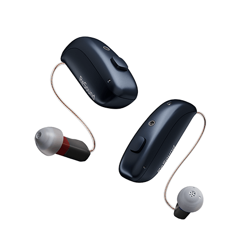
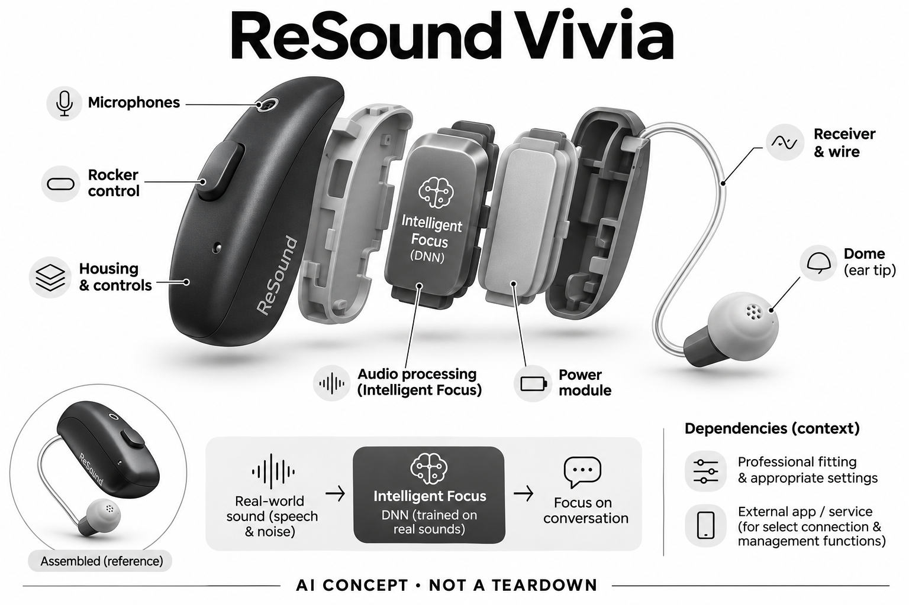

# ReSound Vivia

**ReSound** · 助听与听力 · 核查 2026-11-04

DNN语音突出与个人关注、环境感知的组合定位

消费渠道：个人验配渠道。

## 产品图片与结构参考

### 产品图

ReSound Vivia官方产品外形图 · 来源：[ReSound · 官方产品图片](<https://www.resound.com/en-us/hearing-aids/resound-hearing-aids/resound-vivia>) · [原始图片](<https://www.resound.com/-/media/0ada16778d3245ddbfbc3450759750aa.ashx>)

### 参考图

ReSound Vivia官方另一角度或使用场景参考 · 来源：[ReSound · 官方产品图片](<https://www.resound.com/en-us/hearing-aids/resound-hearing-aids/resound-vivia>) · [原始图片](<https://www.resound.com/-/media/resound/resound-international/products/hearing-aids/resound-vivia/image-container.png?w=1200&usecustomfunctions=1¢ercrop=1&hash=AC69E43A2B416C971134735711EE1A8C>)

### AI 生成爆炸示意

**AI 生成 · 非实物拆机。** 内部为概念推断，不能作为元件布局、BOM 或维修依据。[生成提示词](../../content/hardware/prompts/resound-vivia.txt)

> 外形依据核验参考图；内部位置、模块形状与装配关系仅作AI概念展示。

> 已逐张查看并核对型号。源图未改色/裁切；场景、界面、附件、优惠及效果文案仅为厂商示意，不作为本目录性能或现价依据。

> 分析为基于公开资料的案头研究与 AI 辅助判断，未经用户访谈、销量审计或实物拆机。需求、画像、竞争冷门度、审美及商业机会均为研究假设，不是投资结论。

## 销售与购买

- 状态：在售。官方当前消费者产品页持续展示该型号，并提供试用/验配或官方门店渠道。属于个人经专业验配获得的消费设备，saleMode为consumer-fitting；不声明具体门店库存。

- 地区：美国及所列官方区域验配网络（具体型号当地确认）

- 价格：未公布统一零售价；按个人验配方案报价。报价通常受单/双耳、技术档位、定制、服务和地区影响；不以历史媒体价格或其他型号拼凑。

- 中国大陆：品牌可能具有中国渠道，但本次未核实该具体型号、技术档位与AI软件在大陆的上市和支持范围；需由国内授权验配渠道确认。

- [官方产品 / 商店](<https://www.resound.com/en-us/hearing-aids/resound-hearing-aids/resound-vivia>)

## AI 的实际作用

官方Intelligent Focus使用以真实声音训练的DNN处理语音和噪声，目标是帮助用户聚焦谈话。

服务与联网依赖：个人专业验配与合适参数是前提；部分连接和管理功能依赖兼容手机，核心声音处理不等于云端聊天。

## 是否冷门

细分专业（研究判断）：听觉辅助属于专业消费用途，已有成熟供应商；此分类不表示蓝海或疗效优越。

## 需求与市场

需求假设：在公共空间交流时既想突出谈话，也希望保留对周边声音的感知。真正的使用价值需要在个人真实交流场景中验证，不能从AI名称或厂商演示推定每个人都获得同样改善。

### 官方｜突出谈话并保留周围信息 · 官方资料

ReSound Vivia的官方定位以Intelligent Focus处理语音和噪声，帮助用户关注交流，同时强调个人关注与环境感知。需求因此不是让所有背景都消失，而是更容易获得需要的声音；它仍属复杂声场听清的成熟任务，具体结果依个人专业验配，不能从深度神经网络名称推断每位用户均获相同改善。

依据：[ReSound ReSound Vivia官方产品页](<https://www.resound.com/en-us/hearing-aids/resound-hearing-aids/resound-vivia>) · [ReSound官方消费者验配渠道](<https://www.resound.com/en-us/find-a-professional>)

### 判断｜公共空间中的双重关注 · 研究判断

在餐桌或公共空间，用户可能既想听清面前发言，也需要知道旁边有人加入谈话。单看背景是否安静无法覆盖这种任务，声音处理要在关注和周围信息之间取得适合个人的取舍；本型号值得研究的是是否减少漏掉对话变化，而不是只提高某个主观降噪印象，实际关注对象也会随时改变。

依据：[ReSound ReSound Vivia官方产品页](<https://www.resound.com/en-us/hearing-aids/resound-hearing-aids/resound-vivia>)

### 验证｜把环境信息列入任务 · 待验证

试用可在专业适配后记录多人谈话中何时漏听、何时需要别人提醒，以及周边信息是否仍容易注意。与原方案比较同类活动，而非只用一个固定正面说话人演示；如果用户对目标话语和环境声有不同偏好，应保留差异，目前官方资料尚不能替代这些真实交流和长期使用证据。

依据：[ReSound ReSound Vivia官方产品页](<https://www.resound.com/en-us/hearing-aids/resound-hearing-aids/resound-vivia>) · [ReSound官方消费者验配渠道](<https://www.resound.com/en-us/find-a-professional>)

## 用户画像

画像推断：经专业评估适合microRIE、经常参与社交或公共活动的个人更值得评估。具体是否适配应由听力需求、耳形和操作能力共同决定，本目录不根据年龄、职业或自述症状替人选择医疗产品。

### 判断｜关注多人交流连续性的人 · 研究判断

经常参加家庭、同事或公共空间交流的人，可能更关心听话对象改变时能否自然跟上，而不只是某个方向的语音更响。画像应从具体漏听和追问建立，不能由年龄或社交频率直接推断适用；如果用户偏好非常安静的输出，也需确认其对保留周围信息的接受程度，避免价值主张与偏好错位。

依据：[ReSound ReSound Vivia官方产品页](<https://www.resound.com/en-us/hearing-aids/resound-hearing-aids/resound-vivia>)

### 判断｜愿意表达声音偏好的用户 · 研究判断

用户若能描述哪些声音需要保留、哪些环境最吃力，更容易与专业人员讨论本款的适配结果。已有助听经验可以提供比较基线，但首次用户的学习过程同样重要；不能要求每个人懂算法或技术档位，也不能把不满意简单归于不适应，实际支持应帮助将模糊感受转为可讨论的生活问题。

依据：[ReSound ReSound Vivia官方产品页](<https://www.resound.com/en-us/hearing-aids/resound-hearing-aids/resound-vivia>) · [ReSound官方消费者验配渠道](<https://www.resound.com/en-us/find-a-professional>)

### 验证｜关注目标与周围声音清单 · 待验证

可在试用前请用户列出熟悉场景中最想听见和最不想遗漏的声音，再记录原有设备的表现。试用后复核同一清单，同时观察取放和充电是否可自主完成；当地渠道需确认具体microRIE或其他交付形态及服务，系列页面的介绍不能替代个人适配，也不能证明所有款式配置完全相同。

依据：[ReSound ReSound Vivia官方产品页](<https://www.resound.com/en-us/hearing-aids/resound-hearing-aids/resound-vivia>) · [ReSound官方消费者验配渠道](<https://www.resound.com/en-us/find-a-professional>)

## 竞争与替代

案头判断：DNN语音突出与个人关注、环境感知的组合定位形成可比较特征，但消费助听已有多个成熟品牌和验配渠道。没有销量审计、用户访谈或疗效对照，专业细分不意味着竞争稀少。

### 判断｜与同类DNN助听方案比较 · 研究判断

多个助听品牌都使用感知算法处理语音与噪声，本款的比较重点应落在用户如何关注谈话并保留必要环境信息。相同的深度神经网络标签不能证明处理策略一致，安静感也不直接等于理解效果；应在个人适配前提下比较真实活动，不根据宣传措辞、连接协议或型号新旧判断领先。

依据：[ReSound ReSound Vivia官方产品页](<https://www.resound.com/en-us/hearing-aids/resound-hearing-aids/resound-vivia>)

### 判断｜自动聚焦与用户控制取舍 · 研究判断

手动程序、方向性设置与自动处理都可能帮助用户应对复杂声场，但需要的操作和可控程度不同。自动聚焦若契合当前目标可能减轻负担，若与个人关注不一致则仍需有效调整路径；竞争研究应记录用户什么时候介入和为什么，而不是把无需操作当成对所有人都成立的绝对优点。

依据：[ReSound ReSound Vivia官方产品页](<https://www.resound.com/en-us/hearing-aids/resound-hearing-aids/resound-vivia>)

### 验证｜相同形态和档位比较 · 待验证

报价和试用应标明具体款式、技术档位、耳数以及随访支持，不能用一个系列的全部能力去比较另一款单独配置。连接功能是否可用也需按设备和地区核对，不能用Auracast等协议充当AI效果证据；当前没有销量、留存或独立对照数据，不从官方在售和渠道数量推导市场优势。

依据：[ReSound ReSound Vivia官方产品页](<https://www.resound.com/en-us/hearing-aids/resound-hearing-aids/resound-vivia>) · [ReSound官方消费者验配渠道](<https://www.resound.com/en-us/find-a-professional>)

## 供应链

官方可核对官方主推小型可充电microRIE形态及相应声音功能；具体麦克风、受话器、电池供应商与整机工厂本次未确认。品牌或法定制造商名称不等于实际装配工厂，也不据此估计BOM与良率。

### 官方｜小型耳背输入输出结构 · 官方资料

官方主推小型可充电microRIE形态，声音采集、处理与耳道输出构成基础功能链，Intelligent Focus承担已披露的语音噪声处理。当前没有公开证据点名本款麦克风、核心芯片、受话器或整机制造商；目录按功能拆分研究，不以外形紧凑或行业常见设计猜测真实内部模块及供货关系。

依据：[ReSound ReSound Vivia官方产品页](<https://www.resound.com/en-us/hearing-aids/resound-hearing-aids/resound-vivia>)

### 判断｜紧凑结构仍需声学验证 · 研究判断

小型主机的声孔、周围结构与耳道连接共同影响输入输出，若希望同时处理目标语音和周边信息，更需要一致可靠的采集条件。供应研究应检查声学、功耗和个人适配之间的约束，不能只比较芯片速度；本次没有校准、结构公差、寿命或量产良率资料，不据尺寸宣传估算制造难度或成本。

依据：[ReSound ReSound Vivia官方产品页](<https://www.resound.com/en-us/hearing-aids/resound-hearing-aids/resound-vivia>) · [ReSound官方消费者验配渠道](<https://www.resound.com/en-us/find-a-professional>)

### 判断｜前端与DSP的候选边界 · 研究判断

英飞凌麦克风与onsemi听觉处理平台，可分别作为相近设备的声音输入和新处理架构候选。前者需要在实际声孔与接口下验证，后者需要重建算法、验配及输出链路；没有证据证明两者供应Vivia，也不能把通用平台替换视为保持原有Intelligent Focus体验的捷径，正式资料与样机仍是前提。

依据：[ReSound ReSound Vivia官方产品页](<https://www.resound.com/en-us/hearing-aids/resound-hearing-aids/resound-vivia>)

## 技术路径

官方Intelligent Focus使用以真实声音训练的DNN处理语音和噪声，目标是帮助用户聚焦谈话。这是已披露机制；精确模型、内部电路与个体表现未完全公开。普通放大、蓝牙和自动模式本身不单独作为AI收录理由。

### 官方｜真实声音训练的处理路径 · 官方资料

官方说明Intelligent Focus使用以真实声音训练的深度神经网络处理语音和噪声，目标是帮助用户聚焦谈话。该描述确认了感知算法参与，而非仅把连接功能叫作AI；不过模型结构、训练场景覆盖和独立个人效果未完整公开，目录不从训练素材的表述推定所有公共空间都能准确分离。

依据：[ReSound ReSound Vivia官方产品页](<https://www.resound.com/en-us/hearing-aids/resound-hearing-aids/resound-vivia>)

### 判断｜保留什么需要任务标准 · 研究判断

声音处理中，背景不是统一无用的信息，旁人加入、提示或用户改变关注方向都可能让原本的背景变成目标。技术评价应把这种变化纳入，而不只测固定条件下压低多少声音；本款强调关注与环境感知，值得检查的是两者是否符合具体个人的任务，不能用模型复杂程度代替这个判断。

依据：[ReSound ReSound Vivia官方产品页](<https://www.resound.com/en-us/hearing-aids/resound-hearing-aids/resound-vivia>)

### 验证｜多目标与变化声场 · 待验证

适配之后可记录不同方向发言轮换、短暂插话与周边提示出现时的理解和反应，比较原方案与本款的干预次数。具体技术档位和功能状态应保持明确，连接音频与现场助听也要区分；当前目录没有独立实验，不能把一次安静演示或系列功能列表扩展成所有用户的效果保证。

依据：[ReSound ReSound Vivia官方产品页](<https://www.resound.com/en-us/hearing-aids/resound-hearing-aids/resound-vivia>) · [ReSound官方消费者验配渠道](<https://www.resound.com/en-us/find-a-professional>)

## 产品审美

图示观察：小耳背机身与多配色选择强调日常融入，细线和受话器仍需按个人情况匹配。实际耳内尺寸、舒适感和维护便利仍需验配或试戴确认；宣传图不能证明隐形、无负担或适合所有耳形。

### 判断｜小型microRIE的视觉定位 · 研究判断

小型耳背主机与耳道连接部件，可能让希望减少可见体积的人更容易接受，但产品图只说明轮廓和佩戴方式。耳后空间、眼镜和个人动作会改变体验，尺寸感不能直接转化为舒适；审美研究应让用户表达希望隐藏还是方便取放的偏好，而不是默认外观越不明显越有价值。

依据：[ReSound ReSound Vivia官方产品页](<https://www.resound.com/en-us/hearing-aids/resound-hearing-aids/resound-vivia>)

### 判断｜紧凑与自主维护的平衡 · 研究判断

机身和附件越紧凑，越应观察使用者能否识别左右、完成取放以及理解充电状态，不能以桌面陈列的简洁代替日常容易使用。外观评估需要包括实际交付配件，且不同形态不能互相套用；如果用户需要经常请人协助，微小外形带来的接受度可能无法抵消操作负担。

依据：[ReSound ReSound Vivia官方产品页](<https://www.resound.com/en-us/hearing-aids/resound-hearing-aids/resound-vivia>)

### 验证｜长时间和多种穿戴组合 · 待验证

试用可将设备与眼镜、发型和日常衣物组合，记录碰触、取放和久戴感受，再与个人原方案比较。应该由用户自己完成维护，而非只观看工作人员演示；小型化是否改善佩戴意愿需要数周反馈，官方照片和外观定位无法证明长期舒适，也不能代替验配和声音方面的检查。

依据：[ReSound ReSound Vivia官方产品页](<https://www.resound.com/en-us/hearing-aids/resound-hearing-aids/resound-vivia>) · [ReSound官方消费者验配渠道](<https://www.resound.com/en-us/find-a-professional>)

## 关键风险

官方页面的全系列连接或AI描述可能随技术档位与形态变化，不能以Auracast支持等同AI能力。AI设置辅助与噪声处理不能替代专业适配、随访或对异常听力变化的评估，本研究没有诊断、独立实测或疗效结论。

### 判断｜系列能力被当作单款承诺 · 研究判断

Vivia页面可能同时描述不同形态、连接和技术级别，若把全系列能力叠加到个人订单，就容易高估实际可用功能。需要按交付款确认环境处理及连接条件，不能以支持某种音频协议推导AI更强；中国渠道与海外型号、软件和服务是否一致也未在本次确认，不能从品牌全球存在直接推定。

依据：[ReSound ReSound Vivia官方产品页](<https://www.resound.com/en-us/hearing-aids/resound-hearing-aids/resound-vivia>) · [ReSound官方消费者验配渠道](<https://www.resound.com/en-us/find-a-professional>)

### 判断｜偏好与处理目标不一致 · 研究判断

用户对环境声音的期待不同，某些人可能重视更安静，另一些人更在意持续注意周边变化。若算法输出与关注目标不符，用户可能感到交流仍吃力，因此不能只以降噪主观评价结束试用；这些问题需带回专业适配与随访，本研究没有诊断、独立实测或医学效果结论。

依据：[ReSound ReSound Vivia官方产品页](<https://www.resound.com/en-us/hearing-aids/resound-hearing-aids/resound-vivia>) · [ReSound官方消费者验配渠道](<https://www.resound.com/en-us/find-a-professional>)

### 验证｜实际场景中的失败反馈 · 待验证

应让用户记录听错、错过插话或难以定位当前发言的具体时刻，并确认如何寻求设置帮助和恢复已确认的状态。使用中出现问题不应仅靠更多AI宣传解释，具体服务、维修与软件支持需当地确认；验证应同时看关键话语和周边信息，避免把背景更轻误认成任务已经完成。

依据：[ReSound ReSound Vivia官方产品页](<https://www.resound.com/en-us/hearing-aids/resound-hearing-aids/resound-vivia>) · [ReSound官方消费者验配渠道](<https://www.resound.com/en-us/find-a-professional>)

## 机会与验证

市场差异在于DNN语音突出与个人关注、环境感知的组合定位。尚待验证的购买理由是其在个人场景中的可感知帮助、操作便利和售后支持，而不是追求更多AI术语或用统一分数替代实际试戴。

### 判断｜以完整参与交流衡量价值 · 研究判断

Vivia可研究的购买理由，是用户在复杂交流中能否跟上对象变化，同时继续获得自己需要的环境信息。它与其他助听器共享核心需求，不能因DNN名称或小型外观另算新场景；如果真实活动中追问和退出谈话减少，才形成具体收益，单次听感或配置丰富不足以支持稳定采用。

依据：[ReSound ReSound Vivia官方产品页](<https://www.resound.com/en-us/hearing-aids/resound-hearing-aids/resound-vivia>)

### 判断｜清晰表达取舍帮助选择 · 研究判断

用户未必知道自己更需要聚焦还是环境感知，服务可以通过具体活动帮助其表达期待，再检查本款的输出是否匹配。研究机会在于减少模糊宣传与个人体验之间的落差，而不是假设所有人偏好相同；还应保留选择其他形态或处理方式的理由，这有助于理解本型号实际边界。

依据：[ReSound ReSound Vivia官方产品页](<https://www.resound.com/en-us/hearing-aids/resound-hearing-aids/resound-vivia>) · [ReSound官方消费者验配渠道](<https://www.resound.com/en-us/find-a-professional>)

### 验证｜长期交流与维护记录 · 待验证

后续可跟踪常见多人活动的参与、追问、手动干预、佩戴和维护，并记录哪类声音仍然难以处理。对照应包含个人原方案及相同服务条件，不能只测初次印象；当前目录缺少长期用户研究和销售数据，不以产品在售、微型外观或AI训练宣传宣称需求与效果已经验证。

依据：[ReSound ReSound Vivia官方产品页](<https://www.resound.com/en-us/hearing-aids/resound-hearing-aids/resound-vivia>) · [ReSound官方消费者验配渠道](<https://www.resound.com/en-us/find-a-professional>)

## 对应供应链公司

能力候选用于选型研究，不代表本产品实际采用；未公开的供货关系不作推断。

- [onsemi](../supply-chain/onsemi.md) — **能力候选 · 非已采用** / 语音聚焦与环境信息处理的重设计平台候选：Vivia需要实时处理语音与噪声，onsemi听觉DSP及神经网络能力可用于相近架构评估。其通用平台不包含Intelligent Focus，也不保证保留品牌原有声音与验配体验；需重新验证延迟、算法、输出和软件工具，当前没有本型号采用证据，不能当作可直接替换的芯片。

- [infineon](../supply-chain/infineon.md) — **能力候选 · 非已采用** / 小型microRIE声音采集前端候选：英飞凌MEMS麦克风可为小型耳背声音采集提供模拟或数字输入候选，但需要与声孔、环境声保留目标和现有处理接口共同验证。灵敏度、相位、自噪声与耳部空间均可能限制选型；公司消费声学能力不能直接证明助听适配，也没有Vivia点名采用或现用物料证据。

[浏览供应链目录](../supply-chain.md)

## 功能分层示意

这是功能关系，不是实物拆机、真实空间结构或已核实 BOM。

1. **声音输入**：麦克风采集外界声音；为功能架构，非实际拆机。（分析推断）

2. **个体配置**：专业验配确定与个人听音需求相适应的参数。（官方披露）

3. **AI声音处理**：官方Intelligent Focus使用以真实声音训练的DNN处理语音和噪声，目标是帮助用户聚焦谈话。（官方披露）

4. **声音输出**：受话器向耳道输出经处理声音；具体物理布局不公开。（分析推断）

5. **管理与随访**：按具体型号使用兼容应用或专业渠道调整和维护。（官方披露）

## 来源

1. [ReSound ReSound Vivia官方产品页](<https://www.resound.com/en-us/hearing-aids/resound-hearing-aids/resound-vivia>) — 已打开当前面向消费者的产品介绍及验配/试用入口；没有把医院诊断仪器或B2B订货设备计入。

2. [ReSound官方消费者验配渠道](<https://www.resound.com/en-us/find-a-professional>) — 已打开官方验配/门店定位渠道，消费者经专业验配购买；不代表每家门店现货或统一价格。

[返回目录](../hardware-market.md) · [网页分析](https://romanagent.github.io/Roman/#hardware/product/resound-vivia)
