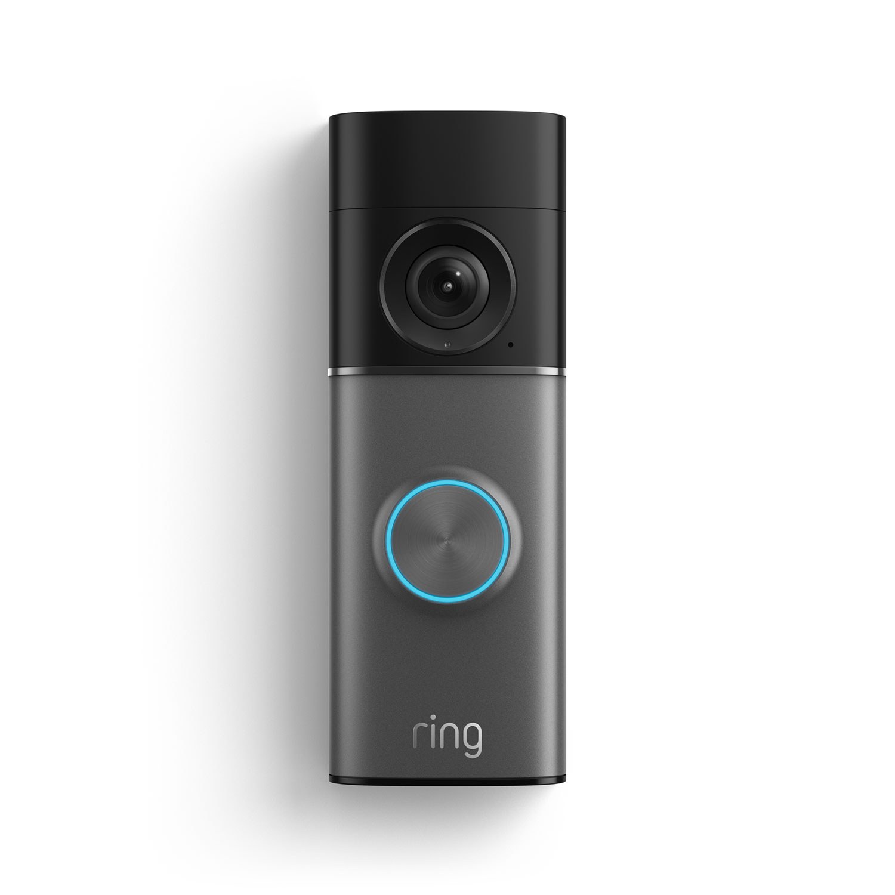
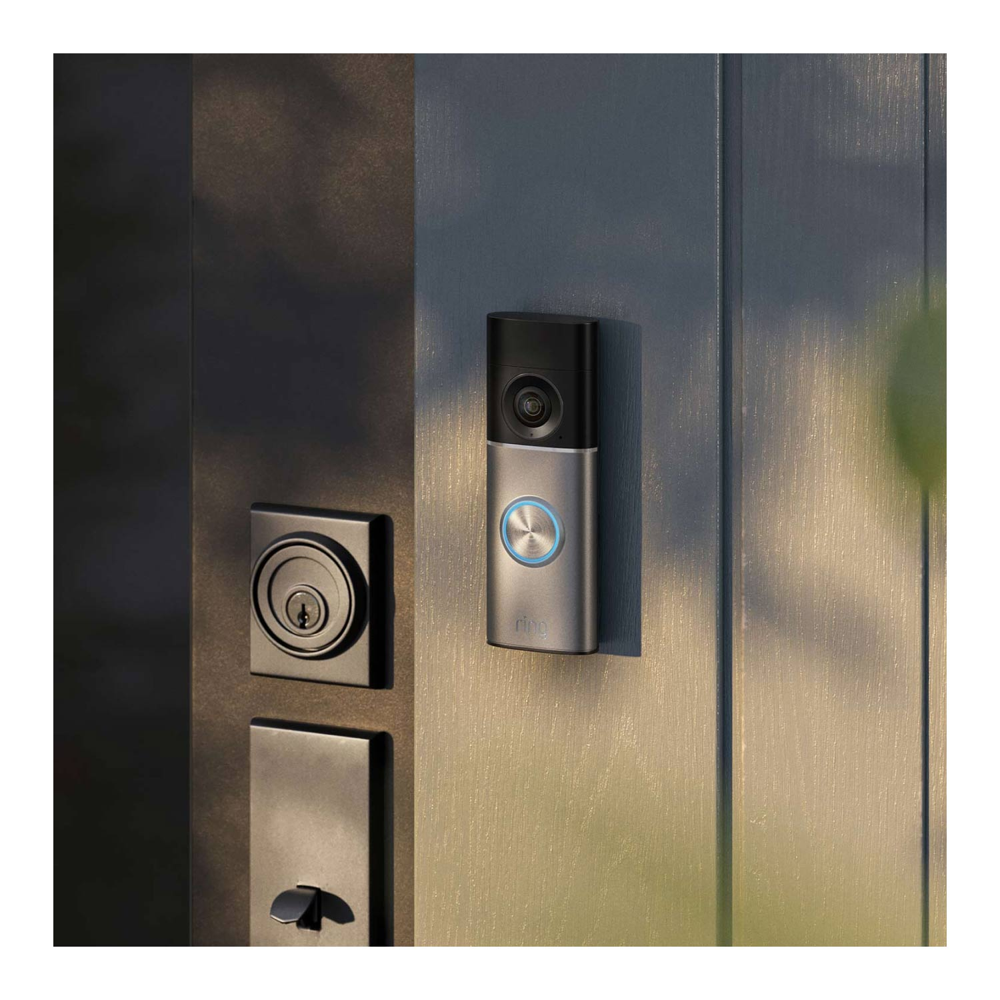
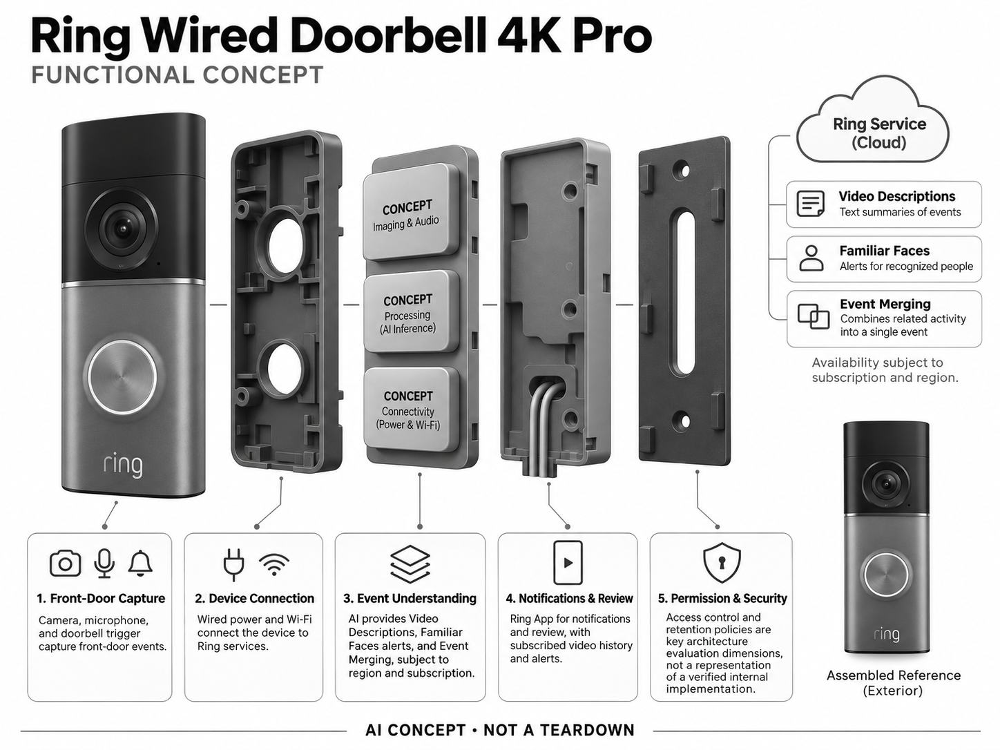

# Ring Wired Doorbell 4K Pro

**Ring** · 家庭安防 · 核查 2026-11-04

把门口影像转换成可读事件提醒的联网门铃

消费渠道：个人零售。

## 产品图片与结构参考

### 产品图

官方商品图：Wired Doorbell 4K Pro 深银色外观 · 来源：[Ring · 官方图片](<https://ring.com/products/wired-doorbell-pro>) · [原始图片](<https://images.ctfassets.net/a3peezndovsu/3gjfLsAnG7SwdB6Z5oA2sD/282c8d4a9582f349c92cdd4236dd828b/ring_wired_doorbell_pro_4k_1500x1500__1_.jpg>)

### 参考图

官方安装场景：4K Pro 与门框、门锁的尺寸关系 · 来源：[Ring · 官方图片](<https://ring.com/products/wired-doorbell-pro>) · [原始图片](<https://images.ctfassets.net/a3peezndovsu/4js315WXCQv1XF4U4OiHQ3/78e40555200ff6dab5302b3408b1da33/ring_wired_doorbell_pro_4k_front_door_outlined_1500x1500.jpg>)

### AI 生成爆炸示意

**AI 生成 · 非实物拆机。** 内部为概念推断，不能作为元件布局、BOM 或维修依据。[生成提示词](../../content/hardware/prompts/ring-wired-doorbell-4k-pro.txt)

> 依据官方外观参考与公开功能生成；未披露的内部布局只作概念模块，不构成BOM或真实结构证据。

> 图片版权归原权利人；用于产品研究并保留出处。未改变图片色彩或内容。

> 分析为基于公开资料的案头研究与 AI 辅助判断，未经用户访谈、销量审计或实物拆机。需求、画像、竞争冷门度、审美及商业机会均为研究假设，不是投资结论。

## 销售与购买

- 状态：在售。美国官方商店以 Wired Doorbell 4K Pro 名称列出 US$249.99、颜色选项及 Add to Cart；AI 事件描述等功能需要兼容订阅与支持地区。

- 地区：美国

- 价格：US$249.99。美国硬件价快照；安装、配件及兼容 Ring 订阅另计，不能按单机价评估长期使用成本。

- 中国大陆：本轮未核实中国大陆官方零售及 AI 订阅服务可用性；购买海外硬件不等于视频描述或账号服务在国内可用。

- [官方产品 / 商店](<https://ring.com/products/wired-doorbell-pro>)

## AI 的实际作用

设备捕捉门口事件，服务提供 Video Descriptions、熟人提示和事件合并等智能理解；能力受套餐和地区限制。

服务与联网依赖：AI 描述、录像历史和部分识别依赖 Ring 网络服务及兼容订阅；无云端不能假定保留全部 AI 功能。

## 是否冷门

竞争密集（研究判断）：门铃安防成熟且有多品牌与平台竞争，AI 描述是一种增强能力，并非独立空白赛道。

## 需求与市场

需求假设：用户希望迅速知道门外发生了什么，减少无意义通知与打开录像的次数。应以包裹、访客和路人等真实事件测试误报与漏报，文字描述是否节省注意力需验证。

## 用户画像

画像假设：频繁接收快递、已有门铃布线且在外时间较多的家庭。与房主不同，租户可能受安装授权限制；老人或多语言家庭更需要简洁通知，但不能预设所有语言均受支持。

## 竞争与替代

竞争判断：视频门铃已有大量品牌和摄像头替代方案，AI 描述是服务体验差异。新创业项目需面对账号生态、安装渠道和订阅关系的竞争，单独增加生成式文案不一定形成独立需求。

## 供应链

供应链推断：摄像头、广角光学、麦克风、扬声器、无线模组和有线供电需要在窄机身集成。具体代工厂、芯片和采购价未披露；防水、变压器兼容、夜间成像与安装公差是关键。

## 技术路径

官方页面列出 Video Descriptions 与订阅要求。技术判断：视觉事件理解应保留原始片段供核对，描述可能错误归因；边缘检测与云端语义服务的分工应透明，不能把描述当作事实证明。

## 产品审美

审美判断：窄长门铃可融入门框，多种饰面适应门面材料；明显镜头提供识别感，也可能影响访客感受。工业设计应兼顾按钮可见性、灯光打扰、隐私提示与安装后的完整度。

## 关键风险

风险判断：存在家庭影像、访客知情、面部识别和订阅依赖问题；地区限制明确存在。AI 文字只能辅助查阅，无法保证威胁识别或事件事实准确，断网和断电场景需提前测试。

## 机会与验证

可验证机会：围绕通知疲劳、快递交接及多住户权限设计服务，而不是复制摄像头。先比较普通事件标签与文字描述带来的确认时间、误解率和订阅意愿，再决定智能化程度。

## 功能分层示意

这是功能关系，不是实物拆机、真实空间结构或已核实 BOM。

1. **门口采集**：摄像头、麦克风与门铃触发。（官方披露）

2. **设备连接**：有线供电和 Wi-Fi 将设备接入 Ring 服务。（官方披露）

3. **事件理解**：文字描述、熟人提醒与事件合并，按地区和套餐。（官方披露）

4. **通知与回看**：手机 App、订阅录像历史及提醒。（官方披露）

5. **权限与安全**：访问控制和保留策略为架构评估维度，不代表已审计内部实现。（分析推断）

## 来源

1. [Ring Wired Doorbell 4K Pro 官方商店](<https://ring.com/products/wired-doorbell-pro>) — 已打开；购物入口、Video Descriptions 和套餐限制明确。

2. [Amazon 关于 Ring 对话 AI 的官方说明](<https://www.aboutamazon.com/news/devices/alexa-ring-doorbell-ai-greetings>) — 已打开；说明部分机型、美国/加拿大英语和订阅条件，不能泛化为所有地区。

[返回目录](../hardware-market.md) · [网页分析](https://romanagent.github.io/Roman/#hardware/product/ring-wired-doorbell-4k-pro)
