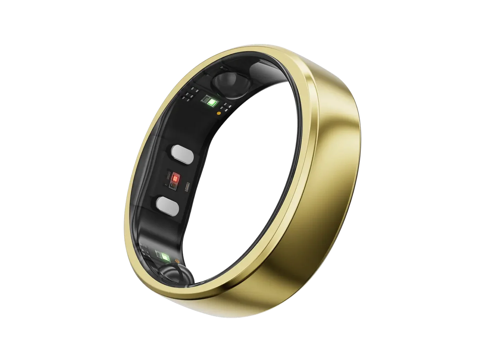
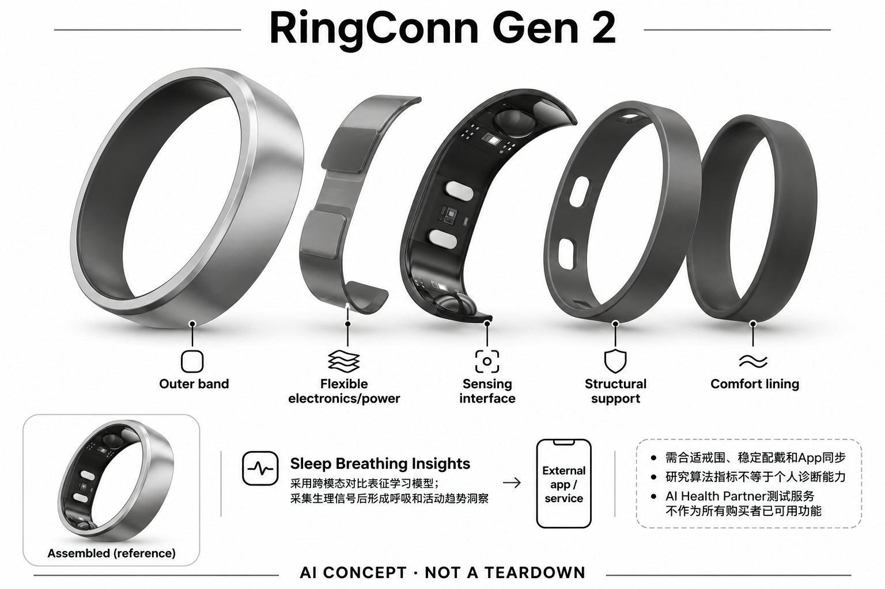

# RingConn Gen 2

**RingConn** · 健康与穿戴 · 核查 2026-11-04

低干扰戒指形态中的机器学习呼吸与活动洞察

消费渠道：个人零售。

## 产品图片与结构参考

### 产品图

RingConn Gen 2官方产品外形图 · 来源：[RingConn · 官方产品图片](<https://ringconn.com/products/ringconn-gen-2>) · [原始图片](<https://ringconn.com/cdn/shop/files/RingConn_Smart_Ring_Gen_2-Royal_Gold.png?v=1780302336&width=1400>)

### 参考图

RingConn Gen 2官方另一角度或使用场景参考 · 来源：[RingConn · 官方产品图片](<https://ringconn.com/products/ringconn-gen-2>) · [原始图片](<https://ringconn.com/cdn/shop/files/gen2_PDP_1.webp?v=1780302341&width=3000>)

### AI 生成爆炸示意

**AI 生成 · 非实物拆机。** 内部为概念推断，不能作为元件布局、BOM 或维修依据。[生成提示词](../../content/hardware/prompts/ringconn-gen-2.txt)

> 外形依据核验参考图；内部位置、模块形状与装配关系仅作AI概念展示。

> 已逐张查看并核对型号。源图未改色/裁切；场景、界面、附件、优惠及效果文案仅为厂商示意，不作为本目录性能或现价依据。

> 分析为基于公开资料的案头研究与 AI 辅助判断，未经用户访谈、销量审计或实物拆机。需求、画像、竞争冷门度、审美及商业机会均为研究假设，不是投资结论。

## 销售与购买

- 状态：在售。实际浏览器加载后Royal Gold含尺码套件选项显示US$279与启用的Add to cart；静态抓取中的Out of stock是未选规格模板，未据此一概判断停售。

- 地区：所列官方区域或授权零售渠道；配送地址与服务支持需结算确认

- 价格：浏览器所见US$279；页面比较表仍标US$299。核查日所见单机或基本配置价；币种、促销、税费、镜片、附件及服务依地区结算，不把颜色或套装重复计数。

- 中国大陆：本次未核实该具体型号在中国大陆的官方销售和完整服务支持；海外在售不等于国内可直接启用全部功能。

- [官方产品 / 商店](<https://ringconn.com/products/ringconn-gen-2>)

## AI 的实际作用

官方注明Sleep Breathing Insights采用跨模态对比表征学习模型；采集生理信号后形成呼吸和活动趋势洞察

服务与联网依赖：需合适戒围、稳定配戴和App同步；研究算法指标不等于个人诊断能力。AI Health Partner测试服务不作为所有购买者已可用功能

## 是否冷门

新兴竞争（研究判断）：按任务与形态作案头分类，无访谈、销量或市场份额证据。

## 需求与市场

需求假设：不喜欢睡觉或日常戴手表，却希望连续查看活动、恢复和夜间呼吸趋势。价值应由实际使用频率、任务完成与操作负担验证，不能把AI功能存在或演示流畅当作需求已得到满足。

### 官方｜夜间呼吸与活动趋势记录 · 官方资料

本型号以戒指中的光学、温度和运动输入形成日常与夜间趋势，官网明确呼吸洞察使用机器学习模型。需求是较少打扰地连续查看变化，而不是得到疾病诊断；测试中的 AI Health Partner 不作为所有用户已可用功能，收录依据也不依赖未正式开放的生成式聊天。

依据：[RingConn Gen 2官方购买及模型脚注](<https://ringconn.com/products/ringconn-gen-2>) · [RingConn Gen 2官方功能页](<https://ringconn.com/pages/ringconn-gen-2>)

### 判断｜趋势能否帮助理解记录 · 研究判断

用户可能不愿夜间戴手表，却希望知道不同日子的睡眠与呼吸相关变化，指环有机会提高佩戴连续性。但更多分数不等于更好理解，也可能让人过度关注单晚异常；价值应以用户能否认识数据范围和缺失判断，不能把模型名称或研究准确率直接当作个人健康收益。

依据：[RingConn Gen 2官方购买及模型脚注](<https://ringconn.com/products/ringconn-gen-2>)

### 验证｜连续记录与理解对照 · 待验证

可观察长期佩戴中的数据缺口、用户回查频率和对趋势的解释，比较手机记录或其他穿戴方式。需要区分设备提示、用户感受和独立专业结论，当前目录没有实机或医学测试；不能以某个模型研究中的表现推断每位用户、每个夜晚都能获得相同结果。

依据：[RingConn Gen 2官方购买及模型脚注](<https://ringconn.com/products/ringconn-gen-2>) · [RingConn Gen 2官方功能页](<https://ringconn.com/pages/ringconn-gen-2>)

## 用户画像

画像推断：可长期佩戴戒指、愿意按自己的基线查看趋势而非追求即时医学答案的用户。个人的语言、操作习惯、环境和预算会改变适配结果，本次只有案头研究，没有用户访谈或长期使用观察。

### 判断｜接受指环且关注长期趋势的人 · 研究判断

愿意正确选码、持续佩戴并通过应用查看的人更可能匹配，尤其主要关注夜间和日常数据的用户。需要即时运动屏幕或频繁手部操作的人可能有其他形态偏好，画像应基于实际习惯；不能把担心睡眠问题的人都视为适合消费戒指，更不能提供诊断式购买理由。

依据：[RingConn Gen 2官方购买及模型脚注](<https://ringconn.com/products/ringconn-gen-2>)

### 判断｜对数据不确定性的接受 · 研究判断

用户需要理解趋势和估算不是确定健康等级，并愿意在佩戴变化或缺失时保留疑问。若期待设备直接确诊或排除疾病，就超出已核实功能边界；研究应记录这种预期差异，不能只问是否喜欢更轻的设备或是否愿意查看健康数据，避免形态吸引掩盖任务错配。

依据：[RingConn Gen 2官方购买及模型脚注](<https://ringconn.com/products/ringconn-gen-2>)

### 验证｜选码和佩戴流程 · 待验证

试用应包含尺码套件、手指位置、日常活动和充电，观察用户是否能保持稳定接触并理解数据缺失。不同手部条件与生活习惯应分别记录，不能只在静止时判断合适；还需核对手机、地区和应用服务，海外可购并不代表所有用户能够获得同样的完整体验。

依据：[RingConn Gen 2官方购买及模型脚注](<https://ringconn.com/products/ringconn-gen-2>)

## 竞争与替代

案头判断：与其他健康戒指和手表竞争，无屏与充电频率是取舍，AI功能不能独立证明更可靠。这只是用途与替代品比较，不是市场份额或销量结论；专业细分和较少曝光也不代表没有成熟竞争者。

### 判断｜同类无屏戒指竞争 · 研究判断

其他指环也提供睡眠和活动趋势，本型号的差异应围绕已公开的呼吸洞察、佩戴和服务，而不是颜色与尺寸。核心被动记录需求应在场景分组中复用，不能每款都当作独立创新；当前没有销量或用户访谈，目录不以特定模型宣传或较少曝光判断市场空白。

依据：[RingConn Gen 2官方购买及模型脚注](<https://ringconn.com/products/ringconn-gen-2>) · [RingConn Gen 2官方功能页](<https://ringconn.com/pages/ringconn-gen-2>)

### 判断｜手表与专业检查的边界 · 研究判断

手表可以承担相似消费记录，也提供更多即时交互，选择取决于佩戴和查看方式。专业检查则回答不同层次的问题，不能把一般健康洞察当作同等替代；竞争分析应先明确用户需要趋势回顾还是确定医疗结论，避免用价格、续航或便利度混合比较不同任务。

依据：[RingConn Gen 2官方购买及模型脚注](<https://ringconn.com/products/ringconn-gen-2>)

### 验证｜配置和地区价格 · 待验证

本次购买依据来自已加载的具体颜色与尺码套件选项，静态售罄模板不能代表全部配置。页面不同位置价格应按所选可结算项核对，不能把旧比较表或新代参数混入；当前没有价格弹性和留存证据，目录不由促销或在售状态推断需求规模与使用效果。

依据：[RingConn Gen 2官方购买及模型脚注](<https://ringconn.com/products/ringconn-gen-2>)

## 供应链

公开资料可核对戒指内侧光学传感窗口、温度/运动传感与便携充电盒，具体整机工厂、关键模块供应商与BOM本次未确认。制造重点可从形态推断，但不能把品牌所在地、外观相似或营销合作等同代工关系。

### 官方｜指端输入与充电部件 · 官方资料

已核查资料支持内侧光学窗口、温度与运动输入以及便携充电盒，具体前端、主控、电池和工厂仍未知。算法名称不能反推出内部传感器数量或位置，也不能从同类戒指猜测方案；目录只建立功能架构，不把概念爆炸示意作为真实装配与物料证据。

依据：[RingConn Gen 2官方购买及模型脚注](<https://ringconn.com/products/ringconn-gen-2>) · [RingConn Gen 2官方功能页](<https://ringconn.com/pages/ringconn-gen-2>)

### 判断｜尺码、旋转与信号稳定 · 研究判断

戒指接触会随尺寸、旋转和手部活动变化，充电与重新佩戴也可能造成数据缺口。供应链研究应核对光路、校准和不同尺寸的一致性，不能只看机身薄或电池宣传；当前没有装配公差、良率和售后流程资料，不能据外形或价格估算制造优势。

依据：[RingConn Gen 2官方购买及模型脚注](<https://ringconn.com/products/ringconn-gen-2>)

### 判断｜光学与运动候选 · 研究判断

汇顶光学前端与博世低功耗运动感知可作为新设计候选，但没有本型号点名采用。需要验证手指光路、采样、安装和电源，不能直接替换或添加未披露测量；这些器件不提供 RingConn 的呼吸模型，也不能把组件参数直接转化为个人健康洞察的可靠性。

依据：[RingConn Gen 2官方购买及模型脚注](<https://ringconn.com/products/ringconn-gen-2>)

## 技术路径

官方注明Sleep Breathing Insights采用跨模态对比表征学习模型；采集生理信号后形成呼吸和活动趋势洞察。这是厂商披露的功能机制；模型版本、准确率及内部结构未完整公开。架构只表示输入、处理和输出关系，不作为真实拆机或性能实测。

### 官方｜机器学习依据与非医疗边界 · 官方资料

官网脚注指向跨模态对比表征学习研究，并将相关结果用于呼吸洞察，同时明确设备不是医疗用途。目录不把研究数据集的准确率用于个人结果保证，也不把地区旧术语覆盖全球站当前边界；已核实的是感知模型应用，不需要借测试中的聊天服务证明其具备人工智能。

依据：[RingConn Gen 2官方购买及模型脚注](<https://ringconn.com/products/ringconn-gen-2>)

### 判断｜训练名称不等于硬件配置 · 研究判断

跨模态模型名称说明研究或训练路线，不能据此推断戒指具备研究中所有信号输入，也不能判断全部推理在指环内完成。技术分析应把采集、模型和应用输出分别确认，尤其避免把算法论文词汇直接画成内部模块；具体版本、部署和个人适用性仍需进一步证据。

依据：[RingConn Gen 2官方购买及模型脚注](<https://ringconn.com/products/ringconn-gen-2>)

### 验证｜缺失与环境变化 · 待验证

应观察佩戴松紧、充电中断、活动和软件更新后，数据与呼吸趋势如何变化，并检查缺失是否明确显示。不能将单晚变化自动解释为身体原因，也不能只看曲线连续就认定输入完整；当前目录没有独立验证，测试应保留原始记录与条件，以便区分采集和解释问题。

依据：[RingConn Gen 2官方购买及模型脚注](<https://ringconn.com/products/ringconn-gen-2>) · [RingConn Gen 2官方功能页](<https://ringconn.com/pages/ringconn-gen-2>)

## 产品审美

图示观察：外轮廓略方、内圈圆润，传感窗口集中于内侧，金属表面保留首饰感。宣传图片只能帮助理解外观和摆放方式，不能证明每个人的舒适度、长时使用体验或实际材料触感。

### 判断｜低存在感的指环形态 · 研究判断

无屏戒指可以减少手腕通知和设备感，但是否适合用户取决于手指习惯、日常抓握和首饰搭配。官方图片能说明外形与颜色，不能证明所有尺寸舒适或不影响工作；审美研究应观察实际摘戴和持续佩戴，而不是把薄型宣传直接当成数据连续与长期使用保证。

依据：[RingConn Gen 2官方购买及模型脚注](<https://ringconn.com/products/ringconn-gen-2>)

### 判断｜充电盒与日常管理 · 研究判断

便携盒可能帮助收纳与充电，也增加一个需要携带和维护的部件，便利程度取决于用户习惯。设计评价应观察取放、尺寸匹配和状态确认，不能只看附带充电盒就推断更适合旅行；无屏设备的电量与数据状态仍需被用户理解，不能完全依赖应用提醒的理想流程。

依据：[RingConn Gen 2官方购买及模型脚注](<https://ringconn.com/products/ringconn-gen-2>)

### 验证｜夜间与手部活动试戴 · 待验证

试用应覆盖睡前、日间工作、洗护和充电后的重新佩戴，记录压力、旋转和主动摘下原因。不同尺寸和手指位置要分别观察数据与舒适，不能以静止试戴或一张宣传图判断；长期体验需要采集连续与可接受负担同时满足，当前没有实机结果可替用户保证。

依据：[RingConn Gen 2官方购买及模型脚注](<https://ringconn.com/products/ringconn-gen-2>)

## 关键风险

戒指是一般健康辅助设备，呼吸异常提示不能确诊或排除疾病；地区功能名称、库存、尺码与App服务均会变化。还需核对地区功能、软件更新与售后边界；本目录未进行实机、医学或可靠性测试，不把厂商演示当作结果保证。

### 判断｜呼吸提示不能用于诊断 · 研究判断

一般健康洞察无法确诊或排除疾病，研究模型的验证结果也不能直接等同个人诊断能力。用户可能因为提示异常而过度解读，或因没有提示而产生错误安心，因此产品应清楚表达范围；目录不把地区旧医疗化措辞或营销准确率扩展成确定健康结论。

依据：[RingConn Gen 2官方购买及模型脚注](<https://ringconn.com/products/ringconn-gen-2>)

### 判断｜测试功能与正式权益 · 研究判断

AI Health Partner 的测试状态不能视为所有购买者已获得的功能，应用、地区与版本也可能影响体验。购买应按当前正式权益和可交付配置核对，而不是依据未来承诺；海外品牌页面、中文资料和具体地区商店不能互相替代，数据与保修条件仍需分别确认。

依据：[RingConn Gen 2官方购买及模型脚注](<https://ringconn.com/products/ringconn-gen-2>) · [RingConn Gen 2官方功能页](<https://ringconn.com/pages/ringconn-gen-2>)

### 验证｜错误与数据控制 · 待验证

应检查错误记录、更正、删除与导出能否按用户预期处理，并观察算法更新后历史趋势是否可解释。重要健康问题不能只依据戒指输出判断，当前目录没有医学审计或个人效果验证；可靠体验应帮助理解不确定性，而不是用一个单日分数替代更完整的信息。

依据：[RingConn Gen 2官方购买及模型脚注](<https://ringconn.com/products/ringconn-gen-2>)

## 机会与验证

市场差异主要在于低干扰戒指形态中的机器学习呼吸与活动洞察。值得进一步验证的购买理由是它能否减少既有任务中的具体步骤，以及硬件、服务与维护的总成本是否符合个人使用频率。

### 判断｜呼吸趋势是明确差异维度 · 研究判断

本型号值得研究的是夜间呼吸相关洞察是否帮助用户回顾长期变化，而非把指环升级为诊断设备。这个差异应与一般睡眠活动记录联系起来，并保留适用范围，不能只因模型名称独特就认定形成全新市场；购买理由仍需真实佩戴与信息使用行为支持。

依据：[RingConn Gen 2官方购买及模型脚注](<https://ringconn.com/products/ringconn-gen-2>)

### 判断｜数据是否被有效理解 · 研究判断

研究应记录用户查看哪些趋势、如何理解异常和何时需要其他信息，不能只统计应用打开或佩戴天数。若解释让人更困惑或过度关注单晚分数，更多数据未必有益；持续价值需要可核查的理解收益超过选码、充电和账户管理，而不是功能表看起来更完整。

依据：[RingConn Gen 2官方功能页](<https://ringconn.com/pages/ringconn-gen-2>)

### 验证｜长期使用与替代比较 · 待验证

后续可跟踪佩戴完整度、数据缺口、趋势回查和更正，并比较手表或其他生活记录方式的负担。地区、计划与配置应保持一致，不能用一次促销或短期体验代表长期价值；当前目录是案头研究，不以在售、模型研究或轻薄形态宣称需求与健康效果已验证。

依据：[RingConn Gen 2官方购买及模型脚注](<https://ringconn.com/products/ringconn-gen-2>) · [RingConn Gen 2官方功能页](<https://ringconn.com/pages/ringconn-gen-2>)

## 对应供应链公司

能力候选用于选型研究，不代表本产品实际采用；未公开的供货关系不作推断。

- [goodix](../supply-chain/goodix.md) — **能力候选 · 非已采用** / 指端光学生理信号前端候选：RingConn Gen 2 披露光学输入，汇顶的模块或前端可作为新设计候选，需验证手指光路、接触、运动伪差与功耗。当前没有点名采用，候选不提供 RingConn 的跨模态模型，也不能从器件支持的其他信号给本戒指新增功能或推断个人诊断能力。

- [bosch-sensortec](../supply-chain/bosch-sensortec.md) — **能力候选 · 非已采用** / 活动与运动输入的低功耗候选：本型号包含运动输入，博世传感路线可用于比较安装、采样和主控分工，但必须按指环空间与电池选择具体器件。当前未确认供货，不能由候选六轴平台推断现有戒指配置；运动数据能力不等于呼吸洞察模型、测试聊天功能或医学效果。

[浏览供应链目录](../supply-chain.md)

## 功能分层示意

这是功能关系，不是实物拆机、真实空间结构或已核实 BOM。

1. **实体输入**：戒指内侧光学传感窗口、温度/运动传感与便携充电盒；仅功能层示意，非拆机。（官方披露）

2. **采集与控制**：设备把输入转为可处理的信息并接收用户操作；具体内部布局未知。（分析推断）

3. **AI功能**：官方注明Sleep Breathing Insights采用跨模态对比表征学习模型；采集生理信号后形成呼吸和活动趋势洞察（官方披露）

4. **服务依赖**：需合适戒围、稳定配戴和App同步；研究算法指标不等于个人诊断能力。AI Health Partner测试服务不作为所有购买者已可用功能（官方披露）

5. **用户反馈**：用户通过声音、屏幕或配套应用接收结果，并对重要信息复核。（分析推断）

## 来源

1. [RingConn Gen 2官方购买及模型脚注](<https://ringconn.com/products/ringconn-gen-2>) — 已用浏览器核对有效购买选项，并读到Cross-Modal Contrastive Representation Learning模型脚注；不引用营销准确率为疗效。

2. [RingConn Gen 2官方功能页](<https://ringconn.com/pages/ringconn-gen-2>) — 已打开一手页面；产品能力为厂商披露，未进行实机或效果验证。

3. [RingConn新加坡产品功能](<https://ringconnsg.com/pages/gen-2>) — 已打开，明确AI-powered sleep health tracking；区域旧术语不替代全球站当前非医疗边界。

[返回目录](../hardware-market.md) · [网页分析](https://romanagent.github.io/Roman/#hardware/product/ringconn-gen-2)
