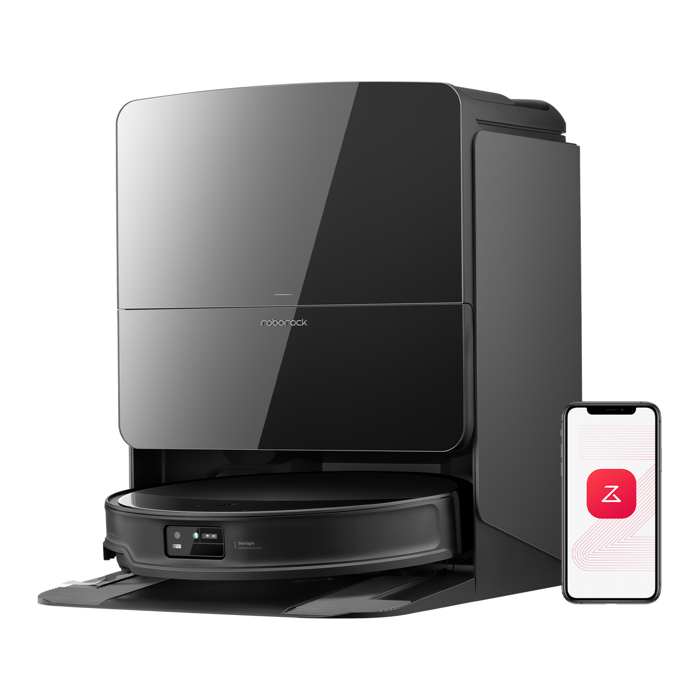
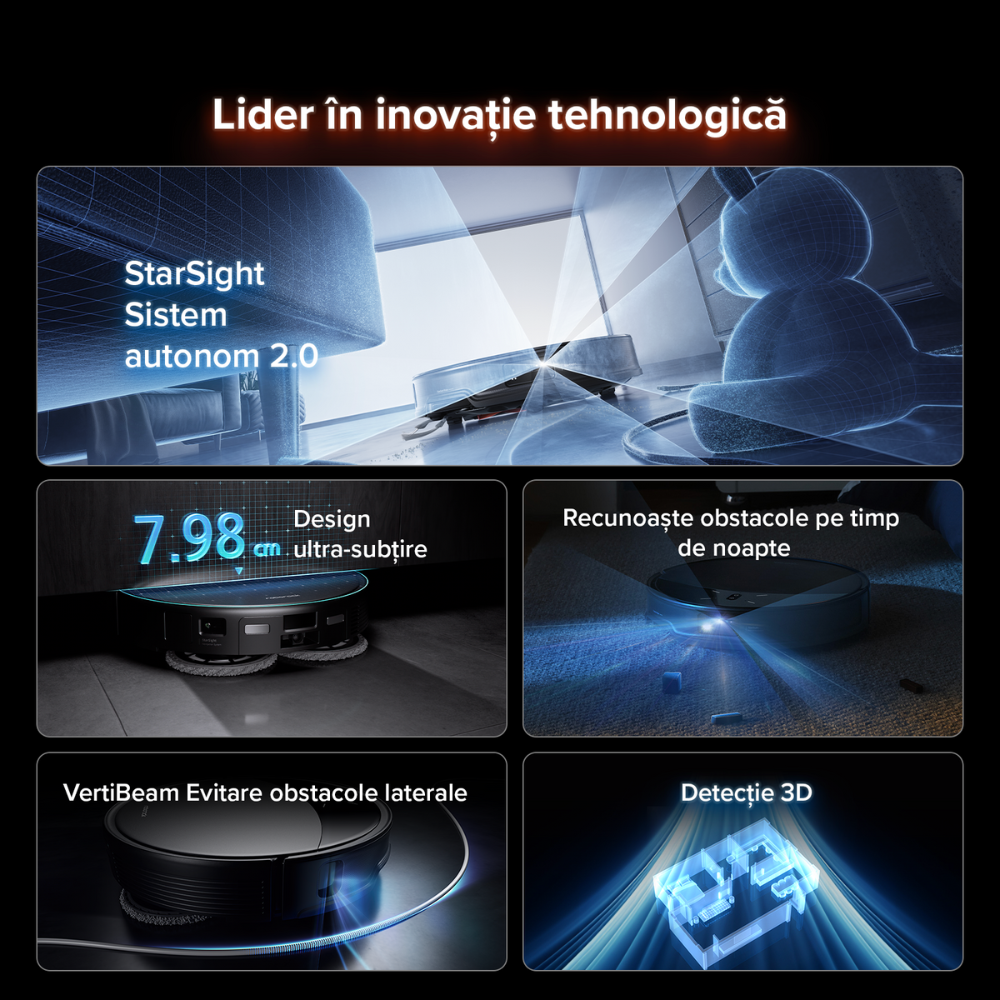
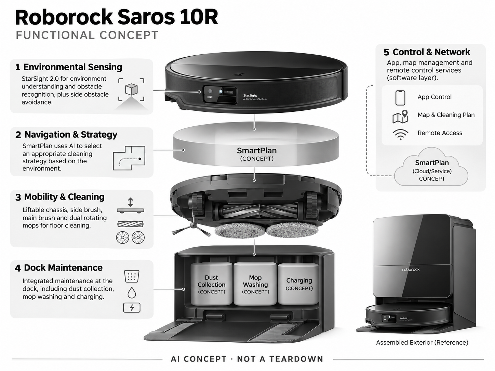

# Roborock Saros 10R

**Roborock** · 清洁机器人 · 核查 2026-11-04

将视觉感知、低矮机身与自动维护结合的扫拖机器人

消费渠道：个人零售。

## 产品图片与结构参考

### 产品图

官方商品图：Saros 10R 主机与维护基站 · 来源：[Roborock · 官方图片](<https://ro.roborock.com/products/roborock-saros-10r>) · [原始图片](<https://cdn.shopify.com/s/files/1/0708/9324/0540/files/1_d7693e94-a754-4fe5-93b7-bd0a0ede3f8e.png?v=1756179244&width=1200>)

### 参考图

官方 StarSight 避障与低矮机身示意（罗马尼亚语营销图，非独立实测） · 来源：[Roborock · 官方图片](<https://ro.roborock.com/products/roborock-saros-10r>) · [原始图片](<https://cdn.shopify.com/s/files/1/0708/9324/0540/files/2_f799eb4f-e814-4cab-ad14-05d1443c7d4c.png?v=1756179244&width=1200>)

### AI 生成爆炸示意

**AI 生成 · 非实物拆机。** 内部为概念推断，不能作为元件布局、BOM 或维修依据。[生成提示词](../../content/hardware/prompts/roborock-saros-10r.txt)

> 依据官方外观参考与公开功能生成；未披露的内部布局只作概念模块，不构成BOM或真实结构证据。

> 图片版权归原权利人；用于产品研究并保留出处。未改变图片色彩或内容。

> 分析为基于公开资料的案头研究与 AI 辅助判断，未经用户访谈、销量审计或实物拆机。需求、画像、竞争冷门度、审美及商业机会均为研究假设，不是投资结论。

## 销售与购买

- 状态：在售。罗马尼亚官方商店显示 7,219 lei 与加入购物车、购买入口；美国官方页同时显示缺货。此条在售仅指已核实的罗马尼亚市场，不代表全球现货。

- 地区：罗马尼亚

- 价格：7,219 lei。罗马尼亚官方页快照；美国页虽列 $1,099.99，但显示缺货，不作为可购买报价。税运、库存与活动以当地结账为准。

- 中国大陆：本轮未核实中国大陆以 Saros 10R 同名销售的官方入口；不可直接把国内相近型号当作同一 SKU。

- [官方产品 / 商店](<https://ro.roborock.com/products/roborock-saros-10r>)

## AI 的实际作用

StarSight 2.0 用于环境和障碍识别，SmartPlan 使用 AI 调整清洁策略；并非通用对话机器人。

服务与联网依赖：核心移动与清洁在设备端执行；地图管理、远程设置及部分语音服务需要 App、网络或第三方服务。

## 是否冷门

竞争密集（研究判断）：观察到多个品牌以视觉避障和基站自动维护竞争；这是定性竞争判断，没有采用销量或市场份额数据。

## 需求与市场

需求假设：养宠或混合地面家庭购买的不是模型本身，而是少捡杂物、少处理缠毛和漏扫。应通过连续两周家庭试用记录人工接管次数，验证自动化是否真正减少劳动。

### 产品任务与边界 · 研究判断

Saros 10R 通过环境感知、清洁策略和低矮机身服务于少捡杂物、少处理缠毛和漏扫的需求。用户购买的不是 SmartPlan 名称，而是家务减少，必须把清洁前整理、运行中接管和基站维护一起评价。

依据：[Roborock 罗马尼亚官方商店](<https://ro.roborock.com/products/roborock-saros-10r>) · [Roborock Saros 10R 官方功能页](<https://global.roborock.com/pages/roborock-saros-10r>)

### 需求判断 · 研究判断

低家具可达性可能让过去需要手动清理的区域进入自动流程，但更低机身并不解决所有门槛和杂物问题。需求研究应观察实际漏扫和救援，不能仅用机身高度或吸力参数推定每个家庭都获得相同收益。

依据：[Roborock 罗马尼亚官方商店](<https://ro.roborock.com/products/roborock-saros-10r>) · [Roborock Saros 10R 官方功能页](<https://global.roborock.com/pages/roborock-saros-10r>)

### 需求验证 · 待验证

可在养宠与混合地面家庭连续记录整理、接管、漏扫和耗材处理，并标记低柜及细线等失败位置。比较使用前后的总人工时间，确认自动维护与规划真正减少劳动，而不是把工作转移到更复杂的基站。

依据：[Roborock 罗马尼亚官方商店](<https://ro.roborock.com/products/roborock-saros-10r>) · [Roborock Saros 10R 官方功能页](<https://global.roborock.com/pages/roborock-saros-10r>)

## 用户画像

画像假设：有一定居住面积、家具较低且愿为家务省时付费的家庭；购买者也承担基站补水与维护。小户型租客可能更在意基站占地、噪声和搬家成本，不能用同一卖点覆盖。

### 适用行为与条件 · 研究判断

较匹配家具较低、愿为家务省时投入且能容纳基站的家庭，购买者通常还需要安排补水和维护。小户型租客可能更关注占地、噪声和搬家，不能用同一旗舰卖点覆盖所有居住条件。

依据：[Roborock 罗马尼亚官方商店](<https://ro.roborock.com/products/roborock-saros-10r>) · [Roborock Saros 10R 官方功能页](<https://global.roborock.com/pages/roborock-saros-10r>)

### 人群取舍 · 研究判断

养宠家庭可能重视缠毛和意外污物，混合地面家庭则更关注地毯与拖地切换。实际维护者对污水和耗材的容忍度也不同，画像应按具体劳动和空间划分，而不是仅以收入或对智能家居兴趣推断适配。

依据：[Roborock 罗马尼亚官方商店](<https://ro.roborock.com/products/roborock-saros-10r>) · [Roborock Saros 10R 官方功能页](<https://global.roborock.com/pages/roborock-saros-10r>)

### 画像验证 · 待验证

画像验证应让主要家务承担者配置地图、补水和处理一次异常，记录最费力的环节。再比较不同家具与地面家庭的收益，识别低机身和策略真正解决问题的人，而非只把高配置购买意愿视为明确需求。

依据：[Roborock 罗马尼亚官方商店](<https://ro.roborock.com/products/roborock-saros-10r>) · [Roborock Saros 10R 官方功能页](<https://global.roborock.com/pages/roborock-saros-10r>)

## 竞争与替代

竞争判断：扫拖属于成熟拥挤赛道，Dreame、Narwal 等已有视觉避障与自清洁产品。差异更依赖特殊家庭环境下的稳定性、维修和耗材体验，而非单项吸力或 AI 名称。

### 比较对象与差异 · 研究判断

Saros 10R 与 Dreame、Narwal 等视觉避障和自维护产品直接竞争，扫拖已经是成熟拥挤赛道。差异更依赖特殊家庭环境中的稳定性、耗材和维修，不能只用 AI 名称、吸力或机身高度建立完整竞争判断。

依据：[Roborock 罗马尼亚官方商店](<https://ro.roborock.com/products/roborock-saros-10r>) · [Roborock Saros 10R 官方功能页](<https://global.roborock.com/pages/roborock-saros-10r>)

### 竞争判断 · 研究判断

低矮结构与复杂感知可能扩大可达范围，却增加内部集成和维护要求。竞争优势需由持续少接管证明，若用户仍需大量整理地面，旗舰功能未必实现预期；地区库存和售后也影响实际选择，不能只看全球发布。

依据：[Roborock 罗马尼亚官方商店](<https://ro.roborock.com/products/roborock-saros-10r>) · [Roborock Saros 10R 官方功能页](<https://global.roborock.com/pages/roborock-saros-10r>)

### 竞争验证 · 待验证

可在相同家具、地毯和宠物物品条件下比较接管、残留与维护时间，并明确当地版本和耗材。当前不同地区库存不同，比较时应把购买可达性与技术能力分开，不将某站缺货推断为全球停售或普遍可购。

依据：[Roborock 罗马尼亚官方商店](<https://ro.roborock.com/products/roborock-saros-10r>) · [Roborock Saros 10R 官方功能页](<https://global.roborock.com/pages/roborock-saros-10r>)

## 供应链

供应链推断：需要深度感知、图像模组、驱动轮组、风机、电池和水路基站协同。具体芯片厂商、代工厂与 BOM 成本未披露；防水、防缠毛机构和长期耗材供应是量产评估重点。

### 功能模块拆分 · 研究判断

功能层包括 StarSight 与侧向感知、SmartPlan 导航策略、抬升底盘及刷组双拖布、集尘清洗充电基站，以及应用地图。公开资料没有完整芯片或工厂清单，服务层示意也不代表已掌握具体端云计算位置。

依据：[Roborock 罗马尼亚官方商店](<https://ro.roborock.com/products/roborock-saros-10r>) · [Roborock Saros 10R 官方功能页](<https://global.roborock.com/pages/roborock-saros-10r>)

### 制造与供应约束 · 研究判断

制造约束是低矮空间中的感知、风机、轮组、电池及水路协同，抬升与拖布动作又需要稳定装配。防缠毛、密封和耗材连续供应应纳入量产评估，不能只以零部件能工作推断整机长期少维护。清洗后重新装配的密封与感知位置也需检查。

依据：[Roborock 罗马尼亚官方商店](<https://ro.roborock.com/products/roborock-saros-10r>) · [Roborock Saros 10R 官方功能页](<https://global.roborock.com/pages/roborock-saros-10r>)

### 候选与证据缺口 · 研究判断

金宝可作为扫拖家电电子与结构制造候选，Fictiv 可支持低矮底盘和抬升机构零件验证。没有 Saros 10R 点名合作证据，感知算法、水路与整机可靠性需专门负责，候选不代表实际使用的供应链。

依据：[Roborock 罗马尼亚官方商店](<https://ro.roborock.com/products/roborock-saros-10r>) · [Roborock Saros 10R 官方功能页](<https://global.roborock.com/pages/roborock-saros-10r>)

## 技术路径

已披露 StarSight 2.0、SmartPlan 与可抬升组件。技术判断：产品价值来自感知—规划—执行闭环；低光、反光、细电线和可移动杂物需要实测。官网能力说明不能替代真实家庭成功率。

### 已披露技术边界 · 研究判断

官方披露 StarSight 2.0、SmartPlan 和可抬升组件，技术价值来自感知、规划与执行闭环。识别环境与选择策略并不等同每个障碍都正确处理，基础清洁和地图远程管理也有不同网络依赖，不能混写为完全离线智能。

依据：[Roborock 罗马尼亚官方商店](<https://ro.roborock.com/products/roborock-saros-10r>) · [Roborock Saros 10R 官方功能页](<https://global.roborock.com/pages/roborock-saros-10r>)

### 系统难点判断 · 研究判断

低光、反光、细电线和可移动杂物会挑战感知，路径正确也不代表清洁头实际触达所有位置。系统需要让用户理解未完成区域与原因，避免只显示地图覆盖而掩盖真实残留，尤其在家具底部难以直接观察时。

依据：[Roborock 罗马尼亚官方商店](<https://ro.roborock.com/products/roborock-saros-10r>) · [Roborock Saros 10R 官方功能页](<https://global.roborock.com/pages/roborock-saros-10r>)

### 技术验证 · 待验证

验证应覆盖低柜、细线、地毯边缘和宠物相关障碍，分别记录识别、绕行与清洁结果。对策略和远程功能测试断网条件，不能以官网功能说明或一条完整地图推断真实家庭成功率及全部任务已完成。

依据：[Roborock 罗马尼亚官方商店](<https://ro.roborock.com/products/roborock-saros-10r>) · [Roborock Saros 10R 官方功能页](<https://global.roborock.com/pages/roborock-saros-10r>)

## 产品审美

审美判断：低矮圆形主机降低地面存在感，但完整产品仍包含较显眼的基站。简洁外壳适合现代家居；应连同线缆、补水空间与开盖操作评估，不能只看主机正面渲染图。

### 外观与交互语言 · 研究判断

低矮圆形主机降低地面存在感，但完整产品仍包含较显眼基站。简洁外壳适合现代家居，实际观感却取决于线材、补水空间和开盖动作，不能只评价主机渲染图而忽略每天需要操作的部分。

依据：[Roborock 罗马尼亚官方商店](<https://ro.roborock.com/products/roborock-saros-10r>) · [Roborock Saros 10R 官方功能页](<https://global.roborock.com/pages/roborock-saros-10r>)

### 使用中审美判断 · 研究判断

进入家具底部可以隐藏清洁过程，也可能让异常救援更困难，设计应考虑拿取和状态定位。基站若需要大幅移动才能清洁，外观整洁会被维护打断，因此日常动作与摆放条件应与造型一并评审。水箱取出路线与基站上方净空也应纳入摆放评审。

依据：[Roborock 罗马尼亚官方商店](<https://ro.roborock.com/products/roborock-saros-10r>) · [Roborock Saros 10R 官方功能页](<https://global.roborock.com/pages/roborock-saros-10r>)

### 设计验证 · 待验证

设计验证可观察真实补水、倒污、清毛及从低柜取出机器人，记录空间冲突与清理负担。还需评估夜间运行和集尘声音对家庭的影响，避免将静态简洁外观等同长期使用低打扰。

依据：[Roborock 罗马尼亚官方商店](<https://ro.roborock.com/products/roborock-saros-10r>) · [Roborock Saros 10R 官方功能页](<https://global.roborock.com/pages/roborock-saros-10r>)

## 关键风险

风险判断：视觉采集涉及家庭环境信息；越障与水路增加维护环节。地区型号、云服务、耗材与保修存在差异，且美站本次缺货说明购买可达性需按地区持续复核。

### 主要失效与依赖 · 研究判断

风险包括家庭视觉信息、越障与水路维护、地区云服务和耗材保修差异。AI 避障不能保证所有杂物和宠物事故被避免，地区库存需要持续核对，购买入口与完整服务可用性也不能混为一谈。

依据：[Roborock 罗马尼亚官方商店](<https://ro.roborock.com/products/roborock-saros-10r>) · [Roborock 美国官方商店](<https://us.roborock.com/products/roborock-saros-10r>) · [Roborock Saros 10R 官方功能页](<https://global.roborock.com/pages/roborock-saros-10r>)

### 风险传播判断 · 研究判断

若复杂机构或水路失效，用户可能同时失去清洁和自动维护便利，恢复成本高于普通手持工具。系统应清楚提示是哪一层异常，并提供可维护路径，避免让所有问题都只表现为任务未完成或需要返厂。

依据：[Roborock 罗马尼亚官方商店](<https://ro.roborock.com/products/roborock-saros-10r>) · [Roborock 美国官方商店](<https://us.roborock.com/products/roborock-saros-10r>) · [Roborock Saros 10R 官方功能页](<https://global.roborock.com/pages/roborock-saros-10r>)

### 风险验证 · 待验证

风险验证应演练基站异常、网络中断和耗材维护后的恢复，记录用户能否定位问题。实际家庭测试应保留障碍与地面条件，不能从高端定位或自动清洗能力推断长期免维护，也不把相机识别当作安全保障。

依据：[Roborock 罗马尼亚官方商店](<https://ro.roborock.com/products/roborock-saros-10r>) · [Roborock 美国官方商店](<https://us.roborock.com/products/roborock-saros-10r>) · [Roborock Saros 10R 官方功能页](<https://global.roborock.com/pages/roborock-saros-10r>)

## 机会与验证

可验证机会：围绕老家具、宠物事故和远程照护家庭设计清洁异常提示与可修复耗材服务。先比较人工接管与维护时间，再决定是否值得另做整机，不能从拥挤市场直接推断没有机会。

### 可能的机会入口 · 研究判断

机会在于老家具、宠物事故和远程查看家庭的异常解释与可修复耗材服务，不一定要再做一台全能扫拖机。拥挤市场仍可能存在具体问题，但需要以实际接管和维护成本证明，而不是仅寻找新的 AI 名称。

依据：[Roborock 罗马尼亚官方商店](<https://ro.roborock.com/products/roborock-saros-10r>) · [Roborock Saros 10R 官方功能页](<https://global.roborock.com/pages/roborock-saros-10r>)

### 机会成立条件 · 研究判断

机会成立需要某类家庭持续获得更少劳动，如果收益只在少数极端障碍出现，整机复杂度可能不划算。可以先用现有产品提供适配或维护服务，验证愿付价值，再决定是否投入新的感知、底盘或基站。

依据：[Roborock 罗马尼亚官方商店](<https://ro.roborock.com/products/roborock-saros-10r>) · [Roborock Saros 10R 官方功能页](<https://global.roborock.com/pages/roborock-saros-10r>)

### 下一步验证 · 待验证

下一步可建立低家具与养宠家庭的两周对照记录，分析人工接管、清洁残留和耗材维护，再测试更清楚异常提示。让结果决定是软件、服务还是机械创新，避免由单项参数领先直接推断商业机会。

依据：[Roborock 罗马尼亚官方商店](<https://ro.roborock.com/products/roborock-saros-10r>) · [Roborock Saros 10R 官方功能页](<https://global.roborock.com/pages/roborock-saros-10r>)

## 对应供应链公司

能力候选用于选型研究，不代表本产品实际采用；未公开的供货关系不作推断。

- [new-kinpo-group](../supply-chain/new-kinpo-group.md) — **能力候选 · 非已采用** / 低矮扫拖系统控制与结构制造：金宝公开家电、PCBA和注塑模具能力可对应扫拖电子与结构评估，但低矮集成、抬升和水路需专项验证；未见 Saros 10R 点名供货资料，因此不能认定其实际制造关系。

- [fictiv](../supply-chain/fictiv.md) — **能力候选 · 非已采用** / 低矮底盘与抬升机构零件验证：Fictiv 的机械原型及制造网络可支持底盘、支架和抬升配合零件评审，但不证明导航、清洁或长期机构寿命；没有 Saros 10R 合作披露，候选只对应机械开发环节。

[浏览供应链目录](../supply-chain.md)

## 功能分层示意

这是功能关系，不是实物拆机、真实空间结构或已核实 BOM。

1. **环境感知**：StarSight 2.0 与侧向避障感知；功能层示意，不是实际拆机布局。（官方披露）

2. **导航与策略**：SmartPlan 根据环境选择清洁策略。（官方披露）

3. **移动与清洁**：抬升底盘、边刷、滚刷与双旋转拖布。（官方披露）

4. **基站维护**：集尘、拖布清洗及充电等集成维护功能。（官方披露）

5. **控制与网络**：将 App、地图与远程控制抽象为服务层，内部计算边界未完全披露。（分析推断）

## 来源

1. [Roborock 罗马尼亚官方商店](<https://ro.roborock.com/products/roborock-saros-10r>) — 已打开；列价格与购物入口。

2. [Roborock 美国官方商店](<https://us.roborock.com/products/roborock-saros-10r>) — 已打开；显示 Out of stock，地区状态与罗马尼亚不同。

3. [Roborock Saros 10R 官方功能页](<https://global.roborock.com/pages/roborock-saros-10r>) — 已打开；说明 StarSight 和 SmartPlan。

[返回目录](../hardware-market.md) · [网页分析](https://romanagent.github.io/Roman/#hardware/product/roborock-saros-10r)
