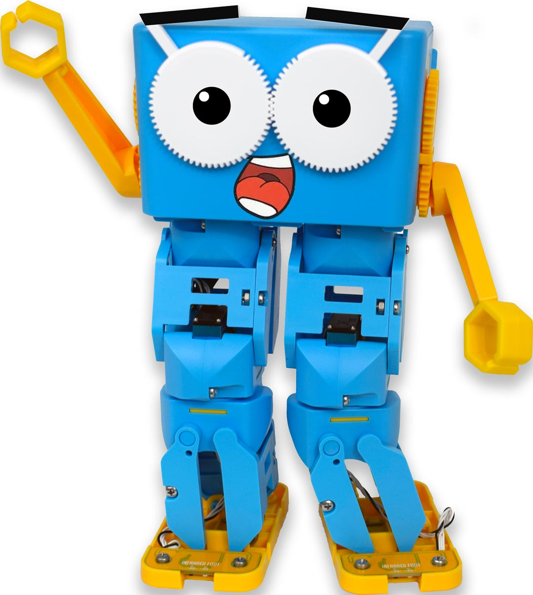
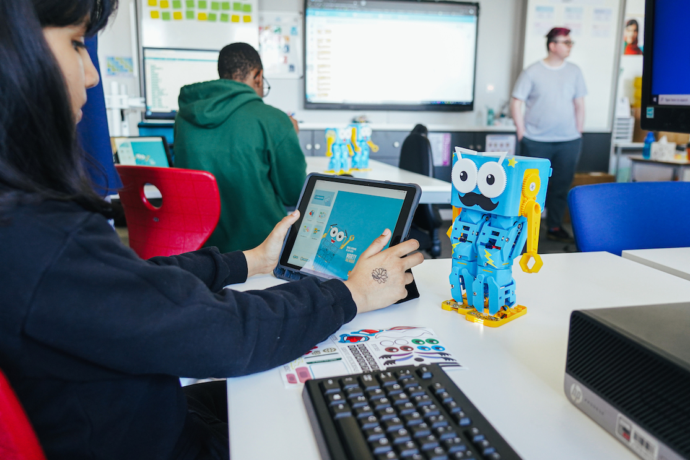
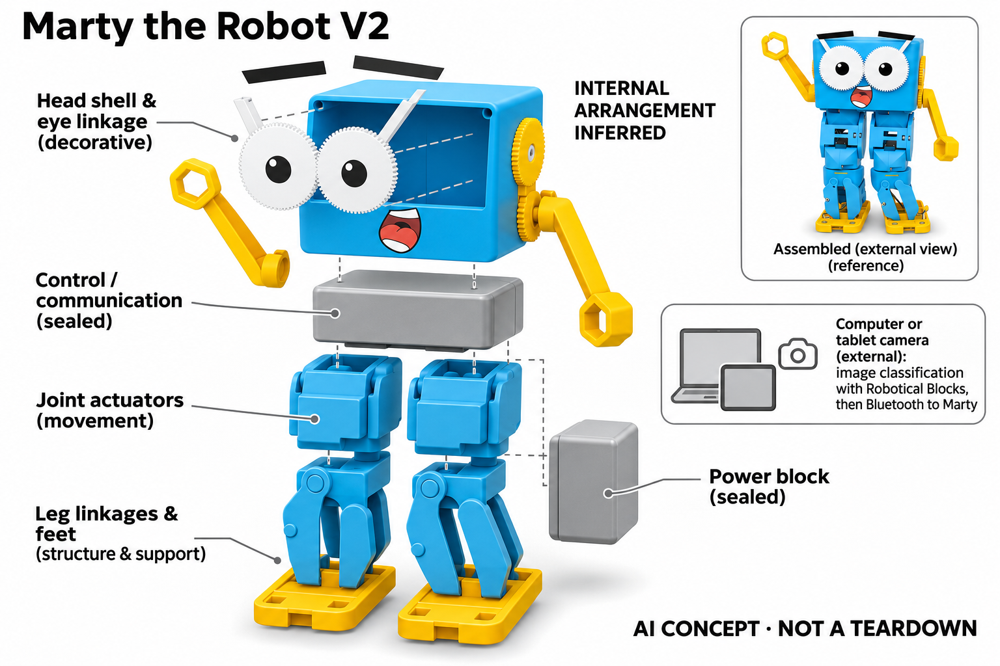

# Robotical Marty the Robot V2

**Robotical** · AI玩具 · 核查 2026-11-04

把图像分类预测变成步行动作

消费渠道：个人零售。

## 产品图片与结构参考

### 产品图

Robotical Marty the Robot V2 · 官方产品图 · 来源：[Robotical · 官方图片](<https://robotical.io/product/marty-the-robot-v2/>) · [原始图片](<https://67b43dae.delivery.rocketcdn.me/wp-content/uploads/2021/02/Marty-the-Robot.jpg>)

### 参考图

Robotical Marty the Robot V2 · 官方参考图 · 来源：[Robotical · 官方图片](<https://robotical.io/product/marty-the-robot-v2/>) · [原始图片](<https://67b43dae.delivery.rocketcdn.me/wp-content/uploads/2025/09/Physical-Computing.jpg>)

### AI 生成爆炸示意

**AI 生成 · 非实物拆机。** 内部为概念推断，不能作为元件布局、BOM 或维修依据。[生成提示词](../../content/hardware/prompts/robotical-marty-v2.txt)

> 已目视核对外形、标签与非拆机声明；不代表内部结构经实测验证。

> 分析为基于公开资料的案头研究与 AI 辅助判断，未经用户访谈、销量审计或实物拆机。需求、画像、竞争冷门度、审美及商业机会均为研究假设，不是投资结论。

## 销售与购买

- 状态：在售。官方单台商品有Add to cart，结构化Offer为InStock；按一台完整Marty V2计数，学校多机包和灯光配件不另计。

- 地区：所列官方国际商店

- 价格：官网 US$449 未含税。核查日页面快照；运费、税费、会员和配送区域按官方结算确认，不视为中国到手价。

- 中国大陆：本轮核实所列区域官方商店；未确认中国大陆官方现货、账户及完整服务，不把境外可购等同大陆可用。

- [官方产品 / 商店](<https://robotical.io/product/marty-the-robot-v2/>)

## AI 的实际作用

Robotical Blocks可用电脑或平板摄像头采集样本、训练和测试图像分类，再通过蓝牙让Marty响应预测；AI并非全部内置在机器人中。

服务与联网依赖：需兼容浏览器、外部电脑或平板及摄像头权限；机器人连接蓝牙执行动作。更高级扩展板与摄像配件不默认包含，也不是收录裸开发板。

## 是否冷门

新兴竞争（研究判断）：外部学习计算与机器人执行分开形成具体使用场景；本轮没有销量与市场份额证据。

## 需求与市场

需求假设：学习者可能更容易通过机器人的步行与转向理解分类模型结果，而不是只看屏幕置信度。应观察是否能解释模型在新背景下失败的原因，不能仅以成功识别一次物体代表掌握机器学习。

### 产品任务与边界 · 研究判断

Marty V2 把外部图像分类结果转化为机器人的步行和转向，任务是让学习者看见模型判断造成的行动。人形动作有吸引力，但真正学习价值在于理解数据与预测边界，不能以一次正确识别后成功行走代表掌握机器学习。

依据：[Marty V2官方单台商品](<https://robotical.io/product/marty-the-robot-v2/>) · [Robotical官方图像分类教程](<https://userguides.robotical.io/martyv2/userguides/martyblocks/machinelearning/image>)

### 需求判断 · 研究判断

相较屏幕分类演示，实体执行可能让错误更值得讨论，也增加连接与机械调试。家庭是否需要 Marty，取决于这种反馈是否提升解释和重试意愿，而不是单纯增加娱乐；额外硬件维护应与学习收益一起评估。

依据：[Marty V2官方单台商品](<https://robotical.io/product/marty-the-robot-v2/>) · [Robotical官方图像分类教程](<https://userguides.robotical.io/martyv2/userguides/martyblocks/machinelearning/image>)

### 需求验证 · 待验证

可在改变背景、光线和物体姿态后让学习者解释错误，再观察是否主动补充样本和重训。记录其预测、修改及验证过程，而不只统计机器人走对方向的次数，才能判断人形反馈是否支持概念理解。

依据：[Marty V2官方单台商品](<https://robotical.io/product/marty-the-robot-v2/>) · [Robotical官方图像分类教程](<https://userguides.robotical.io/martyv2/userguides/martyblocks/machinelearning/image>)

## 用户画像

画像推断：愿意用电脑或平板共同完成项目的家庭学习者与个人机器人爱好者较匹配。人形步行有吸引力，也需要平整活动区域和调试耐心，购买者应接受学习工具与自动玩具的区别。

### 适用行为与条件 · 研究判断

较匹配愿意使用电脑或平板共同完成项目的家庭学习者，以及能接受调试的人形机器人爱好者。平整活动区域和耐心是实际条件，若购买者期待无需设置的自动玩具，外部摄像和浏览器依赖容易造成落差。

依据：[Marty V2官方单台商品](<https://robotical.io/product/marty-the-robot-v2/>) · [Robotical官方图像分类教程](<https://userguides.robotical.io/martyv2/userguides/martyblocks/machinelearning/image>)

### 人群取舍 · 研究判断

喜欢步行动作的孩子未必喜欢收集训练样本，喜欢编程的人也未必愿意维护机械结构。画像应分别观察机械、数据和代码兴趣，并把成人可提供的支持纳入，不能从人形外观的吸引力推定长期课程参与。

依据：[Marty V2官方单台商品](<https://robotical.io/product/marty-the-robot-v2/>) · [Robotical官方图像分类教程](<https://userguides.robotical.io/martyv2/userguides/martyblocks/machinelearning/image>)

### 画像验证 · 待验证

画像验证应让家庭从浏览器权限与蓝牙连接开始完成一次图像项目，记录中断与求助。再观察孩子是否愿意自行设计新的分类任务，区分只想看机器人走路与愿意探索模型边界的两种使用方式。

依据：[Marty V2官方单台商品](<https://robotical.io/product/marty-the-robot-v2/>) · [Robotical官方图像分类教程](<https://userguides.robotical.io/martyv2/userguides/martyblocks/machinelearning/image>)

## 竞争与替代

竞争判断：轮式编程机器人、虚拟角色和免费机器学习网站都能提供部分学习体验，人形动作是具体区别。外形更生动不保证教学更有效，课程可理解性、维修与家庭支持时间同样关键。

### 比较对象与差异 · 研究判断

Marty 面对轮式编程机器人、虚拟角色和免费机器学习网站，人形动作是具体差别。它不应仅按关节或传感数量排名，关键是相同学习目标下，步行反馈是否比屏幕动画或轮式动作提供更多可理解的结果。

依据：[Marty V2官方单台商品](<https://robotical.io/product/marty-the-robot-v2/>) · [Robotical官方图像分类教程](<https://userguides.robotical.io/martyv2/userguides/martyblocks/machinelearning/image>)

### 竞争判断 · 研究判断

人形运动提高表现力，也带来稳定性、维修和成本负担。竞争优势需要建立在可重复的项目体验及支持文档上，如果大量时间用于机械排错，可能削弱机器学习任务；外形更生动并不自动意味着教学效果更好。

依据：[Marty V2官方单台商品](<https://robotical.io/product/marty-the-robot-v2/>) · [Robotical官方图像分类教程](<https://userguides.robotical.io/martyv2/userguides/martyblocks/machinelearning/image>)

### 竞争验证 · 待验证

可让学习者用相同样本完成屏幕和 Marty 两种反馈版本，比较解释错误、重训和再次尝试的行为。记录额外连接及维护时间，避免只用最精彩的一段步行视频评估价值，也不把课堂热情直接外推到家庭长期使用。

依据：[Marty V2官方单台商品](<https://robotical.io/product/marty-the-robot-v2/>) · [Robotical官方图像分类教程](<https://userguides.robotical.io/martyv2/userguides/martyblocks/machinelearning/image>)

## 供应链

供应链推断：关节执行器、腿部结构和可更换部件需要经反复步行测试，连接和姿态校准也影响可靠性。官方未披露完整工厂及物料表，备件、教学软件与支持文档会决定长期维护成本。

### 功能模块拆分 · 研究判断

系统层由外部电脑或平板摄像采样、Robotical Blocks 训练和预测、蓝牙通信，以及机器人关节和表情执行构成。AI 计算并非全部内置，系统图不能默认机器人自带用于该课程的摄像头，也不能把高级扩展板视为标配。

依据：[Marty V2官方单台商品](<https://robotical.io/product/marty-the-robot-v2/>) · [Robotical官方图像分类教程](<https://userguides.robotical.io/martyv2/userguides/martyblocks/machinelearning/image>)

### 制造与供应约束 · 研究判断

制造约束包括关节执行、腿部结构、连接和姿态一致性，反复步行会暴露仅通电测试无法发现的问题。备件与教学软件同样影响交付，若结构更换后需要重新调整，应有可理解指导，避免家庭因小故障放弃整个学习系统。

依据：[Marty V2官方单台商品](<https://robotical.io/product/marty-the-robot-v2/>) · [Robotical官方图像分类教程](<https://userguides.robotical.io/martyv2/userguides/martyblocks/machinelearning/image>)

### 候选与证据缺口 · 研究判断

Seeed 可作为可编程硬件工程候选，Protolabs 可支持关节与腿部结构样件。两者未被公开点名为 Marty 供应商，蓝牙课程链路和步行可靠性仍需专门验证，不能由通用工程或机械加工能力推定完整机器人交付。

依据：[Marty V2官方单台商品](<https://robotical.io/product/marty-the-robot-v2/>) · [Robotical官方图像分类教程](<https://userguides.robotical.io/martyv2/userguides/martyblocks/machinelearning/image>)

## 技术路径

官方图像模型指南明确使用电脑或平板摄像头，并通过蓝牙连接Marty执行预测结果。技术判断应测试未见样本和背景变化，避免把训练集表现写成通用视觉理解，也不虚构机器人自带摄像头。

### 已披露技术边界 · 研究判断

官方教程明确通过电脑或平板摄像头收集图像、训练并测试模型，再经蓝牙让 Marty 响应预测。这里是可观察的图像分类学习流程，不是通用视觉理解，也不能把训练数据上的高表现当作新环境下的稳定识别。

依据：[Marty V2官方单台商品](<https://robotical.io/product/marty-the-robot-v2/>) · [Robotical官方图像分类教程](<https://userguides.robotical.io/martyv2/userguides/martyblocks/machinelearning/image>)

### 系统难点判断 · 研究判断

系统难点是把模型错误、通信故障和动作执行问题分开。机器人没有走动可能来自任何一层，学习工具需要暴露足够信息帮助定位；如果所有失败都表现为静止，学习者很难理解应修改样本、代码还是机械连接。

依据：[Marty V2官方单台商品](<https://robotical.io/product/marty-the-robot-v2/>) · [Robotical官方图像分类教程](<https://userguides.robotical.io/martyv2/userguides/martyblocks/machinelearning/image>)

### 技术验证 · 待验证

技术验证应使用未见样本和新背景测试泛化，再分别中断蓝牙和改变运动条件，观察学习者能否定位问题。浏览器及摄像权限需要记录版本和设备条件，不能把一个电脑上的成功演示外推为所有平板均同样可用。

依据：[Marty V2官方单台商品](<https://robotical.io/product/marty-the-robot-v2/>) · [Robotical官方图像分类教程](<https://userguides.robotical.io/martyv2/userguides/martyblocks/machinelearning/image>)

## 产品审美

审美判断：方形头部、短肢体和可变化眼部表达形成易辨认的角色，步行动作增强学习反馈。动作声音、站立稳定性和孩子拿取姿势都需真实观察，静态照片难以说明机械互动的舒适度。

### 外观与交互语言 · 研究判断

方形头部、短肢体和可变化眼部表达形成明确角色，步行本身又成为编程结果的展示。它的审美与学习反馈紧密结合，重要的是动作是否易读，而不是逼真模仿人类；清楚的姿态变化有助于讨论程序含义。

依据：[Marty V2官方单台商品](<https://robotical.io/product/marty-the-robot-v2/>) · [Robotical官方图像分类教程](<https://userguides.robotical.io/martyv2/userguides/martyblocks/machinelearning/image>)

### 使用中审美判断 · 研究判断

动作声音、站立稳定和拿取方式影响家庭体验，静态照片难以体现这些问题。若孩子为避免倒下而不敢让它自由执行，角色的活泼形象可能无法兑现；设计应让安全移动区域和可操作部位容易理解。

依据：[Marty V2官方单台商品](<https://robotical.io/product/marty-the-robot-v2/>) · [Robotical官方图像分类教程](<https://userguides.robotical.io/martyv2/userguides/martyblocks/machinelearning/image>)

### 设计验证 · 待验证

设计验证应观察孩子设置运行区域、拿起和放回机器人，以及失败后如何恢复姿态。比较不同表情和动作是否帮助理解分类结果，而非只增加装饰，避免把人形造型带来的初始兴趣当作长期学习支持。

依据：[Marty V2官方单台商品](<https://robotical.io/product/marty-the-robot-v2/>) · [Robotical官方图像分类教程](<https://userguides.robotical.io/martyv2/userguides/martyblocks/machinelearning/image>)

## 关键风险

风险判断：训练结果可能随光照和样本偏差变化，机器人动作需在清空的稳定表面运行。浏览器权限与蓝牙兼容也会影响课程，不能把演示中的顺利行走视为任何地面都可靠或学习成果保证。

### 主要失效与依赖 · 研究判断

风险包括样本偏差导致预测失误、运动在不稳定表面上的限制，以及浏览器权限和蓝牙兼容。学习者需要理解模型可能失败，课程不能把识别演示包装成可靠的自主机器人能力，也不能保证特定学习成果。

依据：[Marty V2官方单台商品](<https://robotical.io/product/marty-the-robot-v2/>) · [Robotical官方图像分类教程](<https://userguides.robotical.io/martyv2/userguides/martyblocks/machinelearning/image>)

### 风险传播判断 · 研究判断

当机械问题和模型错误混在一起，家庭可能失去对学习过程的信心。产品支持应帮助分层诊断并提供备件路径，否则一次关节或连接故障会中断整个课程，长期价值不仅取决于软件内容更新，也取决于可维修性。

依据：[Marty V2官方单台商品](<https://robotical.io/product/marty-the-robot-v2/>) · [Robotical官方图像分类教程](<https://userguides.robotical.io/martyv2/userguides/martyblocks/machinelearning/image>)

### 风险验证 · 待验证

风险验证应在受控稳定表面测试动作，并记录不同终端的连接恢复和权限设置。训练验证要保留样本条件与失败案例，不以训练集准确率或一次顺利步行推断广泛可用性，所有教育效果仍需独立观察。

依据：[Marty V2官方单台商品](<https://robotical.io/product/marty-the-robot-v2/>) · [Robotical官方图像分类教程](<https://userguides.robotical.io/martyv2/userguides/martyblocks/machinelearning/image>)

## 机会与验证

市场观察：可比较屏幕分类项目和加入Marty动作后的参与度与理解，记录重训、求助和维修频率。只有在孩子能解释失败并愿意继续探索时，实体反馈才可能提供超出普通动画的价值。

### 可能的机会入口 · 研究判断

机会在于把实体运动与机器学习错误分析结合，让失败成为可讨论而非令人沮丧的部分。新项目可以优先完善分层状态和简单课程，帮助用户理解模型为何错，再决定是否增加更复杂动作或扩展硬件。

依据：[Marty V2官方单台商品](<https://robotical.io/product/marty-the-robot-v2/>) · [Robotical官方图像分类教程](<https://userguides.robotical.io/martyv2/userguides/martyblocks/machinelearning/image>)

### 机会成立条件 · 研究判断

机会成立需要实体反馈提高理解和持续探索，同时没有让机械维护吞噬学习时间。如果屏幕动画已经达到同样效果，机器人应明确提供的额外价值；若主要吸引机械爱好者，课程也应顺应其真实兴趣而非泛化教育承诺。

依据：[Marty V2官方单台商品](<https://robotical.io/product/marty-the-robot-v2/>) · [Robotical官方图像分类教程](<https://userguides.robotical.io/martyv2/userguides/martyblocks/machinelearning/image>)

### 下一步验证 · 待验证

下一步可比较有无 Marty 动作的同一分类项目，记录解释、重训、求助和维修频率。根据实际失败环节调整工具和支持，再扩展课程内容，避免用关节数量、模型名称或热闹课堂照片替代学习证据。

依据：[Marty V2官方单台商品](<https://robotical.io/product/marty-the-robot-v2/>) · [Robotical官方图像分类教程](<https://userguides.robotical.io/martyv2/userguides/martyblocks/machinelearning/image>)

## 对应供应链公司

能力候选用于选型研究，不代表本产品实际采用；未公开的供货关系不作推断。

- [seeed-studio](../supply-chain/seeed-studio.md) — **能力候选 · 非已采用** / 可编程机器人控制系统开发：Seeed 的工程与制造服务可支持类似 Marty 的控制板和可编程硬件导入，但图像课程、蓝牙体验及人形步行需要独立验证；没有点名合作资料，不能认定其为 Marty 的实际供应方。

- [protolabs](../supply-chain/protolabs.md) — **能力候选 · 非已采用** / 腿部关节与结构验证样件：Protolabs 的机械加工和模塑原型能力适合测试腿部配合、支架与可维修结构，但样件不能保证整机步行稳定或长期疲劳；未发现 Marty 供货披露，候选范围限定于机械开发环节。

[浏览供应链目录](../supply-chain.md)

## 功能分层示意

这是功能关系，不是实物拆机、真实空间结构或已核实 BOM。

1. **样本收集**：外部电脑或平板摄像头采集图像。（官方披露）

2. **分类训练**：Robotical Blocks训练并测试模型。（官方披露）

3. **通信控制**：蓝牙将分类结果映射为动作命令。（官方披露）

4. **人形执行**：机器人关节和表情输出学习反馈。（官方披露）

## 来源

1. [Marty V2官方单台商品](<https://robotical.io/product/marty-the-robot-v2/>) — 已实际打开官方页面；功能说明不等于独立性能测量。

2. [Robotical官方图像分类教程](<https://userguides.robotical.io/martyv2/userguides/martyblocks/machinelearning/image>) — 已实际打开官方页面；功能说明不等于独立性能测量。

[返回目录](../hardware-market.md) · [网页分析](https://romanagent.github.io/Roman/#hardware/product/robotical-marty-v2)
