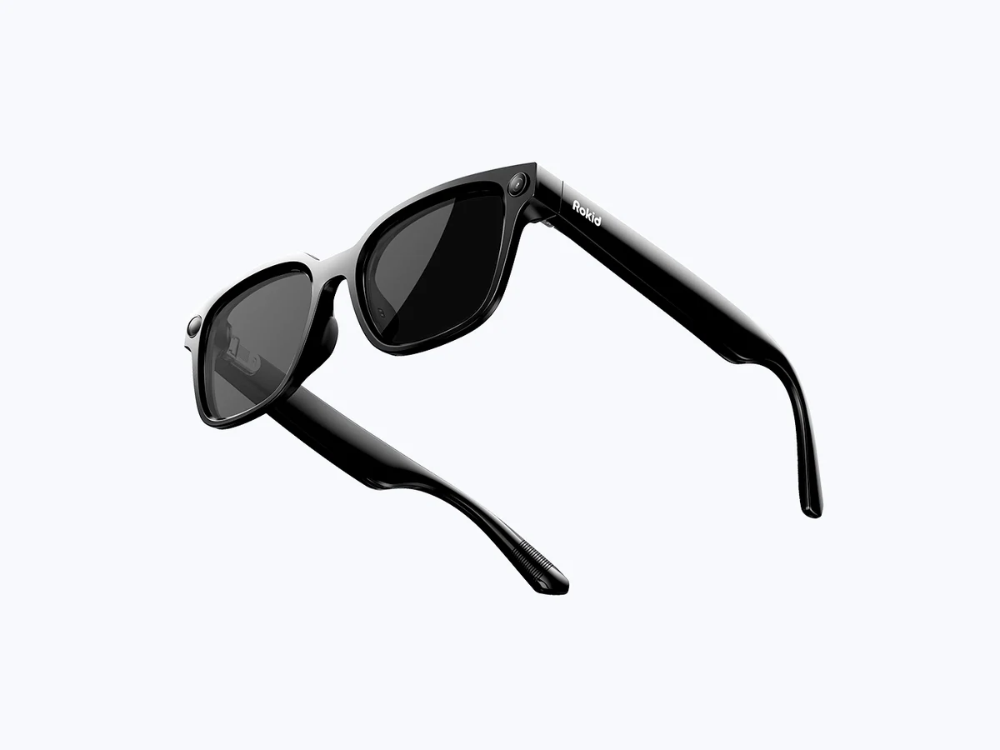
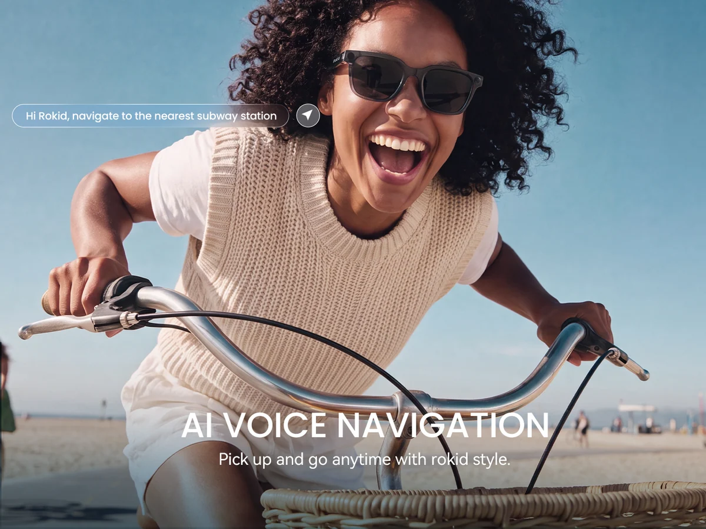
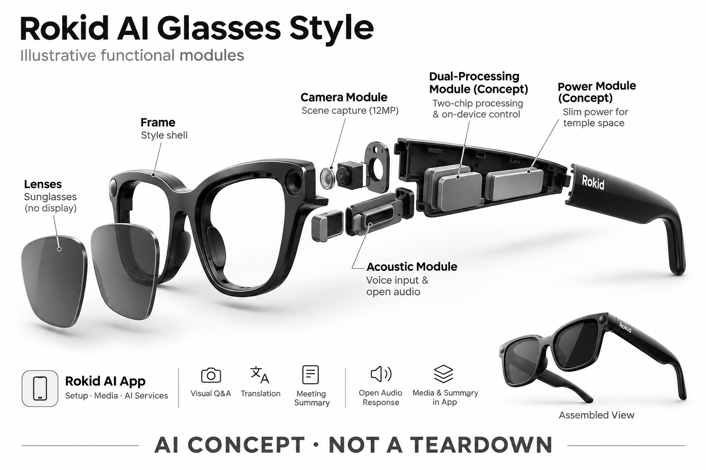

# Rokid AI Glasses Style

**Rokid** · AI 眼镜 · 核查 2026-11-04

无显示、轻量化的语音与视觉 AI 入口

## 产品图片与结构参考

### 产品图

官方 Rokid AI Glasses Style 无显示款产品图 · 来源：[Rokid · 官方产品图片](<https://global.rokid.com/products/rokid-ai-glasses-style>) · [原始图片](<https://cdn.shopify.com/s/files/1/0628/5636/4211/files/002_bec55c7c-a573-496d-8894-64dfd966cede.jpg?v=1788761083&width=1200>)

### 参考图

官方骑行佩戴场景示意，非独立实测 · 来源：[Rokid · 官方产品图片](<https://global.rokid.com/products/rokid-ai-glasses-style>) · [原始图片](<https://cdn.shopify.com/s/files/1/0628/5636/4211/files/23714d83d1faac4a6127afe09e9b41d3.jpg?v=1789385146&width=1200>)

### AI 生成爆炸示意

**AI 生成 · 非实物拆机。** 内部为概念推断，不能作为元件布局、BOM 或维修依据。[生成提示词](../../content/hardware/prompts/rokid-ai-glasses-style.txt)

> 外形依据核验参考图；内部位置、模块形状与装配关系仅作AI概念展示。

> 图片按源站提供格式保存，未裁切或改色；厂商渲染/场景示意不代表实机测试。

> 分析为基于公开资料的案头研究与 AI 辅助判断，未经用户访谈、销量审计或实物拆机。需求、画像、竞争冷门度、审美及商业机会均为研究假设，不是投资结论。

## 销售与购买

- 状态：在售。国际官网商品页显示 US$329、Add To Cart、配送与退换说明。该条仅对应 Non-Display Style，不将 Rokid 带显示款、AR Spatial 或国内其他版本混入。

- 地区：美国、国际站支持配送地区（结算确认）

- 价格：国际站 US$329。核查时促销标价，划线价 US$399；镜片、充电盒及不同配置可能另计，未据此推导中国售价。

- 中国大陆：本次核实的是全球版 Style。Rokid 为中国品牌并不能替代对该 SKU 大陆官方渠道、应用版本、模型服务和保修的核查。

- [官方产品 / 商店](<https://global.rokid.com/products/rokid-ai-glasses-style>)

## AI 的实际作用

以语音与相机支持视觉识别、问答、翻译及会议摘要，无镜内显示。

服务与联网依赖：通过 Rokid AI App 设置与访问适用 AI 服务；全球版与地区版模型、账号、网络条件不可假定一致。

## 是否冷门

竞争密集（研究判断）：无显示相机眼镜直接进入已有品牌竞争；轻量与地区适配属于差异假设。

## 需求与市场

需求假设：想使用视觉问答和随手拍摄的用户，可能更愿意接受没有屏幕、重量较低的眼镜。需要验证省去显示后语音反馈是否足够，以及在嘈杂或不方便出声的场景中是否失效。

## 用户画像

画像推断：对价格和重量敏感、接受手机配套应用的旅行者或轻量创作者更匹配。需要长文阅读、实时字幕或空间屏幕的人属于另一需求，不能把所有智能眼镜用户放入一个画像。

## 竞争与替代

案头判断：与 Ray-Ban Meta 正面竞争，同时受到手机摄像头和耳机替代。更低展示价格或更轻机身只能形成待验证卖点；未进行销量研究、品牌偏好访谈或跨地区渠道调研。

## 供应链

官网披露双芯片设计及镜框、镜片配置，但本次未取得整机工厂、核心器件采购合同或良率资料。推断轻量结构要求电池、铰链、声学和热设计协同，不能把重量直接转换成成本优势。

## 技术路径

官方披露相机、语音阵列、双芯片及 Rokid AI App。哪些能力离线运行、哪些调用服务器，以及地区版本用何模型仍需逐项确认；页面功能展示不是独立测得的准确率或延迟证据。

## 产品审美

图示观察：较厚上框与普通太阳镜轮廓弱化了显示设备感，镜片颜色可帮助日常搭配。轻量是可测指标，外观轻巧则是主观判断；鼻托、镜腿和处方镜片组合需要实际试戴评估。

## 关键风险

风险在于全球版和本地版服务差异、可选镜片与充电配件使总价变化，以及语音和视觉识别在真实环境中的误差。拍摄需要尊重现场边界，不能用厂商全天续航宣传代替连续工作测试。

## 机会与验证

市场差异在于轻量、无显示和多种镜片配置的组合。尚待验证的购买理由是全球版服务在具体地区能否稳定运行、实际续航是否适合日常任务，以及总配置成本相对其他相机眼镜是否有吸引力。

## 功能分层示意

这是功能关系，不是实物拆机、真实空间结构或已核实 BOM。

1. **场景采集**：12MP 相机与语音输入，作为功能架构示意，非物理拆机。（官方披露）

2. **设备协同**：官网描述双芯片处理与本机控制，本文不补写未披露的分工。（官方披露）

3. **手机应用**：Rokid AI App 完成设备配置、媒体管理和 AI 服务入口。（官方披露）

4. **识别与生成**：视觉问答、翻译和会议摘要；精确模型及端云路由待核实。（官方披露）

5. **声音与归档**：开放式音频回应，媒体与摘要在 App 内查看。（官方披露）

## 来源

1. [Rokid Global · AI Glasses Style 商品页](<https://global.rokid.com/products/rokid-ai-glasses-style>) — 已打开，US$329 与 Add To Cart；产品明确为 Non-Display。

2. [Rokid · Style 官方介绍](<https://global.rokid.com/pages/rokid-ai-glasses-style>) — 已打开，轻量与配镜服务说明；不把其他 Rokid AR 产品当成此款 AI 能力。

[返回目录](../hardware-market.md) · [网页分析](https://romanagent.github.io/Roman/#hardware/product/rokid-ai-glasses-style)
