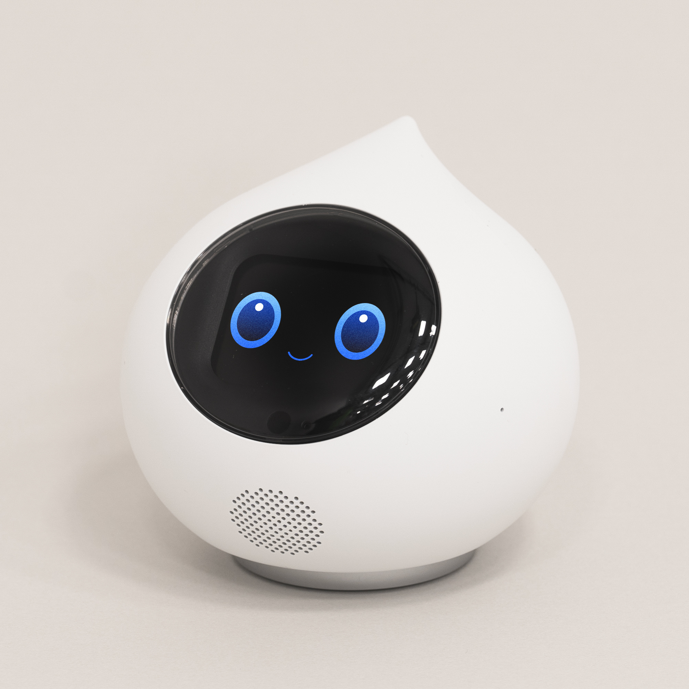
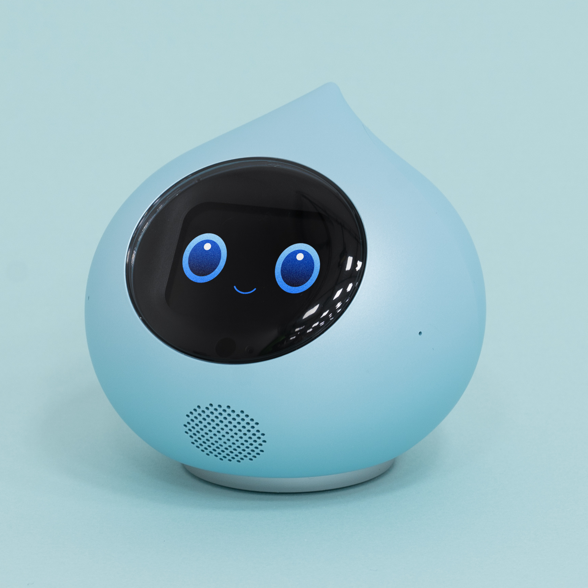
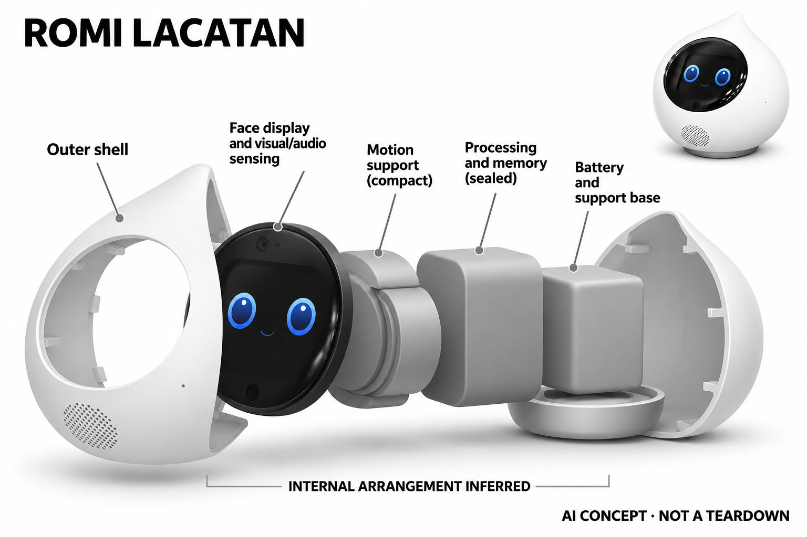

# Romi Lacatan

**MIXI / Romi** · AI玩具 · 核查 2026-11-06

以视觉对话和记忆参与日常交流的小型机器人

消费渠道：个人零售。

## 产品图片与结构参考

### 产品图

Romi Lacatan · 官方产品图 · 来源：[MIXI / Romi · 官方图片](<https://shop.romi.ai/products/romi-lacatan>) · [原始图片](<https://cdn.shopify.com/s/files/1/0701/9941/0971/files/1_f3ef0429-3b09-4c22-916b-76d25c5a7480.png?v=1780373885>)

### 参考图

Romi Lacatan · 官方参考图 · 来源：[MIXI / Romi · 官方图片](<https://shop.romi.ai/products/romi-lacatan>) · [原始图片](<https://cdn.shopify.com/s/files/1/0701/9941/0971/files/3.png?v=1780374039>)

### AI 生成爆炸示意

**AI 生成 · 非实物拆机。** 内部为概念推断，不能作为元件布局、BOM 或维修依据。[生成提示词](../../content/hardware/prompts/romi-lacatan.txt)

> 已目视核对外形、标签与非拆机声明；不代表内部结构经实测验证。

> 两张均为Lacatan型号，不同颜色不单独计数。

> 分析为基于公开资料的案头研究与 AI 辅助判断，未经用户访谈、销量审计或实物拆机。需求、画像、竞争冷门度、审美及商业机会均为研究假设，不是投资结论。

## 销售与购买

- 状态：在售。2026-11-06实际浏览器核验日本官方商店：自然白款¥98,780，显示可用加入购物车与立即购买；抓取文本中的Sold Out为模板，未在当前选中款实际界面出现。月会费在收货后另行登记，实际发货与退货条件以商店为准。

- 地区：日本官方商店

- 价格：日本本体 ¥98,780；服务另计。日元含税硬件价；月费按当前Romi方案选择，旧活动折扣不作为当前统一售价。

- 中国大陆：本轮核实所列区域官方商店；未确认中国大陆官方现货、账户及完整服务，不把境外可购等同大陆可用。

- [官方产品 / 商店](<https://shop.romi.ai/products/romi-lacatan>)

## AI 的实际作用

官方说明以深度学习构建回复，Lacatan增加用户请求时的视觉交互和长期记忆；语音版本与功能上线以当前固件为准。

服务与联网依赖：需要配套账户、联网和持续会费；核心对话与可用语言受服务范围影响，不能推断大陆完整可用。

## 是否冷门

新兴竞争（研究判断）：具备视觉和记忆的小型对话陪伴仍在形成习惯，替代品广泛。

## 需求与市场

需求假设：希望家中有一个容易开启交谈对象的人，可能重视被记住及自然轮流说话，而非任务效率。应长期观察主动对话和重复话题，不能把流畅的首次问答当成关系建立或健康改善。

### 产品任务与边界 · 研究判断

Romi Lacatan 把自然对话、记忆和用户请求时的视觉交互集中到小型桌面角色中，核心任务是让交谈容易发生。它主要研究的是被回应与被记住的体验，而不是替用户搜索所有信息或完成生活管理。

依据：[Romi Lacatan官方商店](<https://shop.romi.ai/products/romi-lacatan>) · [Romi Lacatan官方能力](<https://romi.ai/lp/lacatan/en/>)

### 需求判断 · 研究判断

长期记忆可能让重复交流具有连续性，也可能因为记错或不合时宜地提起往事而破坏体验。需求是否成立取决于用户在新鲜感之后是否仍主动交谈，不能用首次对话流畅或可爱反应来推断关系已建立。

依据：[Romi Lacatan官方商店](<https://shop.romi.ai/products/romi-lacatan>) · [Romi Lacatan官方能力](<https://romi.ai/lp/lacatan/en/>)

### 需求验证 · 待验证

可记录四周内主动交谈、重复话题、记忆纠正和静默时长，并询问用户为何开始或结束对话。把记忆开启后的变化与单次无上下文聊天比较，观察连续性是否真正提高价值，而不是只增加被保存的信息。

依据：[Romi Lacatan官方商店](<https://shop.romi.ai/products/romi-lacatan>) · [Romi Lacatan官方能力](<https://romi.ai/lp/lacatan/en/>)

## 用户画像

画像推断：愿意用日语互动、能设置网络和账户且接受会费的人较匹配。送给家人时购买者与使用者可能不同，需确认对方愿意对设备讲话，并能处理声音、记忆和隐私相关设置。

### 适用行为与条件 · 研究判断

较适合愿意用日语与实体角色交流、能管理网络和账户并接受会费的人。购买者若是家属，需要确认实际使用者愿意向设备说话，而不是把送礼者对陪伴的期待当作接收者的真实需求。

依据：[Romi Lacatan官方商店](<https://shop.romi.ai/products/romi-lacatan>) · [Romi Lacatan官方能力](<https://romi.ai/lp/lacatan/en/>)

### 人群取舍 · 研究判断

独处使用与多人家庭使用对记忆、声源和隐私有不同要求。有人希望设备主动回应，有人只接受被请求时讲话；这些偏好会决定摆放及设置，画像应按交流习惯和控制需求区分，而不只按是否孤独来推测。

依据：[Romi Lacatan官方商店](<https://shop.romi.ai/products/romi-lacatan>) · [Romi Lacatan官方能力](<https://romi.ai/lp/lacatan/en/>)

### 画像验证 · 待验证

画像验证应观察用户自行发起对话的时机，记录家人加入后是否改变交流内容或减少使用。还要检查谁负责会费、网络和记忆设置，识别实际使用者无法独立管理设备而导致持续体验依赖他人的情况。

依据：[Romi Lacatan官方商店](<https://shop.romi.ai/products/romi-lacatan>) · [Romi Lacatan官方能力](<https://romi.ai/lp/lacatan/en/>)

## 竞争与替代

竞争判断：小型对话机器人面对手机聊天、智能音箱和其他桌面宠物的替代。视觉与记忆带来定位差异，但持续云服务、语言质量和角色可信度都影响留存，不能仅凭外形可爱判断竞争优势。

### 比较对象与差异 · 研究判断

Romi 面对手机聊天、智能音箱及其他桌面宠物的替代，其差异是固定角色、实体反馈和会话连续性。视觉及记忆可增强在场感，但不能仅凭这两项功能就认定优于已有聊天习惯，用户迁移仍有成本。

依据：[Romi Lacatan官方商店](<https://shop.romi.ai/products/romi-lacatan>) · [Romi Lacatan官方能力](<https://romi.ai/lp/lacatan/en/>)

### 竞争判断 · 研究判断

竞争重点在语言节奏、记忆可控性和长期服务可信度，而不只是模型输出长度。小型实体角色如果能减少打开应用的摩擦，可能形成优势；若经常误解或需要纠错，物理存在反而会放大打扰感和失望。

依据：[Romi Lacatan官方商店](<https://shop.romi.ai/products/romi-lacatan>) · [Romi Lacatan官方能力](<https://romi.ai/lp/lacatan/en/>)

### 竞争验证 · 待验证

可让用户用相同话题分别与 Romi 类实体角色和手机聊天工具交流，再观察数周后自发选择。比较时应披露会费及记忆条件，重点记录发起便利、纠错和退出体验，避免只评选哪一段回答更自然。

依据：[Romi Lacatan官方商店](<https://shop.romi.ai/products/romi-lacatan>) · [Romi Lacatan官方能力](<https://romi.ai/lp/lacatan/en/>)

## 供应链

供应链推断：显示、摄像、音频、动作机构和紧凑电池需协调发热与机械声，服务后台同样重要。官方未披露完整代工厂和物料表；维修、软件维护与长期记忆迁移也属于拥有体验。

### 功能模块拆分 · 研究判断

功能层由麦克风和请求触发的视觉输入、对话处理、记忆上下文、屏幕与语音及动作反馈构成。紧凑本体还需要电源和网络支持；公开页面未提供完整物料表，不能推定所有模型或记忆均保存在机内。

依据：[Romi Lacatan官方商店](<https://shop.romi.ai/products/romi-lacatan>) · [Romi Lacatan官方能力](<https://romi.ai/lp/lacatan/en/>)

### 制造与供应约束 · 研究判断

制造约束是声学、摄像和动作机构在小体积中协作，机械声可能干扰收音，装配位置也会影响视觉。服务后台、固件更新和记忆迁移同样属于交付链，不能把制造完成理解为长期产品体验已经交付完毕。

依据：[Romi Lacatan官方商店](<https://shop.romi.ai/products/romi-lacatan>) · [Romi Lacatan官方能力](<https://romi.ai/lp/lacatan/en/>)

### 候选与证据缺口 · 研究判断

华勤可作为紧凑联网终端电子工程候选，歌尔可作为音频与实体反馈整合候选。双方公开能力与部分模块匹配，但没有 Romi 点名合作证据；日语对话、记忆治理和角色动作需另外确认，不从硬件能力推断软件供给。

依据：[Romi Lacatan官方商店](<https://shop.romi.ai/products/romi-lacatan>) · [Romi Lacatan官方能力](<https://romi.ai/lp/lacatan/en/>)

## 技术路径

官方说明深度学习回复、请求触发视觉及记忆能力。技术判断需区分视觉理解、话轮控制和长期信息保存，并逐项核查功能版本；同一角色的声音自然不代表所有回答事实可靠。

### 已披露技术边界 · 研究判断

官方说明深度学习回复、用户请求时的视觉交互及长期记忆，并区分具体版本和更新。技术理解应分开会话输入、视觉内容理解和记忆调用，不能把角色连续性归结为一种模型，也不能把计划功能当作已普遍可用。

依据：[Romi Lacatan官方商店](<https://shop.romi.ai/products/romi-lacatan>) · [Romi Lacatan官方能力](<https://romi.ai/lp/lacatan/en/>)

### 系统难点判断 · 研究判断

系统难点是在适当时机调用正确记忆，并维持自然话轮。记住更多信息不必然更好，过时、混淆人物或错误关联会降低信任；视觉输入也应与用户请求保持一致，避免设备表现出超出用户预期的观察能力。

依据：[Romi Lacatan官方商店](<https://shop.romi.ai/products/romi-lacatan>) · [Romi Lacatan官方能力](<https://romi.ai/lp/lacatan/en/>)

### 技术验证 · 待验证

技术验证应包括多人轮流说话、背景电视、重复纠正和视觉请求失败，记录识别、生成及记忆错误的不同来源。还要检查更新前后行为是否变化，所有结论需对应版本，不能由一次成功记住信息推断长期记忆始终准确。

依据：[Romi Lacatan官方商店](<https://shop.romi.ai/products/romi-lacatan>) · [Romi Lacatan官方能力](<https://romi.ai/lp/lacatan/en/>)

## 产品审美

审美判断：圆润小体积和正面表情让它易留在桌面，细微动作与语音承担角色感。屏幕亮度、夜间活动和摆放距离会影响接受度；图片无法说明真实机械声或多人的目光互动效果。

### 外观与交互语言 · 研究判断

圆润小体积和正面表情让 Romi 容易留在桌面，细微动作和语音承担角色感。它不像移动宠物那样占据地面，因此设计重点更接近人与固定物件之间的目光、距离和说话节奏，而不是复杂运动的表演性。

依据：[Romi Lacatan官方商店](<https://shop.romi.ai/products/romi-lacatan>) · [Romi Lacatan官方能力](<https://romi.ai/lp/lacatan/en/>)

### 使用中审美判断 · 研究判断

屏幕亮度、夜间声音和多人对话时的朝向会影响家居接受度。角色若总保持过强关注感，可能让用户不自在；若反馈过弱，又难以判断是否在听，因此需要在亲近和可控之间建立清晰的表达规则。

依据：[Romi Lacatan官方商店](<https://shop.romi.ai/products/romi-lacatan>) · [Romi Lacatan官方能力](<https://romi.ai/lp/lacatan/en/>)

### 设计验证 · 待验证

设计验证应在书桌、餐桌和床边等不同位置观察交谈距离及灯光影响，并记录用户主动转移或关闭设备的时机。还应让用户判断收听、思考与记忆状态是否清楚，避免只以静态可爱评分评价整体交互。

依据：[Romi Lacatan官方商店](<https://shop.romi.ai/products/romi-lacatan>) · [Romi Lacatan官方能力](<https://romi.ai/lp/lacatan/en/>)

## 关键风险

风险判断：视觉和长期对话记忆涉及家庭信息，生成回复也可能出现错误。会费、地区账户及语言服务须在购买前核对；不把对话陪伴宣传解读为医疗、心理治疗或替代真实社会支持。

### 主要失效与依赖 · 研究判断

主要风险是家庭视觉与长期对话记忆的处理、生成错误，以及会费和地区服务条件。陪伴用途不能被转述为心理治疗或替代真实社会支持，用户需要理解设备的角色表达与实际理解能力之间仍有边界。

依据：[Romi Lacatan官方商店](<https://shop.romi.ai/products/romi-lacatan>) · [Romi Lacatan官方能力](<https://romi.ai/lp/lacatan/en/>)

### 风险传播判断 · 研究判断

记忆一旦出错，可能比普通问答错误更容易被用户感知为关系受损；服务中断也可能破坏连续性。产品应提供可理解的纠正、删除和恢复路径，否则越强调个性化，用户对数据和角色状态不可控的担忧可能越强。

依据：[Romi Lacatan官方商店](<https://shop.romi.ai/products/romi-lacatan>) · [Romi Lacatan官方能力](<https://romi.ai/lp/lacatan/en/>)

### 风险验证 · 待验证

风险验证应检查用户能否解释哪些互动会进入记忆，并尝试纠正或删除错误内容。另需演练断网和账户变化后的体验，记录重要状态是否可恢复；这些验证只能说明受测条件，不可转化为对所有情感或健康问题的保障。

依据：[Romi Lacatan官方商店](<https://shop.romi.ai/products/romi-lacatan>) · [Romi Lacatan官方能力](<https://romi.ai/lp/lacatan/en/>)

## 机会与验证

市场观察：Romi的差异是明确的对话与记忆取向，而非以移动能力取胜。验证应记录四周后的主动交谈、记忆纠错和静默时间，判断用户是否愿意为这种具体互动持续承担费用。

### 可能的机会入口 · 研究判断

机会在于把对话连续性做得可理解、可纠正，而不一定增加更多硬件动作。新项目可以先针对明确日常交流场景设计有限记忆，让用户知道设备为何提起某件事，再判断是否需要视觉和更主动的交互。

依据：[Romi Lacatan官方商店](<https://shop.romi.ai/products/romi-lacatan>) · [Romi Lacatan官方能力](<https://romi.ai/lp/lacatan/en/>)

### 机会成立条件 · 研究判断

机会成立需要用户持续主动说话，并愿意承担记忆管理和服务费用。若多数互动仅由设备主动发起，活跃可能掩盖打扰；应区分用户真正需要的连续交流与为了回应设备而产生的被动使用，避免误判市场需求。

依据：[Romi Lacatan官方商店](<https://shop.romi.ai/products/romi-lacatan>) · [Romi Lacatan官方能力](<https://romi.ai/lp/lacatan/en/>)

### 下一步验证 · 待验证

下一步可开展带可见记忆记录的会话原型试用，追踪主动交流、纠错和退出理由，再测试加入实体动作的增量价值。只有在记忆准确性与控制体验都可接受后，才值得扩大到更复杂视觉和长期服务承诺。

依据：[Romi Lacatan官方商店](<https://shop.romi.ai/products/romi-lacatan>) · [Romi Lacatan官方能力](<https://romi.ai/lp/lacatan/en/>)

## 对应供应链公司

能力候选用于选型研究，不代表本产品实际采用；未公开的供货关系不作推断。

- [huaqin](../supply-chain/huaqin.md) — **能力候选 · 非已采用** / 紧凑联网对话终端电子工程：华勤的智能终端研发制造能力可作为 Romi 类摄像、显示和联网计算硬件的候选，但自然对话、记忆治理和机械动作需另行界定；没有公开资料点名其参与 Romi，不能推定实际制造关系。

- [goertek](../supply-chain/goertek.md) — **能力候选 · 非已采用** / 桌面语音与角色反馈整合：歌尔公开声学及智能硬件能力适合评估麦克风、扬声器和紧凑机身的相互影响，但日语话轮、记忆和视觉请求逻辑属于另外的系统职责；本条只有能力匹配，没有 Romi 供货披露。

[浏览供应链目录](../supply-chain.md)

## 功能分层示意

这是功能关系，不是实物拆机、真实空间结构或已核实 BOM。

1. **会话输入**：麦克风与请求触发的视觉输入。（官方披露）

2. **对话模型**：深度学习支持自然回复。（官方披露）

3. **记忆上下文**：保留互动信息支持个性化对话。（官方披露）

4. **角色输出**：屏幕、语音和动作提供反馈。（官方披露）

## 来源

1. [Romi Lacatan官方商店](<https://shop.romi.ai/products/romi-lacatan>) — 2026-11-06实际浏览器核验日本官方商店：自然白款¥98,780，显示可用加入购物车与立即购买；抓取文本中的Sold Out为模板，未在当前选中款实际界面出现。月会费在收货后另行登记，实际发货与退货条件以商店为准。

2. [Romi Lacatan官方能力](<https://romi.ai/lp/lacatan/en/>) — 已打开；标为计划更新的细项不当作必然已交付。

[返回目录](../hardware-market.md) · [网页分析](https://romanagent.github.io/Roman/#hardware/product/romi-lacatan)
