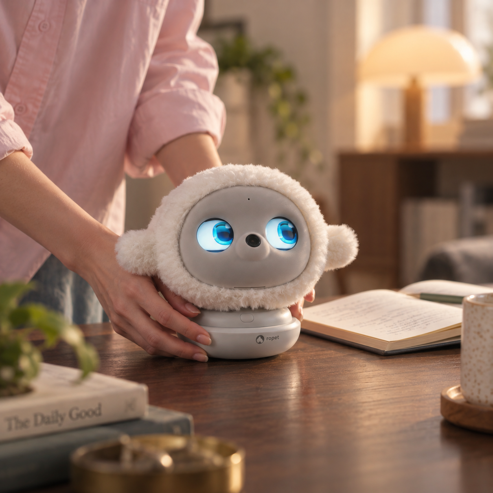
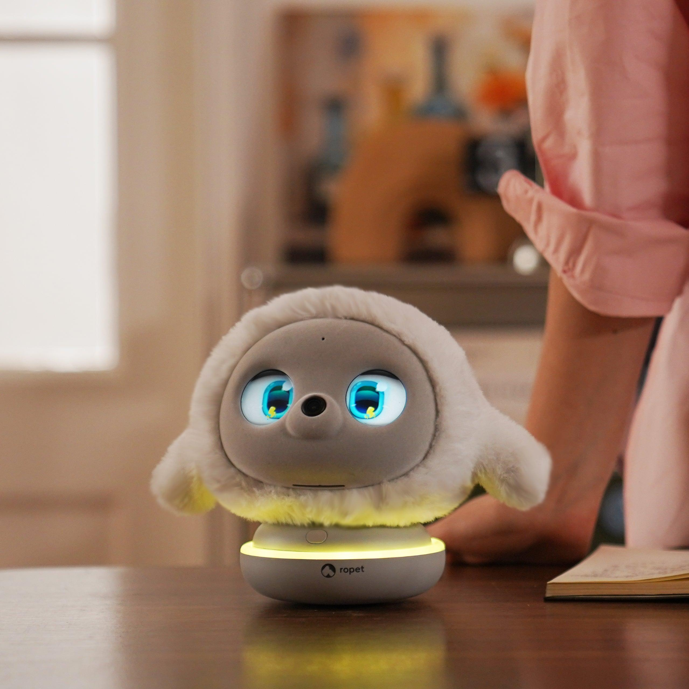
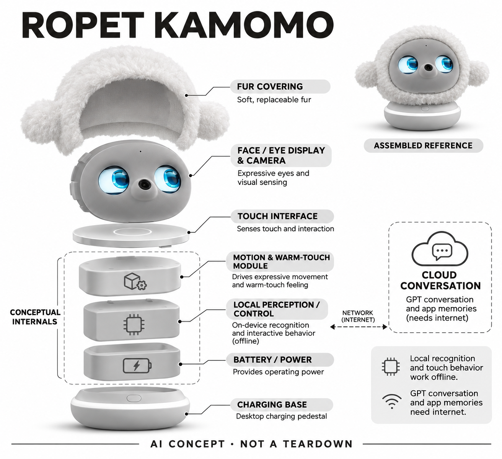

# Ropet KAMOMO

**Ropet** · AI玩具 · 核查 2026-11-06

可触摸的桌面养成宠物，离线回应与联网对话分开运行

消费渠道：个人零售。

## 产品图片与结构参考

### 产品图

Ropet KAMOMO 官方产品图（厂商资料） · 来源：[Ropet 官方资料](<https://ropetai.com/products/ropet%E2%84%A2-ai-comfort-companion-plush-robot>) · [原始图片](<https://cdn.shopify.com/s/files/1/0671/5860/6018/files/ropetaicompanionpet.png?v=1791880303>)

### 参考图

Ropet KAMOMO 官方外形或使用参考（厂商资料） · 来源：[Ropet 官方资料](<https://ropetai.com/products/ropet%E2%84%A2-ai-comfort-companion-plush-robot>) · [原始图片](<https://cdn.shopify.com/s/files/1/0671/5860/6018/files/ropetAicompanionrobotpet.png?v=1791880304>)

### AI 生成爆炸示意

**AI 生成 · 非实物拆机。** 内部为概念推断，不能作为元件布局、BOM 或维修依据。[生成提示词](../../content/hardware/prompts/ropet-kamomo.txt)

> 分析为基于公开资料的案头研究与 AI 辅助判断，未经用户访谈、销量审计或实物拆机。需求、画像、竞争冷门度、审美及商业机会均为研究假设，不是投资结论。

## 销售与购买

- 状态：在售。本轮打开商品页，基础Pro组合US$329.99并有Add to cart；公开商品数据对应变体available=true。换装组合不重复计数。

- 地区：美国、加拿大、部分欧洲国家、新加坡、中国台湾、泰国、澳大利亚、新西兰

- 价格：US$329.99（基础Pro组合）。核查时促销价；配件、税费和目的地以结算为准。

- 中国大陆：本轮核到的国际站标准配送清单不含中国大陆；未据此断言其他国内官方渠道不存在，进口使用与保修须分别确认。

- [官方产品 / 商店](<https://ropetai.com/products/ropet%E2%84%A2-ai-comfort-companion-plush-robot>)

## AI 的实际作用

人脸及手势识别结合角色化动作；达到照顾阶段后提供GPT生成式对话。

服务与联网依赖：识别、日常行为和成长可离线；应用记忆与GPT对话依赖网络及厂商服务，具体地区可用性需确认。

## 是否冷门

新兴竞争（研究判断）：竞争判断要同时比较普通毛绒玩具、屏幕虚拟宠物和带移动能力的机器人。普通玩偶没有持续服务依赖，却缺少回应；移动机器人能追随用户，但要处理地面空间。KAMOMO选择桌面范围，减少移动场景，却也可能使互动始终局限在同一地点。

## 需求与市场

需求判断应区分想要可抱摸的存在感与想要高质量问答的人。前者可能愿意重复很简单的照顾仪式，后者很快会拿它和手机助手比较；温暖触感可以形成硬件差异，但首次惊喜不能证明长期陪伴价值，本轮没有访谈或留存数据支持。

### 事实与范围 · 官方资料

KAMOMO把可触摸的毛绒外形、识别人脸的注视和桌面动作结合起来，当前官方商店销售的是完整宠物及充电底座。它的任务是让日常抚摸、说话和短暂相处得到角色化回应，并不承担家务，也不是必须持续观看屏幕才能使用的手机聊天应用。

依据：[KAMOMO官方商品与当前可购组合](<https://ropetai.com/products/ropet%E2%84%A2-ai-comfort-companion-plush-robot>) · [Ropet官方照顾及设置指南](<https://ropetai.com/pages/parenting-guide>)

### 判断与差异 · 研究判断

需求判断应区分想要可抱摸的存在感与想要高质量问答的人。前者可能愿意重复很简单的照顾仪式，后者很快会拿它和手机助手比较；温暖触感可以形成硬件差异，但首次惊喜不能证明长期陪伴价值，本轮没有访谈或留存数据支持。

依据：[KAMOMO官方商品与当前可购组合](<https://ropetai.com/products/ropet%E2%84%A2-ai-comfort-companion-plush-robot>) · [Ropet官方照顾及设置指南](<https://ropetai.com/pages/parenting-guide>)

### 验证与限制 · 待验证

验证可把设备留在用户原本工作的书桌上两周，让其自行决定何时互动，记录主动摸它、主动聊天和关机的时点。访谈追问它在哪个具体时刻值得占据桌面，以及没有联网对话时是否仍愿意留下，避免只收集开箱后的可爱评价。

依据：[KAMOMO官方商品与当前可购组合](<https://ropetai.com/products/ropet%E2%84%A2-ai-comfort-companion-plush-robot>) · [Ropet官方照顾及设置指南](<https://ropetai.com/pages/parenting-guide>)

## 用户画像

潜在人群是假设性的桌面玩具爱好者、喜欢换装收藏的用户，以及无法或不愿承担真实宠物照料的人。三类动机并不相同：收藏者关注外观与配件，陪伴者关注反应和记忆，送礼者还要考虑收礼人是否愿意安装应用和承担充电维护。

### 事实与范围 · 官方资料

官方指南要求放在干净桌面，通过应用设置名字、查看成长与记忆，并持续互动解锁对话。这说明完整体验包含手机设置和日常照顾，而不只是把一个装饰品送给别人；本条以成人个人使用和送礼作为研究范围，不将其描述为儿童照护工具。

依据：[KAMOMO官方商品与当前可购组合](<https://ropetai.com/products/ropet%E2%84%A2-ai-comfort-companion-plush-robot>) · [Ropet官方照顾及设置指南](<https://ropetai.com/pages/parenting-guide>)

### 判断与差异 · 研究判断

潜在人群是假设性的桌面玩具爱好者、喜欢换装收藏的用户，以及无法或不愿承担真实宠物照料的人。三类动机并不相同：收藏者关注外观与配件，陪伴者关注反应和记忆，送礼者还要考虑收礼人是否愿意安装应用和承担充电维护。

依据：[KAMOMO官方商品与当前可购组合](<https://ropetai.com/products/ropet%E2%84%A2-ai-comfort-companion-plush-robot>) · [Ropet官方照顾及设置指南](<https://ropetai.com/pages/parenting-guide>)

### 验证与限制 · 待验证

招募时应询问已有玩偶、桌面机器人和聊天应用的使用史，并让参与者独立完成首次设置。赠送场景要分别访谈购买者和使用者，确认期待是否一致；不能从独居、年龄或工作压力自动推断孤独程度，也不把互动反馈解释为心理疗效。

依据：[KAMOMO官方商品与当前可购组合](<https://ropetai.com/products/ropet%E2%84%A2-ai-comfort-companion-plush-robot>) · [Ropet官方照顾及设置指南](<https://ropetai.com/pages/parenting-guide>)

## 竞争与替代

竞争判断要同时比较普通毛绒玩具、屏幕虚拟宠物和带移动能力的机器人。普通玩偶没有持续服务依赖，却缺少回应；移动机器人能追随用户，但要处理地面空间。KAMOMO选择桌面范围，减少移动场景，却也可能使互动始终局限在同一地点。

### 事实与范围 · 官方资料

当前商店把白色基础宠物和多种毛套作为同一商品的组合选项，本目录不把换装包再计成新产品。它与已收录的桌面机器人共同提供角色互动，但毛绒触感、固定桌面底座和依照照顾节奏变化的表现构成这款产品的具体表达方式。

依据：[KAMOMO官方商品与当前可购组合](<https://ropetai.com/products/ropet%E2%84%A2-ai-comfort-companion-plush-robot>) · [Ropet官方照顾及设置指南](<https://ropetai.com/pages/parenting-guide>)

### 判断与差异 · 研究判断

竞争判断要同时比较普通毛绒玩具、屏幕虚拟宠物和带移动能力的机器人。普通玩偶没有持续服务依赖，却缺少回应；移动机器人能追随用户，但要处理地面空间。KAMOMO选择桌面范围，减少移动场景，却也可能使互动始终局限在同一地点。

依据：[KAMOMO官方商品与当前可购组合](<https://ropetai.com/products/ropet%E2%84%A2-ai-comfort-companion-plush-robot>) · [Ropet官方照顾及设置指南](<https://ropetai.com/pages/parenting-guide>)

### 验证与限制 · 待验证

比较研究应给参与者相同的短暂休息任务，观察其主动选择摸玩偶、叫机器人还是打开聊天软件。把反应延迟、表达变化和清洁麻烦分开记录，不用功能数量形成总分；也不由社交媒体关注度判断这个细分市场已经拥挤或仍是蓝海。

依据：[KAMOMO官方商品与当前可购组合](<https://ropetai.com/products/ropet%E2%84%A2-ai-comfort-companion-plush-robot>) · [Ropet官方照顾及设置指南](<https://ropetai.com/pages/parenting-guide>)

## 供应链

产品化判断是毛绒与机电必须一起验证：毛套厚度和面罩位置可能影响触摸与视野，缝制尺寸偏差可能影响眼睛开口和运动间隙。持续的温暖感还涉及能耗、表面温度和材料耐受，不能把普通公仔供应链直接当成已完成电子宠物交付能力。

### 事实与范围 · 官方资料

官方公开了可更换毛套与面罩、表情眼睛、视觉识别、触摸回应和充电底座等功能类目，但没有公开这款商品的完整物料清单和代工厂。本条结构示意中的控制、供电和动作模块仅用于解释功能层次，不宣称展示真实内部装配顺序。

依据：[KAMOMO官方商品与当前可购组合](<https://ropetai.com/products/ropet%E2%84%A2-ai-comfort-companion-plush-robot>) · [Ropet官方照顾及设置指南](<https://ropetai.com/pages/parenting-guide>)

### 判断与差异 · 研究判断

产品化判断是毛绒与机电必须一起验证：毛套厚度和面罩位置可能影响触摸与视野，缝制尺寸偏差可能影响眼睛开口和运动间隙。持续的温暖感还涉及能耗、表面温度和材料耐受，不能把普通公仔供应链直接当成已完成电子宠物交付能力。

依据：[KAMOMO官方商品与当前可购组合](<https://ropetai.com/products/ropet%E2%84%A2-ai-comfort-companion-plush-robot>) · [Ropet官方照顾及设置指南](<https://ropetai.com/pages/parenting-guide>)

### 验证与限制 · 待验证

声学和视觉可分别询价具备微型音频与相机模组能力的供应商，然而采购前仍需给出整机空间、噪声、遮挡和散热条件。试产应记录毛套更换后的识别变化与充电接触可靠性，未知成本和起订量保持空白，不由官网零售价倒推制造成本。

依据：[KAMOMO官方商品与当前可购组合](<https://ropetai.com/products/ropet%E2%84%A2-ai-comfort-companion-plush-robot>) · [Ropet官方照顾及设置指南](<https://ropetai.com/pages/parenting-guide>)

## 技术路径

技术判断的关键是把同一角色的不同计算链路拆开：本地识别失败与云端对话等待可能产生相似的沉默，用户却需要不同处理办法。官网没有给出视觉模型、训练覆盖或长期记忆准确率，因此不能把识别熟人等同于稳定理解用户情绪与关系。

### 事实与范围 · 官方资料

官方指南将离线可用的识别、日常行为与照顾成长，同需要互联网的应用功能分开；当前说明还写明照顾达到指定阶段后开放GPT对话。收录依据是人脸识别与生成式对话，固定动画、触摸开关或毛绒温暖本身并不单独构成AI证明。

依据：[KAMOMO官方商品与当前可购组合](<https://ropetai.com/products/ropet%E2%84%A2-ai-comfort-companion-plush-robot>) · [Ropet官方照顾及设置指南](<https://ropetai.com/pages/parenting-guide>)

### 判断与差异 · 研究判断

技术判断的关键是把同一角色的不同计算链路拆开：本地识别失败与云端对话等待可能产生相似的沉默，用户却需要不同处理办法。官网没有给出视觉模型、训练覆盖或长期记忆准确率，因此不能把识别熟人等同于稳定理解用户情绪与关系。

依据：[KAMOMO官方商品与当前可购组合](<https://ropetai.com/products/ropet%E2%84%A2-ai-comfort-companion-plush-robot>) · [Ropet官方照顾及设置指南](<https://ropetai.com/pages/parenting-guide>)

### 验证与限制 · 待验证

验证应分别在联网、断网、换光照和多人轮流互动时记录实际反应，并确认应用里哪些记录可删除或迁移。对话可用日常问候及前后矛盾信息测试短期一致性，但不以几次流畅回应宣称模型具备人格，也不假定所有地区使用同一云服务。

依据：[KAMOMO官方商品与当前可购组合](<https://ropetai.com/products/ropet%E2%84%A2-ai-comfort-companion-plush-robot>) · [Ropet官方照顾及设置指南](<https://ropetai.com/pages/parenting-guide>)

## 产品审美

设计判断是面罩让眼睛与摄像头具有清楚的识别位置，毛套则弱化电子产品感；两者之间仍存在视线与隐私的张力。可以换装有助于个人表达，却也增加配件管理、毛发清洁和长期审美疲劳问题，外观购买欲不能替代实际相处体验。

### 事实与范围 · 官方资料

官方产品图呈现白色毛绒圆体、灰色面罩、两只圆形表情眼睛和中间镜头，下方是圆润底座。参考图保留厂商真实场景与配色，生成图另以灰阶解释功能，既不把生成图当实拍，也不通过改色让来源图片误呈为另一种官方型号。

依据：[KAMOMO官方商品与当前可购组合](<https://ropetai.com/products/ropet%E2%84%A2-ai-comfort-companion-plush-robot>) · [Ropet官方照顾及设置指南](<https://ropetai.com/pages/parenting-guide>)

### 判断与差异 · 研究判断

设计判断是面罩让眼睛与摄像头具有清楚的识别位置，毛套则弱化电子产品感；两者之间仍存在视线与隐私的张力。可以换装有助于个人表达，却也增加配件管理、毛发清洁和长期审美疲劳问题，外观购买欲不能替代实际相处体验。

依据：[KAMOMO官方商品与当前可购组合](<https://ropetai.com/products/ropet%E2%84%A2-ai-comfort-companion-plush-robot>) · [Ropet官方照顾及设置指南](<https://ropetai.com/pages/parenting-guide>)

### 验证与限制 · 待验证

审美测试可让用户在自己的书桌、床头和客厅选择一个固定位置，观察它是否遮挡其他物品或让访客误解摄像头状态。触感评价要结合几天后的积灰和整理体验，并让用户说明哪些表情亲切、哪些表情过度活跃，而非只打可爱分数。

依据：[KAMOMO官方商品与当前可购组合](<https://ropetai.com/products/ropet%E2%84%A2-ai-comfort-companion-plush-robot>) · [Ropet官方照顾及设置指南](<https://ropetai.com/pages/parenting-guide>)

## 关键风险

风险判断包括云服务变化、角色记忆和用户期待不一致，以及毛套损耗后替换渠道不足。它面向情感互动，更容易让人主动透露私人信息；宣传中的安慰和理解不代表医疗能力，也不能把机器表达亲近当成真实具有感受的证据。

### 事实与范围 · 官方资料

官方国际配送清单没有列中国大陆，保修又限定原购买地区；这不足以证明大陆不存在其他官方渠道，因此国内情况记为未明确。当前指南关于免费GPT对话的表述是厂商服务承诺，不构成本轮对长期持续性、网络可达性或数据处理的独立验证。

依据：[KAMOMO官方商品与当前可购组合](<https://ropetai.com/products/ropet%E2%84%A2-ai-comfort-companion-plush-robot>) · [Ropet官方照顾及设置指南](<https://ropetai.com/pages/parenting-guide>)

### 判断与差异 · 研究判断

风险判断包括云服务变化、角色记忆和用户期待不一致，以及毛套损耗后替换渠道不足。它面向情感互动，更容易让人主动透露私人信息；宣传中的安慰和理解不代表医疗能力，也不能把机器表达亲近当成真实具有感受的证据。

依据：[KAMOMO官方商品与当前可购组合](<https://ropetai.com/products/ropet%E2%84%A2-ai-comfort-companion-plush-robot>) · [Ropet官方照顾及设置指南](<https://ropetai.com/pages/parenting-guide>)

### 验证与限制 · 待验证

购买前验证应确认目的地配送、进口费用和返修地点，向品牌询问录音及人脸信息的存储、删除与账户解绑方式。借用研究应设置不愿上传内容的退出选项，关注用户何时感觉被误认或不被尊重，而不是鼓励其分享更敏感经历来测试陪伴。

依据：[KAMOMO官方商品与当前可购组合](<https://ropetai.com/products/ropet%E2%84%A2-ai-comfort-companion-plush-robot>) · [Ropet官方照顾及设置指南](<https://ropetai.com/pages/parenting-guide>)

## 机会与验证

商业模式判断应把一次性硬件、换装配件和持续云服务分开计算。外观配件可以支持表达，但如果核心角色体验依赖未来维护，免费对话不意味着运营没有成本；小团队需要先验证用户愿意为何种服务付费，而非把所有收入期待压在收藏热潮上。

### 事实与范围 · 官方资料

可研究的机会是围绕固定桌面的短时互动建立稳定仪式，例如开始工作和结束工作时的简短招呼。这个判断来自产品形态与现有能力，而非品牌公布的销量；如果用户主要享受触感和眼神，过度扩展问答能力可能并不是最有价值的投入。

依据：[KAMOMO官方商品与当前可购组合](<https://ropetai.com/products/ropet%E2%84%A2-ai-comfort-companion-plush-robot>) · [Ropet官方照顾及设置指南](<https://ropetai.com/pages/parenting-guide>)

### 判断与差异 · 研究判断

商业模式判断应把一次性硬件、换装配件和持续云服务分开计算。外观配件可以支持表达，但如果核心角色体验依赖未来维护，免费对话不意味着运营没有成本；小团队需要先验证用户愿意为何种服务付费，而非把所有收入期待压在收藏热潮上。

依据：[KAMOMO官方商品与当前可购组合](<https://ropetai.com/products/ropet%E2%84%A2-ai-comfort-companion-plush-robot>) · [Ropet官方照顾及设置指南](<https://ropetai.com/pages/parenting-guide>)

### 验证与限制 · 待验证

下一步可比较两组真实使用记录：一组重点体验离线互动，一组使用联网对话，询问最终愿意保留的功能和能接受的维护负担。结果按具体行为和访谈陈述整理，不用模型评分预测成功概率，也不以少量愿意购买的样本估算整体市场规模。

依据：[KAMOMO官方商品与当前可购组合](<https://ropetai.com/products/ropet%E2%84%A2-ai-comfort-companion-plush-robot>) · [Ropet官方照顾及设置指南](<https://ropetai.com/pages/parenting-guide>)

## 对应供应链公司

能力候选用于选型研究，不代表本产品实际采用；未公开的供货关系不作推断。

- [aac-technologies](../supply-chain/aac-technologies.md) — **能力候选 · 非已采用** / 微型语音采集与回放能力候选：瑞声公开具备微型声学器件及系统工程能力，可作为桌面宠物语音输入输出的询样候选。毛套遮挡、动作噪声与腔体条件必须由整机验证，没有点名材料证明其为Ropet供应商。

- [chicony](../supply-chain/chicony.md) — **能力候选 · 非已采用** / 小型视觉模组能力候选：群光公开相机模组业务与影像工程能力，可供面部和手势识别的视觉输入选型参考。镜头视野、弱光与面罩开口需要重新适配，不能把目录能力关联当成已采用的品牌或具体物料。

[浏览供应链目录](../supply-chain.md)

## 功能分层示意

这是功能关系，不是实物拆机、真实空间结构或已核实 BOM。

1. **外观与表达**：可更换毛套、面罩和表情眼睛构成可触摸角色。（官方披露）

2. **感知输入**：视觉识别、声音和触摸作为互动输入。（官方披露）

3. **本地行为**：离线识别与照顾成长驱动角色反应；模型细节未披露。（官方披露）

4. **云端对话**：GPT对话及应用记忆使用互联网服务。（官方披露）

5. **机电与供电示意**：动作、温暖触感和底座供电之间的具体布局为功能推断，非拆机。（分析推断）

## 来源

1. [KAMOMO官方商品与当前可购组合](<https://ropetai.com/products/ropet%E2%84%A2-ai-comfort-companion-plush-robot>) — 本轮打开商品页，基础Pro组合US$329.99并有Add to cart；公开商品数据对应变体available=true。换装组合不重复计数。

2. [Ropet官方照顾及设置指南](<https://ropetai.com/pages/parenting-guide>) — 明确离线识别与照顾成长、联网应用及7天后解锁GPT对话；不挪用第三方所称其他模型或时间。

3. [Ropet官方产品功能](<https://ropetai.com/>) — 核人脸识别、手势、触感、温暖和桌面陪伴定位。

4. [Ropet官方配送条款](<https://ropetai.com/policies/shipping-policy>) — 核国际目的地与地区限制，中国大陆未列入公开标准配送清单。

[返回目录](../hardware-market.md) · [网页分析](https://romanagent.github.io/Roman/#hardware/product/ropet-kamomo)
