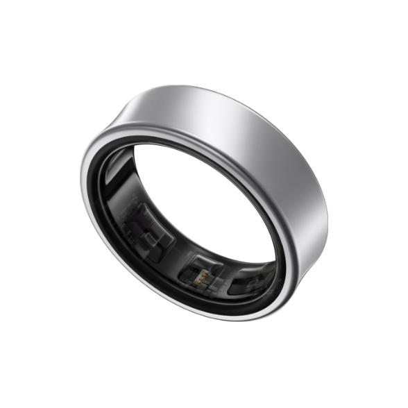
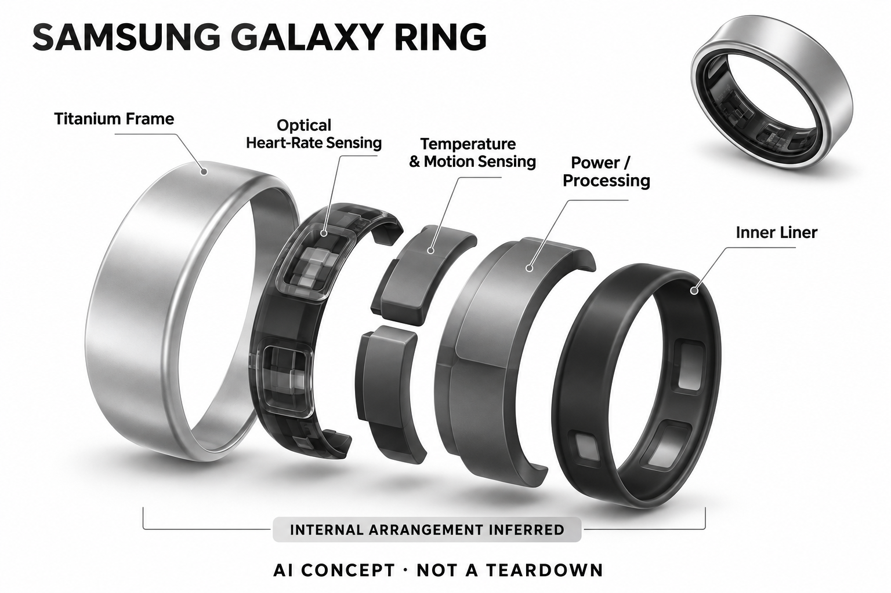

# Samsung Galaxy Ring

**Samsung** · 健康与穿戴 · 核查 2026-11-04

以机器学习能量得分连接指环与手机健康应用

消费渠道：个人零售。

## 产品图片与结构参考

### 产品图

Galaxy Ring 银色官方产品图 · 来源：[Samsung · 官方图片](<https://www.samsung.com.cn/rings/galaxy-ring/galaxy-ring-titanium-silver-size-12-sm-q502nzsachc/>) · [原始图片](<https://images.samsung.com.cn/cn/galaxy-ring/feature/galaxy-ring-color-silver-pc.png>)

### 官方结构参考

Galaxy Ring 官方传感位置示意（非实物拆机） · 来源：[Samsung · 官方图片](<https://www.samsung.com.cn/rings/galaxy-ring/galaxy-ring-titanium-silver-size-12-sm-q502nzsachc/>) · [原始图片](<https://images.samsung.com.cn/is/image/samsung/assets/cn/rings/galaxy-ring/galaxy-ring-sensor-pc_0808.jpg>)

### AI 生成爆炸示意

**AI 生成 · 非实物拆机。** 内部为概念推断，不能作为元件布局、BOM 或维修依据。[生成提示词](../../content/hardware/prompts/samsung-galaxy-ring.txt)

> 已目视核对产品外形与AI标识；verified不代表内部布局经实物拆机验证。

> 主图为银色，传感示意使用同系列金色外观；官方传感说明不等于完整内部拆机。

> 分析为基于公开资料的案头研究与 AI 辅助判断，未经用户访谈、销量审计或实物拆机。需求、画像、竞争冷门度、审美及商业机会均为研究假设，不是投资结论。

## 销售与购买

- 状态：待复核。中国官方购买配置页仍存在，但所核银色12号商品页显示已售完，购买页也提示部分尺码缺货且交付时间不保证。因此保守标待确认，不将产品存在等同全尺码现货。

- 地区：中国大陆官方渠道

- 价格：当前可交付SKU价格待确认。不把旧活动建议零售价当作当前可成交价。需先确认尺寸及库存，再以官网结算金额为准。

- 中国大陆：中国官方渠道已确认；具体颜色尺码页显示售完或组合不可用，需在官网确认可交付SKU，不代表所有型号全面停售。

- [官方产品 / 商店](<https://www.samsung.com.cn/rings/galaxy-ring/buy/>)

## AI 的实际作用

中国官方说明能量得分基于机器学习，使用睡眠、活动等同步数据提供个性化状态信息；不将其描述为戒指内运行的聊天大模型。

服务与联网依赖：健康AI需要将数据同步至Samsung Health及兼容手机；部分手势要求指定Samsung Galaxy系统版本，功能与账户条件需逐项核对。

## 是否冷门

竞争密集（研究判断）：智能指环已有多个品牌，Samsung生态是区别，当前尺码库存仍需确认。

## 需求与市场

需求假设：已有Samsung生态的用户可能希望在不佩戴手表时保留日常与睡眠记录，指环可减少屏幕干扰。验证重点是佩戴舒适及数据连续性，而不是把能量分数当作客观健康等级。

### 官方｜手机生态中的无屏记录 · 官方资料

本型号通过指端传感记录活动、心率相关和皮肤温度信息，同步到三星健康后形成状态与睡眠相关提示，能量得分使用机器学习。需求是在不戴手表或不需要屏幕时保留记录，不能将其描述为戒指内运行聊天大模型；当前已核查具体尺码售罄，购买状态仍需按配置确认。

依据：[三星中国Galaxy Ring购买配置](<https://www.samsung.com.cn/rings/galaxy-ring/buy/>) · [三星中国Galaxy Ring银色12号](<https://www.samsung.com.cn/rings/galaxy-ring/galaxy-ring-titanium-silver-size-12-sm-q502nzsachc/>)

### 判断｜延续已有健康应用的价值 · 研究判断

已有三星健康使用习惯的人，可能希望换一种佩戴方式而不重建数据查看流程，但熟悉应用不代表指环一定更适合。价值应看佩戴是否更连续、信息是否被理解，而不是仅增加一个能量分数；如果用户本来已经稳定戴表，新硬件可能产生重复数据与额外管理。

依据：[三星中国：如何使用 Galaxy Ring](<https://www.samsung.com.cn/support/mobile-devices/how-to-use-the-samsung-galaxy-ring/>)

### 验证｜佩戴与信息理解对照 · 待验证

可在合适尺码可获得后比较指环和既有记录方式的佩戴完整、充电缺口与应用查看，观察用户如何解释能量得分。测试应区分数据与个人感受，当前目录没有实机或医学研究；不能从机器学习参与或品牌生态熟悉推断健康收益，也不能以库存未知安排确定购买。

依据：[三星中国Galaxy Ring银色12号](<https://www.samsung.com.cn/rings/galaxy-ring/galaxy-ring-titanium-silver-size-12-sm-q502nzsachc/>) · [三星中国：如何使用 Galaxy Ring](<https://www.samsung.com.cn/support/mobile-devices/how-to-use-the-samsung-galaxy-ring/>)

## 用户画像

用户画像推断：使用兼容手机、愿意试戴并主要通过应用看结果的人较匹配。需要独立屏幕、频繁操作消息或手指容易受压的人，可能更适合腕表；选择应先看习惯和身体适配。

### 判断｜兼容手机与应用用户 · 研究判断

使用适用手机、愿意通过应用看结果并接受无屏形态的人可能更匹配，部分手势还有特定系统条件。不能把所有蓝牙手机都视为完整兼容，也不能仅按三星品牌用户推算需求；画像应先确认实际手机、账户和高频任务，再考虑外观与价格。

依据：[三星中国Galaxy Ring购买配置](<https://www.samsung.com.cn/rings/galaxy-ring/buy/>) · [三星中国：如何使用 Galaxy Ring](<https://www.samsung.com.cn/support/mobile-devices/how-to-use-the-samsung-galaxy-ring/>)

### 判断｜手指佩戴的日常条件 · 研究判断

戒指可能适合不想夜间戴表的人，也可能不适合频繁抓握、手指受压或不习惯戒饰的用户。不同尺寸和手部活动会影响接触与舒适，不能用轻薄宣传替代个体适配；需要即时屏幕或频繁操作消息的人，也可能更适合其他形态，不能将所有穿戴需求合并。

依据：[三星中国Galaxy Ring银色12号](<https://www.samsung.com.cn/rings/galaxy-ring/galaxy-ring-titanium-silver-size-12-sm-q502nzsachc/>)

### 验证｜选码与状态管理 · 待验证

试用应包含正确方向、尺码、充电盒放置和手机连接，记录用户是否理解数据与电量状态。不同日常活动和重新佩戴要分别观察，不能只在静止时判断合适；当前具体库存需要确认，也不应为了某个颜色有货而忽略尺寸适配，购买可得性与使用匹配是两件事。

依据：[三星中国：如何使用 Galaxy Ring](<https://www.samsung.com.cn/support/mobile-devices/how-to-use-the-samsung-galaxy-ring/>)

## 竞争与替代

竞争判断：Oura、Ultrahuman和RingConn等已提供智能指环，属于拥挤市场。Samsung的差异主要是手机健康生态与设备协同，而非单独一种传感器；同样需要比较地区功能和拥有成本。

### 判断｜同类指环的共同需求 · 研究判断

其他智能戒指也提供被动生活数据，本型号差异更多来自手机生态、机器学习状态提示和具体交互条件。品牌、颜色和尺码不应单独增加独立场景，竞争比较应看长期记录与理解任务；当前没有销量或访谈证据，不能由三星品牌或正式渠道推断用户会持续使用。

依据：[三星中国Galaxy Ring银色12号](<https://www.samsung.com.cn/rings/galaxy-ring/galaxy-ring-titanium-silver-size-12-sm-q502nzsachc/>)

### 判断｜与 Galaxy Watch 的取舍 · 研究判断

手表提供屏幕与更多即时操作，指环则强调无屏佩戴，两者可能互补，也可能对同一用户重复。比较应先确认用户是否需要查看时间、消息和运动中反馈，不能只按小巧程度判断优劣；能量得分来自应用分析，换一种硬件形态也不自动创造新的智能需求。

依据：[三星中国Galaxy Ring银色12号](<https://www.samsung.com.cn/rings/galaxy-ring/galaxy-ring-titanium-silver-size-12-sm-q502nzsachc/>) · [三星中国：如何使用 Galaxy Ring](<https://www.samsung.com.cn/support/mobile-devices/how-to-use-the-samsung-galaxy-ring/>)

### 验证｜先确认可交付配置 · 待验证

本次具体颜色尺码页显示售罄，不能用仍存在的配置页面认定可立即购买，也不能据少数缺货推断全面停售。价格比较需要先确认适合且可交付的配置，旧活动建议价不作当前成交价；当前目录保留待核查状态，不据库存变化推导需求强弱或品牌退出。

依据：[三星中国Galaxy Ring购买配置](<https://www.samsung.com.cn/rings/galaxy-ring/buy/>) · [三星中国Galaxy Ring银色12号](<https://www.samsung.com.cn/rings/galaxy-ring/galaxy-ring-titanium-silver-size-12-sm-q502nzsachc/>)

## 供应链

供应链推断：多尺寸金属结构、微型电池和传感接触需要稳定封装，试戴和尺码库存影响交付。官方未披露具体组装工厂；缺码和售后更换不能仅靠统一产品页面解决。

### 官方｜三类传感与手机同步 · 官方资料

官方系列说明列出加速度、心率相关与皮肤温度输入，手机应用承担结果展示和部分智能分析。具体芯片、工厂和电池供应未完整披露，BioActive 品牌名称不能直接当作所有器件自制的证据；目录只记录功能架构，不从品牌、外观或概念图反推真实物料关系。

依据：[三星中国Galaxy Ring银色12号](<https://www.samsung.com.cn/rings/galaxy-ring/galaxy-ring-titanium-silver-size-12-sm-q502nzsachc/>) · [三星中国 Galaxy Ring 黑色 5 号系列说明](<https://www.samsung.com.cn/rings/galaxy-ring/galaxy-ring-titanium-black-size-5-sm-q505nzkachc/>)

### 判断｜尺寸库存也是交付约束 · 研究判断

戒指需要尺寸与颜色组合，用户适合的尺码缺货会直接阻止正常使用，不能由统一商品页解决。结构、传感接触和充电适配也需要各尺寸一致验证，但当前没有良率或库存策略资料；供应链研究应关注试戴与更换流程，不据缺货猜测具体工厂、产能或成本。

依据：[三星中国Galaxy Ring购买配置](<https://www.samsung.com.cn/rings/galaxy-ring/buy/>)

### 判断｜光学与连接候选 · 研究判断

汇顶可作为光学输入路线候选，Nordic 可作为低功耗手机连接候选，当前没有本型号点名采用。需要验证光路、封装、天线和算法接口，不能直接替换；候选器件也不提供三星健康能量模型、账户或特定手势兼容，更不能从组件能力给指环新增未披露功能。

依据：[三星中国Galaxy Ring银色12号](<https://www.samsung.com.cn/rings/galaxy-ring/galaxy-ring-titanium-silver-size-12-sm-q502nzsachc/>) · [三星中国：如何使用 Galaxy Ring](<https://www.samsung.com.cn/support/mobile-devices/how-to-use-the-samsung-galaxy-ring/>)

## 技术路径

官方明确三类传感输入、应用同步和机器学习能量得分。推断系统价值来自长期数据处理与手机展示，不应称为戒指端生成式推理；模型估计与个人身体感受仍需保持区别。

### 官方｜机器学习状态估计 · 官方资料

能量得分基于同步后的活动、睡眠等数据形成状态信息，是感知与估算任务，不等于戒指可以生成开放式对话。官方支持还明确功能随手机、地区和型号变化，数据需要进入应用流程；目录不把一个分数当作客观健康等级，也不从 Galaxy AI 总品牌推断所有生成式功能都包含。

依据：[三星中国Galaxy Ring银色12号](<https://www.samsung.com.cn/rings/galaxy-ring/galaxy-ring-titanium-silver-size-12-sm-q502nzsachc/>) · [三星中国：如何使用 Galaxy Ring](<https://www.samsung.com.cn/support/mobile-devices/how-to-use-the-samsung-galaxy-ring/>)

### 判断｜连续性影响分数解释 · 研究判断

若佩戴中断、睡眠记录缺失或活动输入不完整，最终状态可能缺少重要背景。系统需要让用户看见这些条件，而不是只展示一个容易比较的数字；技术评价应区分原始输入、算法估算与应用解释，不能因为结果个性化就推断它准确反映每个人当下的全部状态。

依据：[三星中国：如何使用 Galaxy Ring](<https://www.samsung.com.cn/support/mobile-devices/how-to-use-the-samsung-galaxy-ring/>)

### 验证｜同步与兼容边界 · 待验证

应在目标手机和系统版本中测试配对、同步、权限和特定交互，观察缺失数据时如何反馈。不同地区的功能不应互相代入，也不能由蓝牙连接成功推断全部健康提示可用；当前目录没有独立测量或模型评估，官方操作说明仅能支持功能与流程边界。

依据：[三星中国Galaxy Ring购买配置](<https://www.samsung.com.cn/rings/galaxy-ring/buy/>) · [三星中国：如何使用 Galaxy Ring](<https://www.samsung.com.cn/support/mobile-devices/how-to-use-the-samsung-galaxy-ring/>)

## 产品审美

审美判断：凹面轮廓与金属表面强化首饰属性，无屏幕有利于日常搭配。指环在真实工作和睡眠时的厚度、刮擦及尺寸感，比宣传图中的轻盈视觉更影响长期佩戴意愿。

### 判断｜戒饰化曲线与金属外形 · 研究判断

官方图示强调金属和弧度设计，可能使设备更接近日常戒饰，但真实触感、磨损和手指压力仍需试戴。审美评价应结合工作、睡眠和既有首饰搭配，而不是只看颜色；外形轻薄不能自动证明长期舒适或持续接触，也不能代替具体尺寸的个人适配。

依据：[三星中国 Galaxy Ring 黑色 5 号系列说明](<https://www.samsung.com.cn/rings/galaxy-ring/galaxy-ring-titanium-black-size-5-sm-q505nzkachc/>)

### 判断｜无屏状态通过应用与盒子传达 · 研究判断

指环没有大屏，用户通过应用和充电盒等反馈理解状态，设计需要让连接、电量和数据问题清楚。无屏可以减少通知，却也可能让异常不易被发现；评价应观察用户是否需要频繁检查手机，不能只把没有屏幕当成使用简单或认知负担更低的证据。

依据：[三星中国：如何使用 Galaxy Ring](<https://www.samsung.com.cn/support/mobile-devices/how-to-use-the-samsung-galaxy-ring/>)

### 验证｜充电与重新佩戴流程 · 待验证

试用应让用户完成取下、放入充电盒、查看状态和重新佩戴，记录方向错误、遗忘和数据缺口。不同生活节奏下的维护负担要分别观察，不能仅由官方续航和照片判断全天体验；长期记录依赖舒适、管理和同步共同稳定，单项设计优势不足以保证整体价值。

依据：[三星中国：如何使用 Galaxy Ring](<https://www.samsung.com.cn/support/mobile-devices/how-to-use-the-samsung-galaxy-ring/>)

## 关键风险

风险判断：当前具体尺码已售完，用户应避免把官方配置页理解为可即时交付。健康数据和机器学习提示不用于诊断或治疗；兼容手机、账户及地区差异也可能限制完整功能。

### 判断｜库存与购买预期 · 研究判断

当前具体尺码已售罄，用户不能把官网页面存在理解为可即时交付，也不应以旧价格作确定预算。多个配置不可用仍不证明产品全面停止销售，目录保持待核查并限定证据；正式渠道能够帮助确认主体，却不能替代实际尺码、库存和交付条件。

依据：[三星中国Galaxy Ring购买配置](<https://www.samsung.com.cn/rings/galaxy-ring/buy/>) · [三星中国Galaxy Ring银色12号](<https://www.samsung.com.cn/rings/galaxy-ring/galaxy-ring-titanium-silver-size-12-sm-q502nzsachc/>)

### 判断｜状态提示与健康边界 · 研究判断

官方将功能限定为一般健康与健身参考，不能用于诊断、治疗或排除疾病。能量分数可能让用户过度解释单日变化，需要保留数据条件和个人感受；账户与云端同步还涉及敏感信息管理，目录不把品牌或机器学习参与当作绝对准确和隐私保证。

依据：[三星中国：如何使用 Galaxy Ring](<https://www.samsung.com.cn/support/mobile-devices/how-to-use-the-samsung-galaxy-ring/>)

### 验证｜权限与错误更正 · 待验证

应检查同步失败、账户变化和误记录时用户能控制哪些数据，以及删除或导出后应用如何反映。重要健康问题不能只依据一个状态分数判断，特定手势也需在兼容系统中验证；可靠体验应让限制和缺失可见，而不是用统一的应用界面掩盖地区与设备差异。

依据：[三星中国：如何使用 Galaxy Ring](<https://www.samsung.com.cn/support/mobile-devices/how-to-use-the-samsung-galaxy-ring/>)

## 机会与验证

市场观察：它补充了中国有官方渠道的智能指环样本，但本次库存证据不足以标现售。对比时将能量算法、手机要求及尺码交付放在同一层，比用Galaxy AI名称概括全部价值更准确。

### 判断｜生态延续的具体收益 · 研究判断

本型号值得研究的是用户能否在熟悉应用中以更可接受的佩戴方式保留日常数据，而不是因已有手机就自然需要指环。若长期连续性和理解没有改善，生态整合可能只是新增设备；场景分组应与被动健康趋势任务复用，不按品牌、颜色或尺码制造新需求。

依据：[三星中国Galaxy Ring银色12号](<https://www.samsung.com.cn/rings/galaxy-ring/galaxy-ring-titanium-silver-size-12-sm-q502nzsachc/>) · [三星中国：如何使用 Galaxy Ring](<https://www.samsung.com.cn/support/mobile-devices/how-to-use-the-samsung-galaxy-ring/>)

### 判断｜可得性与长期价值分开 · 研究判断

即使后续补货，购买理由仍需由佩戴、记录和信息使用支撑，库存恢复本身不能证明产品更适合。反过来，当前缺码也不能证明需求不存在，目录应把市场供给状态与任务分析分开；这样的边界有助于避免用页面变化替代对实际用户与使用过程的研究。

依据：[三星中国Galaxy Ring购买配置](<https://www.samsung.com.cn/rings/galaxy-ring/buy/>)

### 验证｜补货后的持续评估 · 待验证

后续首先应确认适合尺码和当前价格，再跟踪佩戴完整、同步、状态理解和维护，比较原有手表或其他方案。所有结果需限定手机与地区条件，不能以一次试戴代表长期；当前目录不计作已确认可即时购买样本，也不以品牌、机器学习或外观宣称健康效果已验证。

依据：[三星中国Galaxy Ring购买配置](<https://www.samsung.com.cn/rings/galaxy-ring/buy/>) · [三星中国：如何使用 Galaxy Ring](<https://www.samsung.com.cn/support/mobile-devices/how-to-use-the-samsung-galaxy-ring/>)

## 对应供应链公司

能力候选用于选型研究，不代表本产品实际采用；未公开的供货关系不作推断。

- [goodix](../supply-chain/goodix.md) — **能力候选 · 非已采用** / 心率相关光学输入的重设计候选：Galaxy Ring 披露心率相关传感，汇顶光学模块或前端可作为新设计候选。需验证手指接触、光路、封装和与指标算法的接口，当前没有点名采用；该候选不证明 BioActive 内部器件来源，也不能直接替代三星健康模型或为指环增加其他测量能力。

- [nordic-semiconductor](../supply-chain/nordic-semiconductor.md) — **能力候选 · 非已采用** / 指环与手机同步的低功耗无线候选：官方支持说明通过蓝牙与手机连接，Nordic 可作为这一链路的新设计候选。需核对天线、封装、缓存和电池周期，当前没有供货点名；无线连接能力不提供三星账户、能量得分或特定 Galaxy 手势兼容，也不能证明现有指环采用具体 Nordic 型号。

[浏览供应链目录](../supply-chain.md)

## 功能分层示意

这是功能关系，不是实物拆机、真实空间结构或已核实 BOM。

1. **传感记录**：加速度、心率相关与皮肤温度传感器记录数据。（官方披露）

2. **手机同步**：健康AI需要同步至Samsung Health应用。（官方披露）

3. **状态估计**：官方说明能量得分使用机器学习。（官方披露）

4. **结果反馈**：应用提供状态与个性化健康睡眠信息。（官方披露）

5. **生态条件**：部分手势和功能需要特定Galaxy手机及系统。（官方披露）

## 来源

1. [三星中国Galaxy Ring购买配置](<https://www.samsung.com.cn/rings/galaxy-ring/buy/>) — 购买页仍在，说明部分尺寸缺货且交期可能无法保证。

2. [三星中国Galaxy Ring银色12号](<https://www.samsung.com.cn/rings/galaxy-ring/galaxy-ring-titanium-silver-size-12-sm-q502nzsachc/>) — 具体SKU显示已售完，同时给出传感、机器学习及兼容条件。

[返回目录](../hardware-market.md) · [网页分析](https://romanagent.github.io/Roman/#hardware/product/samsung-galaxy-ring)
