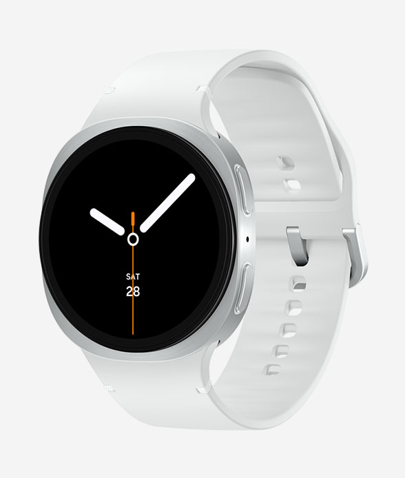
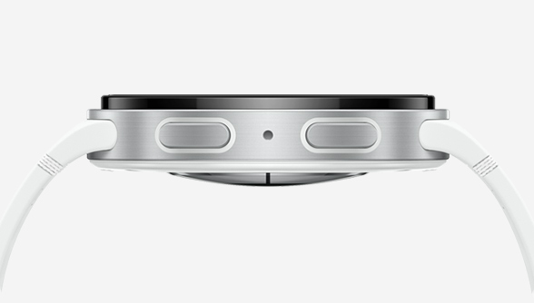
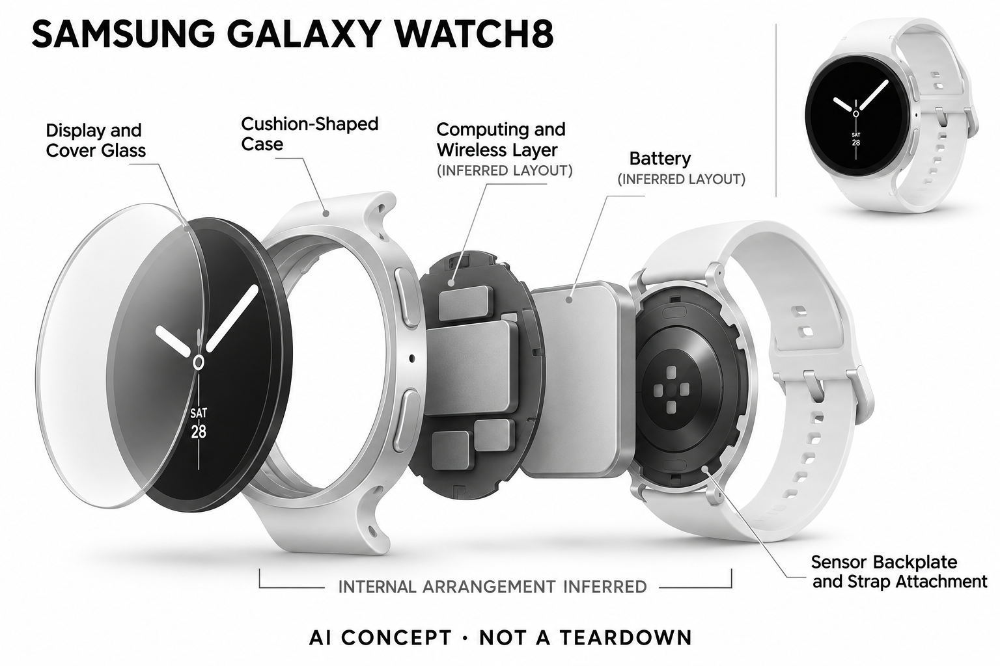

# Samsung Galaxy Watch8

**Samsung** · 健康与穿戴 · 核查 2026-11-04

腕上助手与健康数据服务结合的生态型手表

消费渠道：个人零售。

## 产品图片与结构参考

### 产品图

Galaxy Watch8 银色官方角度图 · 来源：[Samsung · 官方图片](<https://www.samsung.com/us/watches/galaxy-watch8/>) · [原始图片](<https://image-us.samsung.com/us/watches/galaxy-watch8/images/galaxy-watch8-design-colors-silver-perspective.jpg?imbypass=true>)

### 参考图

Galaxy Watch8 银色官方侧面参考 · 来源：[Samsung · 官方图片](<https://www.samsung.com/us/watches/galaxy-watch8/>) · [原始图片](<https://image-us.samsung.com/us/watches/galaxy-watch8/images/galaxy-watch8-design-colors-silver-side.jpg?imbypass=true>)

### AI 生成爆炸示意

**AI 生成 · 非实物拆机。** 内部为概念推断，不能作为元件布局、BOM 或维修依据。[生成提示词](../../content/hardware/prompts/samsung-galaxy-watch8.txt)

> 已目视核对产品外形与AI标识；verified不代表内部布局经实物拆机验证。

> 分析为基于公开资料的案头研究与 AI 辅助判断，未经用户访谈、销量审计或实物拆机。需求、画像、竞争冷门度、审美及商业机会均为研究假设，不是投资结论。

## 销售与购买

- 状态：在售。美国官方页面提供Buy now及US$299.99起信息；三星中国官网也有Watch8购买配置页。不同国家的语音助手和健康功能不能视为完全相同。

- 地区：美国、中国大陆

- 价格：美国官网 US$299.99 起；国行以官方配置价为准。尺寸、蓝牙/LTE、配件及促销会改变价格；不把折抵换新优惠当作无条件售价。

- 中国大陆：已打开三星中国Watch8官方购买页。美国宣传的Gemini、健康功能及账户条件必须与国行页面分别核对，不能据此保证国行功能相同。

- [官方产品 / 商店](<https://www.samsung.com/us/watches/galaxy-watch8/>)

## AI 的实际作用

海外版将腕上生成式助手与健康算法服务结合，基于穿戴记录提供能量、睡眠和活动相关信息；功能随区域与账户条件变化。

服务与联网依赖：依赖兼容Android/部分Samsung Galaxy手机、Samsung Health及账号；海外语音助手联网与地区要求需单独确认，不能推广到国行。

## 是否冷门

竞争密集（研究判断）：通用智能腕表已有成熟手机生态竞争，地区与平台适配是决定性约束。

## 需求与市场

需求假设：已有Android或Samsung生态的用户，希望在手腕完成短任务并查看日常状态，可能更看重设备协同而非单一AI功能。应验证常用任务是否真能离开手机完成，减少重复操作。

### 官方｜腕上短任务与个人状态 · 官方资料

本型号在海外页面结合自然语言助手、健康算法和应用生态，国内也有独立购买入口。需求是让部分短任务和状态查看留在手腕，减少取手机，但两地服务不能默认相同；测量、健康估算与生成式操作是不同能力，不能把 Galaxy AI 名称当作所有功能在每个版本都可用。

依据：[Samsung美国Watch8产品及购买](<https://www.samsung.com/us/watches/galaxy-watch8/>) · [Samsung中国Watch8购买页](<https://www.samsung.com.cn/watches/galaxy-watch8/buy/>)

### 判断｜真正减少多少手机操作 · 研究判断

用户可能希望快速查询、调整或查看信息，但如果每次都要回手机确认，腕上助手的便利就有限。价值应以一个完整任务是否少步骤判断，而不是回答是否自然；手表也会增加通知、账户和充电，功能整合需要与这些负担一起比较，不能只计算新增能力。

依据：[Samsung美国Watch8产品及购买](<https://www.samsung.com/us/watches/galaxy-watch8/>)

### 验证｜短任务的端到端对照 · 待验证

可让用户使用手表和手机完成同样的日常短任务，记录唤醒、理解、确认和失败恢复，而不只测语音回答时间。健康查看则另测数据解释与回查，避免混合评价；当前目录没有实机或长期行为研究，不能由海外助手演示推断所有地区用户都能稳定离开手机完成任务。

依据：[Samsung美国Watch8产品及购买](<https://www.samsung.com/us/watches/galaxy-watch8/>)

## 用户画像

用户画像推断：持续佩戴手表、使用兼容手机并愿意设置多个账户的人较匹配。iPhone使用者、追求极简无通知或只想记录睡眠的人，需要先比较生态限制和充电习惯再决定。

### 判断｜已有兼容手机的持续戴表者 · 研究判断

使用适用 Android 或 Galaxy 手机、愿意长期戴表并管理账户的人可能更匹配。对其他手机、极简无通知偏好或只想记录睡眠的人，需要先确认生态与形态是否合适；画像应依据实际高频任务和佩戴习惯，而不是以手机品牌或人工智能兴趣直接推算需求。

依据：[Samsung美国Watch8产品及购买](<https://www.samsung.com/us/watches/galaxy-watch8/>)

### 判断｜多个服务的配置意愿 · 研究判断

自然语言、健康和设备协同可能涉及不同权限与账号，熟悉一项服务不代表用户愿意管理全部设置。研究应观察哪些能力真正被启用、哪些因复杂而停用，不能把购买硬件当作使用所有生态功能；首次用户与已有三星设备者的学习成本也应分开评价。

依据：[Samsung美国Watch8产品及购买](<https://www.samsung.com/us/watches/galaxy-watch8/>)

### 验证｜地区、语言与手机组合 · 待验证

首次测试应以用户实际地区和手机完成设置，并逐项确认助手、健康信息和其他高频任务。美国页面不能替代国行功能说明，购买入口也不代表所有配置库存一致；还需观察受限时的回退方式，避免只由最完整的演示环境定义所有用户体验。

依据：[Samsung美国Watch8产品及购买](<https://www.samsung.com/us/watches/galaxy-watch8/>) · [Samsung中国Watch8购买页](<https://www.samsung.com.cn/watches/galaxy-watch8/buy/>)

## 竞争与替代

竞争判断：通用智能手表是高度拥挤市场，竞争不只在硬件，还涉及应用、手机生态与服务地区。腕上助手可提升便利性，但往往受平台策略影响，不能把它视为独立小硬件的全部价值。

### 判断｜与其他智能手表比较 · 研究判断

其他手表也可提供语音、消息和运动记录，Watch8 的差异应具体到任务执行、生态兼容和健康信息使用，而不只看助手品牌。若用户的常用任务已由旧表满足，升级收益需要实证；竞争分析不应由新代、屏幕或功能数量直接推断更高的实际效率。

依据：[Samsung美国Watch8产品及购买](<https://www.samsung.com/us/watches/galaxy-watch8/>)

### 判断｜指环与手机的替代边界 · 研究判断

指环更偏被动记录，手机提供更完整界面，手表则把即时操作放在手腕，三者承担的任务不同。用户可能需要组合，也可能只需其中一种，不能把所有健康数据都当成同一需求；比较应先问是否需要当场交互，再看生态和成本，避免单纯以小巧或多功能排名。

依据：[Samsung美国Watch8产品及购买](<https://www.samsung.com/us/watches/galaxy-watch8/>)

### 验证｜同版本与真实成本 · 待验证

价格比较应保持地区、尺寸、连接配置和配件一致，不能把以旧换新或另一版本的优惠当作无条件售价。服务和健康功能的区域条件也需单独核对，当前目录没有销量或留存证据；官方购买页支持列售判断，不足以证明用户愿意为所有新增功能持续付费或升级。

依据：[Samsung美国Watch8产品及购买](<https://www.samsung.com/us/watches/galaxy-watch8/>) · [Samsung中国Watch8购买页](<https://www.samsung.com.cn/watches/galaxy-watch8/buy/>)

## 供应链

供应链推断：高集成芯片、显示、无线连接、防水结构与多传感系统需要规模化验证。三星品牌不等于本型号所有部件自制，本次未披露具体组装工厂，因此不猜测供应商关系。

### 官方｜集成硬件与生态层 · 官方资料

公开产品包含显示、无线、声音和运动健康相关输入，软件与手机承担部分分析和任务协同。具体组装工厂及所有器件来源没有在本次资料中完整披露，三星品牌不等于全部部件自制；目录不从集团能力或其他型号猜测主控、传感和制造关系，概念图也不是拆机证据。

依据：[Samsung美国Watch8产品及购买](<https://www.samsung.com/us/watches/galaxy-watch8/>)

### 判断｜多任务与电源约束 · 研究判断

显示、连接、声音和传感同时工作，会让温升、续航和后台调度成为系统问题。不同连接配置还可能带来不同负载，不能用单项最长时间代表日常组合；供应链研究应核对真实模式和维修支持，当前没有足够工厂或良率资料，不据品牌规模补造制造保证。

依据：[Samsung美国Watch8产品及购买](<https://www.samsung.com/us/watches/galaxy-watch8/>)

### 判断｜外围候选与自研边界 · 研究判断

TDK/InvenSense 可作为运动输入候选，英飞凌可作为麦克风前端候选，当前均未被本型号点名采用。选择需验证安装、声孔、接口与固件，不能直接替换或推断主芯片；候选只对应外围功能，不提供三星健康、海外助手或账户服务，也不能证明所有部件由同一集团制造。

依据：[Samsung美国Watch8产品及购买](<https://www.samsung.com/us/watches/galaxy-watch8/>)

## 技术路径

官方将Galaxy AI、状态分析和海外腕上助手结合。推断应把测量、健康算法及自然语言任务执行分层看待，同时核对功能实际运行在手表、手机还是云端，避免误称全部端侧AI。

### 官方｜测量、算法与助手分层 · 官方资料

官方把健康状态信息与海外腕上助手结合，但具体任务可能由手表、手机或远端共同完成，不能称为全部端侧人工智能。兼容手机、账号、语言和网络影响服务，国行能力需另行核对；目录不以语音交互流畅作为健康测量准确的证据，也不从通用品牌名扩展未披露功能。

依据：[Samsung美国Watch8产品及购买](<https://www.samsung.com/us/watches/galaxy-watch8/>)

### 判断｜自然语言需要执行反馈 · 研究判断

助手理解一句话与真正完成任务不是同一结果，用户需要知道操作是否成功、是否需要进一步确认。若涉及消息、设置或其他状态变化，应让结果可核查并能恢复，不能只以一句回答结束；技术评价应看完整任务和失败路径，而不是对话风格是否自然或拟人。

依据：[Samsung美国Watch8产品及购买](<https://www.samsung.com/us/watches/galaxy-watch8/>)

### 验证｜权限与后台条件 · 待验证

测试应在不同权限、手机连接和网络状态下重复高频任务，记录哪些留在手表、哪些转到手机以及错误提示。健康数据则单独检查同步与缺失，避免把服务问题误认为传感器失效；当前没有独立性能或医学评估，官方条件只支持可用范围，不能保证所有组合结果一致。

依据：[Samsung美国Watch8产品及购买](<https://www.samsung.com/us/watches/galaxy-watch8/>)

## 产品审美

审美判断：表盘与缓冲式轮廓在运动设备和日常配饰之间取得平衡，表带贴合也影响传感接触。界面信息和通知密度会改变高级感与安静感，单靠材质或表壳渲染不足以判断。

### 判断｜腕表界面的多功能密度 · 研究判断

手腕屏幕需要同时展示时间、任务和健康信息，用户可能希望随时可见，也可能觉得通知过多。审美评价应结合真实查看频率和操作，而不是只看表盘与渲染图；界面精致不等于容易找到重要状态，佩戴、字体和信息密度都需要个人体验验证。

依据：[Samsung美国Watch8产品及购买](<https://www.samsung.com/us/watches/galaxy-watch8/>)

### 判断｜语音在日常场合的接受 · 研究判断

在不便触屏时语音可能方便，在共享空间却可能暴露内容或打断交流，用户需要容易切换到安静方式。设计研究应观察实际使用场合，不能把腕上可对话当作所有短任务的最佳入口；失败后的确认和撤销同样影响体验，不应只评价第一次成功请求。

依据：[Samsung美国Watch8产品及购买](<https://www.samsung.com/us/watches/galaxy-watch8/>)

### 验证｜全天佩戴与充电安排 · 待验证

试用应覆盖工作、活动、睡前与充电，记录用户何时摘下、漏记或关闭通知，并检查不同表带和腕围的舒适。若为了持续记录而改变原有生活习惯，需计算额外负担；官方图片和标称参数可以初筛，但不能证明所有人都适合全天佩戴或不受充电影响。

依据：[Samsung美国Watch8产品及购买](<https://www.samsung.com/us/watches/galaxy-watch8/>)

## 关键风险

风险判断：中国和海外服务存在差异，语言、账号、联网和兼容手机限制会影响体验。健康指标与AI建议不构成诊断；涉及特定健康功能时，应按当地许可和官方使用条件核查。

### 判断｜国行与海外功能混用 · 研究判断

海外助手、健康或账户服务不能直接保证在中国版本相同，用户应核对自己真正要用的功能。国内官方购买入口能够确认渠道，却不能补足海外功能许可和联网条件；目录明确两地证据范围，不把一边的宣传与另一边的价格拼成不存在的统一配置。

依据：[Samsung美国Watch8产品及购买](<https://www.samsung.com/us/watches/galaxy-watch8/>) · [Samsung中国Watch8购买页](<https://www.samsung.com.cn/watches/galaxy-watch8/buy/>)

### 判断｜健康建议与数据敏感性 · 研究判断

健康指标和人工智能解释属于有条件的信息，不应被当作诊断或治疗结论，特定功能还需按当地官方条件理解。账户、同步和对话涉及个人数据，厂商说明也不是本研究独立审计；用户需要看见输入缺失与推断范围，不能因品牌或回答流畅而过度相信单个分数。

依据：[Samsung美国Watch8产品及购买](<https://www.samsung.com/us/watches/galaxy-watch8/>)

### 验证｜误操作与重要信息复核 · 待验证

应检查语音误解、连接中断和健康记录错误时的提示与恢复，观察用户能否更正并理解结果。重要消息和状态变化需要保留确认，健康问题也不能只依赖生成建议；验证目标是让短任务更可控，而不是用更自然的交互掩盖权限、网络与算法的不确定性。

依据：[Samsung美国Watch8产品及购买](<https://www.samsung.com/us/watches/galaxy-watch8/>)

## 机会与验证

市场观察：该产品适合作为生态型智能穿戴参照，比较应固定地区、手机和版本。目录明确腕上任务与健康算法两条能力路径，比笼统称为“AI手表”更能帮助理解实际竞争关系。

### 判断｜生态协同的真实收益 · 研究判断

本型号的购买理由应来自兼容设备之间减少了真实步骤，而不是生态品牌本身。若用户只查看基础数据，复杂助手可能很少使用；若高频需要腕上短任务，地区和权限就成为关键，研究应分别评价这些动机，不能把全部功能叠加当作统一需求成立。

依据：[Samsung美国Watch8产品及购买](<https://www.samsung.com/us/watches/galaxy-watch8/>)

### 判断｜形态和代际不等于新场景 · 研究判断

与其他可完成腕上短任务的设备相比，差异应放在兼容、反馈、佩戴和具体功能边界，而不是仅用 Watch8 名称增加独立需求。健康记录与即时助手也需分层，不能把共享软件在不同外壳中重复计算；实际用户任务和限制才是场景分组的依据。

依据：[Samsung美国Watch8产品及购买](<https://www.samsung.com/us/watches/galaxy-watch8/>)

### 验证｜长期任务与拥有成本 · 待验证

后续可跟踪助手使用、任务完成、误操作、佩戴和充电维护，并比较原有手机手表组合何时已经足够。不同地区和连接配置应分别核算，避免以促销或短期尝鲜代表长期；当前目录是案头研究，不以官方列售、品牌生态或生成式助手宣称需求与健康效果已验证。

依据：[Samsung美国Watch8产品及购买](<https://www.samsung.com/us/watches/galaxy-watch8/>) · [Samsung中国Watch8购买页](<https://www.samsung.com.cn/watches/galaxy-watch8/buy/>)

## 对应供应链公司

能力候选用于选型研究，不代表本产品实际采用；未公开的供货关系不作推断。

- [tdk-invensense](../supply-chain/tdk-invensense.md) — **能力候选 · 非已采用** / 腕部运动与姿态输入候选：Watch8 的活动记录需要运动输入，TDK/InvenSense 可作为新设计传感路线候选。需验证安装、采样、主控接口和功耗，当前没有供货点名；器件能力不等于三星健康的实际算法，也不能由三星品牌或同类手表常见配置推断本型号的具体传感器来源。

- [infineon](../supply-chain/infineon.md) — **能力候选 · 非已采用** / 腕上语音助手的声音输入候选：海外腕上语音任务需要声音输入，英飞凌麦克风可作为前端候选，但需核对风、佩戴角度、播放回声和主控接口。当前未确认采用，器件不提供海外助手或国行服务授权，也不能保证所有手机地区功能相同；该链接仅对应新设计声音输入而非主芯片供货。

[浏览供应链目录](../supply-chain.md)

## 功能分层示意

这是功能关系，不是实物拆机、真实空间结构或已核实 BOM。

1. **穿戴记录**：手表采集活动与健康相关信号。（官方披露）

2. **个人状态**：Samsung Health整理睡眠和活动等状态。（官方披露）

3. **腕上助手**：海外页面列AI助手交互，与国行分别理解。（官方披露）

4. **生态连接**：兼容手机、账户和网络连接构成服务条件。（官方披露）

5. **使用反馈**：屏幕、声音与应用完成任务反馈的功能示意。（分析推断）

## 来源

1. [Samsung美国Watch8产品及购买](<https://www.samsung.com/us/watches/galaxy-watch8/>) — 美国版能力和购买入口；不推导国行功能。

2. [Samsung中国Watch8购买页](<https://www.samsung.com.cn/watches/galaxy-watch8/buy/>) — 确认大陆官方购买配置入口，不以动态模板推断具体库存。

[返回目录](../hardware-market.md) · [网页分析](https://romanagent.github.io/Roman/#hardware/product/samsung-galaxy-watch8)
