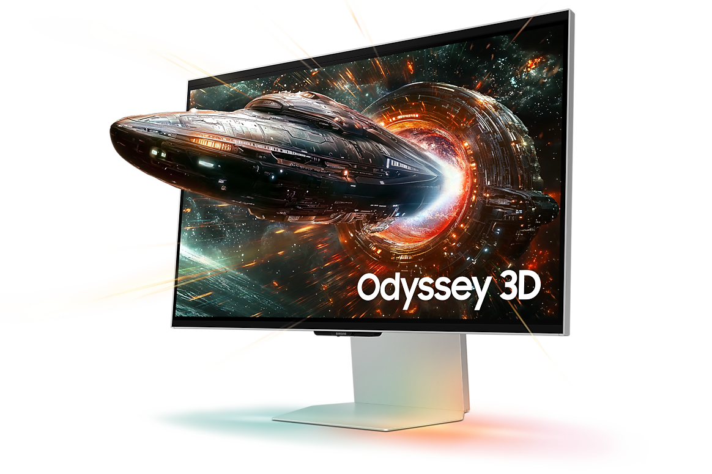
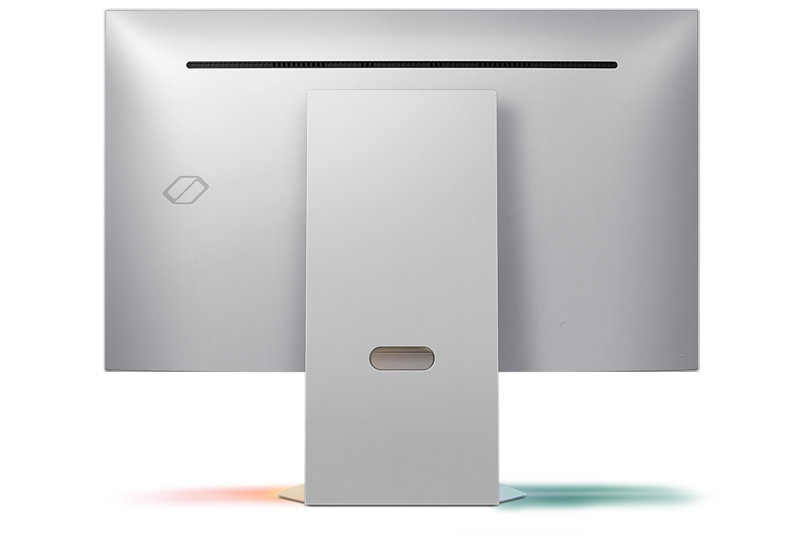
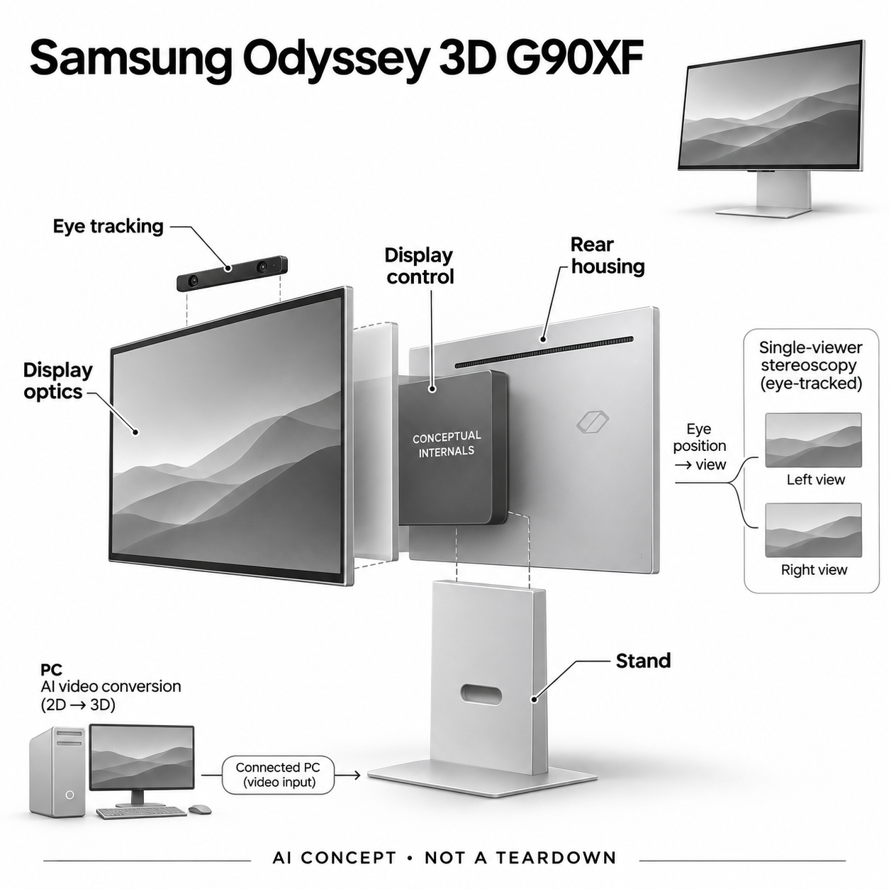

# Samsung Odyssey 3D G90XF（27英寸）

**Samsung** · 空间显示与交互 · 核查 2026-11-04

结合视点追踪与AI视频深度转换的个人裸眼立体显示器

消费渠道：个人零售。

## 产品图片与结构参考

### 产品图

G90XF 官方外观与3D宣传效果图（出屏物体为效果示意） · 来源：[Samsung · 官方资料](<https://www.samsung.com/uk/monitors/gaming/odyssey-3d-g90xf-27-inch-165hz-uhd-ls27fg900xuxxu/>) · [原始图片](<https://images.samsung.com/is/image/samsung/p6pim/uk/ls27fg900xuxxu/gallery/uk-odyssey-3d-g90xf-ls27fg900xuxxu-545403536?$1164_776_PNG$>)

### 参考图

Samsung Odyssey 3D G90XF（27英寸） 官方外观与使用参考图 · 来源：[Samsung · 官方资料](<https://www.samsung.com/uk/monitors/gaming/odyssey-3d-g90xf-27-inch-165hz-uhd-ls27fg900xuxxu/>) · [原始图片](<https://images.samsung.com/is/image/samsung/p6pim/uk/ls27fg900xuxxu/gallery/uk-odyssey-3d-g90xf-ls27fg900xuxxu-545403508?$1164_776_PNG$>)

### AI 生成爆炸示意

**AI 生成 · 非实物拆机。** 内部为概念推断，不能作为元件布局、BOM 或维修依据。[生成提示词](../../content/hardware/prompts/samsung-odyssey-3d-g90xf.txt)

> 以已目视核对的官方图片独立生成，未知内部为功能概念，不代表真实PCB、拆机或已采用供应商。

> 保留官方图片原貌；图片中的宣传数字和效果不作为本站实测。

> 分析为基于公开资料的案头研究与 AI 辅助判断，未经用户访谈、销量审计或实物拆机。需求、画像、竞争冷门度、审美及商业机会均为研究假设，不是投资结论。

## 销售与购买

- 状态：在售。核查日英国官方商店浏览器实际显示银色27英寸LS27FG900XUXXU、£1,499及启用的Add to basket。网页文本抓取的No longer available为隐藏状态模板，未据它断言停售。

- 地区：英国（本轮核实官方可购）

- 价格：英国官网£1,499。核查日实际UI价，回收折抵和支付优惠另计；地区税费、兼容电脑和游戏不包含在显示器售价中。

- 中国大陆：本轮核实英国官方型号；中国大陆官方库存、地区保修与软件分发条件未独立确认。电脑显卡和内容限制不会因跨境买到显示器而消失。

- [官方产品 / 商店](<https://www.samsung.com/uk/monitors/gaming/odyssey-3d-g90xf-27-inch-165hz-uhd-ls27fg900xuxxu/>)

## AI 的实际作用

AI分析二维视频并估计深度转成立体显示；摄像头跟踪观看者位置，视点映射调整左右眼画面。游戏3D支持清单与视频AI转换是不同功能。

服务与联网依赖：AI视频转换需电脑上的Odyssey 3D Hub、NVIDIA显卡及全屏内容，DRM或HDR条件不支持。官方说明一次一名观看者，脸部遮挡和大幅头动会影响效果，不是任意内容的共享全息屏。

## 是否冷门

细分专业（研究判断）：裸眼个人立体显示是明确窄场景，兼容内容、观看位置和成本限制显著，不能由高规格推断普遍显示器升级需求。

## 需求与市场

案头需求是在桌面观看视频或兼容游戏时获得不用眼镜的立体体验。AI负责把部分二维视频转为深度内容，显示硬件配合观看位置；需求应从用户愿看哪些内容开始，而不是只看新显示技术。

### 事实：任务边界 · 官方资料

G90XF将个人视点追踪与裸眼立体显示结合，官方还提供通过电脑软件把部分二维视频转换成三维观看的功能。产品并非因为更高刷新率而收录，本条任务是在普通桌面位置观看具有深度的动态内容，并区分兼容游戏与AI视频转换两种流程。

依据：[Samsung英国G90XF官方商店](<https://www.samsung.com/uk/monitors/gaming/odyssey-3d-g90xf-27-inch-165hz-uhd-ls27fg900xuxxu/>) · [Samsung G90XF官方3D使用说明](<https://www.samsung.com/uk/support/displays/how-to-use-3d-on-the-odyssey-3d-gaming-monitor/>)

### 判断：真实需求 · 研究判断

需求判断应先问用户真正想看什么：已有立体内容、普通视频的深度转换或特定支持游戏，对设备的意义不相同。若常看的是受保护流媒体，宣传中能转视频并不一定对应其日常内容；没有合适素材时，再好的显示硬件也可能只被当作普通屏。

依据：[Samsung英国G90XF官方商店](<https://www.samsung.com/uk/monitors/gaming/odyssey-3d-g90xf-27-inch-165hz-uhd-ls27fg900xuxxu/>) · [Samsung G90XF官方3D使用说明](<https://www.samsung.com/uk/support/displays/how-to-use-3d-on-the-odyssey-3d-gaming-monitor/>)

### 验证：任务完成 · 待验证

调研可让用户带来常用视频和游戏清单，逐项尝试并记录成功、受限及需要改设置的情况。访谈问立体效果在哪种内容上值得保留、什么时候主动关掉，以及若只用二维显示还愿不愿购买，避免只用厂家演示片刺激购买意愿。

依据：[Samsung英国G90XF官方商店](<https://www.samsung.com/uk/monitors/gaming/odyssey-3d-g90xf-27-inch-165hz-uhd-ls27fg900xuxxu/>) · [Samsung G90XF官方3D使用说明](<https://www.samsung.com/uk/support/displays/how-to-use-3d-on-the-odyssey-3d-gaming-monitor/>)

## 用户画像

适合已有兼容电脑、愿意调整软件与观看位置的个人立体影像爱好者。多人一起看、普通办公或Mac用户的任务不同；它不是只接任意视频源就自动适配所有人的显示器。

### 事实：使用条件 · 官方资料

官方说明三维效果一次只面向一名观看者，需要摄像头看见面部，并尽量保持合适位置；AI视频转换还要求兼容的电脑显卡及软件。它是个人桌面观看设备，不能由屏幕尺寸推断全家坐在不同位置也能得到相同立体效果。

依据：[Samsung英国G90XF官方商店](<https://www.samsung.com/uk/monitors/gaming/odyssey-3d-g90xf-27-inch-165hz-uhd-ls27fg900xuxxu/>) · [Samsung G90XF官方3D使用说明](<https://www.samsung.com/uk/support/displays/how-to-use-3d-on-the-odyssey-3d-gaming-monitor/>)

### 判断：人群筛选 · 研究判断

潜在用户是愿意调整环境与软件的立体影像爱好者，或已经拥有适配电脑的玩家。多人观看、轻办公和其它电脑平台用户有不同需求，不能把能够接入普通显示信号的兼容性扩大到三维功能；购买者可能还需要承担整套电脑条件。

依据：[Samsung英国G90XF官方商店](<https://www.samsung.com/uk/monitors/gaming/odyssey-3d-g90xf-27-inch-165hz-uhd-ls27fg900xuxxu/>) · [Samsung G90XF官方3D使用说明](<https://www.samsung.com/uk/support/displays/how-to-use-3d-on-the-odyssey-3d-gaming-monitor/>)

### 验证：参与者差异 · 待验证

招募应记录真实桌面距离、座椅姿势、眼镜使用习惯和常用电脑，观察用户是否能自行找到稳定观看位置。访谈可问愿不愿意为立体效果改变坐姿、是否经常与别人分享屏幕，以及在移动头部后能否理解效果变化，而非只调查显卡规格。

依据：[Samsung英国G90XF官方商店](<https://www.samsung.com/uk/monitors/gaming/odyssey-3d-g90xf-27-inch-165hz-uhd-ls27fg900xuxxu/>) · [Samsung G90XF官方3D使用说明](<https://www.samsung.com/uk/support/displays/how-to-use-3d-on-the-odyssey-3d-gaming-monitor/>)

## 竞争与替代

替代包括普通显示器、头戴VR、立体眼镜方案与多视图光场屏。此条区别是单个观看者的动态内容和视点适配，不把普通显示器的尺寸、刷新率或同系列规格变化当新需求。

### 事实：方案范围 · 官方资料

替代方案包括普通平面屏、佩戴立体眼镜、头戴VR和多视图光场陈列屏，虽然都涉及深度感，输出任务并不相同。目录将G90XF作为单人动态观看代表，不继续按显示器尺寸、分辨率或同系列代次补条目，也不把它与照片陈列屏等同。

依据：[Samsung英国G90XF官方商店](<https://www.samsung.com/uk/monitors/gaming/odyssey-3d-g90xf-27-inch-165hz-uhd-ls27fg900xuxxu/>) · [Samsung G90XF官方3D使用说明](<https://www.samsung.com/uk/support/displays/how-to-use-3d-on-the-odyssey-3d-gaming-monitor/>)

### 判断：替代关系 · 研究判断

眼追踪路线可以围绕个人位置调整左右眼视图，但也引入摄像感知与位置约束；多视图光场则服务不同方向观看，常见用途可能偏内容展示。哪一种更有价值取决于用户需要沉浸观看、互动游戏还是共享作品，不能只按都有裸眼三维来排序。

依据：[Samsung英国G90XF官方商店](<https://www.samsung.com/uk/monitors/gaming/odyssey-3d-g90xf-27-inch-165hz-uhd-ls27fg900xuxxu/>) · [Samsung G90XF官方3D使用说明](<https://www.samsung.com/uk/support/displays/how-to-use-3d-on-the-odyssey-3d-gaming-monitor/>)

### 验证：比较方法 · 待验证

对照应给不同方案适合各自条件但内容目标相同的任务，记录佩戴负担、坐姿限制、清晰度观感和切换设置。尤其要把原生立体内容与AI转出的深度分开评价，避免把转换质量差异误归于显示硬件，或用单人体验推断多人场景。

依据：[Samsung英国G90XF官方商店](<https://www.samsung.com/uk/monitors/gaming/odyssey-3d-g90xf-27-inch-165hz-uhd-ls27fg900xuxxu/>) · [Samsung G90XF官方3D使用说明](<https://www.samsung.com/uk/support/displays/how-to-use-3d-on-the-odyssey-3d-gaming-monitor/>)

## 供应链

功能链包含显示与视图光学、顶部追踪摄像、控制供电和支架，AI视频处理还需要外部电脑。具体面板、光学结构和制造供应关系未公开，本轮只列能力候选，不猜真实内部层叠。

### 事实：功能组成 · 官方资料

已核官方材料披露显示器、顶部追踪摄像、输入控制、供电和支架等功能，视频AI处理需要连接电脑的软件工作流。具体面板供应商、光学层结构和内部主控没有在本轮来源中点名，因此概念图只展示抽象功能层，不能当作真实层叠或拆机说明。

依据：[Samsung英国G90XF官方商店](<https://www.samsung.com/uk/monitors/gaming/odyssey-3d-g90xf-27-inch-165hz-uhd-ls27fg900xuxxu/>) · [Samsung G90XF官方3D使用说明](<https://www.samsung.com/uk/support/displays/how-to-use-3d-on-the-odyssey-3d-gaming-monitor/>)

### 判断：交付约束 · 研究判断

工程判断是追踪结果、视图映射与显示时序必须共同保持稳定，任何延迟或位置误差都可能影响深度观感。与普通显示器不同，摄像安装角度、桌面姿势和光学标定也是交付条件；仅找到同尺寸面板无法复制其裸眼效果与用户体验。

依据：[Samsung英国G90XF官方商店](<https://www.samsung.com/uk/monitors/gaming/odyssey-3d-g90xf-27-inch-165hz-uhd-ls27fg900xuxxu/>) · [Samsung G90XF官方3D使用说明](<https://www.samsung.com/uk/support/displays/how-to-use-3d-on-the-odyssey-3d-gaming-monitor/>)

### 验证：选型缺口 · 待验证

群光可作为窄边框和立体视觉相机模组能力候选，Protolabs可作为支架及机壳结构样件候选。相机仍需匹配追踪算法和光学位置，结构也需验证稳定性；两家公司都没有被证明实际供货，不能据能力目录推断Samsung内部方案。

依据：[Samsung英国G90XF官方商店](<https://www.samsung.com/uk/monitors/gaming/odyssey-3d-g90xf-27-inch-165hz-uhd-ls27fg900xuxxu/>) · [Samsung G90XF官方3D使用说明](<https://www.samsung.com/uk/support/displays/how-to-use-3d-on-the-odyssey-3d-gaming-monitor/>)

## 技术路径

官方支持说明以眼追踪和视点映射实现立体，视频转换依赖特定显卡与Hub。AI生成的深度不是现场真实测距；游戏清单也不能被理解成任意游戏都可一键AI转3D。

### 事实：AI机制 · 官方资料

官方支持把眼追踪和视点映射解释为裸眼三维的基础，而商品页明确二维视频的AI转换需要Odyssey 3D Hub、指定显卡类型及全屏播放。HDR和受保护内容存在限制，兼容游戏另有清单；不能把一类视频转换能力泛化成所有游戏和信号源。

依据：[Samsung英国G90XF官方商店](<https://www.samsung.com/uk/monitors/gaming/odyssey-3d-g90xf-27-inch-165hz-uhd-ls27fg900xuxxu/>) · [Samsung G90XF官方3D使用说明](<https://www.samsung.com/uk/support/displays/how-to-use-3d-on-the-odyssey-3d-gaming-monitor/>)

### 判断：系统边界 · 研究判断

AI从二维内容产生的深度属于推断，与在拍摄时记录真实双目或深度数据不同。场景切换、细小前景与遮挡可能需要专门观察，公开资料没有给出这些内容类型的独立误差分布；显示出深度感并不能证明画面几何关系完全正确。

依据：[Samsung英国G90XF官方商店](<https://www.samsung.com/uk/monitors/gaming/odyssey-3d-g90xf-27-inch-165hz-uhd-ls27fg900xuxxu/>) · [Samsung G90XF官方3D使用说明](<https://www.samsung.com/uk/support/displays/how-to-use-3d-on-the-odyssey-3d-gaming-monitor/>)

### 验证：算法与体验 · 待验证

验证时可分别检查人物边缘、字幕、快速切镜和大幅运动，记录用户看到的断层或不自然深度，并同时测试头部移动后的恢复。把AI转换、眼追踪和显示效果拆开分析，才可能定位问题；本轮没有连续观看实测，不报告舒适度或转换准确率。

依据：[Samsung英国G90XF官方商店](<https://www.samsung.com/uk/monitors/gaming/odyssey-3d-g90xf-27-inch-165hz-uhd-ls27fg900xuxxu/>) · [Samsung G90XF官方3D使用说明](<https://www.samsung.com/uk/support/displays/how-to-use-3d-on-the-odyssey-3d-gaming-monitor/>)

## 产品审美

薄边框、银色背板和宽支撑保留普通桌面显示器外形，但观看姿态更受约束。主图飞船出屏是厂商效果示意，概念图会去除这种宣传画面，避免暗示有真实物体投影到空气中。

### 事实：外观与交互 · 官方资料

实际产品保持普通宽屏显示器的薄边框、银色背板和宽支撑形态，官方主图用飞船伸出屏幕来表达立体效果。那是宣传视觉示意，不是设备向空气投射真实物体；本次概念图采用屏幕内的普通几何图像，避免把效果画成物理悬浮投影。

依据：[Samsung英国G90XF官方商店](<https://www.samsung.com/uk/monitors/gaming/odyssey-3d-g90xf-27-inch-165hz-uhd-ls27fg900xuxxu/>) · [Samsung G90XF官方3D使用说明](<https://www.samsung.com/uk/support/displays/how-to-use-3d-on-the-odyssey-3d-gaming-monitor/>)

### 判断：使用中的形态 · 研究判断

外形像普通屏可能降低摆放门槛，但使用者的头部位置和摄像头视线更重要。宽支架与桌面物品、灯光和摄像位置的关系需要实地观察；视觉上简洁并不能证明适合随意斜坐、与人共享或频繁改变坐姿的日常桌面习惯。

依据：[Samsung英国G90XF官方商店](<https://www.samsung.com/uk/monitors/gaming/odyssey-3d-g90xf-27-inch-165hz-uhd-ls27fg900xuxxu/>) · [Samsung G90XF官方3D使用说明](<https://www.samsung.com/uk/support/displays/how-to-use-3d-on-the-odyssey-3d-gaming-monitor/>)

### 验证：日常接受度 · 待验证

可让参与者在自己的桌面摆放设备并自然使用，记录是否挡住追踪区域、是否习惯靠近或离开，以及效果变化时会如何调整。访谈问他们更愿意改变桌面布置还是放弃立体，评价应包含使用姿势和状态提示，而非只评价背板是否好看。

依据：[Samsung英国G90XF官方商店](<https://www.samsung.com/uk/monitors/gaming/odyssey-3d-g90xf-27-inch-165hz-uhd-ls27fg900xuxxu/>) · [Samsung G90XF官方3D使用说明](<https://www.samsung.com/uk/support/displays/how-to-use-3d-on-the-odyssey-3d-gaming-monitor/>)

## 关键风险

风险是内容限制、显卡成本与观看不适，且单人视点不能自然覆盖多人。应核对目标游戏和视频能否工作，不能用兼容少数演示内容的结果推断所有平台与流媒体都可用。

### 事实：已知限制 · 官方资料

官方提示部分人可能出现观看不适并应停止休息，且三维模式不兼容全部游戏和视频条件。英国商品页当前价格与购买状态已用浏览器核查，抓取文本中的隐藏停售模板没有被当成事实；其它地区现货与保修仍需分别确认。

依据：[Samsung英国G90XF官方商店](<https://www.samsung.com/uk/monitors/gaming/odyssey-3d-g90xf-27-inch-165hz-uhd-ls27fg900xuxxu/>) · [Samsung G90XF官方3D使用说明](<https://www.samsung.com/uk/support/displays/how-to-use-3d-on-the-odyssey-3d-gaming-monitor/>)

### 判断：失效影响 · 研究判断

主要风险是用户为了一个演示效果买下整套条件，却发现日常内容受限，或者把头部位置引起的变化误认为硬件坏了。AI深度转换和眼追踪也可能在不同内容及光线下表现不同；本轮没有故障率与长期体验样本，不把这些可能性写成已证实缺陷。

依据：[Samsung英国G90XF官方商店](<https://www.samsung.com/uk/monitors/gaming/odyssey-3d-g90xf-27-inch-165hz-uhd-ls27fg900xuxxu/>) · [Samsung G90XF官方3D使用说明](<https://www.samsung.com/uk/support/displays/how-to-use-3d-on-the-odyssey-3d-gaming-monitor/>)

### 验证：风险处理 · 待验证

试用应优先覆盖用户真实内容、正常坐姿和较长观看过程，记录主动切回二维或休息的原因。采购前核对显卡、系统、Hub与内容条件，将素材限制和设备故障分开排查；也不要把一次短时演示外推成每个人长时间观看都同样舒适。

依据：[Samsung英国G90XF官方商店](<https://www.samsung.com/uk/monitors/gaming/odyssey-3d-g90xf-27-inch-165hz-uhd-ls27fg900xuxxu/>) · [Samsung G90XF官方3D使用说明](<https://www.samsung.com/uk/support/displays/how-to-use-3d-on-the-odyssey-3d-gaming-monitor/>)

## 机会与验证

可验证机会在特定立体视频爱好和桌面体验。让用户用自己常看的非受限内容连续体验，记录设置、头部位置丢失和主动切回2D的原因，再比较是否值得承担软件与硬件条件。

### 判断：可尝试切口 · 研究判断

可研究的切口是为明确的个人立体内容爱好者提供可预先验证的兼容清单和试看片段，让用户先知道自己的素材能否获得有意义的深度。若主要障碍是内容支持，持续软件适配可能比再提升刷新率更能增加使用价值；这仍需实际行为证据。

依据：[Samsung英国G90XF官方商店](<https://www.samsung.com/uk/monitors/gaming/odyssey-3d-g90xf-27-inch-165hz-uhd-ls27fg900xuxxu/>) · [Samsung G90XF官方3D使用说明](<https://www.samsung.com/uk/support/displays/how-to-use-3d-on-the-odyssey-3d-gaming-monitor/>)

### 判断：商业边界 · 研究判断

商业边界在于它服务的不是所有购买显示器的人。具备适配电脑、喜欢立体效果并接受位置限制的用户交集可能较窄，本轮没有市场份额或访谈规模资料；不能将普通游戏显示器销量作为这个具体功能的潜在成交数量。

依据：[Samsung英国G90XF官方商店](<https://www.samsung.com/uk/monitors/gaming/odyssey-3d-g90xf-27-inch-165hz-uhd-ls27fg900xuxxu/>) · [Samsung G90XF官方3D使用说明](<https://www.samsung.com/uk/support/displays/how-to-use-3d-on-the-odyssey-3d-gaming-monitor/>)

### 验证：下一步调研 · 待验证

下一步可让少量用户连续一周记录二维与三维使用时长、内容失败和放弃原因，再询问是否愿意单独为三维功能付费。将真实兼容、观看行为和价格选择分开分析，不用AI创新评分或厂商最高规格预测该显示形态的商业成功。

依据：[Samsung英国G90XF官方商店](<https://www.samsung.com/uk/monitors/gaming/odyssey-3d-g90xf-27-inch-165hz-uhd-ls27fg900xuxxu/>) · [Samsung G90XF官方3D使用说明](<https://www.samsung.com/uk/support/displays/how-to-use-3d-on-the-odyssey-3d-gaming-monitor/>)

## 对应供应链公司

能力候选用于选型研究，不代表本产品实际采用；未公开的供货关系不作推断。

- [chicony](../supply-chain/chicony.md) — **能力候选 · 非已采用** / 窄边框观看位置采集模组候选：G90XF需要顶部摄像输入支撑眼部与观看位置跟踪，群光公开窄边框、红外和深度相关相机模组能力，可作为感知子系统候选。实际光路、接口和算法标定仍需匹配，没有证据显示该型号采用群光，不能把候选当作供货披露。

- [protolabs](../supply-chain/protolabs.md) — **能力候选 · 非已采用** / 显示器支架与机身结构原型候选：个人视点显示需要稳定的机身和支撑，Protolabs公开机加工、钣金及结构原型能力，可作为支架与外壳样件候选。承载、重心、调节和摄像位置仍须专门测试，其加工能力不涵盖完整裸眼光学方案，也未披露为Samsung本机供货。

[浏览供应链目录](../supply-chain.md)

## 功能分层示意

这是功能关系，不是实物拆机、真实空间结构或已核实 BOM。

1. **观看位置感知**：顶部摄像头追踪个人观看位置，需面部在可见范围。（官方披露）

2. **视图显示**：显示与光学系统按视点映射提供左右眼不同画面。（官方披露）

3. **外部AI转换**：兼容电脑和Odyssey 3D Hub处理二维视频深度转换，不视为机内独立AI。（官方披露）

4. **机身控制**：输入、控制和电源配合显示，内部布局未公开。（官方披露）

5. **支撑与边界**：银色支架与机身支持桌面摆放；官方说明一次只能一人获得3D效果。（官方披露）

## 来源

1. [Samsung英国G90XF官方商店](<https://www.samsung.com/uk/monitors/gaming/odyssey-3d-g90xf-27-inch-165hz-uhd-ls27fg900xuxxu/>) — 实际web和浏览器打开；1499英镑购买、视频AI转换、HDR/DRM及显卡限制。

2. [Samsung G90XF官方3D使用说明](<https://www.samsung.com/uk/support/displays/how-to-use-3d-on-the-odyssey-3d-gaming-monitor/>) — 实际打开；眼追踪、视点映射、Hub安装、NVIDIA转换、单人及观看位置限制。

3. [Samsung G90XF型号支持页](<https://www.samsung.com/uk/support/model/LS27FG900XUXXU/>) — 实际打开；型号专属支持和3D功能指南入口，不沿用其它显示器通用功能。

[返回目录](../hardware-market.md) · [网页分析](https://romanagent.github.io/Roman/#hardware/product/samsung-odyssey-3d-g90xf)
