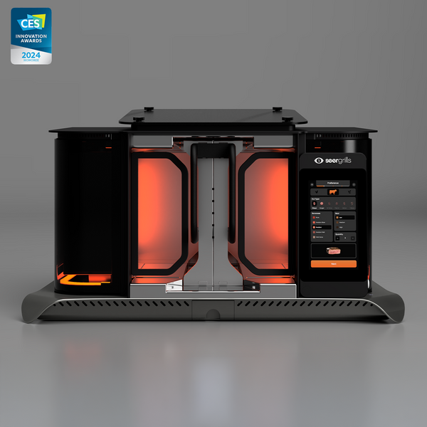
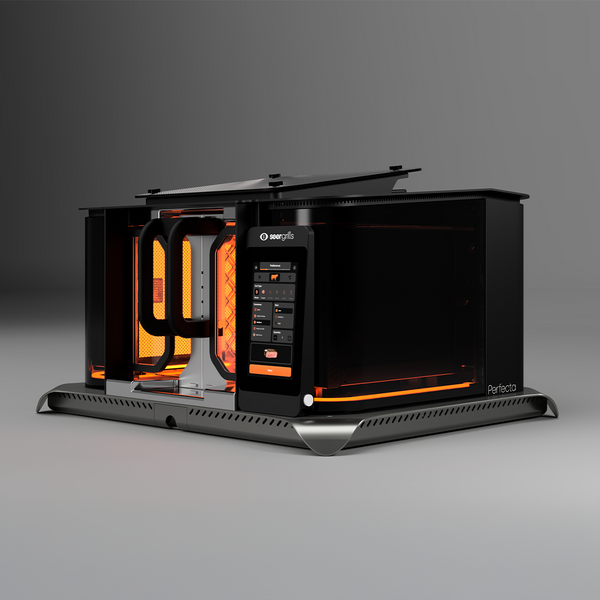
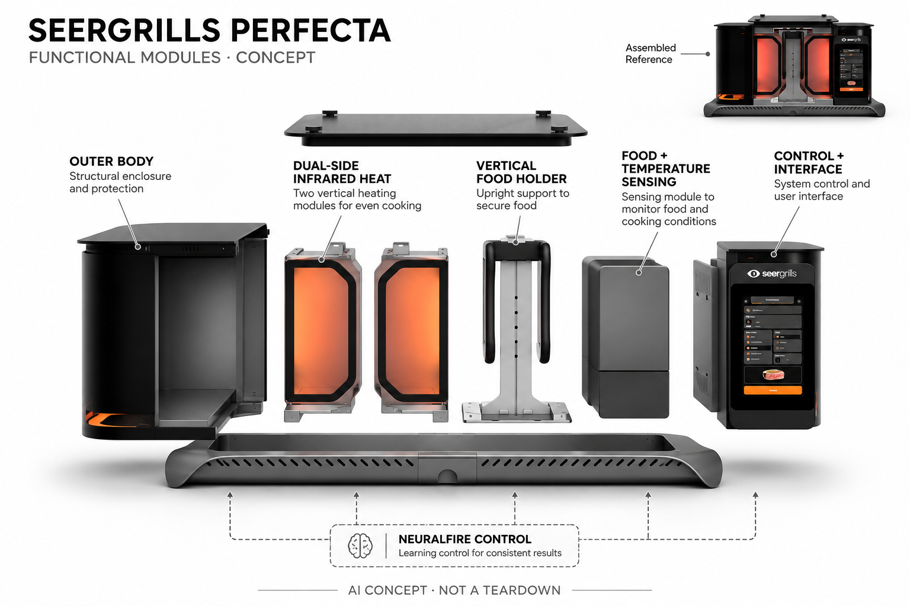

# SEERGRILLS Perfecta

**SEERGRILLS** · 厨房与食物管理 · 核查 2026-11-04

以双侧垂直红外加热和学习控制处理食材表面焦化与熟度

消费渠道：消费预订。

## 产品图片与结构参考

### 产品图

官方Perfecta前视图 · 来源：[SEERGRILLS · 官方图片](<https://seergrills.com/products/perfecta-bundles>) · [原始图片](<https://seergrills.com/cdn/shop/files/Artboard1_600x600.png?v=1746624300>)

### 参考图

官方Perfecta侧前视角 · 来源：[SEERGRILLS · 官方图片](<https://seergrills.com/products/perfecta-bundles>) · [原始图片](<https://seergrills.com/cdn/shop/files/Artboard1-1_600x.png?v=1746624300>)

### AI 生成爆炸示意

**AI 生成 · 非实物拆机。** 内部为概念推断，不能作为元件布局、BOM 或维修依据。[生成提示词](../../content/hardware/prompts/seergrills-perfecta.txt)

> 实际查看并核对当前型号；官方原图未改色或语义编辑，宣传文字不作为独立实测。

> 分析为基于公开资料的案头研究与 AI 辅助判断，未经用户访谈、销量审计或实物拆机。需求、画像、竞争冷门度、审美及商业机会均为研究假设，不是投资结论。

## 销售与购买

- 状态：预售 / 接受延期订单。官方整机US$5999可Add To Cart，页面写Now Shipping、英国按单组装，预计2026年11月发货；条款允许早期批次预订单且交期非保证，本条保守列预售。

- 地区：美国

- 价格：整机 US$5,999。选择基础Perfecta含VertiGrate，不将附加支架或套装作为新品；按单组装、运费与实际交期按结算，尚未发货可依官方条款取消。

- 中国大陆：2026-03-12官方配送条款明确当前仅美国，阿拉斯加、夏威夷等另行安排；未开放中国大陆官方配送。

- [官方产品 / 商店](<https://seergrills.com/products/perfecta-bundles>)

## AI 的实际作用

NeuralFire官方描述强化学习结合食物及环境信号调整烤制过程；双侧垂直红外燃烧器执行加热，不应将未来披萨或旋转烤附件算作已交付。

服务与联网依赖：需要丙烷燃气和户外适配供电、操作场地；应用更新与部分功能依赖连接，型号能力与批次须核对。

## 是否冷门

细分专业（研究判断）：高端家庭红外自动烤制是窄场景，执行机制与普通烤架明显不同；价格、燃气场地及早期交付限制受众，不视为已验证蓝海。

## 需求与市场

需求假设：家庭户外烹饪爱好者希望更少翻面和观察，同时重复获得自己偏好的表面与熟度。垂直夹持和双侧加热改变操作流程，但装夹、预热、清洁与成品复核仍存在，不能把宣传秒数视为所有食材和全部步骤的实际完成时间。

### 产品任务与边界 · 研究判断

需求假设：家庭户外烹饪爱好者希望更少翻面和观察，同时重复获得自己偏好的表面与熟度。垂直夹持和双侧加热改变操作流程，但装夹、预热、清洁与成品复核仍存在，不能把宣传秒数视为所有食材和全部步骤的实际完成时间。

依据：[Perfecta官方当前订购页](<https://seergrills.com/products/perfecta-bundles>) · [SEERGRILLS NeuralFire官方介绍](<https://seergrills.com/>)

### 需求判断 · 研究判断

垂直夹持让食物两侧同时受热，可以减少翻面动作和看守节奏，但准备、放入、取出与清洗不会消失。用户真正需要的可能是稳定复现某种熟度，而不是最快烤制；需求应包含多人用餐的出餐组织，不以宣传中最短时间代表完整做饭周期。

依据：[Perfecta官方当前订购页](<https://seergrills.com/products/perfecta-bundles>) · [SEERGRILLS NeuralFire官方介绍](<https://seergrills.com/>)

### 需求验证 · 待验证

需求验证可在符合官方场地与食材条件的正常使用中记录准备、烤制、复核和清洁，与已有烤具比较。食品与燃气安全需要专业要求，本目录不提出危险极限测试，也不把发布演示、品尝评价或单次理想结果当成所有家庭的可重复收益。

依据：[Perfecta官方当前订购页](<https://seergrills.com/products/perfecta-bundles>) · [SEERGRILLS NeuralFire官方介绍](<https://seergrills.com/>)

## 用户画像

画像推断：有合适户外燃气烹饪条件、频繁处理适配食材并接受高价早期设备的人更匹配。公寓、偶尔使用与习惯手工烤制的人需要不同，用户仍需确认食品和设备安全，不能只按喜欢牛排或收入推定购买需求。

### 适用行为与条件 · 研究判断

画像推断：有合适户外燃气烹饪条件、频繁处理适配食材并接受高价早期设备的人更匹配。公寓、偶尔使用与习惯手工烤制的人需要不同，用户仍需确认食品和设备安全，不能只按喜欢牛排或收入推定购买需求。

依据：[Perfecta官方当前订购页](<https://seergrills.com/products/perfecta-bundles>) · [SEERGRILLS NeuralFire官方介绍](<https://seergrills.com/>)

### 人群取舍 · 研究判断

有合适户外空间、接受丙烷和外接电源、经常处理适配食材的人与偶尔聚会者需求不同。高售价还意味着用户对支持和维修有更高期待，画像应包含能源条件、清洁责任和早期产品接受度，不按收入或喜欢牛排就推定设备匹配。

依据：[Perfecta官方当前订购页](<https://seergrills.com/products/perfecta-bundles>) · [SEERGRILLS NeuralFire官方介绍](<https://seergrills.com/>)

### 画像验证 · 待验证

画像验证应记录原有烹饪频次、通常人数、愿意交给机器的步骤和场地限制，再确认使用说明能否被理解。对公寓、狭小庭院或偏好手工控制的人明确保留不匹配，不把昂贵设备的拥有兴趣等同愿意承担安装、存放与持续维护劳动。

依据：[Perfecta官方当前订购页](<https://seergrills.com/products/perfecta-bundles>) · [SEERGRILLS NeuralFire官方介绍](<https://seergrills.com/>)

## 竞争与替代

竞争判断：与传统燃气烤架、红外炉和人工测温竞争，差异是垂直双侧执行和学习火候。与Brisk It的烤箱或颗粒烟熏不是单纯代次替换，但套装和未来附件不新增产品；应比较完整准备、成品与维护，而非仅看最快出炉时间。

### 比较对象与差异 · 研究判断

竞争判断：与传统燃气烤架、红外炉和人工测温竞争，差异是垂直双侧执行和学习火候。与Brisk It的烤箱或颗粒烟熏不是单纯代次替换，但套装和未来附件不新增产品；应比较完整准备、成品与维护，而非仅看最快出炉时间。

依据：[Perfecta官方当前订购页](<https://seergrills.com/products/perfecta-bundles>) · [SEERGRILLS NeuralFire官方介绍](<https://seergrills.com/>)

### 竞争判断 · 研究判断

传统烤架需要翻面和观察，红外炉也可提供高热，但Perfecta把双侧执行与学习控制整合到特定夹持方式。与烟熏炉或烤箱比较时应对齐任务而不是全部菜谱，设备覆盖面尚有限，更多未来附件不能提前算成已经拥有的功能优势。

依据：[Perfecta官方当前订购页](<https://seergrills.com/products/perfecta-bundles>) · [SEERGRILLS NeuralFire官方介绍](<https://seergrills.com/>)

### 竞争验证 · 待验证

竞争验证可选相同适配食材和最终要求，比较人工参与、结果一致与清洁，独立记录自动控制的增量。基础整机、Plus及GrillMaster套装只代表配件组合，不能扩成多种创新；也不拿厂家最快样例与传统方法完整准备时间作不公平比较。

依据：[Perfecta官方当前订购页](<https://seergrills.com/products/perfecta-bundles>) · [SEERGRILLS NeuralFire官方介绍](<https://seergrills.com/>)

## 供应链

供应链分析：耐热壳体、食物夹架、红外燃烧、燃气控制、温度感知与计算交互协同，完整BOM和部件供应商未披露。官网明确英国按单组装，仅能确认组装声明；不能推定全部零件英国制造或把控制主板成本当整机成本。

### 功能模块拆分 · 研究判断

食物夹架、耐热外壳、双侧红外燃烧、温度及食物信号、控制界面、电源和燃气接口共同构成系统。热、油脂与清洁会反复作用到结构和电子边界，公开材料仅支持功能拆分；概念图不应提供未经确认的气路、阀门或点火电路布局。

依据：[Perfecta官方当前订购页](<https://seergrills.com/products/perfecta-bundles>) · [SEERGRILLS NeuralFire官方介绍](<https://seergrills.com/>)

### 制造与供应约束 · 研究判断

供应链分析：耐热壳体、食物夹架、红外燃烧、燃气控制、温度感知与计算交互协同，完整BOM和部件供应商未披露。官网明确英国按单组装，仅能确认组装声明；不能推定全部零件英国制造或把控制主板成本当整机成本。

依据：[Perfecta官方当前订购页](<https://seergrills.com/products/perfecta-bundles>) · [SEERGRILLS NeuralFire官方介绍](<https://seergrills.com/>)

### 候选与证据缺口 · 研究判断

捷普可作为控制电子与整机导入候选，Protolabs可评估壳体和夹架的原型及装配，两者没有Perfecta点名采用证据。高温、燃气及食品接触要求需专项工程和验证，通用加工能力不能直接证明满足要求；英国组装声明也不揭示所有部件产地。

依据：[Perfecta官方当前订购页](<https://seergrills.com/products/perfecta-bundles>) · [SEERGRILLS NeuralFire官方介绍](<https://seergrills.com/>)

## 技术路径

技术判断：官方明确强化学习和食物环境传感作为NeuralFire组成，模型训练与独立性能未完整公开。加热控制与食品安全需分开验证，未来模式仍有限制，不能把宣传最佳结果、全部食物类型或尚未发货附件写成现售能力。

### 已披露技术边界 · 研究判断

技术判断：官方明确强化学习和食物环境传感作为NeuralFire组成，模型训练与独立性能未完整公开。加热控制与食品安全需分开验证，未来模式仍有限制，不能把宣传最佳结果、全部食物类型或尚未发货附件写成现售能力。

依据：[Perfecta官方当前订购页](<https://seergrills.com/products/perfecta-bundles>) · [SEERGRILLS NeuralFire官方介绍](<https://seergrills.com/>)

### 系统难点判断 · 研究判断

强化学习与传感输入描述了控制路线，但公开没有完整训练方法或每种食材的可靠边界。偏好输入还涉及表面焦化与内部状态的权衡，模型不能替代食品安全判断；页面将部分披萨、烤箱或旋转模式列为未来能力，必须与当前交付分开。

依据：[Perfecta官方当前订购页](<https://seergrills.com/products/perfecta-bundles>) · [SEERGRILLS NeuralFire官方介绍](<https://seergrills.com/>)

### 技术验证 · 待验证

技术验证应锁定实际软件版本、允许食材和操作条件，记录传感异常、手动停止与偏好调整，必要时由合适专业方式复核结果。不能以自动结束或触屏显示完成推定全部食物都安全，也不通过改造燃气或绕过保护来验证机器学习效果。

依据：[Perfecta官方当前订购页](<https://seergrills.com/products/perfecta-bundles>) · [SEERGRILLS NeuralFire官方介绍](<https://seergrills.com/>)

## 产品审美

审美判断：台面式宽体金属外壳和垂直食物架强调厨房工具属性，控制屏帮助选择偏好。真正使用中油脂、夹架拆洗、燃气软管和户外摆位影响观感，不能只看光洁产品图，也不应用炫目火焰替代清楚的操作状态。

### 外观与交互语言 · 研究判断

审美判断：台面式宽体金属外壳和垂直食物架强调厨房工具属性，控制屏帮助选择偏好。真正使用中油脂、夹架拆洗、燃气软管和户外摆位影响观感，不能只看光洁产品图，也不应用炫目火焰替代清楚的操作状态。

依据：[Perfecta官方当前订购页](<https://seergrills.com/products/perfecta-bundles>) · [SEERGRILLS NeuralFire官方介绍](<https://seergrills.com/>)

### 使用中审美判断 · 研究判断

宽体炉身、中央竖架和右侧屏幕让操作任务容易识别，也形成明显工具体量。官方图中的高亮加热区是功能表达，概念图保持克制避免制造科幻效果；真实家居审美更取决于油脂清洁、食物架收纳和燃气线缆，而非宣传中光洁金属表面。

依据：[Perfecta官方当前订购页](<https://seergrills.com/products/perfecta-bundles>) · [SEERGRILLS NeuralFire官方介绍](<https://seergrills.com/>)

### 设计验证 · 待验证

设计验证可观察用户是否清楚放架、取架、暂停和清理顺序，记录不同体型用户的可达性及必要安全空间。先保留完整真实外形，再评价是否适合家庭台面或户外支架；不能为了简洁隐藏能源接口，也不把屏幕指引当作所有风险已被解决。

依据：[Perfecta官方当前订购页](<https://seergrills.com/products/perfecta-bundles>) · [SEERGRILLS NeuralFire官方介绍](<https://seergrills.com/>)

## 关键风险

风险判断：高热、燃气、食材厚度与装夹条件要求严格遵循说明，AI不能保证任何食物自动达到安全状态。按单组装交期可能变化，部分模式待更新；目录不提供绕过保护或危险烤制实验，地区配送和服务也不能从发布会推定。

### 主要失效与依赖 · 研究判断

风险判断：高热、燃气、食材厚度与装夹条件要求严格遵循说明，AI不能保证任何食物自动达到安全状态。按单组装交期可能变化，部分模式待更新；目录不提供绕过保护或危险烤制实验，地区配送和服务也不能从发布会推定。

依据：[Perfecta官方当前订购页](<https://seergrills.com/products/perfecta-bundles>) · [SEERGRILLS NeuralFire官方介绍](<https://seergrills.com/>) · [Perfecta官方配送与预订条款](<https://seergrills.com/pages/shipping-and-returns-policy>)

### 风险传播判断 · 研究判断

高温、燃气与食材条件会放大控制失误后果，用户仍须遵循正常安全要求并复核结果。按单组装意味着交付时间可能变化，已开始部分出货也不等于当前订单立即有现货；未来模式与附件的宣传若未区分，会造成用户对范围和费用的误解。

依据：[Perfecta官方当前订购页](<https://seergrills.com/products/perfecta-bundles>) · [SEERGRILLS NeuralFire官方介绍](<https://seergrills.com/>) · [Perfecta官方配送与预订条款](<https://seergrills.com/pages/shipping-and-returns-policy>)

### 风险验证 · 待验证

风险验证应先核对地区、预计交付、退款和实际功能清单，再检查停止与维护说明，不开展危险自行测试。仅美国配送是当前条款边界，不应把英国组装地点解释成欧洲消费者都可直接购买；AI和厂家性能词也不能成为食品安全保证。

依据：[Perfecta官方当前订购页](<https://seergrills.com/products/perfecta-bundles>) · [SEERGRILLS NeuralFire官方介绍](<https://seergrills.com/>) · [Perfecta官方配送与预订条款](<https://seergrills.com/pages/shipping-and-returns-policy>)

## 机会与验证

机会假设：可从高频而可重复的食材任务验证成品一致和人工观察减少，再判断学习模型的增量。若清洁和准备抵消节省，传统烤具更合适；应依据实际使用和批次稳定性判断，不以最快烤制宣传或高价定位直接推算市场空间。

### 可能的机会入口 · 研究判断

机会假设：可从高频而可重复的食材任务验证成品一致和人工观察减少，再判断学习模型的增量。若清洁和准备抵消节省，传统烤具更合适；应依据实际使用和批次稳定性判断，不以最快烤制宣传或高价定位直接推算市场空间。

依据：[Perfecta官方当前订购页](<https://seergrills.com/products/perfecta-bundles>) · [SEERGRILLS NeuralFire官方介绍](<https://seergrills.com/>)

### 机会成立条件 · 研究判断

机会在于让少数高频烤制任务更稳定、可重复并降低看守负担，未必需要扩展成全部厨房家电。若用户主要痛点是准备和清洁，进一步缩短加热不一定有价值；创业评估应先验证整段流程与服务支持，再讨论学习模型及更多附件。

依据：[Perfecta官方当前订购页](<https://seergrills.com/products/perfecta-bundles>) · [SEERGRILLS NeuralFire官方介绍](<https://seergrills.com/>)

### 下一步验证 · 待验证

下一步可跟踪完整家庭用餐周期，记录偏好复现、失败处理、清洁和设备闲置原因，比较已有工具。将早期交付不确定和未来功能分开估算，不以最快烤制时间、高端定位或发布会反响推定消费者普遍需求，也不虚构销量和硬件毛利。

依据：[Perfecta官方当前订购页](<https://seergrills.com/products/perfecta-bundles>) · [SEERGRILLS NeuralFire官方介绍](<https://seergrills.com/>)

## 对应供应链公司

能力候选用于选型研究，不代表本产品实际采用；未公开的供货关系不作推断。

- [jabil](../supply-chain/jabil.md) — **能力候选 · 非已采用** / 烤制控制电子与整机验证导入：捷普公开产品工程及电子制造服务可对应传感控制、界面和整机测试导入，但燃气、高温及食品接触需要专项验证；没有Perfecta型号点名合作证据，不能称实际代工或已满足全部安全要求。

- [protolabs](../supply-chain/protolabs.md) — **能力候选 · 非已采用** / 耐热壳体及夹架的结构原型评估：Protolabs公开加工与快速原型服务可支持炉身、夹架和可拆洗接口验证，但材料耐热、食品接触及燃气边界须专门工程确认；未见SEERGRILLS实际采用披露，只列结构能力候选而非现有供应商。

[浏览供应链目录](../supply-chain.md)

## 功能分层示意

这是功能关系，不是实物拆机、真实空间结构或已核实 BOM。

1. **VertiGrate食物架**：可取出的垂直夹持架固定食材。（官方披露）

2. **双侧红外加热**：公开双垂直红外燃烧器，实际气路不作概念重建。（官方披露）

3. **食物环境感知**：公开厚度、表面和温度类信号供控制使用。（官方披露）

4. **控制与交互**：NeuralFire学习控制和触屏偏好输入。（官方披露）

5. **能源与安全边界**：丙烷、外接电源与停止保护功能，内部布置未完整披露。（官方披露）

## 来源

1. [Perfecta官方当前订购页](<https://seergrills.com/products/perfecta-bundles>) — 实际打开基础整机加购、按单组装与2026年11月预计发货；未来附件能力未计入。

2. [SEERGRILLS NeuralFire官方介绍](<https://seergrills.com/>) — 实际打开强化学习、双侧垂直红外及英国手工组装说明，性能宣传不作独立保证。

3. [Perfecta官方配送与预订条款](<https://seergrills.com/pages/shipping-and-returns-policy>) — 实际打开2026-03-12版本，美国配送、预售可取消、交期非保证；按早期批次预售保守标注。

[返回目录](../hardware-market.md) · [网页分析](https://romanagent.github.io/Roman/#hardware/product/seergrills-perfecta)
