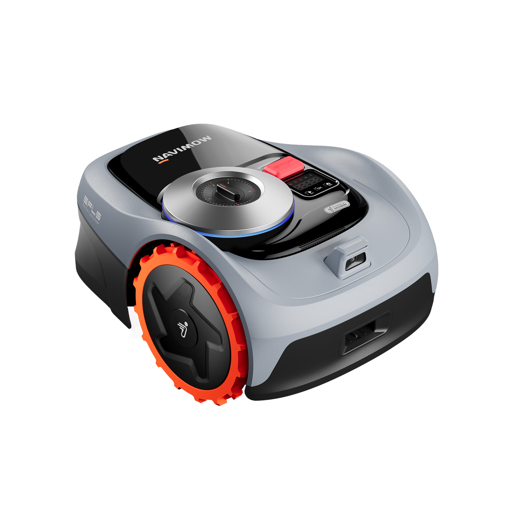
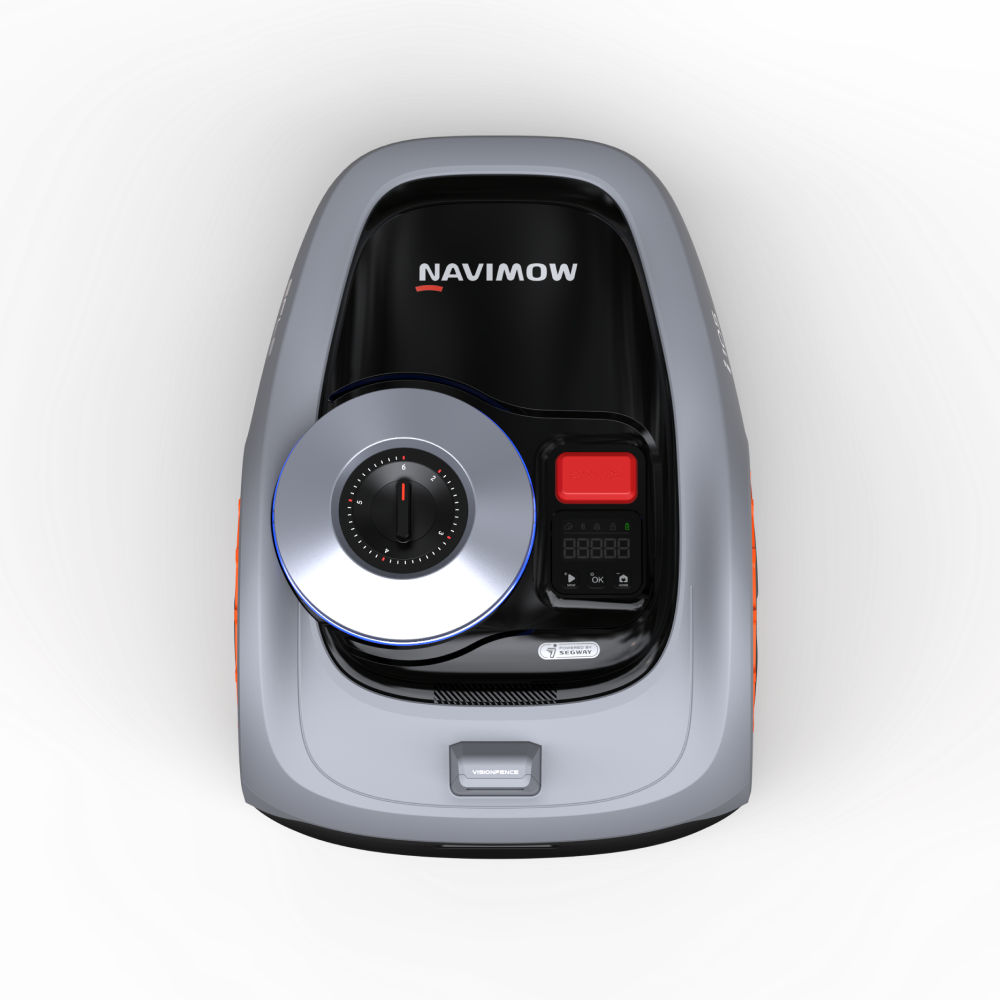
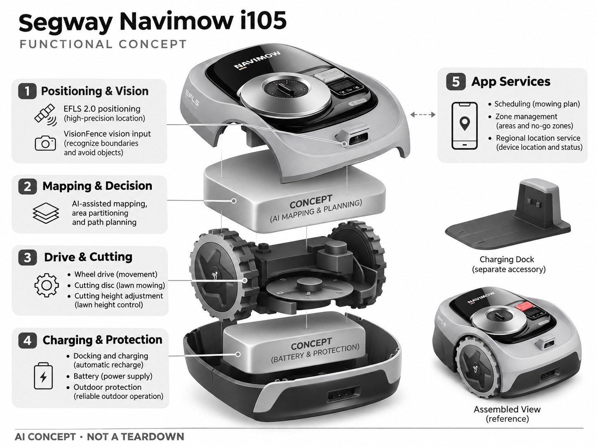

# Segway Navimow i105

**Segway Navimow** · 庭院与自然 · 核查 2026-11-04

面向小型草坪的无埋线视觉割草机器人

消费渠道：个人零售。

## 产品图片与结构参考

### 产品图

官方商品图：Navimow i105 斜前视角 · 来源：[Segway Navimow · 官方图片](<https://navimow.com/products/navimow-i105>) · [原始图片](<https://cdn.shopify.com/s/files/1/0676/6896/7561/files/Nav_Bar_i105.png?v=1766745896>)

### 参考图

官方参考图：i105 俯视，可见控制区与前部视觉模组 · 来源：[Segway Navimow · 官方图片](<https://navimow.com/products/navimow-i105>) · [原始图片](<https://cdn.shopify.com/s/files/1/0676/6896/7561/files/i105-square-top_427d4620-5a60-4b13-b41f-a9c52ab13dfa.png?v=1766745896&width=1200>)

### AI 生成爆炸示意

**AI 生成 · 非实物拆机。** 内部为概念推断，不能作为元件布局、BOM 或维修依据。[生成提示词](../../content/hardware/prompts/segway-navimow-i105.txt)

> 依据官方外观参考与公开功能生成；未披露的内部布局只作概念模块，不构成BOM或真实结构证据。

> 图片版权归原权利人；用于产品研究并保留出处。未改变图片色彩或内容。

> 分析为基于公开资料的案头研究与 AI 辅助判断，未经用户访谈、销量审计或实物拆机。需求、画像、竞争冷门度、审美及商业机会均为研究假设，不是投资结论。

## 销售与购买

- 状态：在售。美国官方商店列 US$799 购买选项、加入购物车与 Buy now；欧洲 i105e 页面显示售罄，不能把美版在售延伸到所有地区。

- 地区：美国

- 价格：US$799。美国购买价快照。页面另列按月方案，其产品和服务条件不同，不与买断价混用。

- 中国大陆：未核实该美国 i105 型号在中国大陆的官方购买和定位服务覆盖；庭院条件、频段和售后须单独确认。

- [官方产品 / 商店](<https://navimow.com/products/navimow-i105>)

## AI 的实际作用

AI 辅助建图与 VisionFence 图像避障用于识别边界及绕开物体，EFLS 2.0 提供定位。

服务与联网依赖：室外定位、App 和地区网络服务共同决定体验；不能假定任意地区均可使用同样的 Network RTK。

## 是否冷门

细分专业（研究判断）：需求高度依赖私家庭院，地域性强；相对通用家电属于专业场景，但已有明显竞争，不能称为无人市场。

## 需求与市场

需求假设：草坪面积不大但需要频繁维护的家庭，希望减少重复割草劳动而不施工埋线。应测量首次安装、修边及救援时间，总劳动下降才是价值，机器运行时间本身不代表省时。

### 产品任务与边界 · 研究判断

Navimow i105 面向需要规律维护的小草坪，用免传统边界线、AI 辅助建图和视觉避障减少重复劳动。需求应以安装、修边、救援和保养总时间衡量，机器人自行运行多久不等于用户省下多久，也不能取消所有人工工作。

依据：[Navimow i105 美国官方商店](<https://navimow.com/products/navimow-i105>) · [Navimow i105e 欧洲官方商店](<https://navimow.segway.com/collections/robot-lawn-mower/products/navimow-i105>)

### 需求判断 · 研究判断

小草坪可能不需要极端地形能力，却对价格和安装负担敏感。免埋线降低首次施工，但树荫、窄道和季节边界变化仍可能增加后续工作，因此需求研究应覆盖完整季节，而不只比较开箱建图是否快速。

依据：[Navimow i105 美国官方商店](<https://navimow.com/products/navimow-i105>) · [Navimow i105e 欧洲官方商店](<https://navimow.segway.com/collections/robot-lawn-mower/products/navimow-i105>)

### 需求验证 · 待验证

可在真实小院记录首次设置、每周补边、卡住和地图修正，并与原有电动割草机或服务比较。将天气、草高和边界条件保留，确认总劳动下降，避免用理想平坦草坪演示或名义面积推断所有小院都容易。

依据：[Navimow i105 美国官方商店](<https://navimow.com/products/navimow-i105>) · [Navimow i105e 欧洲官方商店](<https://navimow.segway.com/collections/robot-lawn-mower/products/navimow-i105>)

## 用户画像

画像假设：有私家草坪、愿自行安装智能设备的房主；付款者通常也负责草坪维护。公寓住户没有同等需求，跨国市场还取决于独立住宅比例、草种、地形和当地人工服务价格。

### 适用行为与条件 · 研究判断

较匹配有私家草坪、愿自行安装和使用应用管理的房主，通常付款者也参与维护。公寓住户没有同等场景，跨地区市场还受草种、住宅形态和人工成本影响，不能以全球家庭数量直接推算消费需求。

依据：[Navimow i105 美国官方商店](<https://navimow.com/products/navimow-i105>) · [Navimow i105e 欧洲官方商店](<https://navimow.segway.com/collections/robot-lawn-mower/products/navimow-i105>)

### 人群取舍 · 研究判断

首次割草机器人用户需要理解定位和地图，已有经验者可能更关注修边与备件。小院不一定简单，窄通道、树冠和临时玩具都改变适配，画像应按真实障碍和维护习惯划分，而不是仅用面积档位判断。

依据：[Navimow i105 美国官方商店](<https://navimow.com/products/navimow-i105>) · [Navimow i105e 欧洲官方商店](<https://navimow.segway.com/collections/robot-lawn-mower/products/navimow-i105>)

### 画像验证 · 待验证

画像验证应让用户完成选址、建图和一次边界调整，再记录一季内人工介入。询问哪些步骤需要帮助及是否愿意持续维护，识别能从免埋线获益的人，避免把对科技便利的兴趣误认为家庭条件已经适合。

依据：[Navimow i105 美国官方商店](<https://navimow.com/products/navimow-i105>) · [Navimow i105e 欧洲官方商店](<https://navimow.segway.com/collections/robot-lawn-mower/products/navimow-i105>)

## 竞争与替代

竞争判断：割草不是空白市场，传统园林品牌和机器人品牌均已进入。小草坪可负担性与安装简易性是细分切入点；产品必须与人工、普通电动割草机和园艺服务同时竞争。

### 比较对象与差异 · 研究判断

i105 与传统园林品牌、其他机器人和人工服务竞争，小草坪的可负担性与安装简易是细分重点。它不处于空白市场，比较应包括修边、售后和季节维护，不能只用视觉避障或 AI 建图作为独立优势。

依据：[Navimow i105 美国官方商店](<https://navimow.com/products/navimow-i105>) · [Navimow i105e 欧洲官方商店](<https://navimow.segway.com/collections/robot-lawn-mower/products/navimow-i105>)

### 竞争判断 · 研究判断

定位融合可能提高部分场景的稳定性，也需要正确安装与地区支持。竞争优势应由完整季节少接管证明，若安装位置或网络理解复杂，较低硬件价格可能伴随支持成本；其他型号的服务不能自动归给 i105。

依据：[Navimow i105 美国官方商店](<https://navimow.com/products/navimow-i105>) · [Navimow i105e 欧洲官方商店](<https://navimow.segway.com/collections/robot-lawn-mower/products/navimow-i105>)

### 竞争验证 · 待验证

可在相同小院比较免埋线、传统边界线和普通工具的总投入，记录修边和恢复。美国与欧洲购买状态需分开，定位功能也按地区核对，不能将某一站可购或新版系列能力作为全球统一结论。

依据：[Navimow i105 美国官方商店](<https://navimow.com/products/navimow-i105>) · [Navimow i105e 欧洲官方商店](<https://navimow.segway.com/collections/robot-lawn-mower/products/navimow-i105>)

## 供应链

供应链推断：定位模组、视觉摄像头、电池、轮驱和刀盘是主要模块；防水、碰撞、刀盘防护和庭院维修能力尤其重要。具体工厂、模组供应商与 BOM 未披露，不能按室内机器人经验直接套用。

### 功能模块拆分 · 研究判断

功能层包括 EFLS 定位、VisionFence 图像输入、AI 辅助地图与分区、轮驱刀盘、充电防护和应用。公开资料没有完整模组及工厂清单，部分停靠防护是功能分析层，不能据此推定实际控制板或所有地区网络定位配置。

依据：[Navimow i105 美国官方商店](<https://navimow.com/products/navimow-i105>) · [Navimow i105e 欧洲官方商店](<https://navimow.segway.com/collections/robot-lawn-mower/products/navimow-i105>)

### 制造与供应约束 · 研究判断

制造约束是定位与相机、驱动、电池和刀盘在户外长期协同，防水、碰撞与维修可达性尤为重要。草屑泥沙和反复维护会影响状态，不能按室内机器人经验直接估计寿命，备件与安装支持也属于交付成本。

依据：[Navimow i105 美国官方商店](<https://navimow.com/products/navimow-i105>) · [Navimow i105e 欧洲官方商店](<https://navimow.segway.com/collections/robot-lawn-mower/products/navimow-i105>)

### 候选与证据缺口 · 研究判断

金宝可作为控制电子与模塑结构制造候选，USI 可评估定位无线系统。没有 i105 点名合作证据，刀盘、户外安全及视觉地图需专项验证，公开供应能力不能被写成实际代工或该型号已采用的部件清单。

依据：[Navimow i105 美国官方商店](<https://navimow.com/products/navimow-i105>) · [Navimow i105e 欧洲官方商店](<https://navimow.segway.com/collections/robot-lawn-mower/products/navimow-i105>)

## 技术路径

已披露 EFLS 2.0、AI 建图与 VisionFence。技术判断：树荫、窄通道、草高变化和临时玩具会挑战定位与识别；应比较不同季节的边界稳定性，地区定位覆盖需要按官方当前地图核对。

### 已披露技术边界 · 研究判断

官方披露 EFLS 2.0、AI 辅助建图和 VisionFence，分别承担定位、地图和图像障碍处理。技术说明需要区分固定区域管理与视觉识别，也不能假定任意地区都具备相同网络定位服务或所有功能完全离线。

依据：[Navimow i105 美国官方商店](<https://navimow.com/products/navimow-i105>) · [Navimow i105e 欧洲官方商店](<https://navimow.segway.com/collections/robot-lawn-mower/products/navimow-i105>)

### 系统难点判断 · 研究判断

树荫、窄通道、草高变化和临时玩具会同时挑战位置与识别，地图稳定性需要跨季节观察。系统应让用户理解边界为何变化和何时需要修正，不能只显示一张整齐地图便认定所有区域都能可靠执行。

依据：[Navimow i105 美国官方商店](<https://navimow.com/products/navimow-i105>) · [Navimow i105e 欧洲官方商店](<https://navimow.segway.com/collections/robot-lawn-mower/products/navimow-i105>)

### 技术验证 · 待验证

验证应记录不同季节与光照下的边界、通道和受控障碍表现，分别检查定位、避让及切割。地区服务需按当前配置核对，不以一次成功建图或 VisionFence 名称保证所有动物、玩具和地面变化都被正确处理。

依据：[Navimow i105 美国官方商店](<https://navimow.com/products/navimow-i105>) · [Navimow i105e 欧洲官方商店](<https://navimow.segway.com/collections/robot-lawn-mower/products/navimow-i105>)

## 产品审美

审美判断：低重心机身与实用轮组强调工具属性，适合在草坪中保持低存在感。院内停靠站、定位天线或线缆的摆放也属于外观体验，不能只以草地上的单机图片判断。

### 外观与交互语言 · 研究判断

低重心机身和实用轮组强调工具属性，在草坪中保持相对低存在感，配套站点和线材却仍需规划。审美应包含完整庭院部署，不能只看草地上的单机图，把安装设施和维护空间从产品体验中省略。

依据：[Navimow i105 美国官方商店](<https://navimow.com/products/navimow-i105>) · [Navimow i105e 欧洲官方商店](<https://navimow.segway.com/collections/robot-lawn-mower/products/navimow-i105>)

### 使用中审美判断 · 研究判断

小院更容易受基站位置和收纳影响，清洗刀盘、搬运与冬季存放都需要明确动作。设备若看起来简洁却必须频繁移动其他物品才能维护，长期接受度会下降，工业设计应围绕真实房主使用而不是仅追求低轮廓。

依据：[Navimow i105 美国官方商店](<https://navimow.com/products/navimow-i105>) · [Navimow i105e 欧洲官方商店](<https://navimow.segway.com/collections/robot-lawn-mower/products/navimow-i105>)

### 设计验证 · 待验证

设计验证应观察定位设施、充电站安装和季节维护，记录线材、通行和清洗操作的冲突。还需检查用户能否理解运行及异常状态，避免以外观低调推断设备不会打扰生活或无需持续管理。

依据：[Navimow i105 美国官方商店](<https://navimow.com/products/navimow-i105>) · [Navimow i105e 欧洲官方商店](<https://navimow.segway.com/collections/robot-lawn-mower/products/navimow-i105>)

## 关键风险

风险判断：旋转刀盘带来实物安全风险，儿童、宠物和野生动物活动时应遵循操作规程。冬季收纳、雨天打滑、边缘漏割与联网覆盖都会影响实际可用性，视觉避障不是绝对安全保证。

### 主要失效与依赖 · 研究判断

风险包括旋转刀盘、儿童宠物和野生动物活动，以及雨天、边缘漏割与冬季收纳。视觉避障不是绝对安全保证，用户仍需遵循使用条件，地区联网和服务差异也可能改变实际可用性及维护频率。

依据：[Navimow i105 美国官方商店](<https://navimow.com/products/navimow-i105>) · [Navimow i105e 欧洲官方商店](<https://navimow.segway.com/collections/robot-lawn-mower/products/navimow-i105>)

### 风险传播判断 · 研究判断

如果用户把小草坪理解为低风险环境，可能忽略窄边界和临时物品带来的问题。产品应清楚显示定位、地图和充电状态，帮助及时恢复，避免没有割草或停止被误解为任务已经完成或草坪无需处理。

依据：[Navimow i105 美国官方商店](<https://navimow.com/products/navimow-i105>) · [Navimow i105e 欧洲官方商店](<https://navimow.segway.com/collections/robot-lawn-mower/products/navimow-i105>)

### 风险验证 · 待验证

风险验证应演练信号不足、地图变化、网络中断和充电失败，检查提示与人工恢复。实际测试需受控并遵守操作规则，不用真实动物验证避障，也不从某地区购买入口推断全球服务和配件一致。

依据：[Navimow i105 美国官方商店](<https://navimow.com/products/navimow-i105>) · [Navimow i105e 欧洲官方商店](<https://navimow.segway.com/collections/robot-lawn-mower/products/navimow-i105>)

## 机会与验证

可验证机会：面向小草坪提供安装评估、边界复核和季节保养，将产品可用性转成服务。新硬件想法应先验证一季使用的人工介入成本，再追求更复杂的自动化。

### 可能的机会入口 · 研究判断

机会在于小草坪安装评估、边界复核和季节保养，把机器人能力转为稳定维护。新项目可以先用现有设备验证服务价值，明确用户最常需要帮助的环节，再决定是否开发更复杂硬件或扩大面积。

依据：[Navimow i105 美国官方商店](<https://navimow.com/products/navimow-i105>) · [Navimow i105e 欧洲官方商店](<https://navimow.segway.com/collections/robot-lawn-mower/products/navimow-i105>)

### 机会成立条件 · 研究判断

机会成立需要一季内人工介入成本下降，若每周补边和救援抵消了自动割草收益，初始免埋线优势有限。更清楚的选址和维护指导可能比增加识别类别有效，产品应根据具体草坪条件选择复杂度。

依据：[Navimow i105 美国官方商店](<https://navimow.com/products/navimow-i105>) · [Navimow i105e 欧洲官方商店](<https://navimow.segway.com/collections/robot-lawn-mower/products/navimow-i105>)

### 下一步验证 · 待验证

下一步可建立小院使用日志，比较设置、修边、救援和保养的总时间，再测试安装与季节服务。用实际持续使用和省时判断方向，避免把机器人运行时间、覆盖面积或 AI 名称直接当作市场需求证据。

依据：[Navimow i105 美国官方商店](<https://navimow.com/products/navimow-i105>) · [Navimow i105e 欧洲官方商店](<https://navimow.segway.com/collections/robot-lawn-mower/products/navimow-i105>)

## 对应供应链公司

能力候选用于选型研究，不代表本产品实际采用；未公开的供货关系不作推断。

- [new-kinpo-group](../supply-chain/new-kinpo-group.md) — **能力候选 · 非已采用** / 小草坪割草电子与模塑制造：金宝公开家电、PCBA及注塑模具业务可对应控制电子和壳体制造评估，但刀盘、防护与导航需专项确认；没有 i105 点名供货证据，不能将能力候选认定为实际代工。

- [usi](../supply-chain/usi.md) — **能力候选 · 非已采用** / 定位视觉终端的无线电子整合：USI 的无线和系统电子能力可支持定位、连接及计算模块评审，但 VisionFence、地图与地区服务需要独立验证；未见 Navimow i105 合作披露，当前仅为电子工程候选。

[浏览供应链目录](../supply-chain.md)

## 功能分层示意

这是功能关系，不是实物拆机、真实空间结构或已核实 BOM。

1. **定位与视觉**：EFLS 2.0 定位及 VisionFence 图像输入。（官方披露）

2. **地图决策**：AI 辅助建图、分区及路径规划。（官方披露）

3. **机电切割**：轮驱、刀盘与割草高度调整。（官方披露）

4. **充电与防护**：停靠充电、电池与户外防护共同保障运行。（分析推断）

5. **App 服务**：调度、区域管理及地区定位服务。（官方披露）

## 来源

1. [Navimow i105 美国官方商店](<https://navimow.com/products/navimow-i105>) — 已打开；列购买与 AI 功能。

2. [Navimow i105e 欧洲官方商店](<https://navimow.segway.com/collections/robot-lawn-mower/products/navimow-i105>) — 已查看；页面显示 Sold Out，地区情况不同。

[返回目录](../hardware-market.md) · [网页分析](https://romanagent.github.io/Roman/#hardware/product/segway-navimow-i105)
