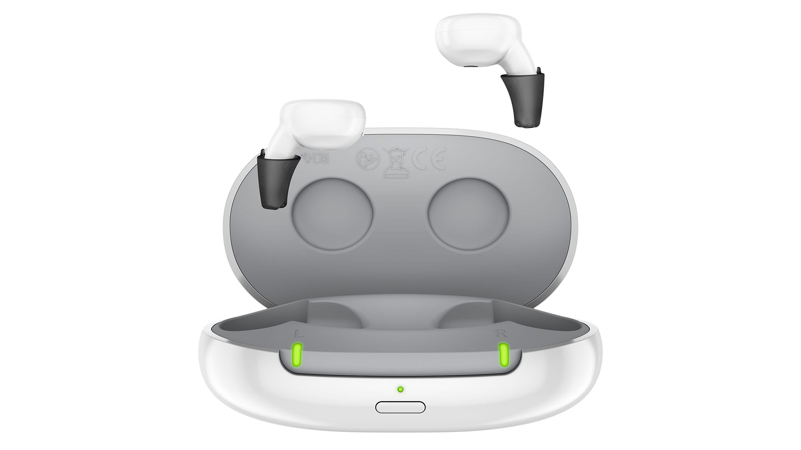
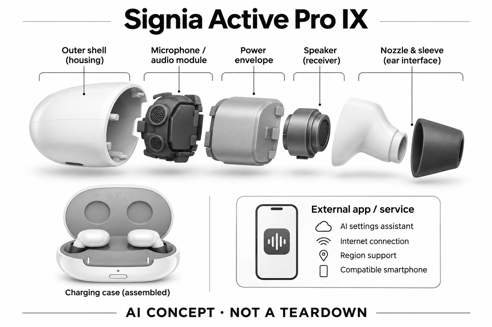

# Signia Active Pro IX

**Signia** · 助听与听力 · 核查 2026-11-04

耳机化形态加AI设置助手，而不是把普通耳机ANC改称助听AI

消费渠道：个人验配渠道。

## 产品图片与结构参考

### 产品图

Signia Active Pro IX官方产品外形图 · 来源：[Signia · 官方产品图片](<https://www.signia.net/en-in/hearing-aids/integrated-xperience/active-ix/>) · [原始图片](<https://cdn.signia.net/-/media/signia/global/images/products/signia-ix/active-ix/active-ix_charger_front-open_ha-out_led-on_1920x1080.jpg?rev=4fde602798a24b94aa13990a200c5c2f&hash=60797C85A1C90190D466502877E16C19&w=992>)

### 参考图

Signia Active Pro IX官方另一角度或使用场景参考 · 来源：[Signia · 官方产品图片](<https://www.signia.net/en-in/hearing-aids/integrated-xperience/active-ix/>) · [原始图片](<https://cdn.signia.net/-/media/signia/global/images/campaigns/signia-ix/active-ix/active-ix_man-tapping-hearing-aid_circle_1000x1000.jpg?rev=f57249622247409395f9c31525a71311&hash=E99F27C398553BD9F907DAF7D26ED227&w=992>)

### AI 生成爆炸示意

**AI 生成 · 非实物拆机。** 内部为概念推断，不能作为元件布局、BOM 或维修依据。[生成提示词](../../content/hardware/prompts/signia-active-pro-ix.txt)

> 外形依据核验参考图；内部位置、模块形状与装配关系仅作AI概念展示。

> 已逐张查看并核对型号。源图未改色/裁切；场景、界面、附件、优惠及效果文案仅为厂商示意，不作为本目录性能或现价依据。

> 分析为基于公开资料的案头研究与 AI 辅助判断，未经用户访谈、销量审计或实物拆机。需求、画像、竞争冷门度、审美及商业机会均为研究假设，不是投资结论。

## 销售与购买

- 状态：在售。官方当前消费者产品页持续展示该型号，并提供试用/验配或官方门店渠道。属于个人经专业验配获得的消费设备，saleMode为consumer-fitting；不声明具体门店库存。

- 地区：美国及所列官方区域验配网络（具体型号当地确认）

- 价格：未公布统一零售价；按个人验配方案报价。报价通常受单/双耳、技术档位、定制、服务和地区影响；不以历史媒体价格或其他型号拼凑。

- 中国大陆：品牌可能具有中国渠道，但本次未核实该具体型号、技术档位与AI软件在大陆的上市和支持范围；需由国内授权验配渠道确认。

- [官方产品 / 商店](<https://www.signia.net/en-in/hearing-aids/integrated-xperience/active-ix/>)

## AI 的实际作用

官方Active Pro IX页列AI-powered Signia Assistant，用于按环境与偏好定制声音；其神经网络处理依赖联网App。

服务与联网依赖：AI设置助手依赖兼容手机、联网和地区支持；基础助听设置由专业验配确定。

## 是否冷门

细分专业（研究判断）：听觉辅助属于专业消费用途，已有成熟供应商；此分类不表示蓝海或疗效优越。

## 需求与市场

需求假设：希望助听设备看起来更接近日常耳机，同时能根据个人偏好调整声音。真正的使用价值需要在个人真实交流场景中验证，不能从AI名称或厂商演示推定每个人都获得同样改善。

### 官方｜耳机化外形与声音设置辅助 · 官方资料

Active Pro IX采用接近真无线耳机的即戴式耳内外观，官方列出可按环境和偏好辅助定制声音的Signia Assistant。其主要任务仍是帮助复杂环境中的交流，软件助手依赖联网应用，基础设置由专业验配确定；不能因外形像耳机就把它当作普通主动降噪设备，也不能从即戴式称呼推断所有人无需适配。

依据：[Signia Signia Active Pro IX官方产品页](<https://www.signia.net/en-in/hearing-aids/integrated-xperience/active-ix/>) · [Signia官方技术或应用说明](<https://www.signia.net/en/support/app/>)

### 判断｜愿意戴出门才有使用价值 · 研究判断

一些用户可能对传统助听外观有顾虑，希望设备更接近日常佩戴的耳机，本款可以研究这种外形是否提高使用意愿。但接受外观只是开始，实际谈话、日常操作和长期佩戴仍需合适；需求分析应关注用户为什么少用原方案，而不是假设耳机化设计天然更时尚或自动解决个人交流困难。

依据：[Signia Signia Active Pro IX官方产品页](<https://www.signia.net/en-in/hearing-aids/integrated-xperience/active-ix/>)

### 验证｜外形接受与听音收益分开 · 待验证

试用可先记录用户对佩戴和公开使用的看法，再在其常见场景中观察是否确实增加使用、减少追问及完成维护。若只是初次喜欢外观而声音仍不合适，不能认为需求已经满足；当前目录没有访谈或留存证据，需把耳机化设计的接受度与App助手调整的独立贡献分别验证。

依据：[Signia Signia Active Pro IX官方产品页](<https://www.signia.net/en-in/hearing-aids/integrated-xperience/active-ix/>) · [Signia官方消费者验配渠道](<https://www.signia.net/en-us/store-locator/>) · [Signia官方技术或应用说明](<https://www.signia.net/en/support/app/>)

## 用户画像

画像推断：经专业评估适合即戴耳内形态、在意外观与手机使用便利的个人更值得评估。具体是否适配应由听力需求、耳形和操作能力共同决定，本目录不根据年龄、职业或自述症状替人选择医疗产品。

### 判断｜偏好熟悉耳机外观的人 · 研究判断

已经习惯日常耳机轮廓、希望助听设备融入个人穿戴风格的人可能关注本款，但不应按年龄或职业刻画唯一用户。有人愿意让设备明显可见，也有人希望尽量低调，两者都需要尊重；关键是个人外观接受和真实听音要求是否同时成立，不能由产品造型推定听力情况或使用能力。

依据：[Signia Signia Active Pro IX官方产品页](<https://www.signia.net/en-in/hearing-aids/integrated-xperience/active-ix/>)

### 判断｜接受专业基础加App调整的人 · 研究判断

本款可以吸引愿意使用手机表达环境和声音偏好的人，但AI助手不是购买后自行完成全部适配的途径。用户仍需理解基础验配、应用建议和长期随访各自的作用；如果本人不愿看手机或难以比较调整前后声音，应把支持方式纳入选择，而不是以智能化程度判断是否适合。

依据：[Signia官方消费者验配渠道](<https://www.signia.net/en-us/store-locator/>) · [Signia官方技术或应用说明](<https://www.signia.net/en/support/app/>)

### 验证｜实际佩戴和数字习惯 · 待验证

可观察用户在熟悉地点戴取、与人交流和使用应用的全过程，记录是否有人误以为其只是听音乐，以及本人是否介意解释。手机兼容、地区服务和独立操作能力也需确认，不能由日常会用耳机推定能够完成助听设置；渠道应清楚说明Active Pro IX具体交付配置和专业服务。

依据：[Signia Signia Active Pro IX官方产品页](<https://www.signia.net/en-in/hearing-aids/integrated-xperience/active-ix/>) · [Signia官方消费者验配渠道](<https://www.signia.net/en-us/store-locator/>) · [Signia官方技术或应用说明](<https://www.signia.net/en/support/app/>)

## 竞争与替代

案头判断：耳机化形态加AI设置助手，而不是把普通耳机ANC改称助听AI形成可比较特征，但消费助听已有多个成熟品牌和验配渠道。没有销量审计、用户访谈或疗效对照，专业细分不意味着竞争稀少。

### 判断｜与传统外形助听器比较 · 研究判断

与Pure Charge&Go IX等耳背方案相比，本款改变了可见轮廓和佩戴位置，仍解决同一个复杂声场听清任务。比较应包括外观接受、取放、声音与维护，而不是只问哪款更像耳机；同品牌共享部分服务也不意味着声学结构与适配完全相同，不能仅依据应用功能重合认定可以相互替代。

依据：[Signia Signia Active Pro IX官方产品页](<https://www.signia.net/en-in/hearing-aids/integrated-xperience/active-ix/>) · [Signia官方技术或应用说明](<https://www.signia.net/en/support/app/>)

### 判断｜与普通耳机区分比较指标 · 研究判断

普通耳机的隔音、音乐或通话体验，不能直接证明持续现场助听的适配结果。Active Pro IX虽然外观接近这一熟悉形态，仍应按个人交流和专业服务比较；若仅以主动降噪感受或价格衡量，容易忽略增益、声音偏好和听音场景的不同，目录不将外形相似等同功能与验证要求相同。

依据：[Signia Signia Active Pro IX官方产品页](<https://www.signia.net/en-in/hearing-aids/integrated-xperience/active-ix/>) · [Signia官方消费者验配渠道](<https://www.signia.net/en-us/store-locator/>)

### 验证｜Pro与Mini及区域配置区分 · 待验证

本条只分析Active Pro IX，不借Active Mini IX的体积、连接和其他规格补足资料。不同市场的列售组合需要按订单确认，报价也应包括耳数、技术档位和服务范围；比较同任务试用的真实反馈比拼接系列参数更有用，当前没有独立销量和采用数据，不能从耳机化定位判断新市场已成立。

依据：[Signia Signia Active Pro IX官方产品页](<https://www.signia.net/en-in/hearing-aids/integrated-xperience/active-ix/>) · [Signia官方消费者验配渠道](<https://www.signia.net/en-us/store-locator/>)

## 供应链

官方可核对外观接近真无线耳机的即戴式耳内助听器及相应声音功能；具体麦克风、受话器、电池供应商与整机工厂本次未确认。品牌或法定制造商名称不等于实际装配工厂，也不据此估计BOM与良率。

### 官方｜即戴式耳内与联网助手 · 官方资料

外部资料确认即戴式耳内助听形态和Signia Assistant应用支持，可以划分声音输入、基础处理、声音输出及手机设置服务几个环节。AI助手的神经网络依赖联网App，不能直接归于某颗耳内处理芯片；具体声学器件、核心平台、封装和工厂并未点名，目录不以真无线耳机外观猜测整机供应链。

依据：[Signia Signia Active Pro IX官方产品页](<https://www.signia.net/en-in/hearing-aids/integrated-xperience/active-ix/>) · [Signia官方技术或应用说明](<https://www.signia.net/en/support/app/>)

### 判断｜熟悉造型仍有专门约束 · 研究判断

耳机式造型不会消除现场助听的反馈、输出、延迟和个人贴合要求，结构与声学需要联合设计。若改用通用耳机方案，必须重新验证这些条件，不能把外壳做得相似就声称等效；本次没有耳内装配、校准与可靠性资料，也不估算量产良率、代工成本或可直接采购的整套公版方案。

依据：[Signia Signia Active Pro IX官方产品页](<https://www.signia.net/en-in/hearing-aids/integrated-xperience/active-ix/>) · [Signia官方消费者验配渠道](<https://www.signia.net/en-us/store-locator/>)

### 判断｜候选需要重新建立系统 · 研究判断

英飞凌麦克风可比较耳内采集，onsemi听觉DSP可比较基础处理，但都不提供原厂IX能力与Signia Assistant的完整服务。声孔、个体贴合、参数接口和验配工具要重新匹配，通用蓝牙或模型能力不能保证兼容；没有本型号点名采用关系，候选只能用于相似任务的新设计可行性研究。

依据：[Signia Signia Active Pro IX官方产品页](<https://www.signia.net/en-in/hearing-aids/integrated-xperience/active-ix/>) · [Signia官方技术或应用说明](<https://www.signia.net/en/support/app/>)

## 技术路径

官方Active Pro IX页列AI-powered Signia Assistant，用于按环境与偏好定制声音；其神经网络处理依赖联网App。这是已披露机制；精确模型、内部电路与个体表现未完全公开。普通放大、蓝牙和自动模式本身不单独作为AI收录理由。

### 官方｜应用建议而非耳内聊天 · 官方资料

官方Active Pro IX页面和应用说明支持AI驱动的Signia Assistant，依据用户环境与偏好提出声音设置并作用于兼容设备。已确认的神经网络路径需要联网App，基础助听状态由专业验配提供；目录不将云端设置过程写成全部在耳内实时运行，也不借普通耳机降噪算法补充未披露的本款机制。

依据：[Signia Signia Active Pro IX官方产品页](<https://www.signia.net/en-in/hearing-aids/integrated-xperience/active-ix/>) · [Signia官方技术或应用说明](<https://www.signia.net/en/support/app/>)

### 判断｜佩戴稳定影响建议可评估性 · 研究判断

用户比较调整前后声音时，若同时改变了佩戴位置、场所或关注对象，就可能难以判断建议是否有效。技术分析因此需要把输入声场、佩戴和软件修改分开，不能只看设置已经发送成功；耳机化外形可能降低尝试门槛，但不会使用户自动理解参数，也不证明模型能够推知每次听音意图。

依据：[Signia Signia Active Pro IX官方产品页](<https://www.signia.net/en-in/hearing-aids/integrated-xperience/active-ix/>) · [Signia官方技术或应用说明](<https://www.signia.net/en/support/app/>)

### 验证｜场景与偏好的重复反馈 · 待验证

试用可记录同类环境中反复提出的听音问题，以及建议应用后是否减少手动尝试或仍需专业帮助。网络不可用和用户不接受建议的流程也应根据实际版本观察，不能自行承诺恢复方式；当前目录未进行实机兼容或独立效果测试，AI应用的存在仅说明处理机制，不等于结果已验证。

依据：[Signia官方消费者验配渠道](<https://www.signia.net/en-us/store-locator/>) · [Signia官方技术或应用说明](<https://www.signia.net/en/support/app/>)

## 产品审美

图示观察：圆润耳塞与充电盒具有消费电子外观；这种熟悉感可能降低佩戴顾虑，但属于待验证审美假设。实际耳内尺寸、舒适感和维护便利仍需验配或试戴确认；宣传图不能证明隐形、无负担或适合所有耳形。

### 判断｜把可见佩戴变成个人选择 · 研究判断

本款外观接近日常耳机，可能让部分用户愿意把助听设备作为正常穿戴的一部分，而另一些人仍偏好隐蔽。审美讨论应从个人表达和社会场景出发，不能暗示只有隐藏才体面，也不应把耳机风格自动写成更年轻；产品图能支持轮廓判断，无法证明耳内触感、贴合和长时间接受度。

依据：[Signia Signia Active Pro IX官方产品页](<https://www.signia.net/en-in/hearing-aids/integrated-xperience/active-ix/>)

### 判断｜外观会影响他人的理解 · 研究判断

看见耳机式设备的人可能对用户是否正在听取现场声音产生不同理解，这会影响谈话开始和互动习惯。可以研究佩戴者是否愿意解释及需要怎样表达，而不是把这种误读直接判为缺点；外形的社会含义不是固定事实，实际反馈需来自用户生活场景，不能凭宣传照片推定普遍态度。

依据：[Signia Signia Active Pro IX官方产品页](<https://www.signia.net/en-in/hearing-aids/integrated-xperience/active-ix/>)

### 验证｜从镜前偏好到日常动作 · 待验证

外观试用应覆盖静坐交谈、走动、戴取和实际维护，让用户自己判断是否愿意持续公开佩戴。还应单独观察手机助手界面是否与身体操作协调，避免只有工作人员能顺畅演示；审美满意、操作便利和声音适配是不同结果，需要分别记录，不能用一种满意度代替所有使用质量。

依据：[Signia Signia Active Pro IX官方产品页](<https://www.signia.net/en-in/hearing-aids/integrated-xperience/active-ix/>) · [Signia官方消费者验配渠道](<https://www.signia.net/en-us/store-locator/>) · [Signia官方技术或应用说明](<https://www.signia.net/en/support/app/>)

## 关键风险

不同市场可能同时列Active Mini IX等款式；本条仅指Active Pro IX，不自动复制Mini的体积或连接规格。AI设置辅助与噪声处理不能替代专业适配、随访或对异常听力变化的评估，本研究没有诊断、独立实测或疗效结论。

### 判断｜耳机外观导致用途误判 · 研究判断

最需要避免的是把本款当成普通耳机加一项AI功能，或反过来用普通耳机主动降噪体验推断助听效果。它的基础设置仍需专业验配，具体个人适配不能由即戴式名称保证；同品牌Mini与Pro也有型号边界，任何借用其他款式的体积、连接或服务承诺都会改变用户对实际交付的理解。

依据：[Signia Signia Active Pro IX官方产品页](<https://www.signia.net/en-in/hearing-aids/integrated-xperience/active-ix/>) · [Signia官方消费者验配渠道](<https://www.signia.net/en-us/store-locator/>)

### 判断｜应用条件与使用预期脱节 · 研究判断

用户可能喜欢外形却没有兼容手机、可用网络或当地助手支持，导致重要的个性化流程无法按预期执行。应明确基础助听与联网AI调整是两个环节，不能把App无法使用说成设备完全失效，也不能承诺离线拥有全部服务；本目录没有独立兼容测试，实际条件需要按当地交付核对。

依据：[Signia Signia Active Pro IX官方产品页](<https://www.signia.net/en-in/hearing-aids/integrated-xperience/active-ix/>) · [Signia官方技术或应用说明](<https://www.signia.net/en/support/app/>)

### 验证｜长期不适与重复调整 · 待验证

试用需要记录持续佩戴不适、听音困难反复出现或用户不断请求相似建议的情况，并确认专业支持入口。不能将所有问题解释为需要再用一次AI，也不把建议采用率当作医学效果；软件数据处理与账户条件应按现有说明了解，当前研究未做隐私审计或个人疗效评估。

依据：[Signia官方消费者验配渠道](<https://www.signia.net/en-us/store-locator/>) · [Signia官方技术或应用说明](<https://www.signia.net/en/support/app/>)

## 机会与验证

市场差异在于耳机化形态加AI设置助手，而不是把普通耳机ANC改称助听AI。尚待验证的购买理由是其在个人场景中的可感知帮助、操作便利和售后支持，而不是追求更多AI术语或用统一分数替代实际试戴。

### 判断｜降低外形带来的采用阻力 · 研究判断

本款可研究的机会是有明确听音需求的人，是否因耳机化外观而更愿意开始并持续使用合适设备。它不创造另一种复杂声场需求，而可能改变接受路径；只有外形偏好转为长期佩戴并伴随真实交流收益，才支持购买理由，不能以外观新颖或宣传中的生活方式推断市场增长。

依据：[Signia Signia Active Pro IX官方产品页](<https://www.signia.net/en-in/hearing-aids/integrated-xperience/active-ix/>)

### 判断｜让熟悉外形承接专业体验 · 研究判断

熟悉耳机轮廓可能减少第一次接触的陌生感，但专业适配、日常反馈和应用设置仍需要被理解。研究可观察解释这些差异的服务是否帮助用户建立合理预期，避免把简单上手等同无需支持；这属于已有功能和交付体验的改进方向，并不要求把更多云端能力塞入外观卖点。

依据：[Signia Signia Active Pro IX官方产品页](<https://www.signia.net/en-in/hearing-aids/integrated-xperience/active-ix/>) · [Signia官方消费者验配渠道](<https://www.signia.net/en-us/store-locator/>) · [Signia官方技术或应用说明](<https://www.signia.net/en/support/app/>)

### 验证｜长期佩戴意愿和任务结果 · 待验证

后续可跟踪实际佩戴、公开交流、App建议使用、退出原因及专业随访，并与用户原来的设备或选择比较。硬件与服务总投入应一并考虑，而不是只看第一次外观评价；当前没有用户研究、销量和长期效果数据，目录不以耳机化设计或AI助手认定新需求及商业成功已经成立。

依据：[Signia Signia Active Pro IX官方产品页](<https://www.signia.net/en-in/hearing-aids/integrated-xperience/active-ix/>) · [Signia官方消费者验配渠道](<https://www.signia.net/en-us/store-locator/>) · [Signia官方技术或应用说明](<https://www.signia.net/en/support/app/>)

## 对应供应链公司

能力候选用于选型研究，不代表本产品实际采用；未公开的供货关系不作推断。

- [onsemi](../supply-chain/onsemi.md) — **能力候选 · 非已采用** / 即戴式耳内助听声音链路重设计候选：Active Pro IX的耳内形态仍需专门助听声音处理，onsemi听觉DSP可用于新设计可行性比较。它不提供原厂IX算法、Signia Assistant或验配软件，必须重新验证贴合、反馈、延迟及应用参数接口；外形像耳机不能证明可使用普通耳机平台替代，也无本款实际采用证据。

- [infineon](../supply-chain/infineon.md) — **能力候选 · 非已采用** / 即戴式耳内现场声音采集候选：英飞凌MEMS麦克风可以比较耳内设备的现场声音输入，但本款的助听任务要求与外壳声孔、佩戴稳定性和低噪声共同验证。消费耳机应用资料不能证明可直接满足个人验配或长期输出要求，当前未确认本型号采用；任何候选更换都需要声学重调，而非外观相同即可兼容。

[浏览供应链目录](../supply-chain.md)

## 功能分层示意

这是功能关系，不是实物拆机、真实空间结构或已核实 BOM。

1. **声音输入**：麦克风采集外界声音；为功能架构，非实际拆机。（分析推断）

2. **个体配置**：专业验配确定与个人听音需求相适应的参数。（官方披露）

3. **AI声音处理**：官方Active Pro IX页列AI-powered Signia Assistant，用于按环境与偏好定制声音；其神经网络处理依赖联网App。（官方披露）

4. **声音输出**：受话器向耳道输出经处理声音；具体物理布局不公开。（分析推断）

5. **管理与随访**：按具体型号使用兼容应用或专业渠道调整和维护。（官方披露）

## 来源

1. [Signia Signia Active Pro IX官方产品页](<https://www.signia.net/en-in/hearing-aids/integrated-xperience/active-ix/>) — 已打开当前面向消费者的产品介绍及验配/试用入口；没有把医院诊断仪器或B2B订货设备计入。

2. [Signia官方消费者验配渠道](<https://www.signia.net/en-us/store-locator/>) — 已打开官方验配/门店定位渠道，消费者经专业验配购买；不代表每家门店现货或统一价格。

3. [Signia官方技术或应用说明](<https://www.signia.net/en/support/app/>) — 已打开，用于确认AI机制和兼容边界；厂商性能宣传不作为独立疗效证据。

[返回目录](../hardware-market.md) · [网页分析](https://romanagent.github.io/Roman/#hardware/product/signia-active-pro-ix)
