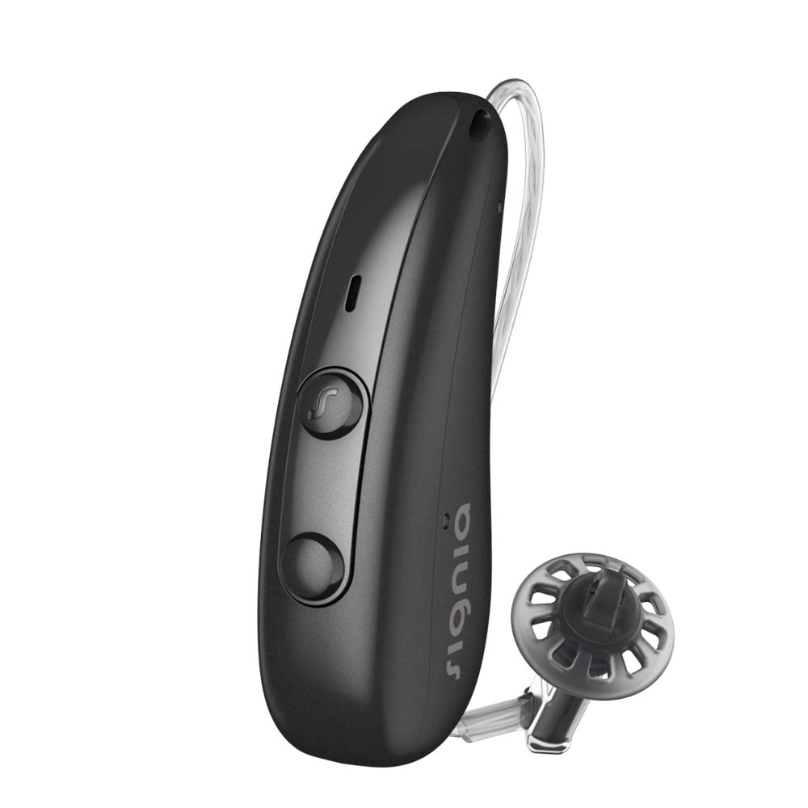
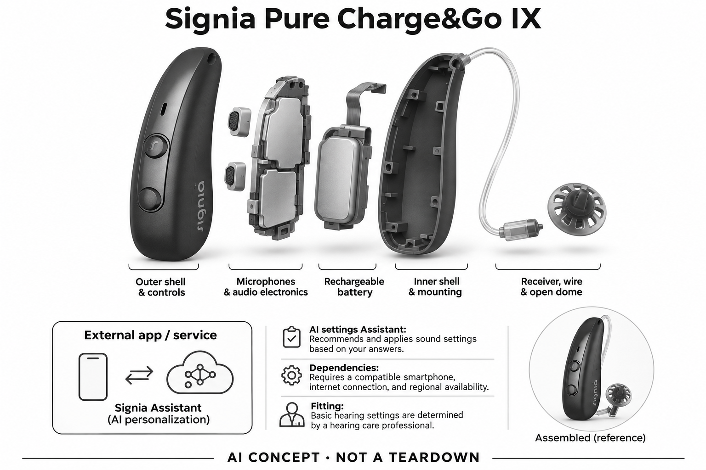

# Signia Pure Charge&Go IX

**Signia** · 助听与听力 · 核查 2026-11-04

云端AI助手与实体助听器设置之间的闭环

消费渠道：个人适配 / 验配。

## 产品图片与结构参考

### 产品图

Signia Pure Charge&Go IX官方产品外形图 · 来源：[Signia · 官方产品图片](<https://www.signia.net/en-us/hearing-aids/integrated-xperience/pure-charge-go-ix/>) · [原始图片](<https://cdn.signia.net/-/media/signia/global/images/products/signia-ix/pure-chargego-ix/pure-charge-go-ix_black_1000x1000.jpg?rev=0095d967363e4eba81eb255d5650c120&hash=C783CEEC83010D2977E171B83E5CA916>)

### 参考图

Signia Pure Charge&Go IX官方另一角度或使用场景参考 · 来源：[Signia · 官方产品图片](<https://www.signia.net/en-us/hearing-aids/integrated-xperience/pure-charge-go-ix/>) · [原始图片](<https://cdn.signia.net/-/media/signia/global/images/campaigns/signia-ix/pure-chargego-ix/signia-ix_pure-chgo_artist-head_side-view_bg_1200x630.jpg?h=630&w=1200&rev=bb0508c9ed3f41c8943bf0410ebbe17c&hash=DA509DB775B41AC520B014528F1AE39F>)

### AI 生成爆炸示意

**AI 生成 · 非实物拆机。** 内部为概念推断，不能作为元件布局、BOM 或维修依据。[生成提示词](../../content/hardware/prompts/signia-pure-charge-go-ix.txt)

> 外形依据核验参考图；内部位置、模块形状与装配关系仅作AI概念展示。

> 已逐张查看并核对型号。源图未改色/裁切；场景、界面、附件、优惠及效果文案仅为厂商示意，不作为本目录性能或现价依据。

> 分析为基于公开资料的案头研究与 AI 辅助判断，未经用户访谈、销量审计或实物拆机。需求、画像、竞争冷门度、审美及商业机会均为研究假设，不是投资结论。

## 销售与购买

- 状态：在售。官方当前消费者产品页持续展示该型号，并提供试用/验配或官方门店渠道。属于个人经专业验配获得的消费设备，saleMode为consumer-fitting；不声明具体门店库存。

- 地区：美国及所列官方区域验配网络（具体型号当地确认）

- 价格：未公布统一零售价；按个人验配方案报价。报价通常受单/双耳、技术档位、定制、服务和地区影响；不以历史媒体价格或其他型号拼凑。

- 中国大陆：品牌可能具有中国渠道，但本次未核实该具体型号、技术档位与AI软件在大陆的上市和支持范围；需由国内授权验配渠道确认。

- [官方产品 / 商店](<https://www.signia.net/en-us/hearing-aids/integrated-xperience/pure-charge-go-ix/>)

## AI 的实际作用

兼容的Signia Assistant使用云端神经网络，根据用户对听音问题的回答推荐并应用声音设置。

服务与联网依赖：AI设置助手依赖兼容手机、联网和地区支持；基础助听设置由专业验配确定。

## 是否冷门

细分专业（研究判断）：听觉辅助属于专业消费用途，已有成熟供应商；此分类不表示蓝海或疗效优越。

## 需求与市场

需求假设：验配之间遇到特定听音问题时，希望有即时且可撤回的设置辅助。真正的使用价值需要在个人真实交流场景中验证，不能从AI名称或厂商演示推定每个人都获得同样改善。

### 官方｜听音反馈进入设置流程 · 官方资料

Pure Charge&Go IX在专业验配基础上可使用兼容的Signia Assistant，用户回答听音问题后，由云端神经网络推荐并应用声音设置。它满足的是日常场景中对已有助听状态作进一步调整的需要，而不是在耳内运行聊天模型；基础声音参数、手机兼容和地区服务仍有前提，不能把助手存在当作无需专业支持。

依据：[Signia Signia Pure Charge&Go IX官方产品页](<https://www.signia.net/en-us/hearing-aids/integrated-xperience/pure-charge-go-ix/>) · [Signia官方技术或应用说明](<https://www.signia.net/en/support/app/>)

### 判断｜把模糊感受转成可调整问题 · 研究判断

用户在离开验配地点后可能只知道某个场景听着不舒服，却不知道应该调哪项参数。问答式助手有机会降低表达和操作门槛，让问题及时进入设置流程；价值要看调整是否解决原困难并能被理解，而非建议次数。若用户不能准确描述或很难比较前后变化，自动推荐也可能增加困惑。

依据：[Signia官方技术或应用说明](<https://www.signia.net/en/support/app/>)

### 验证｜一次反馈到结果的完整过程 · 待验证

试用可选择用户反复遇到的场景，记录提出问题、回答助手、应用建议和重新听取的过程，同时观察何时仍要寻求专业人员帮助。不要只展示建议成功下发就认定交流改善；当前目录没有真实用户的调整成功率或长期效果，需以具体任务和个人反馈判断助手是否减少负担。

依据：[Signia官方消费者验配渠道](<https://www.signia.net/en-us/store-locator/>) · [Signia官方技术或应用说明](<https://www.signia.net/en/support/app/>)

## 用户画像

画像推断：经专业评估、拥有兼容手机并能描述听音偏好的个人更值得评估。具体是否适配应由听力需求、耳形和操作能力共同决定，本目录不根据年龄、职业或自述症状替人选择医疗产品。

### 判断｜愿意在手机上表达问题的人 · 研究判断

经常使用兼容手机、愿意回答几个具体问题并比较声音变化的人，可能更容易使用这类助手。画像应来自操作习惯与实际支持需要，而非年龄或技术兴趣；如果用户不愿在交流中拿出手机，或者更偏好直接联系验配人员，软件建议的便利未必能转化为高频价值，不能假定人人都会使用。

依据：[Signia官方技术或应用说明](<https://www.signia.net/en/support/app/>)

### 判断｜已有基础适配但仍有难点 · 研究判断

本款更值得研究的使用状态，是已有经过专业确认的基础设置，在某些地点仍出现可描述的听音问题。助手可作为反馈入口，却不能代替初始评估，也不应把一切不适都当成软件偏好；不同用户对声音和控制的期待会改变是否接受建议，应让具体生活困难而非AI标签决定关注程度。

依据：[Signia Signia Pure Charge&Go IX官方产品页](<https://www.signia.net/en-us/hearing-aids/integrated-xperience/pure-charge-go-ix/>) · [Signia官方消费者验配渠道](<https://www.signia.net/en-us/store-locator/>) · [Signia官方技术或应用说明](<https://www.signia.net/en/support/app/>)

### 验证｜手机能力与服务支持并看 · 待验证

试用时应让用户自己完成应用连接、阅读问题、应用调整并说明变化，观察是否需要旁人代操作。还要确认实际手机、网络和地区支持，以及遇到无法解释的问题如何回到专业服务；能够启动App并不等于能安全理解所有设置，渠道应明确个人交付版本与随访范围，而不是只给统一功能表。

依据：[Signia官方消费者验配渠道](<https://www.signia.net/en-us/store-locator/>) · [Signia官方技术或应用说明](<https://www.signia.net/en/support/app/>)

## 竞争与替代

案头判断：云端AI助手与实体助听器设置之间的闭环形成可比较特征，但消费助听已有多个成熟品牌和验配渠道。没有销量审计、用户访谈或疗效对照，专业细分不意味着竞争稀少。

### 判断｜对照手动预设与随访调整 · 研究判断

手动切换程序、记录问题后等待随访和当场使用App助手，都可以处理日常听音困难，但即时性、可解释性与支持责任不同。比较本款应看用户是否少试错、少等待并保持对变化的理解，不能仅以云端神经网络替代人工步骤为优势；复杂问题仍可能需要专业适配，软件反馈也未必适合每次交流。

依据：[Signia官方消费者验配渠道](<https://www.signia.net/en-us/store-locator/>) · [Signia官方技术或应用说明](<https://www.signia.net/en/support/app/>)

### 判断｜与端侧自动处理分开比较 · 研究判断

有些助听方案强调设备自动识别声场，本款明确的AI证据还包含用户发起的云端设置建议，两者发生在不同环节。不能用同一个AI勾选项把它们视为完全相同，也不应据此拆成新的听清需求；应比较自动输出和用户介入如何协作，尤其是在助手不联网时用户能否沿用熟悉的基础方案。

依据：[Signia Signia Pure Charge&Go IX官方产品页](<https://www.signia.net/en-us/hearing-aids/integrated-xperience/pure-charge-go-ix/>) · [Signia官方技术或应用说明](<https://www.signia.net/en/support/app/>)

### 验证｜按具体连接款式核算 · 待验证

比较时应明确本款连接和App条件，不把CROS或无连接款一起承诺同样助手能力，也不混用其他IX款式的规格。报价需说明耳数、技术档位和随访内容，试用保持相同交流任务；当前没有独立留存、使用频率或销量数据，不能从品牌生态和助手功能推出普遍购买意愿。

依据：[Signia Signia Pure Charge&Go IX官方产品页](<https://www.signia.net/en-us/hearing-aids/integrated-xperience/pure-charge-go-ix/>) · [Signia官方消费者验配渠道](<https://www.signia.net/en-us/store-locator/>) · [Signia官方技术或应用说明](<https://www.signia.net/en/support/app/>)

## 供应链

官方可核对可充电RIC耳背与受话器形态及相应声音功能；具体麦克风、受话器、电池供应商与整机工厂本次未确认。品牌或法定制造商名称不等于实际装配工厂，也不据此估计BOM与良率。

### 官方｜耳部硬件与手机服务分层 · 官方资料

本款是可充电RIC耳背主机与耳道受话器结构，基础声学处理在助听设备中完成，已确认的AI助手则经过兼容App和云端服务产生设置建议。两层不能混成一个耳内AI芯片；本次资料没有点名麦克风、核心处理器、无线器件或工厂，目录仅据功能建立硬件与服务的研究边界。

依据：[Signia Signia Pure Charge&Go IX官方产品页](<https://www.signia.net/en-us/hearing-aids/integrated-xperience/pure-charge-go-ix/>) · [Signia官方技术或应用说明](<https://www.signia.net/en/support/app/>)

### 判断｜参数链路也是交付约束 · 研究判断

如果App建议需要作用于实际设备，声音参数、连接、权限和版本必须保持一致，硬件替换就不只是换一块处理器。供应研究应同时考虑声学、低延迟和设置同步，不能以通用蓝牙或神经网络能力推定兼容；当前没有接口开放、算法授权和生产校准依据，不猜测现有系统可供第三方直接复用。

依据：[Signia Signia Pure Charge&Go IX官方产品页](<https://www.signia.net/en-us/hearing-aids/integrated-xperience/pure-charge-go-ix/>) · [Signia官方技术或应用说明](<https://www.signia.net/en/support/app/>)

### 判断｜候选不包含云端助手 · 研究判断

onsemi听觉DSP可研究相近设备的基础声音链路，Syntiant麦克风可研究输入，但两者都不等于Signia Assistant服务或品牌验配软件。候选需验证硬件接口、输出调校及参数控制，并重新建立应用协同；没有点名采用证据，不能把这些能力公司写为本款供应商，也不能假定更换后保持既有AI体验。

依据：[Signia Signia Pure Charge&Go IX官方产品页](<https://www.signia.net/en-us/hearing-aids/integrated-xperience/pure-charge-go-ix/>) · [Signia官方技术或应用说明](<https://www.signia.net/en/support/app/>)

## 技术路径

兼容的Signia Assistant使用云端神经网络，根据用户对听音问题的回答推荐并应用声音设置。这是已披露机制；精确模型、内部电路与个体表现未完全公开。普通放大、蓝牙和自动模式本身不单独作为AI收录理由。

### 官方｜云端神经网络的准确位置 · 官方资料

官方应用说明确认Signia Assistant根据用户回答推荐并应用声音设置，神经网络处理依赖联网App。目录据此识别其AI机制，而不把所有IX设备内的音频处理都称为该云模型；兼容手机、地区和连接条件影响助手使用，基础设置仍由专业验配确定，不能将助手理解为自行诊断或生成无限制参数。

依据：[Signia官方技术或应用说明](<https://www.signia.net/en/support/app/>)

### 判断｜推荐正确还需要理解反馈 · 研究判断

即便参数成功应用，用户是否听得更合适仍取决于问题描述、场景是否保持一致以及能否比较变化。技术研究需要区分问答理解、建议生成、下发和实际体验，某一环节成功不代表整条流程有效；若用户很快离开原声场，建议也可能难以评价，因此应关注真实使用的时机而不是只看界面响应。

依据：[Signia官方技术或应用说明](<https://www.signia.net/en/support/app/>)

### 验证｜联网与错误描述的边界 · 待验证

测试可观察网络不稳、问题描述含糊、场景已经变化和用户不接受建议时的行为，并确认如何返回经过认可的设置。具体恢复方式需依实际软件说明核验，不能由可调参数推定无限可撤回；本目录未做功能测试，也没有独立证明调整效果，技术分析只确认公开机制并提出验证条件。

依据：[Signia Signia Pure Charge&Go IX官方产品页](<https://www.signia.net/en-us/hearing-aids/integrated-xperience/pure-charge-go-ix/>) · [Signia官方技术或应用说明](<https://www.signia.net/en/support/app/>)

## 产品审美

图示观察：RIC机身、实体按键与便携充电器保持熟悉的助听器形态，手机界面承担更复杂交互。实际耳内尺寸、舒适感和维护便利仍需验配或试戴确认；宣传图不能证明隐形、无负担或适合所有耳形。

### 判断｜RIC硬件与手机界面共同使用 · 研究判断

耳背主机和耳道连接部件形成日常佩戴外观，手机应用则在需要调节时进入体验，二者应共同评价。外壳小巧不能说明用户容易读懂助手问题，App简洁也不能证明耳部舒适；设计研究应同时看眼镜等穿戴组合和实际交互，不把宣传图的整洁转换成长期使用感受。

依据：[Signia Signia Pure Charge&Go IX官方产品页](<https://www.signia.net/en-us/hearing-aids/integrated-xperience/pure-charge-go-ix/>) · [Signia官方技术或应用说明](<https://www.signia.net/en/support/app/>)

### 判断｜调节入口不宜抢占交流 · 研究判断

助手在听音困难发生时最相关，但这也可能是用户最不方便看手机的时刻。界面的任务在于帮助简短表达、看清状态和理解结果，而非展示很多AI解释；设计比较应观察是否中断正在进行的谈话，不能因设置步骤数字少就认定负担低，真实时机和注意力同样重要。

依据：[Signia官方技术或应用说明](<https://www.signia.net/en/support/app/>)

### 验证｜佩戴与数字操作分别观察 · 待验证

可让用户先完成戴取和充电，再在真实困难场景下尝试助手，分别记录身体操作与屏幕阅读的负担。需要区分本人能独立完成和旁人代操作两种情况，不用工作人员熟练演示代表所有用户；外形和应用偏好都应尊重个人，任何视觉简洁结论仍不能代替专业适配和长期反馈。

依据：[Signia Signia Pure Charge&Go IX官方产品页](<https://www.signia.net/en-us/hearing-aids/integrated-xperience/pure-charge-go-ix/>) · [Signia官方消费者验配渠道](<https://www.signia.net/en-us/store-locator/>) · [Signia官方技术或应用说明](<https://www.signia.net/en/support/app/>)

## 关键风险

AI助手需要网络、Bluetooth兼容设备及地区支持；不将CROS或无连接款纳入同一AI承诺。AI设置辅助与噪声处理不能替代专业适配、随访或对异常听力变化的评估，本研究没有诊断、独立实测或疗效结论。

### 判断｜把云助手当作全部端侧AI · 研究判断

最容易出现的误读，是把Signia Assistant的云端神经网络写成耳内芯片在每时每刻独立运行的同一功能。实际手机、网络与地区条件会影响可用性，CROS和无连接款也不能自动继承承诺；产品资料应明确AI发生在哪一步，避免用户因离线预期购买后才发现所需反馈流程不能执行。

依据：[Signia Signia Pure Charge&Go IX官方产品页](<https://www.signia.net/en-us/hearing-aids/integrated-xperience/pure-charge-go-ix/>) · [Signia官方技术或应用说明](<https://www.signia.net/en/support/app/>)

### 判断｜偏好调整越过适配边界 · 研究判断

用户可能把助手建议当成对个人听力情况的判断，或试图通过不断调参解决所有听音变化，这超出了已确认的功能范围。软件提供的是声音设置辅助，基础验配和随访仍重要；研究应记录难以描述、连续调整仍不满意的情况，让问题进入合适支持流程，不能以推荐被采用就推断医学效果。

依据：[Signia官方消费者验配渠道](<https://www.signia.net/en-us/store-locator/>) · [Signia官方技术或应用说明](<https://www.signia.net/en/support/app/>)

### 验证｜版本、数据与恢复方式 · 待验证

应按实际App查看哪些反馈会被处理、账户与连接如何工作，以及用户不接受建议时的可用操作，而不是从云端名称推定数据流细节。软件更新或手机更换也可能影响使用，需确认当地支持；本次未进行隐私审计或实机兼容测试，不能把官方功能介绍当作持续可用及完全安全的保证。

依据：[Signia官方技术或应用说明](<https://www.signia.net/en/support/app/>)

## 机会与验证

市场差异在于云端AI助手与实体助听器设置之间的闭环。尚待验证的购买理由是其在个人场景中的可感知帮助、操作便利和售后支持，而不是追求更多AI术语或用统一分数替代实际试戴。

### 判断｜降低表达听音困难的门槛 · 研究判断

本型号值得研究的增量，是让用户在具体困难发生时更容易说明问题并尝试合适设置，减少对技术参数的猜测。它仍服务复杂声场听清，云助手不是另一个独立消费场景；只有交流改善和操作负担同时可接受，才形成稳定价值，问答完成量或建议次数不能替代这类证据。

依据：[Signia官方技术或应用说明](<https://www.signia.net/en/support/app/>)

### 判断｜连接自助与专业随访 · 研究判断

如果用户能把助手前后的感受带回专业服务，可能更容易说明哪些问题持续存在，进而改善适配沟通。这里的机会在于已有反馈环节如何支持后续服务，而非让软件取代专业人员；需要观察个人是否理解和愿意使用，并保留偏好直接求助或完全不使用App的情况。

依据：[Signia官方消费者验配渠道](<https://www.signia.net/en-us/store-locator/>) · [Signia官方技术或应用说明](<https://www.signia.net/en/support/app/>)

### 验证｜跟踪解决率和重复调整 · 待验证

后续可记录每类场景的提问、建议采用、重复调整、停止使用和转向专业支持的情况，再与原有手动流程比较。长期费用、手机兼容和随访投入也要计入，不能只看首次演示顺畅；当前没有独立使用研究，不以AI助手存在或品牌在售宣称效率、需求及个人效果已经验证。

依据：[Signia Signia Pure Charge&Go IX官方产品页](<https://www.signia.net/en-us/hearing-aids/integrated-xperience/pure-charge-go-ix/>) · [Signia官方消费者验配渠道](<https://www.signia.net/en-us/store-locator/>) · [Signia官方技术或应用说明](<https://www.signia.net/en/support/app/>)

## 对应供应链公司

能力候选用于选型研究，不代表本产品实际采用；未公开的供货关系不作推断。

- [onsemi](../supply-chain/onsemi.md) — **能力候选 · 非已采用** / RIC基础声学处理与参数控制重设计候选：本款需要实时助听处理与可被应用控制的参数链路，onsemi听觉DSP可评估基础硬件新设计，但不含Signia Assistant云端模型、品牌验配或既有接口。必须重新验证算法、延迟、连接和设置同步，不能替换后宣称保留原系统；当前没有点名采用关系，仅为能力候选。

- [syntiant](../supply-chain/syntiant.md) — **能力候选 · 非已采用** / RIC耳背结构的MEMS声音输入候选：Syntiant的MEMS麦克风能力可用于比较本类耳背声音输入，但声孔、风噪、自噪声和处理接口必须联合评估。当前品牌历史归属不等于本款现用料号或供货主体，亦不保证满足助听低延迟与验配要求；没有点名采用证据，候选只服务重新设计，不能代表AI云助手供应。

[浏览供应链目录](../supply-chain.md)

## 功能分层示意

这是功能关系，不是实物拆机、真实空间结构或已核实 BOM。

1. **声音输入**：麦克风采集外界声音；为功能架构，非实际拆机。（分析推断）

2. **个体配置**：专业验配确定与个人听音需求相适应的参数。（官方披露）

3. **AI声音处理**：兼容的Signia Assistant使用云端神经网络，根据用户对听音问题的回答推荐并应用声音设置。（官方披露）

4. **声音输出**：受话器向耳道输出经处理声音；具体物理布局不公开。（分析推断）

5. **管理与随访**：按具体型号使用兼容应用或专业渠道调整和维护。（官方披露）

## 来源

1. [Signia Signia Pure Charge&Go IX官方产品页](<https://www.signia.net/en-us/hearing-aids/integrated-xperience/pure-charge-go-ix/>) — 已打开当前面向消费者的产品介绍及验配/试用入口；没有把医院诊断仪器或B2B订货设备计入。

2. [Signia官方消费者验配渠道](<https://www.signia.net/en-us/store-locator/>) — 已打开官方验配/门店定位渠道，消费者经专业验配购买；不代表每家门店现货或统一价格。

3. [Signia官方技术或应用说明](<https://www.signia.net/en/support/app/>) — 已打开，用于确认AI机制和兼容边界；厂商性能宣传不作为独立疗效证据。

[返回目录](../hardware-market.md) · [网页分析](https://romanagent.github.io/Roman/#hardware/product/signia-pure-charge-go-ix)
