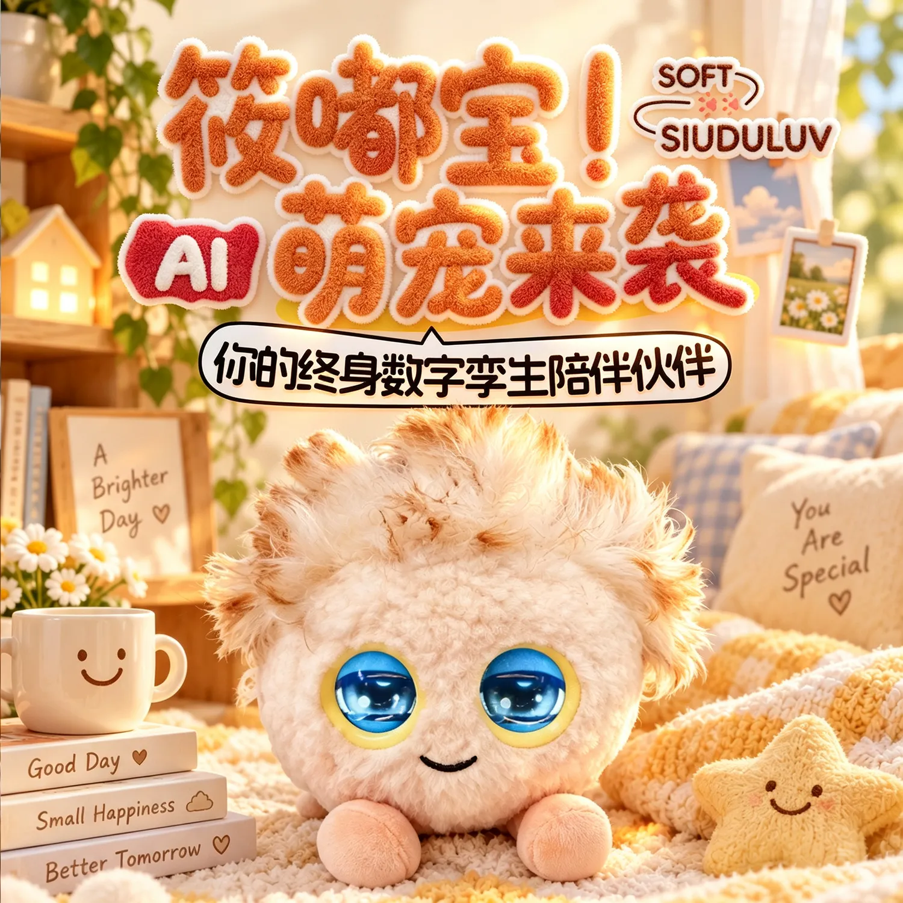
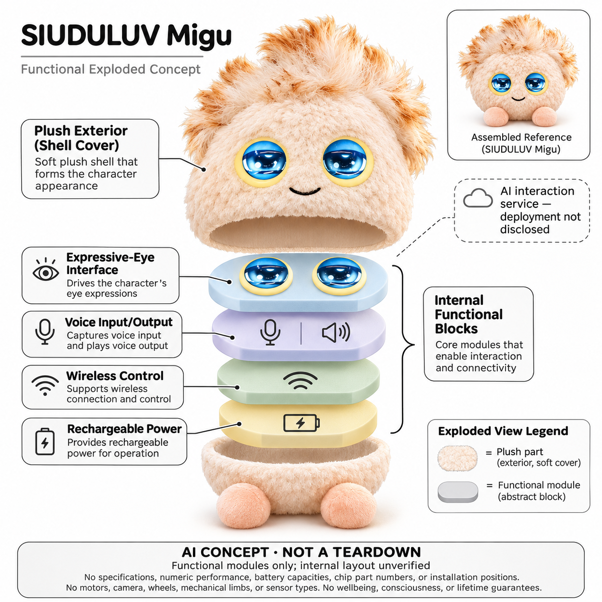

# 筱嘟宝 SIUDULUV 米咕

**SIUDULUV / 筱嘟宝** · AI玩具 · 核查 2026-11-06

以毛绒角色和表情眼睛承载日常语音陪伴。

消费渠道：个人零售。

## 产品图片与结构参考

### 产品图

米咕官方产品宣传图 · 来源：[SIUDULUV · 官方物料](<https://www.siuduluv.com/mall/products/42>) · [原始图片](<https://download.soulxiaodu.com/archive/ssd-%E5%92%AA%E5%92%95/zhutu1.webp>)

### 参考图

米咕官方场景参考物料 · 来源：[SIUDULUV · 官方物料](<https://www.siuduluv.com/mall/products/42>) · [原始图片](<https://download.soulxiaodu.com/archive/ssd-%E5%92%AA%E5%92%95/zhutu2.webp>)

### AI 生成爆炸示意

**AI 生成 · 非实物拆机。** 内部为概念推断，不能作为元件布局、BOM 或维修依据。[生成提示词](../../content/hardware/prompts/siuduluv-migu.txt)

> 内置ImageGen独立生成并目视核验，仅显示抽象功能块；未猜测PCB、电池容量和传感器位置。

> 使用对应型号官方物料，宣传场景可能含合成处理，不作独立实拍、疗效或终身服务保证；未语义编辑。

> 分析为基于公开资料的案头研究与 AI 辅助判断，未经用户访谈、销量审计或实物拆机。需求、画像、竞争冷门度、审美及商业机会均为研究假设，不是投资结论。

## 销售与购买

- 状态：在售。品牌商城具体商品页显示米咕、库存、加购与立即购买，官方FAQ描述现货发货与大陆配送；未实际付款。

- 地区：中国大陆大部分地区（以结算可选地址为准）

- 价格：人民币269元。核查为米咕商品价，划线价299元；套餐、网络及后续内容收费未完整披露，不写一次买断永久免费。

- 中国大陆：中文品牌官网有人民币商品和官方购买入口，FAQ明确大陆大部分地区配送；商品与联系页运营主体表述不同，合同销售方、票据和售后归属需下单前核实。

- [官方产品 / 商店](<https://www.siuduluv.com/mall/products/42>)

## AI 的实际作用

官方把米咕定位为能进行语音陪聊、故事和角色性格互动的AI毛绒，表情眼睛呈现反馈。具体模型、记忆算法与情绪判断效果没有公开可核细节，不能仅凭“AI性格”宣称真实情感。

服务与联网依赖：官方FAQ要求手机App、手机号账户、设备绑定与2.4GHz Wi-Fi；首页提端侧AI但未说明各功能的端云分工，不能写成全离线运行，长期服务费用亦需确认。

## 是否冷门

新兴竞争（研究判断）：毛绒AI陪伴已有多家进入，国内价格与渠道是比较因素，公开技术及服务透明度仍需补证。

## 需求与市场

米咕将聊天、讲故事和角色表情放进一只小型毛绒伙伴，面向希望把轻量互动放在生活空间中的使用者。核心需求可能是随手交流与角色陪伴，而不是精确知识检索或课程训练；是否存在长期价值，需要看用户反复开启什么任务，不能把品牌宣传的温暖与治愈直接当作需求已被验证。

### 任务判断 · 研究判断

米咕将聊天、讲故事和角色表情放进一只小型毛绒伙伴，面向希望把轻量互动放在生活空间中的使用者。核心需求可能是随手交流与角色陪伴，而不是精确知识检索或课程训练；是否存在长期价值，需要看用户反复开启什么任务，不能把品牌宣传的温暖与治愈直接当作需求已被验证。

依据：[米咕官方商城商品页](<https://www.siuduluv.com/mall/products/42>) · [筱嘟宝官方FAQ](<https://www.siuduluv.com/help/faq>)

### 场景拆分 · 研究判断

官方同时使用家庭故事、日常倾听和潮玩送礼的表达，这些购买动机并不完全相同。孩子可能希望共同编故事，成人可能只想有可爱的桌面回应，送礼者则关注包装；研究应区分这些行为，不把同一毛球可以放在多处空间理解为每个场景都有独立市场。

依据：[米咕官方商城商品页](<https://www.siuduluv.com/mall/products/42>) · [筱嘟宝官方FAQ](<https://www.siuduluv.com/help/faq>)

### 需求验证 · 待验证

可以用原创的短故事和日常分享任务观察米咕与普通毛绒、手机语音应用的差异，记录谁主动开始、何时结束和是否再次使用。对等待、答非所问和需要成人解释的情况同样记录，至少跨过开箱新鲜期；本轮没有实物体验，不能把验证计划写成真实留存结果。

依据：[米咕官方商城商品页](<https://www.siuduluv.com/mall/products/42>) · [筱嘟宝官方FAQ](<https://www.siuduluv.com/help/faq>)

## 用户画像

画像推断：喜欢软触感和表情角色、能够使用手机App并愿意管理网络的人，更容易完成米咕的基本使用。官网面向家庭也展示成人场景，但具体型号没有充分可核的年龄和全部服务条件，因此不能仅凭毛绒外观把所有幼儿都视为适用对象，仍应核对包装说明与监护要求。

### 画像判断 · 研究判断

画像推断：喜欢软触感和表情角色、能够使用手机App并愿意管理网络的人，更容易完成米咕的基本使用。官网面向家庭也展示成人场景，但具体型号没有充分可核的年龄和全部服务条件，因此不能仅凭毛绒外观把所有幼儿都视为适用对象，仍应核对包装说明与监护要求。

依据：[米咕官方商城商品页](<https://www.siuduluv.com/mall/products/42>) · [筱嘟宝官方FAQ](<https://www.siuduluv.com/help/faq>)

### 家庭管理 · 研究判断

手机号账户与设备绑定使购买者、配置者和日常使用者可能承担不同角色，赠礼后尤其容易忽略后续管理。家庭需要知道谁负责内容设置、售后与数据请求，不能以一只玩具看起来简单就认定老人或儿童能够独立处理全部问题；这种责任分工也是用户画像的一部分。

依据：[米咕官方商城商品页](<https://www.siuduluv.com/mall/products/42>) · [筱嘟宝官方FAQ](<https://www.siuduluv.com/help/faq>)

### 画像验证 · 待验证

建议分别观察成人自用与家长陪同的开箱流程，检查是否能理解配网、唤醒和退出服务，并让使用者说出真正想让角色做的事情。对只喜欢收藏而不愿注册账户的人，应保留普通毛绒作为替代，不用购买能力或网站人物照片直接推断可持续使用的人群。

依据：[米咕官方商城商品页](<https://www.siuduluv.com/mall/products/42>) · [筱嘟宝官方FAQ](<https://www.siuduluv.com/help/faq>)

## 竞争与替代

米咕与Kumma、Fuzozo、普通毛绒和手机角色聊天应用存在明显替代关系，主要比较点是声音互动、表情表达和服务可管理性。不同毛簇、颜色和角色名称并不自动产生新需求，本目录只选一个具体可购商品代表，不把官网所有盲盒和外观版本加总为独立创新方向。

### 比较对象 · 研究判断

米咕与Kumma、Fuzozo、普通毛绒和手机角色聊天应用存在明显替代关系，主要比较点是声音互动、表情表达和服务可管理性。不同毛簇、颜色和角色名称并不自动产生新需求，本目录只选一个具体可购商品代表，不把官网所有盲盒和外观版本加总为独立创新方向。

依据：[米咕官方商城商品页](<https://www.siuduluv.com/mall/products/42>) · [筱嘟宝官方FAQ](<https://www.siuduluv.com/help/faq>)

### 公开差异 · 研究判断

相比披露详细免费额度和地区限制的Fuzozo英语版，米咕的公开技术、长期收费与服务主体说明仍较少。它有国内人民币直售入口和大陆配送说明，但便利购买不等于效果更好；竞争分析要同时看到信息透明度与角色审美，不能只凭低价或中文页面判断优势。

依据：[米咕官方商城商品页](<https://www.siuduluv.com/mall/products/42>) · [筱嘟宝官方FAQ](<https://www.siuduluv.com/help/faq>)

### 比较验证 · 待验证

可用相同提问和故事回合比较米咕、固定音频玩具与手机应用，记录回应是否接住前文、停止是否清晰和家长能否查看相关状态。把注册、联网与服务询问的时间一并计入，若任务主要是听固定故事，应允许非生成式方案更适合，而不是预设AI标签必然更优。

依据：[米咕官方商城商品页](<https://www.siuduluv.com/mall/products/42>) · [筱嘟宝官方FAQ](<https://www.siuduluv.com/help/faq>)

## 供应链

公开商品图支持毛绒角色、双眼表情和语音互动，FAQ支持手机账户及无线联网；这些足以建立功能层示意，但不能确定屏幕型号、传感器种类或主板位置。具体电源参数与端云推理分工也未充分披露，因此图里只用抽象块表达职责，不画声称来自真实拆机的内部细节。

### 功能拆分 · 研究判断

公开商品图支持毛绒角色、双眼表情和语音互动，FAQ支持手机账户及无线联网；这些足以建立功能层示意，但不能确定屏幕型号、传感器种类或主板位置。具体电源参数与端云推理分工也未充分披露，因此图里只用抽象块表达职责，不画声称来自真实拆机的内部细节。

依据：[米咕官方商城商品页](<https://www.siuduluv.com/mall/products/42>) · [筱嘟宝官方FAQ](<https://www.siuduluv.com/help/faq>)

### 制造约束 · 研究判断

圆形毛绒和大眼睛需要兼顾软触感、窗口固定、语音通道与使用中的脏污，顶部毛簇也可能影响长期外观。工厂、测试流程和物料来源未知，不能根据外壳相似就断言与其他毛球共用平台；实际选型仍要评估装配牢固、清洁方式和维护服务是否与目标使用者匹配。

依据：[米咕官方商城商品页](<https://www.siuduluv.com/mall/products/42>) · [筱嘟宝官方FAQ](<https://www.siuduluv.com/help/faq>)

### 能力候选 · 研究判断

Seeed的感知联网样机工程可作为对话终端开发候选，瑞声的声学单元与调试能力可用于软材料覆盖下的声音评估。没有米咕采用它们的公开证据，角色内容、眼睛显示及毛绒加工仍需不同能力协同；候选链接不表示已采购，也不承诺量产成本、最小订单或交期。

依据：[米咕官方商城商品页](<https://www.siuduluv.com/mall/products/42>) · [筱嘟宝官方FAQ](<https://www.siuduluv.com/help/faq>)

## 技术路径

官方以AI对话和性格互动描述米咕，图文展示眼睛变化，首页另提端侧AI，但没有说明哪些功能在本地完成、哪些请求经过外部服务。分析只能确认公开的交互定位和联网要求，不能据一句端侧宣传写成完全离线大模型，也不能将情绪感知解释为已验证的心理状态判断。

### 技术边界 · 研究判断

官方以AI对话和性格互动描述米咕，图文展示眼睛变化，首页另提端侧AI，但没有说明哪些功能在本地完成、哪些请求经过外部服务。分析只能确认公开的交互定位和联网要求，不能据一句端侧宣传写成完全离线大模型，也不能将情绪感知解释为已验证的心理状态判断。

依据：[米咕官方商城商品页](<https://www.siuduluv.com/mall/products/42>) · [筱嘟宝官方FAQ](<https://www.siuduluv.com/help/faq>)

### 系统难点 · 研究判断

小毛球容易被抱住、放进包里或靠近其他声音来源，声音入口和眼睛状态必须帮助用户区分正在听、等待与无法回应。角色记忆若存在也需要处理错误输入与纠正，而公开资料尚不足以说明这些机制；因此技术评价应关注可解释的反馈，避免只记录最流畅的一次演示。

依据：[米咕官方商城商品页](<https://www.siuduluv.com/mall/products/42>) · [筱嘟宝官方FAQ](<https://www.siuduluv.com/help/faq>)

### 验证方法 · 待验证

建议在安静、背景电视声和网络中断条件下测试同一组短问题，记录唤醒、回答与表情是否一致。使用虚构信息检查上下文和纠正，不提交个人敏感内容，再核实断网后还剩哪些能力；本轮没有调用设备或抓取端云流量，不能给出离线能力和准确率结论。

依据：[米咕官方商城商品页](<https://www.siuduluv.com/mall/products/42>) · [筱嘟宝官方FAQ](<https://www.siuduluv.com/help/faq>)

## 产品审美

浅色圆毛绒、顶部毛簇、蓝色大眼与固定微笑让米咕接近可随身携带的小型潮玩，软脚帮助构成完整角色。厂商商品图采用浓重宣传场景，不能作为独立实拍品质证明；审美评价应进一步观察实际材质、体积和长时间触摸后的状态，而不是把合成感场景当作真实家庭反馈。

### 审美判断 · 研究判断

浅色圆毛绒、顶部毛簇、蓝色大眼与固定微笑让米咕接近可随身携带的小型潮玩，软脚帮助构成完整角色。厂商商品图采用浓重宣传场景，不能作为独立实拍品质证明；审美评价应进一步观察实际材质、体积和长时间触摸后的状态，而不是把合成感场景当作真实家庭反馈。

依据：[米咕官方商城商品页](<https://www.siuduluv.com/mall/products/42>) · [筱嘟宝官方FAQ](<https://www.siuduluv.com/help/faq>)

### 表情与理解 · 研究判断

大眼睛的动态图形容易强化生命感，但用户需要能区分表情娱乐和系统状态，例如配网失败或服务暂停。若所有情形都显示可爱动画，反而可能掩盖设备没有听清的问题；这类视觉语言应与语音提示、按键和家长控制共同评估，不能只按表情丰富程度判断体验完整。

依据：[米咕官方商城商品页](<https://www.siuduluv.com/mall/products/42>) · [筱嘟宝官方FAQ](<https://www.siuduluv.com/help/faq>)

### 审美验证 · 待验证

可以让样机在真实桌面、包具和收纳环境中使用，记录是否容易弄脏、毛簇是否压塌以及眼睛窗口是否耐磨。询问用户在公共场合让毛绒说话是否自然，并检查充电与清洁的操作，避免只根据新品照片或送礼时的喜爱就推断长期可接受性。

依据：[米咕官方商城商品页](<https://www.siuduluv.com/mall/products/42>) · [筱嘟宝官方FAQ](<https://www.siuduluv.com/help/faq>)

## 关键风险

商城页脚与公开联系页列出不同公司名称，品牌公开资料没有充分解释关系，下单前需确认实际销售合同主体、发票和售后责任。具体订阅与端云处理也不够透明，不能把网站的库存数字和安全原则当成全部交付条件已经明确，更不应把宣传中的终身伙伴理解为永久服务保证。

### 信息风险 · 研究判断

商城页脚与公开联系页列出不同公司名称，品牌公开资料没有充分解释关系，下单前需确认实际销售合同主体、发票和售后责任。具体订阅与端云处理也不够透明，不能把网站的库存数字和安全原则当成全部交付条件已经明确，更不应把宣传中的终身伙伴理解为永久服务保证。

依据：[米咕官方商城商品页](<https://www.siuduluv.com/mall/products/42>) · [筱嘟宝官方FAQ](<https://www.siuduluv.com/help/faq>)

### 数据与陪伴 · 研究判断

家长安全页说明对话保存取决于功能和设置，并提供查看、导出和删除请求渠道，这些属于厂商声明而非独立审计。使用者应理解玩具可以回应一般信息，却不能代替照护者或专业服务；其角色表达越亲近，越需要清楚告知回答不确定性与什么时候找真人帮助。

依据：[米咕官方商城商品页](<https://www.siuduluv.com/mall/products/42>) · [筱嘟宝官方FAQ](<https://www.siuduluv.com/help/faq>)

### 风险验证 · 待验证

建议在付款前核对包装年龄、联网、收费和保修说明，体验账户注销及数据请求流程，并由成人先测试不确定回答和停止互动。对宣传页与商品页的矛盾应保留书面询问，不自行猜测；本轮没有完成交易、客服验证或安全测试，目录仅记录当前公开证据范围。

依据：[米咕官方商城商品页](<https://www.siuduluv.com/mall/products/42>) · [筱嘟宝官方FAQ](<https://www.siuduluv.com/help/faq>)

## 机会与验证

米咕的机会可能是为国内用户提供价格相对容易尝试的毛绒对话入口，但持续价值需要来自具体交流行为和清楚的维护服务。若用户主要为外观收藏付费，模型功能未必是决定因素，因此创业团队应区分潮玩生意与联网服务生意，不把两者混合宣传当作已经成立的复购逻辑。

### 机会判断 · 研究判断

米咕的机会可能是为国内用户提供价格相对容易尝试的毛绒对话入口，但持续价值需要来自具体交流行为和清楚的维护服务。若用户主要为外观收藏付费，模型功能未必是决定因素，因此创业团队应区分潮玩生意与联网服务生意，不把两者混合宣传当作已经成立的复购逻辑。

依据：[米咕官方商城商品页](<https://www.siuduluv.com/mall/products/42>) · [筱嘟宝官方FAQ](<https://www.siuduluv.com/help/faq>)

### 改进方向 · 研究判断

公开准确的型号、年龄要求、端云职责、服务期限和合同主体，可以直接降低消费者理解成本，也有助于研究者比较同类产品。这里的机会重点是信息和服务交付，而不是再加一种毛绒颜色；当前没有足够证据证明这些改进已经实现，更不能据页面评价或库存推导销量。

依据：[米咕官方商城商品页](<https://www.siuduluv.com/mall/products/42>) · [筱嘟宝官方FAQ](<https://www.siuduluv.com/help/faq>)

### 商业验证 · 待验证

可以在明确全部条件后开展小规模付费试用，比较用户为外观、故事还是日常倾听付费，并记录后续闲置、退款和服务咨询原因。实际支出应包含网络与可能的内容费，只有持续使用理由和可接受价格一致，才考虑扩大角色系列；本轮不对市场规模或营收作无依据预测。

依据：[米咕官方商城商品页](<https://www.siuduluv.com/mall/products/42>) · [筱嘟宝官方FAQ](<https://www.siuduluv.com/help/faq>)

## 对应供应链公司

能力候选用于选型研究，不代表本产品实际采用；未公开的供货关系不作推断。

- [seeed-studio](../supply-chain/seeed-studio.md) — **能力候选 · 非已采用** / 联网语音和显示交互原型：Seeed公开原型与感知模组工程可用于重新开发同类毛绒对话终端，但没有米咕实际供货证据；外套固定、声学通道、眼睛显示与账户服务需专项验证，不据候选能力推断原厂内部方案。

- [aac-technologies](../supply-chain/aac-technologies.md) — **能力候选 · 非已采用** / 小型毛绒声学路径：瑞声小型声学单元和整机调试能力可用于评估声音经过毛绒材料后的表现，但本型号未披露采购关系；实际体积、功耗、音量及安全要求必须通过样机和商务确认，不能直接视为已采用。

[浏览供应链目录](../supply-chain.md)

## 功能分层示意

这是功能关系，不是实物拆机、真实空间结构或已核实 BOM。

1. **毛绒角色**：米咕浅色圆形毛绒、顶部毛簇、软脚与固定微笑。（官方披露）

2. **表情界面**：官方图文展示双眼图形随互动变化。（官方披露）

3. **语音输入输出**：对话和故事通过语音交互，具体声学器件位置未知。（官方披露）

4. **连接与账户**：App绑定与2.4GHz Wi-Fi建立服务入口。（官方披露）

5. **控制及供电**：为交互提供基础控制与电源；内部布局和电源规格不作确认。（分析推断）

## 来源

1. [米咕官方商城商品页](<https://www.siuduluv.com/mall/products/42>) — Chrome实际打开米咕269元、库存、加购和立即购买；读取并目视核对该型号图组，不执行下单。

2. [筱嘟宝官方FAQ](<https://www.siuduluv.com/help/faq>) — Chrome实际读取手机App绑定、2.4GHz Wi-Fi、中国大陆大部分地区配送和现货发货说明。

3. [筱嘟宝家长安全说明](<https://www.siuduluv.com/safety>) — Chrome实际读取功能数据处理边界与家长查看/删除渠道；品牌原则不视为独立安全审计。

4. [筱嘟宝品牌介绍](<https://www.siuduluv.com/>) — 实际打开语音内容、角色、对话与家长控制介绍；端侧AI营销未提供可验证技术细节。

5. [筱嘟宝公开联系页](<https://www.siuduluv.com/about>) — 页面列嘉兴潇湘阁智能家居股份有限公司，商城页脚列桐乡霄享人工智能科技有限公司；主体不一致保留为下单前应确认事项，不猜两者关系。

[返回目录](../hardware-market.md) · [网页分析](https://romanagent.github.io/Roman/#hardware/product/siuduluv-migu)
