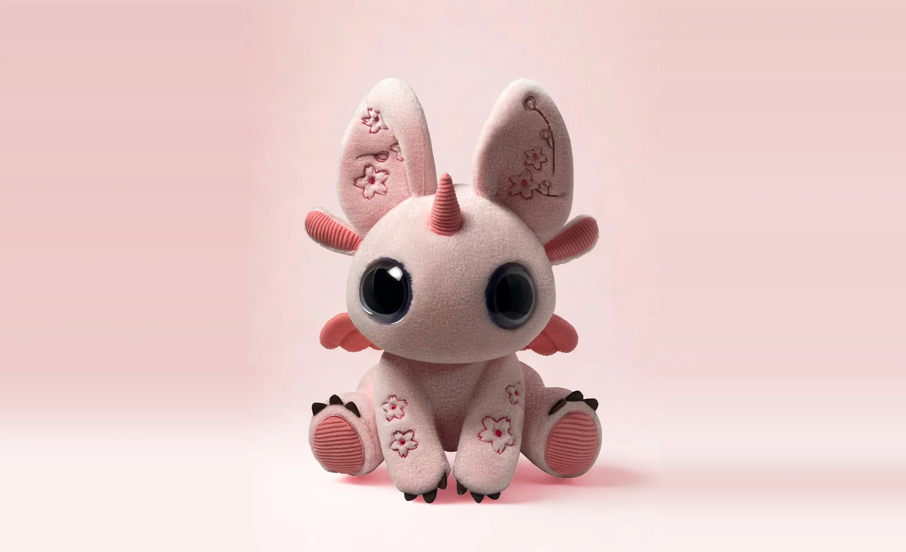
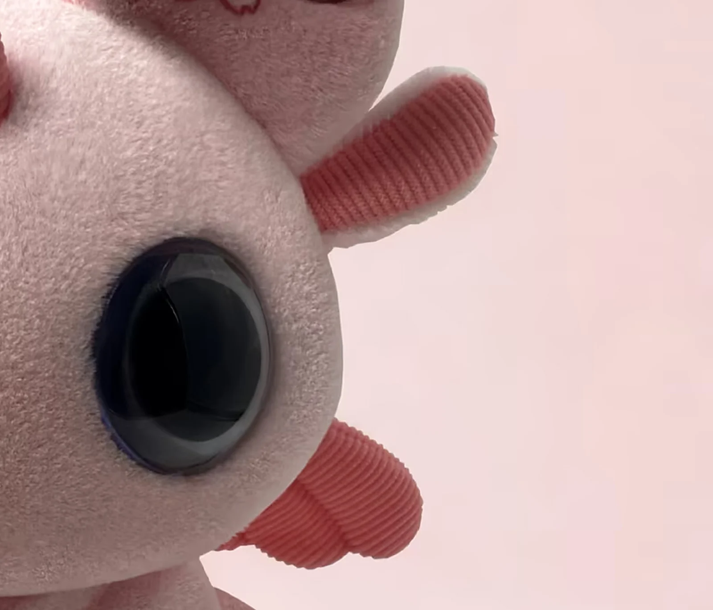
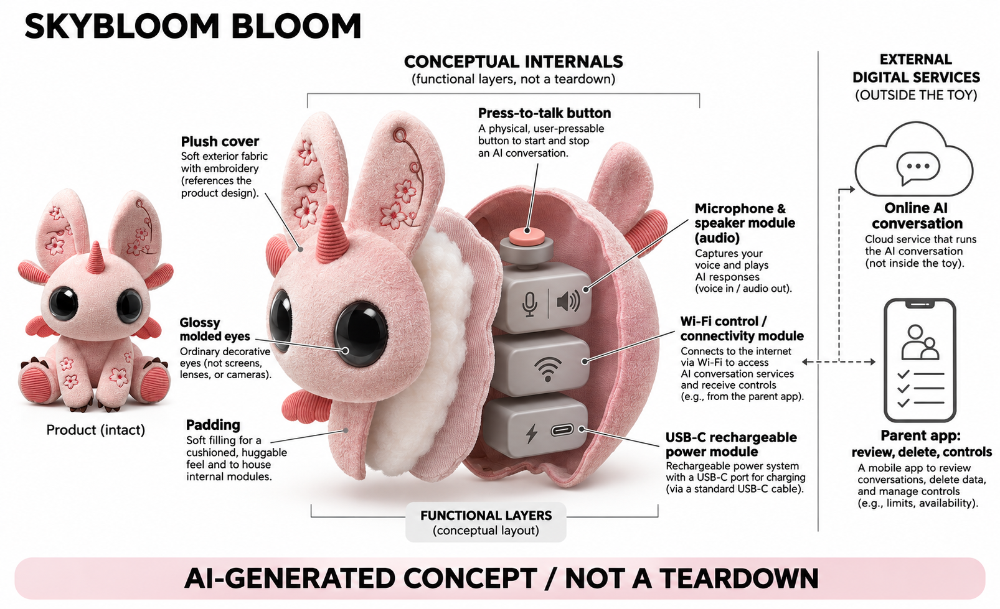

# SkyBloom Bloom

**SkyBloom** · AI玩具 · 核查 2026-11-06

按键开启收音、家长可回看对话的长耳毛绒伙伴

消费渠道：个人零售。

## 产品图片与结构参考

### 产品图

官方粉色Bloom产品外观 · 来源：[产品品牌官网](<https://www.meetskybloom.com/products>) · [原始图片](<https://www.meetskybloom.com/images/product/bloom-pink-wide.webp>)

### 参考图

官方Bloom塑料眼与侧部织物细节 · 来源：[产品品牌官网](<https://www.meetskybloom.com/products>) · [原始图片](<https://www.meetskybloom.com/images/product/bloom-pink-face.webp>)

### AI 生成爆炸示意

**AI 生成 · 非实物拆机。** 内部为概念推断，不能作为元件布局、BOM 或维修依据。[生成提示词](../../content/hardware/prompts/skybloom-bloom.txt)

> 由协作代理使用内置ImageGen独立生成，已检查外形和功能边界；未知内部不能作为BOM或维修依据。

> 图片保留官方原貌；效果、安全与性能宣传不代表本目录独立验证。

> 分析为基于公开资料的案头研究与 AI 辅助判断，未经用户访谈、销量审计或实物拆机。需求、画像、竞争冷门度、审美及商业机会均为研究假设，不是投资结论。

## 销售与购买

- 状态：在售。2026-11-06官方商品页及浏览器显示单只US$149与Order now；进一步观察到正确Pink商品购物车及官方商店Checkout入口，随后清空本次测试项。未提交地址、资料或付款。

- 地区：官网美元零售渠道，具体配送地区以结算为准

- 价格：US$149（当前单只上线价）。官方单只与双只包不同，税运在结算计算；本轮未核实完整后续收费计划，不将硬件价格解释成无限期包含全部AI服务。

- 中国大陆：未核实中国大陆官方销售、物流、应用与联网服务；支持多语言不能代替地区支持证据，也不从品牌联系地址推断产地。

- [官方产品 / 商店](<https://www.meetskybloom.com/products>)

## AI 的实际作用

接收按键触发的儿童语音并进行即时对话、故事和游戏，保留适量偏好用于后续回应；外部家长应用呈现文字历史、摘要与需要注意的话题提示。

服务与联网依赖：需要2.4GHz Wi-Fi和家长应用；声音转成文字再由软件回应，官方称原始录音处理后删除、文字最多保留90天，模型供应与部署细节未完整公开。

## 是否冷门

新兴竞争（研究判断）：与多家儿童语音毛绒共享核心任务，按键收音和家长参与是比较维度；不根据外形、宣传证言或语言数量判定市场领先。

## 需求与市场

孩子提出角色和故事走向，玩具给出回应，可能帮助家庭在日常间隙展开游戏。价值应看孩子是否持续贡献想法和愿意与家人分享，而不是对话时长越长越好；如果互动主要由设备推动，低屏幕使用也不能自动证明家庭交流得到改善。

### 事实｜商品把对话和家长参与结合 · 官方资料

Bloom提供自然语音对话、故事和游戏，家长应用显示摘要、文字历史和使用情况，并允许提供后续互动建议。它不是只播放预录内容的毛绒，但模型版本没有公开；目录记录这些功能层次，不由家庭证言推导每位儿童都能获得相同的表达或学习收益。

依据：[SkyBloom当前产品与订单入口](<https://www.meetskybloom.com/products>) · [SkyBloom对话与隐私机制说明](<https://www.meetskybloom.com/safety>)

### 判断｜需求可能是孩子主导的短时共玩 · 研究判断

孩子提出角色和故事走向，玩具给出回应，可能帮助家庭在日常间隙展开游戏。价值应看孩子是否持续贡献想法和愿意与家人分享，而不是对话时长越长越好；如果互动主要由设备推动，低屏幕使用也不能自动证明家庭交流得到改善。

依据：[SkyBloom当前产品与订单入口](<https://www.meetskybloom.com/products>)

### 验证｜观察家长介入如何改变游戏 · 待验证

可以记录家长使用Whisper前后孩子是否愿意延续话题，是否感到突兀，以及家长查看摘要是否增加负担。应与不使用该功能的自然共玩比较，避免把任何参与都解释为积极效果；本目录没有家庭访谈、对照试验或销量资料，相关需求仅为研究假设。

依据：[SkyBloom当前产品与订单入口](<https://www.meetskybloom.com/products>) · [SkyBloom对话与隐私机制说明](<https://www.meetskybloom.com/safety>)

## 用户画像

孩子需要知道何时可以说话和怎样结束，家长需要了解记录、记忆和提醒包含什么。两者期待可能不同，尤其成人把提醒视为监督而孩子把玩具视为私人朋友时；研究应关注这些理解差异，不能只按是否喜欢外形来判断家庭适配。

### 事实｜官网定位三至十岁并要求家长应用 · 官方资料

当前FAQ将Bloom面向三至十岁，家长应用承担可见性和控制，而孩子通过玩具声音互动。年龄范围属于厂商定位，不保证每个阶段的儿童都能正确理解AI回答；目录不把毛绒角色用作替代成人、教师或专业支持的工具。

依据：[SkyBloom当前产品与订单入口](<https://www.meetskybloom.com/products>)

### 判断｜孩子和家长需要不同的信息 · 研究判断

孩子需要知道何时可以说话和怎样结束，家长需要了解记录、记忆和提醒包含什么。两者期待可能不同，尤其成人把提醒视为监督而孩子把玩具视为私人朋友时；研究应关注这些理解差异，不能只按是否喜欢外形来判断家庭适配。

依据：[SkyBloom当前产品与订单入口](<https://www.meetskybloom.com/products>) · [SkyBloom对话与隐私机制说明](<https://www.meetskybloom.com/safety>)

### 验证｜检查按键与历史功能是否容易理解 · 待验证

试用可以让孩子用公开话题完成一轮提问，家长再寻找对应文字和删除入口，确认双方理解互动状态。多成员使用时还需注意记忆归属，避免混合个人经历；本研究没有激活设备或处理儿童资料，也不根据宣传界面声称真实操作已经验证。

依据：[SkyBloom当前产品与订单入口](<https://www.meetskybloom.com/products>) · [SkyBloom对话与隐私机制说明](<https://www.meetskybloom.com/safety>)

## 竞争与替代

对话毛绒已经出现多种角色，Bloom需要与它们及传统故事播放器共同比较。塑料大眼和柔软身体可能形成识别，但真正使用差异应来自按键收音、故事质量和家长控制；不能因没有屏幕就认为它一定比其他设备更有助于成长或更少占用注意力。

### 事实｜两个配色与套装共用核心功能 · 官方资料

官方商品提供粉色、绿色与双只组合，均围绕同一Bloom对话产品。目录只建立一个条目，价格采用单只当前页面，不把兄弟姐妹套装或颜色视为新硬件机制；旧搜索摘要的预售时间也不能替代本轮已观察到的当前商品和购物车状态。

依据：[SkyBloom当前产品与订单入口](<https://www.meetskybloom.com/products>)

### 判断｜差异在声音流程与家长控制 · 研究判断

对话毛绒已经出现多种角色，Bloom需要与它们及传统故事播放器共同比较。塑料大眼和柔软身体可能形成识别，但真正使用差异应来自按键收音、故事质量和家长控制；不能因没有屏幕就认为它一定比其他设备更有助于成长或更少占用注意力。

依据：[SkyBloom当前产品与订单入口](<https://www.meetskybloom.com/products>) · [SkyBloom对话与隐私机制说明](<https://www.meetskybloom.com/safety>)

### 验证｜把完整费用与管理时间一起比较 · 待验证

硬件促销会降低首次购买门槛，但后续服务、网络和家长维护也可能影响选择。比较应围绕同一段使用周期和真实任务，核对权益与支出，而不是只比较划线价格；本轮未获得长期收费与运营数据，不能推断厂商利润或家庭总成本优势。

依据：[SkyBloom当前产品与订单入口](<https://www.meetskybloom.com/products>)

## 供应链

大耳、侧鳍和长肢造型会影响抱持、放置与声孔遮挡，按键的位置又决定是否容易误触。类似产品应把外皮、填充、声音和状态控制共同设计，而非仅把现成聊天模块塞进玩偶；具体可维护性和清洁方式还需随货说明与实物验证。

### 事实｜按钮音频无线和充电已有披露 · 官方资料

官方列出按钮开启麦克风、扬声器、Wi-Fi和USB-C充电，并明确没有摄像头和屏幕，眼睛是模塑塑料。具体主控、声学器件、电池型号和工厂未公开；这些信息支持功能分层，不足以绘制精确内部电路、驱动机构或生产装配顺序。

依据：[SkyBloom当前产品与订单入口](<https://www.meetskybloom.com/products>) · [SkyBloom对话与隐私机制说明](<https://www.meetskybloom.com/safety>)

### 判断｜毛绒外形与电子状态必须协同 · 研究判断

大耳、侧鳍和长肢造型会影响抱持、放置与声孔遮挡，按键的位置又决定是否容易误触。类似产品应把外皮、填充、声音和状态控制共同设计，而非仅把现成聊天模块塞进玩偶；具体可维护性和清洁方式还需随货说明与实物验证。

依据：[SkyBloom当前产品与订单入口](<https://www.meetskybloom.com/products>) · [SkyBloom对话与隐私机制说明](<https://www.meetskybloom.com/safety>)

### 验证｜候选器件不等于原机供应关系 · 待验证

供应研究可以考察Wi-Fi控制和MEMS采音能力，并在抱持遮挡、播放回声和断网恢复中测试。目录没有品牌点名任何芯片或工厂的证据，因此关联只用于同类设计选型；器件性能也不能自动证明按键上传边界、内容过滤或家长应用的可靠性。

依据：[SkyBloom当前产品与订单入口](<https://www.meetskybloom.com/products>) · [SkyBloom对话与隐私机制说明](<https://www.meetskybloom.com/safety>)

## 技术路径

摘要有助于家长快速了解主题，却可能遗漏语气、上下文和虚构游戏的区别。提醒应允许回到原始文字，而不能把模型推断直接当成孩子真实状态；技术评价要看误解如何被纠正，以及删除记忆是否让家庭真正掌握继续个性化的范围。

### 事实｜语音与文字有不同处理规则 · 官方资料

安全说明称声音转成文字后原始录音删除，文字可在应用查看并最多保留九十天，另有可删除的记忆。它描述了不同数据层，不能简化成从不保存对话；这些仍是厂商规则披露，本目录没有独立审计其后台实现或确认具体模型服务商。

依据：[SkyBloom对话与隐私机制说明](<https://www.meetskybloom.com/safety>)

### 判断｜记忆摘要和原始话语需要对应 · 研究判断

摘要有助于家长快速了解主题，却可能遗漏语气、上下文和虚构游戏的区别。提醒应允许回到原始文字，而不能把模型推断直接当成孩子真实状态；技术评价要看误解如何被纠正，以及删除记忆是否让家庭真正掌握继续个性化的范围。

依据：[SkyBloom当前产品与订单入口](<https://www.meetskybloom.com/products>) · [SkyBloom对话与隐私机制说明](<https://www.meetskybloom.com/safety>)

### 验证｜检查停止收音与网络恢复行为 · 待验证

可以用非敏感话题观察按键前后是否有明确提示、说完后如何结束，以及网络恢复会不会重复处理旧请求。还应核对历史和记忆删除后的实际效果；本轮没有运行硬件或采集声音，不能以官网写明控制机制就声称所有边界已被实测验证。

依据：[SkyBloom当前产品与订单入口](<https://www.meetskybloom.com/products>) · [SkyBloom对话与隐私机制说明](<https://www.meetskybloom.com/safety>)

## 产品审美

大眼与软质身体可能让孩子自然赋予角色性格，但玩具的实际能力仍由软件和服务决定。审美设计应让开口、等待和结束易于辨别，避免外形一直微笑却让人不知道它有没有听懂；是否产生积极体验需要观察真实游戏，不能靠造型推断。

### 事实｜大眼是装饰而非视觉输入 · 官方资料

官方特别说明Bloom的眼睛为模塑塑料，不含摄像头，照片中的反光不能当作镜头证据。主图展示长耳、额角和侧部软鳍，形成鲜明角色；生成图会保留这些外观，并把内部以概念层呈现，不增加运动电机、显示面板或视觉传感器。

依据：[SkyBloom对话与隐私机制说明](<https://www.meetskybloom.com/safety>)

### 判断｜拟人化需要清楚的声音状态 · 研究判断

大眼与软质身体可能让孩子自然赋予角色性格，但玩具的实际能力仍由软件和服务决定。审美设计应让开口、等待和结束易于辨别，避免外形一直微笑却让人不知道它有没有听懂；是否产生积极体验需要观察真实游戏，不能靠造型推断。

依据：[SkyBloom当前产品与订单入口](<https://www.meetskybloom.com/products>) · [SkyBloom对话与隐私机制说明](<https://www.meetskybloom.com/safety>)

### 验证｜把日常维护与放置纳入体验 · 待验证

家庭试用应检查按键在抱持中是否好找、放在不同位置能否听清、成人充电是否方便以及如何按说明清洁。照片只能反映外观，不支持耐洗或抗跌结论；目录不会把可爱角色、圆润边缘或宣传里的长续航当作已经独立验证的安全和便利。

依据：[SkyBloom当前产品与订单入口](<https://www.meetskybloom.com/products>)

## 关键风险

对话里可能混入家庭信息，记忆让这些内容在后续互动中再次出现。家长需要知道保存多久、谁能查看和如何退出，服务变化也会影响硬件价值；无摄像头减少一种输入，却不能自动消除声音和文字处理的风险，仍需按实际功能评价。

### 事实｜提醒并非紧急监护服务 · 官方资料

官方说明敏感情境下会引导孩子找可信成人并通知家长，同时明确AI并不完美，Bloom不提供紧急监护，也不替代家长和专业人员。目录保留这一范围，不用没有收到提醒推导没有问题，更不将记录和摘要视为儿童心理状态诊断。

依据：[SkyBloom对话与隐私机制说明](<https://www.meetskybloom.com/safety>)

### 判断｜持续历史会增加资料管理责任 · 研究判断

对话里可能混入家庭信息，记忆让这些内容在后续互动中再次出现。家长需要知道保存多久、谁能查看和如何退出，服务变化也会影响硬件价值；无摄像头减少一种输入，却不能自动消除声音和文字处理的风险，仍需按实际功能评价。

依据：[SkyBloom对话与隐私机制说明](<https://www.meetskybloom.com/safety>)

### 验证｜核对历史记忆和退出的区别 · 待验证

采用时应分别验证删除某次文字、清除记忆和停止使用账户的效果，再了解服务终止时如何处理资料。测试以最少必要的非敏感样本进行，不要求儿童披露个人困境；本目录没有安全审计或法律判断，厂商合规用语也不作为本研究保证。

依据：[SkyBloom当前产品与订单入口](<https://www.meetskybloom.com/products>) · [SkyBloom对话与隐私机制说明](<https://www.meetskybloom.com/safety>)

## 机会与验证

Bloom值得继续研究的是家长能否参与而不过度管理、孩子能否获得有回应但可随时结束的游戏。角色外形只是入口，长期差异需要通过内容、记忆控制和服务维护体现；无法从初始价格或厂商家庭采访推导广泛需求及未来收入。

### 事实｜当前下单路径已能显示具体商品 · 官方资料

本轮浏览器在选择粉色单只后显示相应购物车金额和官方商店结算入口，随后移除测试项，没有提交付款或地址。这个证据支持当前零售路径，不能证明每个地区都有库存和可达服务；国内情况仍列待核，而不是由网页可访问推定可用。

依据：[SkyBloom当前产品与订单入口](<https://www.meetskybloom.com/products>)

### 判断｜市场空间在于可靠的共玩关系 · 研究判断

Bloom值得继续研究的是家长能否参与而不过度管理、孩子能否获得有回应但可随时结束的游戏。角色外形只是入口，长期差异需要通过内容、记忆控制和服务维护体现；无法从初始价格或厂商家庭采访推导广泛需求及未来收入。

依据：[SkyBloom当前产品与订单入口](<https://www.meetskybloom.com/products>) · [SkyBloom对话与隐私机制说明](<https://www.meetskybloom.com/safety>)

### 验证｜记录家庭继续与放弃的具体原因 · 待验证

后续可跟踪主动发起的玩法、家长回看时间、误解和网络问题，了解设备是否在新鲜感之后仍有位置。评价应把用户体验、资料控制和费用分开，允许传统故事机更合适；当前为案头分析，没有独立留存、销量或教育效果证据。

依据：[SkyBloom当前产品与订单入口](<https://www.meetskybloom.com/products>) · [SkyBloom对话与隐私机制说明](<https://www.meetskybloom.com/safety>)

## 对应供应链公司

能力候选用于选型研究，不代表本产品实际采用；未公开的供货关系不作推断。

- [espressif](../supply-chain/espressif.md) — **能力候选 · 非已采用** / 同类Wi-Fi毛绒的连接与状态控制候选：Espressif公开Wi-Fi控制能力可用于类似Bloom的配网、按键收音状态和云端请求恢复研究，必须验证网络变化时输入是否仍受清晰控制。当前没有SkyBloom点名采用证据，也不能从无线平台推出全部AI在机内运行；候选关联不包含云模型、家长应用或具体生产厂商。

- [infineon](../supply-chain/infineon.md) — **能力候选 · 非已采用** / 按键触发的儿童语音前端候选：Infineon MEMS麦克风可作为同类长耳毛绒采音器件的研究入口，应测试拥抱遮挡、近距离呼吸和扬声器回声。麦克风本身不决定是否仅按键时上传，也不提供内容过滤；没有品牌点名供货资料，候选需结合整机电路、状态机和应用实测，不能推定Bloom实际BOM。

[浏览供应链目录](../supply-chain.md)

## 功能分层示意

这是功能关系，不是实物拆机、真实空间结构或已核实 BOM。

1. **外部造型**：长耳、额角和侧部软鳍毛绒，眼睛为模塑塑料，不是摄像头。（官方披露）

2. **按钮与声音**：按按钮开启收音、完成后关闭，内置扬声器播放回复。（官方披露）

3. **连接与电源**：2.4GHz Wi-Fi连接，USB-C充电；内部主控和电池料号未公开。（官方披露）

4. **外部生成与记忆**：软件根据语音文字及记忆回应，具体模型和端云细节未完整披露。（分析推断）

5. **家长管理**：应用提供文字历史、摘要、删除与提示，并可通过Whisper参与后续对话。（官方披露）

## 来源

1. [SkyBloom当前产品与订单入口](<https://www.meetskybloom.com/products>) — 已打开并用浏览器核实149美元单只加购及官方结算入口，未付款；旧搜索摘要Q2预售不能覆盖当前页面。

2. [SkyBloom对话与隐私机制说明](<https://www.meetskybloom.com/safety>) — 已打开按键收音、无摄像头、塑料眼、录音/文字区别、最多90天与删除说明；不将机制宣传当独立安全认证。

[返回目录](../hardware-market.md) · [网页分析](https://romanagent.github.io/Roman/#hardware/product/skybloom-bloom)
