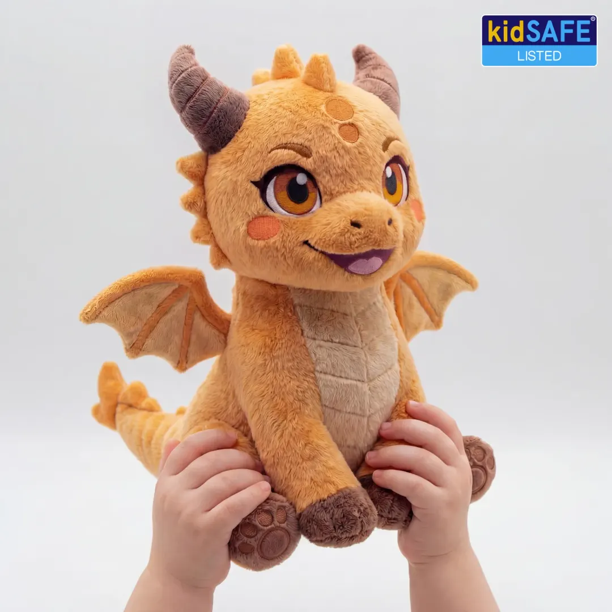
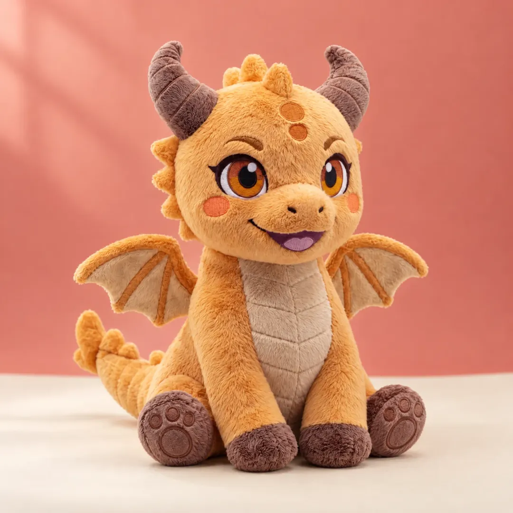
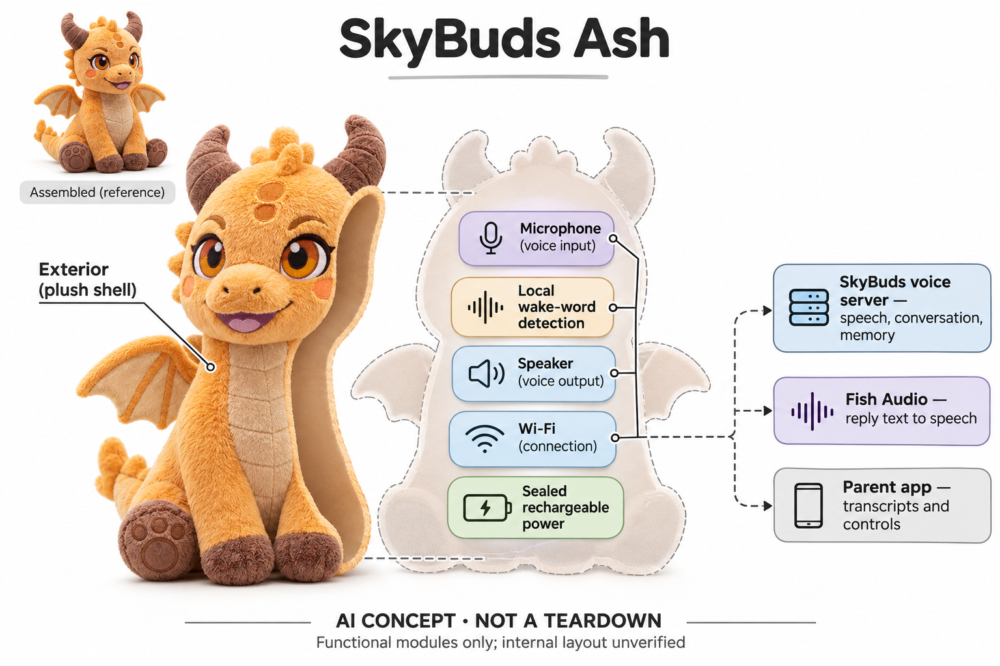

# SkyBuds Ash（对话毛绒系列）

**SkyBuds / Firefly Jar, Inc.** · AI玩具 · 核查 2026-11-06

以无屏幕小龙毛绒承载儿童对话、故事与家长可查看的记录。

消费渠道：个人零售。

## 产品图片与结构参考

### 产品图

Ash官方商品图片 · 来源：[SkyBuds / Firefly Jar · 官方图片](<https://getskybuds.com/products/ash>) · [原始图片](<https://getskybuds.com/cdn/products/ash-0-1080.webp>)

### 参考图

Ash官方外观与场景参考 · 来源：[SkyBuds / Firefly Jar · 官方图片](<https://getskybuds.com/products/ash>) · [原始图片](<https://getskybuds.com/cdn/products/ash-life-4-1080.webp>)

### AI 生成爆炸示意

**AI 生成 · 非实物拆机。** 内部为概念推断，不能作为元件布局、BOM 或维修依据。[生成提示词](../../content/hardware/prompts/skybuds-ash.txt)

> 内置ImageGen独立生成并目视核验；静态刺绣眼睛、无相机屏幕，内部位置为抽象功能块。

> 保留对应型号官方原图；原图所含认证徽章不视为本研究独立审计，角色和配色不重复计数。

> 分析为基于公开资料的案头研究与 AI 辅助判断，未经用户访谈、销量审计或实物拆机。需求、画像、竞争冷门度、审美及商业机会均为研究假设，不是投资结论。

## 销售与购买

- 状态：在售。具体Ash商品页有Order Now与1—3工作日发货，官方问答明确三角色现货；Ash、Pearl、Sprout同平台仅收一条代表。

- 地区：美国

- 价格：商品页US$179；FAQ仍列US$139。核查时官网价格存在冲突，以结算确认为准；SkyBuds+可选9.99美元/月，基本聊天和故事免费为厂商服务承诺，非永久交付保证。

- 中国大陆：官方当前明确仅美国境内销售配送；没有大陆官方购买或服务承诺，不将转运等同国内支持，也不把同名4smarts耳机认作本品牌。

- [官方产品 / 商店](<https://getskybuds.com/products/ash>)

## AI 的实际作用

本地芯片在待机时检测唤醒词，激活后语音经网络进入SkyBuds自管服务器，完成识别、对话和记忆；回复文本交Fish Audio合成声音。厂商说其模型为微调开放模型，不是机内离线大模型。

服务与联网依赖：需要2.4GHz Wi-Fi或手机热点、家长App与设置许可；当前玩具和App V2的数据路径不同于旧App及网站演示。常规聊天记录与可选改善模型录音计划分别管理，Plus增加部分内容和家长功能。

## 是否冷门

新兴竞争（研究判断）：儿童对话毛绒正出现多家竞争，角色与家长控制可比较，不据品牌宣传认定低竞争。

## 需求与市场

Ash面向儿童把提问、角色聊天与故事放到可以抱持的小龙毛绒里，让互动不必一直盯着屏幕。需求可能来自喜欢角色扮演、会不断追问且希望得到回应的孩子，但它不是教育成效或照护质量的证明；是否值得购买，需要观察真实家庭是否因此增加有意义的交流，而非只减少看屏幕的时间。

### 需求判断 · 研究判断

Ash面向儿童把提问、角色聊天与故事放到可以抱持的小龙毛绒里，让互动不必一直盯着屏幕。需求可能来自喜欢角色扮演、会不断追问且希望得到回应的孩子，但它不是教育成效或照护质量的证明；是否值得购买，需要观察真实家庭是否因此增加有意义的交流，而非只减少看屏幕的时间。

依据：[SkyBuds Ash官方商品页](<https://getskybuds.com/products/ash>) · [SkyBuds当前产品问答](<https://getskybuds.com/pages/skybuds-questions>)

### 连续互动场景 · 研究判断

记忆和个性化故事尝试把多次对话连接起来，家长应用又让成人能回看发生了什么。这样的组合可能支持亲子延续话题，也可能增加家长审阅负担；需求分析应同时关注孩子愿意表达的内容与成人愿意管理的记录，不能把更长聊天时长或更多转写自动视为更好的体验。

依据：[SkyBuds Ash官方商品页](<https://getskybuds.com/products/ash>) · [SkyBuds当前产品问答](<https://getskybuds.com/pages/skybuds-questions>)

### 需求验证 · 待验证

可让家长陪同孩子围绕原创故事和日常好奇问题使用一段时间，记录是否主动开启、何时求助以及是否把话题带回家庭讨论。与普通毛绒加真人讲故事及音频播放器比较，并跨过开箱新鲜期；本轮没有开展儿童访谈或实测，不将厂商对话示例作为真实使用结果。

依据：[SkyBuds Ash官方商品页](<https://getskybuds.com/products/ash>) · [SkyBuds当前产品问答](<https://getskybuds.com/pages/skybuds-questions>)

## 用户画像

官方把SkyBuds定位为三至十岁，并说明三岁以下不适用，家长负责设置和批准。当前销售仅限美国，这些条件比毛绒外观更能界定适用范围；不能把多语言宣传等同全球服务可达，也不能把同名无线耳机的销售渠道、价格和隐私说明用于本产品。

### 年龄与地区 · 官方资料

官方把SkyBuds定位为三至十岁，并说明三岁以下不适用，家长负责设置和批准。当前销售仅限美国，这些条件比毛绒外观更能界定适用范围；不能把多语言宣传等同全球服务可达，也不能把同名无线耳机的销售渠道、价格和隐私说明用于本产品。

依据：[SkyBuds Ash官方商品页](<https://getskybuds.com/products/ash>) · [SkyBuds当前产品问答](<https://getskybuds.com/pages/skybuds-questions>)

### 家庭角色划分 · 研究判断

付款、账户设置、查看记录与实际聊天通常由不同家庭成员完成，家长需要愿意理解录音计划、会员和静默时间。对于希望设备完全代替成人交流的家庭，产品设计本身并不能证明满足这种期待；画像应包含照护者参与程度和网络条件，而不只列孩子年龄及喜欢哪种动物。

依据：[SkyBuds Ash官方商品页](<https://getskybuds.com/products/ash>) · [SkyBuds当前产品问答](<https://getskybuds.com/pages/skybuds-questions>)

### 画像验证 · 待验证

建议检查家长能否在开箱前解释数据保留、关闭改善模型选项和基本免费功能，再观察孩子能否理解玩具并非知道所有答案。对语音表达差异或不同家庭语言的体验应分别验证，不能凭官方语种数量保证同等效果，也不把公开测试宣传当作个体适配结论。

依据：[SkyBuds Ash官方商品页](<https://getskybuds.com/products/ash>) · [SkyBuds当前产品问答](<https://getskybuds.com/pages/skybuds-questions>)

## 竞争与替代

Ash与Curio等对话毛绒、固定故事播放器和家长手机上的语音助手竞争，候选差异在角色记忆与可回看转写结合。普通玩偶无需账户和网络，固定故事又更可预测，因此不能仅以生成式功能更多判断优势；比较应围绕家庭是否需要开放聊天，以及愿意承担多少数据和维护管理。

### 替代方案 · 研究判断

Ash与Curio等对话毛绒、固定故事播放器和家长手机上的语音助手竞争，候选差异在角色记忆与可回看转写结合。普通玩偶无需账户和网络，固定故事又更可预测，因此不能仅以生成式功能更多判断优势；比较应围绕家庭是否需要开放聊天，以及愿意承担多少数据和维护管理。

依据：[SkyBuds Ash官方商品页](<https://getskybuds.com/products/ash>) · [SkyBuds当前产品问答](<https://getskybuds.com/pages/skybuds-questions>)

### 同平台合并 · 研究判断

官方把Ash、Pearl和Sprout作为同一SkyBuds平台的不同角色，主要外形和人设差异不构成三种独立需求。目录只选Ash代表，并保留同平台信息，避免通过角色数放大市场覆盖；相同服务也不保证所有毛绒外形的抱持、清洁或声学表现完全一致。

依据：[SkyBuds Ash官方商品页](<https://getskybuds.com/products/ash>) · [SkyBuds当前产品问答](<https://getskybuds.com/pages/skybuds-questions>)

### 比较验证 · 待验证

可用同一段故事和一组追问比较开放对话、固定音频和真人讲述，记录回答可控性、停用操作及家长介入次数。还应比较不订阅时的实际可用范围，避免把试用期权益当成长期标准；厂商自己的竞品价格表仅是营销材料，不用于证明其他品牌优劣或真实成交。

依据：[SkyBuds Ash官方商品页](<https://getskybuds.com/products/ash>) · [SkyBuds当前产品问答](<https://getskybuds.com/pages/skybuds-questions>)

## 供应链

公开资料可拆为小龙毛绒、本地唤醒词检测、麦克风与扬声器、无线通信、封闭充电电池和机外服务。自管模型运行在租用的数据中心算力上，不能把自有模型误画为机内芯片；具体工厂、主板、麦克风数量和电池结构未披露，概念图只表达功能职责。

### 功能拆分 · 研究判断

公开资料可拆为小龙毛绒、本地唤醒词检测、麦克风与扬声器、无线通信、封闭充电电池和机外服务。自管模型运行在租用的数据中心算力上，不能把自有模型误画为机内芯片；具体工厂、主板、麦克风数量和电池结构未披露，概念图只表达功能职责。

依据：[SkyBuds Ash官方商品页](<https://getskybuds.com/products/ash>) · [SkyBuds当前产品问答](<https://getskybuds.com/pages/skybuds-questions>)

### 硬软交付约束 · 研究判断

毛绒会被抱紧、放在床边或靠近被子，材料遮挡会改变拾音与播放，内置封闭电池又使维修和清洁流程重要。服务端还需要持续运行识别、记忆、内容检查和语音合成，硬件生产与云运营缺一不可；不能只按塑胶、布料和无线模块价格推算完整商业成本。

依据：[SkyBuds Ash官方商品页](<https://getskybuds.com/products/ash>) · [SkyBuds当前产品问答](<https://getskybuds.com/pages/skybuds-questions>)

### 候选与真实服务分开 · 研究判断

Seeed可作为联网语音原型与电子装联候选，瑞声可研究毛绒覆盖下的小型声学单元，两者都没有Ash供货证据。官网点名的RunPod和Fish Audio属于当前计算与语音服务链，不能扩展成硬件代工关系；选型需分别核封装、声学、联网和数据责任，避免混成一个所谓完整供应商。

依据：[SkyBuds Ash官方商品页](<https://getskybuds.com/products/ash>) · [SkyBuds当前产品问答](<https://getskybuds.com/pages/skybuds-questions>)

## 技术路径

十一月隐私政策说明玩具采用SkyBuds微调开放模型，语音识别、对话、记忆与检查运行在其管理的服务器上，回复文本另交语音合成服务。旧App和网页语音演示使用不同处理商，不能从演示效果或历史供应商名单推断当前玩具实际模型，更不能把自管服务器描述成本地离线。

### 当前技术路径 · 官方资料

十一月隐私政策说明玩具采用SkyBuds微调开放模型，语音识别、对话、记忆与检查运行在其管理的服务器上，回复文本另交语音合成服务。旧App和网页语音演示使用不同处理商，不能从演示效果或历史供应商名单推断当前玩具实际模型，更不能把自管服务器描述成本地离线。

依据：[SkyBuds当前产品问答](<https://getskybuds.com/pages/skybuds-questions>) · [SkyBuds隐私政策2026-11-04](<https://getskybuds.com/pages/privacy-policy>)

### 儿童语音难点 · 研究判断

儿童可能说得断续、含糊或不断改变故事规则，系统需要在识别、上下文和回答长度之间保持一致。记忆功能也可能保存误识别的信息，造成后续重复错误，因此可纠正性和停止能力值得关注；模型来自微调并不能证明适龄效果，也没有公开资料支持把拟人语气解释为真实理解。

依据：[SkyBuds Ash官方商品页](<https://getskybuds.com/products/ash>) · [SkyBuds当前产品问答](<https://getskybuds.com/pages/skybuds-questions>)

### 技术验证 · 待验证

建议在成人监督下使用不含个人秘密的虚构故事测试接话、角色更改、记忆纠正与网络断开，分别记录声音识别和内容生成的问题。检查待机唤醒与真正聊天时的状态提示，比较关闭录音改善选项前后是否保持功能；本轮没有实物或网络流量验证，不给出准确率结论。

依据：[SkyBuds Ash官方商品页](<https://getskybuds.com/products/ash>) · [SkyBuds当前产品问答](<https://getskybuds.com/pages/skybuds-questions>)

## 产品审美

金橙色小龙、软角翅膀和刺绣面部接近传统毛绒角色，缺少屏幕与摄像头有助于保持普通玩具的视觉感受。静态面部也意味着回应状态主要依靠声音来表达，用户不能从眼睛判断设备在录音或断网；审美评价应同时考虑抱持舒适与反馈可理解性，而非只看可爱照片。

### 外观判断 · 研究判断

金橙色小龙、软角翅膀和刺绣面部接近传统毛绒角色，缺少屏幕与摄像头有助于保持普通玩具的视觉感受。静态面部也意味着回应状态主要依靠声音来表达，用户不能从眼睛判断设备在录音或断网；审美评价应同时考虑抱持舒适与反馈可理解性，而非只看可爱照片。

依据：[SkyBuds Ash官方商品页](<https://getskybuds.com/products/ash>) · [SkyBuds当前产品问答](<https://getskybuds.com/pages/skybuds-questions>)

### 角色与状态 · 研究判断

Ash的面部始终保持友好神情，可能增加孩子愿意开口的意愿，也可能让拒答或系统错误不容易被察觉。唤醒、思考、静默和充电等状态需要清楚提示，不能让家长以为毛绒不动就没有电子活动；照片中的认证标志也不能替代真实使用中的状态表达和维护体验。

依据：[SkyBuds Ash官方商品页](<https://getskybuds.com/products/ash>) · [SkyBuds当前产品问答](<https://getskybuds.com/pages/skybuds-questions>)

### 审美验证 · 待验证

可以观察连续抱持后角、翅膀和尾巴是否影响舒适，检查在床边、书桌与收纳空间的实际占位及充电操作。按正式说明评估清洁与外观耐久，不推断整个玩具可以水洗；同时询问孩子是否仍喜欢不联网的毛绒形态，区分外观收藏价值与AI互动价值。

依据：[SkyBuds Ash官方商品页](<https://getskybuds.com/products/ash>) · [SkyBuds当前产品问答](<https://getskybuds.com/pages/skybuds-questions>)

## 关键风险

当前政策说明家长在设置或结算时同意的许可包含保留部分录音及转写，用于训练测试SkyBuds自有模型，除非关闭相关选项；这不同于不训练外部公司的模型。录音使用随机代码仍属于个人信息，不可称为不可逆匿名数据；此前九月二十九日前设置的家庭需同意更新后才适用新规则。

### 默认数据规则 · 官方资料

当前政策说明家长在设置或结算时同意的许可包含保留部分录音及转写，用于训练测试SkyBuds自有模型，除非关闭相关选项；这不同于不训练外部公司的模型。录音使用随机代码仍属于个人信息，不可称为不可逆匿名数据；此前九月二十九日前设置的家庭需同意更新后才适用新规则。

依据：[SkyBuds当前产品问答](<https://getskybuds.com/pages/skybuds-questions>) · [SkyBuds隐私政策2026-11-04](<https://getskybuds.com/pages/privacy-policy>)

### 留存与退出边界 · 官方资料

训练录音及配套转写保留至二十四个月，常规对话转写为十二个月；关闭改善选项后录音在三十日内删除并移出未来训练数据，已训练模型不会自动重训。玩具在关闭该选项后仍可使用，这些属于厂商政策声明而非独立审计，家长仍需要核实自己的账户设置和请求处理。

依据：[SkyBuds隐私政策2026-11-04](<https://getskybuds.com/pages/privacy-policy>)

### 销售与服务验证 · 待验证

商品页一百七十九美元与FAQ一百三十九美元相互冲突，购买时应先核最终订单，不把较低数字当保证。基本聊天免费是持续服务承诺，仍依赖公司与网络；建议确认退换、会员续费及停服计划，并由成人验证敏感内容和数据删除路径，本研究不提供安全或法律认证结论。

依据：[SkyBuds Ash官方商品页](<https://getskybuds.com/products/ash>) · [SkyBuds当前产品问答](<https://getskybuds.com/pages/skybuds-questions>) · [SkyBuds隐私政策2026-11-04](<https://getskybuds.com/pages/privacy-policy>) · [SkyBuds价格及订阅说明](<https://getskybuds.com/pages/skybuds-cost>)

## 机会与验证

Ash尝试用熟悉毛绒承载可延续的聊天，并把记录反馈给成人，机会可能在于帮助家庭找到后续讨论线索。价值不应只用设备说了多少话衡量，还需看是否促进孩子表达和家长参与；若家庭只需要可预测的睡前音频，联网生成式系统未必提供足够额外收益。

### 机会判断 · 研究判断

Ash尝试用熟悉毛绒承载可延续的聊天，并把记录反馈给成人，机会可能在于帮助家庭找到后续讨论线索。价值不应只用设备说了多少话衡量，还需看是否促进孩子表达和家长参与；若家庭只需要可预测的睡前音频，联网生成式系统未必提供足够额外收益。

依据：[SkyBuds Ash官方商品页](<https://getskybuds.com/products/ash>) · [SkyBuds当前产品问答](<https://getskybuds.com/pages/skybuds-questions>)

### 可改善方向 · 研究判断

更一致的价格、容易理解的录音设置和清楚区分免费与会员内容，可能直接减少购买与使用误会。尤其应让家长知道自有模型训练与第三方训练的区别，避免把笼统隐私标语当作充分说明；这些是从公开边界推导的机会，不能视为公司已经完成的体验成果。

依据：[SkyBuds Ash官方商品页](<https://getskybuds.com/products/ash>) · [SkyBuds当前产品问答](<https://getskybuds.com/pages/skybuds-questions>)

### 商业验证 · 待验证

可按重复故事、开放问答与共同创作分别记录长期使用和付费原因，观察试用结束后是否需要Plus，再计入云端服务与客服管理成本。把闲置、断网、误答和关闭录音改善选项的家庭都纳入，不以官网展示的批次占比、评价或用户数推断实际销量与商业成功。

依据：[SkyBuds Ash官方商品页](<https://getskybuds.com/products/ash>) · [SkyBuds当前产品问答](<https://getskybuds.com/pages/skybuds-questions>)

## 对应供应链公司

能力候选用于选型研究，不代表本产品实际采用；未公开的供货关系不作推断。

- [seeed-studio](../supply-chain/seeed-studio.md) — **能力候选 · 非已采用** / 语音联网毛绒控制模块原型：Seeed公开感知联网原型与电子装联服务，可作为同类语音玩具开发的候选，但没有SkyBuds实际采用证据；需要另行确认唤醒、充电防护、声学布置与批量测试，不能把公开能力写成现有代工关系。

- [aac-technologies](../supply-chain/aac-technologies.md) — **能力候选 · 非已采用** / 毛绒覆盖下的小型扬声器与拾音评估：瑞声公开声学单元与整机调试能力可帮助评估抱持和软材料遮挡后的音频表现，但Ash未披露其器件供货；实际尺寸、功耗、音量与玩具使用条件需用样机验证，候选关联不保证可直接替换原部件。

[浏览供应链目录](../supply-chain.md)

## 功能分层示意

这是功能关系，不是实物拆机、真实空间结构或已核实 BOM。

1. **小龙毛绒外形**：Ash的角、翅膀、尾巴与面部为毛绒和刺绣外观，没有屏幕或摄像头。（官方披露）

2. **唤醒与音频**：待机本地唤醒词检测，随后语音输入与扬声器输出。（官方披露）

3. **无线连接**：2.4GHz Wi-Fi连接服务，设备不是离线聊天玩具。（官方披露）

4. **充电供电**：USB-C充电与封闭式电池，具体内部位置和电路未知。（官方披露）

5. **外部AI和家长应用**：自管服务器进行语音识别、对话、记忆，Fish Audio接收回复文字；家长可查看记录与管理设置。（官方披露）

## 来源

1. [SkyBuds Ash官方商品页](<https://getskybuds.com/products/ash>) — 本轮打开Order Now与1—3工作日发货；商品页179美元，与FAQ和价格页139美元不一致，未实际结算。

2. [SkyBuds当前产品问答](<https://getskybuds.com/pages/skybuds-questions>) — 10月28日复核页面：3—10岁、2.4GHz Wi-Fi、美国限售、品牌与同名耳机无关；明确自有服务器和录音保留规则。

3. [SkyBuds隐私政策2026-11-04](<https://getskybuds.com/pages/privacy-policy>) — 实际读取录音训练默认设置许可、退出、不影响玩具使用、24月录音与12月常规转写留存、处理商及旧App和网页demo差别。

4. [SkyBuds价格及订阅说明](<https://getskybuds.com/pages/skybuds-cost>) — 实际读取139美元旧标价、基本聊天故事免费承诺与可选Plus；保留与商品页差异，不复用该页竞品比较作为证据。

5. [SkyBuds官方安全说明](<https://getskybuds.com/pages/safety>) — 实际打开品牌安全与家长控制声明；kidSAFE Listed与正在进行的COPPA审查不等同已完成所有认证，不作独立效果验证。

6. [SkyBuds官方首页](<https://getskybuds.com/>) — 读取唤醒词、家长应用与三种同平台角色；不按品牌展示的订单或用户数字推算销量。

[返回目录](../hardware-market.md) · [网页分析](https://romanagent.github.io/Roman/#hardware/product/skybuds-ash)
