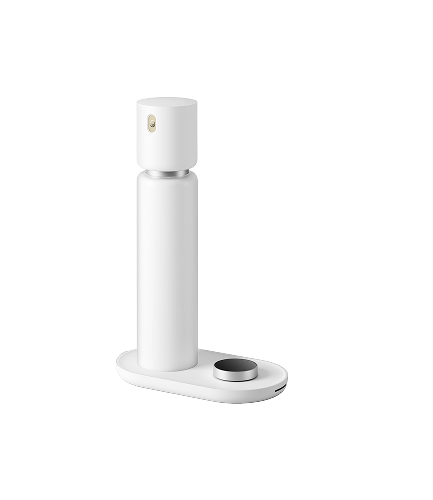
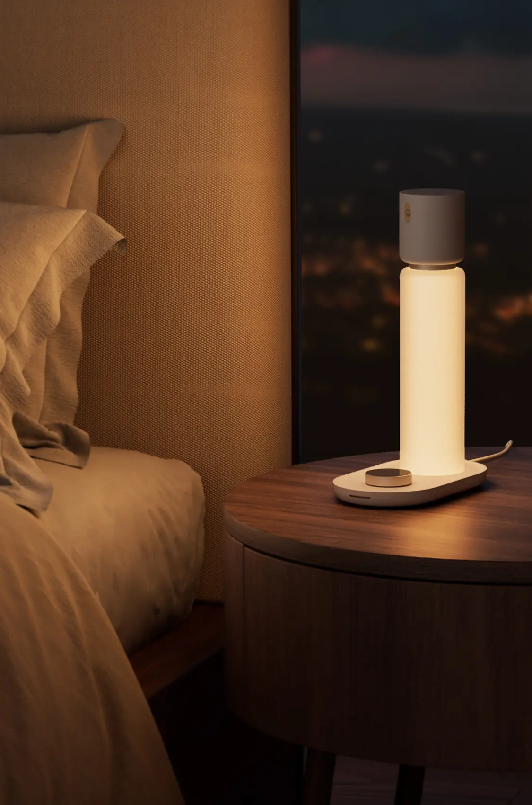
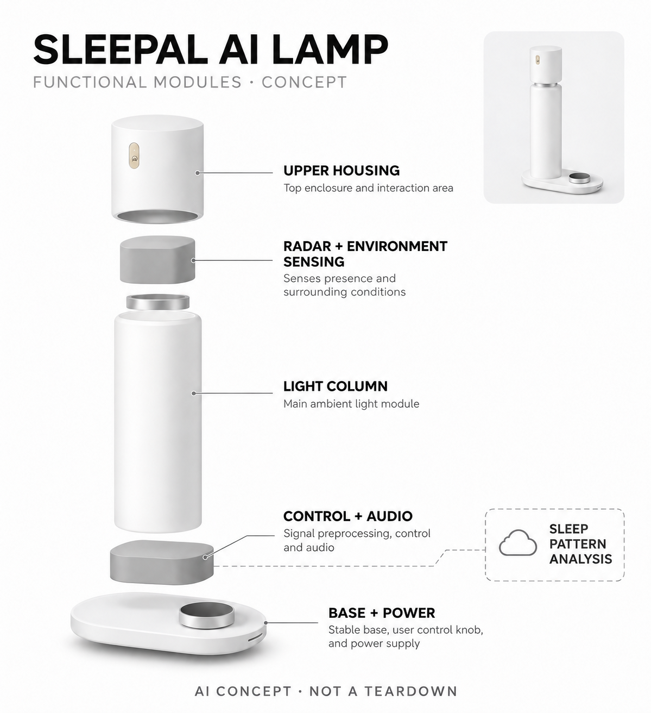

# Sleepal AI Lamp

**Sleepal** · 睡眠与放松 · 核查 2026-11-04

把无接触雷达睡眠观察与床头灯交互放在同一设备

消费渠道：个人零售。

## 产品图片与结构参考

### 产品图

当前官方购物页整机图 · 来源：[Sleepal · 官方图片](<https://www.sleepal.ai/cart>) · [原始图片](<https://www.sleepal.ai/cart/images/product-sleepal-lamp.png>)

### 参考图

当前官方床头使用场景 · 来源：[Sleepal · 官方图片](<https://www.sleepal.ai/home>) · [原始图片](<https://www.sleepal.ai/sections/hero/images/hero-kv-mobile.webp>)

### AI 生成爆炸示意

**AI 生成 · 非实物拆机。** 内部为概念推断，不能作为元件布局、BOM 或维修依据。[生成提示词](../../content/hardware/prompts/sleepal-ai-lamp.txt)

> 依据已核验官方外形与公开功能生成；未知内部仅为概念功能块，不代表原机电路板、芯片或实际布局。

> 2026-11-05按官网 https://shop.sleepal.ai/ 的本地预处理→云端分析说明，单独修正CONTROL + AUDIO文案为Signal preprocessing, control and audio；保留产品外形、功能模块与云端分析框。

> 前版AI图保存在assets/hardware/sleepal-ai-lamp/ai-exploded-before-processing-fix.png，作为本次唯一编辑图像输入；原生成日期2026-11-04，原提示词归档content/hardware/prompts/sleepal-ai-lamp-original.txt。

> 原生成真实参考图为assets/hardware/sleepal-ai-lamp/product.png与assets/hardware/sleepal-ai-lamp/reference.webp；本次未修改官方图片。

> 实际查看并核对对应型号，原图未经改色或语义编辑；厂商标注不等同本研究实测。

> 分析为基于公开资料的案头研究与 AI 辅助判断，未经用户访谈、销量审计或实物拆机。需求、画像、竞争冷门度、审美及商业机会均为研究假设，不是投资结论。

## 销售与购买

- 状态：在售。2026-11-04实际浏览主站Buy Now进入/cart，显示实体Sleepal AI Lamp、HKD3,131及Checkout；官方商品变体available=true且requires_shipping=true，非旧站虚拟定金商品。

- 地区：美国、国际配送按官方结算确认

- 价格：本次地区页面 HKD 3,131。购物页含三个月AI+试用；币种、国际运费及试用后订阅条件以结算地区为准。未将旧虚拟定金或早期众筹宣传作为当前价格。

- 中国大陆：当前购物页显示美元计价的国际运费与港币地区价格，但未验证中国大陆收货地址、售后和完整服务；不能据此认定国内官方渠道。

- [官方产品 / 商店](<https://www.sleepal.ai/cart>)

## AI 的实际作用

官方雷达信号提取呼吸和运动特征，由深度学习估计睡眠阶段；另有光声环境与床头交互。研究预印本不是医疗批准，不支持自行诊断。

服务与联网依赖：官方描述本地预处理后将提炼特征用于云端AI分析，部分体验依赖应用和AI+服务；隐私开关的具体停用范围需按说明确认。

## 是否冷门

新兴竞争（研究判断）：睡眠追踪竞争较多，雷达无接触观察与床头照明组合具有交互差异；仍需验证真实卧室条件及持续服务价值。

## 需求与市场

需求假设：不愿睡觉时佩戴或给穿戴设备充电的人，希望在床边自动获得睡眠记录并保留熟悉的照明动作。价值应由长期使用和可理解变化验证，不把记录连续直接等同睡得更好，也不从雷达观察推导任何疾病诊断效果。

### 产品任务与边界 · 研究判断

需求假设：不愿睡觉时佩戴或给穿戴设备充电的人，希望在床边自动获得睡眠记录并保留熟悉的照明动作。价值应由长期使用和可理解变化验证，不把记录连续直接等同睡得更好，也不从雷达观察推导任何疾病诊断效果。

依据：[Sleepal当前实体购物页](<https://www.sleepal.ai/cart>) · [Sleepal官方技术与隐私说明](<https://shop.sleepal.ai/>)

### 需求判断 · 研究判断

不愿佩戴设备的人可能仍希望了解作息变化，但床边被动采集的便利与数据是否有用是两个问题。把灯光作为既有交互入口能减少新增设备感，却不自动减少用户对睡眠的焦虑；需求应看记录是否帮助理解自己的日常，而不是评分是否更细。

依据：[Sleepal当前实体购物页](<https://www.sleepal.ai/cart>) · [Sleepal官方技术与隐私说明](<https://shop.sleepal.ai/>)

### 需求验证 · 待验证

需求验证可先记录用户已有照明和睡眠日志习惯，再在自愿试用中观察是否持续查看且能理解误差。不得把产品用于自行诊断或改变医疗方案，研究应独立记录主观体验与算法输出；在没有实机对照前，本目录仅提出验证计划而不声称试验完成。

依据：[Sleepal当前实体购物页](<https://www.sleepal.ai/cart>) · [Sleepal官方技术与隐私说明](<https://shop.sleepal.ai/>)

## 用户画像

画像推断：愿意固定床头设备、理解观察误差并能管理数据权限的成年人较匹配。双人同床、宠物和不同睡姿可能改变可用性，用户仍需对自己的感受和专业建议负责，不能把失眠担忧或健康标签当作产品适配证明。

### 适用行为与条件 · 研究判断

画像推断：愿意固定床头设备、理解观察误差并能管理数据权限的成年人较匹配。双人同床、宠物和不同睡姿可能改变可用性，用户仍需对自己的感受和专业建议负责，不能把失眠担忧或健康标签当作产品适配证明。

依据：[Sleepal当前实体购物页](<https://www.sleepal.ai/cart>) · [Sleepal官方技术与隐私说明](<https://shop.sleepal.ai/>)

### 人群取舍 · 研究判断

床头空间、稳定摆位与网络条件会影响体验，双人、宠物或经常变换房间的用户需要单独评估。愿意接受被动感知不代表接受云端分析，画像应包含数据权限与信息需求；对只想买普通灯的人，新增睡眠记录未必值得持续服务成本。

依据：[Sleepal当前实体购物页](<https://www.sleepal.ai/cart>) · [Sleepal官方技术与隐私说明](<https://shop.sleepal.ai/>)

### 画像验证 · 待验证

画像验证可以让用户解释想解决的具体问题、查看报告后的用途和不愿上传的资料，再确认实际床头条件。不要以失眠、年龄或照护标签推定需求，尤其不能用设备宣传中的群体定位替代独立适配判断；不合适的人应保留使用简单灯具的选择。

依据：[Sleepal当前实体购物页](<https://www.sleepal.ai/cart>) · [Sleepal官方技术与隐私说明](<https://shop.sleepal.ai/>)

## 竞争与替代

竞争判断：与穿戴追踪、床垫下传感器和普通床头灯竞争，差异是无接触感知加灯光交互。不会再把同款不同服务套餐计算成新品，也不将论文指标与商业硬件全部功能混同；比较应包含摆位、隐私和持续维护。

### 比较对象与差异 · 研究判断

竞争判断：与穿戴追踪、床垫下传感器和普通床头灯竞争，差异是无接触感知加灯光交互。不会再把同款不同服务套餐计算成新品，也不将论文指标与商业硬件全部功能混同；比较应包含摆位、隐私和持续维护。

依据：[Sleepal当前实体购物页](<https://www.sleepal.ai/cart>) · [Sleepal官方技术与隐私说明](<https://shop.sleepal.ai/>)

### 竞争判断 · 研究判断

相比穿戴追踪，床旁雷达减少佩戴与充电动作，但固定位置和多目标场景产生新的条件；相比床垫下传感，灯具形态更显眼却也有熟悉用途。竞争应比较这些使用取舍，不能把作者论文某项指标直接与不同研究里的其他设备数字排名。

依据：[Sleepal当前实体购物页](<https://www.sleepal.ai/cart>) · [Sleepal官方技术与隐私说明](<https://shop.sleepal.ai/>)

### 竞争验证 · 待验证

竞争验证应在相同使用目标和条件下比较可穿戴、床下与床旁方式的连续性、缺失和解释，分别记录灯光交互的增量。试验若涉及健康结论需要合适专业设计，本目录不以白底产品图、宣传对照或预印本摘要替代独立效能评估。

依据：[Sleepal当前实体购物页](<https://www.sleepal.ai/cart>) · [Sleepal官方技术与隐私说明](<https://shop.sleepal.ai/>)

## 供应链

供应链分析：雷达、环境感知、照明、音频、供电与软件服务共同构成床头设备，实际芯片厂及整机代工未披露。传感互扰、散热、夜间噪声和装配稳定影响体验，不能只按一盏灯或一个雷达模块价格估算成本。

### 功能模块拆分 · 研究判断

功能模块包括雷达与环境信号、照明、音频、控制能源、应用与云端分析。官方真实外形不能证明每个传感器的具体安装位置，供应分析应把光热、夜间噪声和信号互扰纳入；概念图用功能块，不杜撰天线、电路、芯片或内部布置。

依据：[Sleepal当前实体购物页](<https://www.sleepal.ai/cart>) · [Sleepal官方技术与隐私说明](<https://shop.sleepal.ai/>)

### 制造与供应约束 · 研究判断

供应链分析：雷达、环境感知、照明、音频、供电与软件服务共同构成床头设备，实际芯片厂及整机代工未披露。传感互扰、散热、夜间噪声和装配稳定影响体验，不能只按一盏灯或一个雷达模块价格估算成本。

依据：[Sleepal当前实体购物页](<https://www.sleepal.ai/cart>) · [Sleepal官方技术与隐私说明](<https://shop.sleepal.ai/>)

### 候选与证据缺口 · 研究判断

Sensirion可作为温湿度环境输入候选，捷普可用于灯具电子与整机可靠性导入评估，均无Sleepal型号实际采用证据。雷达算法与卧室测量验证仍需专门团队，环境传感或通用制造能力不能推导为已具备完整睡眠分析方案和临床有效性。

依据：[Sleepal当前实体购物页](<https://www.sleepal.ai/cart>) · [Sleepal官方技术与隐私说明](<https://shop.sleepal.ai/>)

## 技术路径

技术判断：作者预印本说明从雷达提取呼吸与运动特征并训练深度学习模型，提供了比笼统AI口号更具体的路径。论文属于预印本且实验条件有限，不能据此承诺每个卧室准确度，也不把阶段估计当作医疗评估替代。

### 已披露技术边界 · 研究判断

技术判断：作者预印本说明从雷达提取呼吸与运动特征并训练深度学习模型，提供了比笼统AI口号更具体的路径。论文属于预印本且实验条件有限，不能据此承诺每个卧室准确度，也不把阶段估计当作医疗评估替代。

依据：[Sleepal当前实体购物页](<https://www.sleepal.ai/cart>) · [Sleepal官方技术与隐私说明](<https://shop.sleepal.ai/>) · [Sleepal AI Lamp作者预印本](<https://arxiv.org/abs/2604.16442>)

### 系统难点判断 · 研究判断

预印本描述从雷达信号提取多尺度运动和呼吸相关特征，再用深度学习估计睡眠状态，提供了具体技术路线。其数据条件与商业设备版本需要继续对应，论文未同行评议也不构成医疗批准，不能把实验平均表现转为对每个人每晚的保证。

依据：[Sleepal当前实体购物页](<https://www.sleepal.ai/cart>) · [Sleepal官方技术与隐私说明](<https://shop.sleepal.ai/>) · [Sleepal AI Lamp作者预印本](<https://arxiv.org/abs/2604.16442>)

### 技术验证 · 待验证

技术验证应先确认实际商品版本、摆位要求和同床对象处理，再记录信号缺失、阶段估计与用户可见不确定。若要评价睡眠分期准确，需专业对照设计；不能以主观睡得好或灯自动变暗证明分期正确，也不能通过危险呼吸干预制造测试数据。

依据：[Sleepal当前实体购物页](<https://www.sleepal.ai/cart>) · [Sleepal官方技术与隐私说明](<https://shop.sleepal.ai/>) · [Sleepal AI Lamp作者预印本](<https://arxiv.org/abs/2604.16442>)

## 产品审美

审美判断：白色柱灯与椭圆旋钮底座接近家居灯具，适合降低额外监测设备的存在感。夜间亮度、提示音和隐私状态应克制且清楚，不能只追求极简外观而让用户不知道何时采集或哪些功能因隐私设置停止。

### 外观与交互语言 · 研究判断

审美判断：白色柱灯与椭圆旋钮底座接近家居灯具，适合降低额外监测设备的存在感。夜间亮度、提示音和隐私状态应克制且清楚，不能只追求极简外观而让用户不知道何时采集或哪些功能因隐私设置停止。

依据：[Sleepal当前实体购物页](<https://www.sleepal.ai/cart>) · [Sleepal官方技术与隐私说明](<https://shop.sleepal.ai/>)

### 使用中审美判断 · 研究判断

柱状发光体、上部圆筒与椭圆旋钮底座将照明和监测合并，能够保持床头工具的熟悉感。安静并不等于不可感知：隐私状态、采集停止与服务故障应清楚，用户不应因为外观柔和而忽略声学或雷达数据正在被处理。

依据：[Sleepal当前实体购物页](<https://www.sleepal.ai/cart>) · [Sleepal官方技术与隐私说明](<https://shop.sleepal.ai/>)

### 设计验证 · 待验证

设计验证可观察用户在夜间调光、暂停采集和查看状态时需要多少步骤，以及是否打扰同床者。保持原图真实比例，不把设备改画成带光学镜头的摄像头；审美评价也应包括白天待机、线缆和报告信息，而非只看暖光卧室照片。

依据：[Sleepal当前实体购物页](<https://www.sleepal.ai/cart>) · [Sleepal官方技术与隐私说明](<https://shop.sleepal.ai/>)

## 关键风险

风险判断：摆位、同床对象、反射和网络可能改变估计，算法结果也可能增加不必要的睡眠焦虑。官方当前购买页与旧预发布页状态不同，需明确实际商品和服务；设备不承担诊断治疗，不能根据单个分数调整医疗行为。

### 主要失效与依赖 · 研究判断

风险判断：摆位、同床对象、反射和网络可能改变估计，算法结果也可能增加不必要的睡眠焦虑。官方当前购买页与旧预发布页状态不同，需明确实际商品和服务；设备不承担诊断治疗，不能根据单个分数调整医疗行为。

依据：[Sleepal当前实体购物页](<https://www.sleepal.ai/cart>) · [Sleepal官方技术与隐私说明](<https://shop.sleepal.ai/>) · [Sleepal AI Lamp作者预印本](<https://arxiv.org/abs/2604.16442>)

### 风险传播判断 · 研究判断

雷达反射、同床运动和模型偏差都可能生成看似精确的报告，进而让用户过度关注某个分数。官方本地优先仍包含提炼特征的云分析，不宜简称为完全不上传；隐私开关明确断开哪些输入、哪些服务继续运行，需要按当前说明进一步确认。

依据：[Sleepal当前实体购物页](<https://www.sleepal.ai/cart>) · [Sleepal官方技术与隐私说明](<https://shop.sleepal.ai/>) · [Sleepal AI Lamp作者预印本](<https://arxiv.org/abs/2604.16442>)

### 风险验证 · 待验证

风险验证应核对数据路径、删除方式、会员到期和无网络时的表现，查看是否把无法估计与良好睡眠区分开。涉及身体不适应寻求适当专业评估，不能用消费设备排除疾病；购物页与旧预发布页面冲突也应记录，避免引用旧定金商品当实体零售。

依据：[Sleepal当前实体购物页](<https://www.sleepal.ai/cart>) · [Sleepal官方技术与隐私说明](<https://shop.sleepal.ai/>) · [Sleepal AI Lamp作者预印本](<https://arxiv.org/abs/2604.16442>)

## 机会与验证

机会假设：在无需佩戴的床边记录与可解释照明交互上验证持续收益，先确认用户真的会理解和使用信息。若只是查看分数而无明确价值，简单灯具或已有设备可能足够；不要从睡眠问题普遍直接推算AI床头硬件市场。

### 可能的机会入口 · 研究判断

机会假设：在无需佩戴的床边记录与可解释照明交互上验证持续收益，先确认用户真的会理解和使用信息。若只是查看分数而无明确价值，简单灯具或已有设备可能足够；不要从睡眠问题普遍直接推算AI床头硬件市场。

依据：[Sleepal当前实体购物页](<https://www.sleepal.ai/cart>) · [Sleepal官方技术与隐私说明](<https://shop.sleepal.ai/>)

### 机会成立条件 · 研究判断

机会在于把长期无接触记录做得可理解、可关闭，并通过既有灯具动作减少操作负担。若用户只是收到更多无法行动的分数，应优先改善解释和不确定表达；新项目不必先追求复杂传感组合，更不能用医疗式营销放大普通消费记录的价值。

依据：[Sleepal当前实体购物页](<https://www.sleepal.ai/cart>) · [Sleepal官方技术与隐私说明](<https://shop.sleepal.ai/>)

### 下一步验证 · 待验证

下一步可以从稳定单人卧室条件下的可用性、数据缺失和报告理解开始，再决定是否扩展复杂场景。区分体验研究与专业测量验证，依据用户持续获得的具体信息价值选择硬件和订阅，不从睡眠困扰普遍或论文模型规模推定市场已被证实。

依据：[Sleepal当前实体购物页](<https://www.sleepal.ai/cart>) · [Sleepal官方技术与隐私说明](<https://shop.sleepal.ai/>)

## 对应供应链公司

能力候选用于选型研究，不代表本产品实际采用；未公开的供货关系不作推断。

- [sensirion](../supply-chain/sensirion.md) — **能力候选 · 非已采用** / 床头环境温湿度输入候选：Sensirion的温湿度产品可对应Sleepal公开环境感知功能，但不承担雷达信号、睡眠阶段模型或健康判断，需验证灯体热影响与安装；未见该型号点名采用，当前仅为传感能力候选。

- [jabil](../supply-chain/jabil.md) — **能力候选 · 非已采用** / 照明与感知电子整机导入评估：捷普公开工程制造服务可匹配照明、控制、供电与感知终端的整机导入，但雷达互扰、夜间声光体验及睡眠模型需专项验证；没有Sleepal点名合作资料，不能视为实际代工或临床可靠性证据。

[浏览供应链目录](../supply-chain.md)

## 功能分层示意

这是功能关系，不是实物拆机、真实空间结构或已核实 BOM。

1. **灯体与交互底座**：官方真实图为白色柱状灯体及带旋钮的椭圆底座。（官方披露）

2. **雷达与多模态感知**：无光学摄像头的雷达及环境信号路径，内部安装位置不推定。（官方披露）

3. **信号处理**：提取运动和呼吸相关特征的概念处理层。（官方披露）

4. **照明与音频**：床头灯光与声音交互功能，不能画成医疗刺激设备。（官方披露）

5. **应用与AI分析**：睡眠记录、解释和服务权限依赖相应软件。（官方披露）

## 来源

1. [Sleepal当前实体购物页](<https://www.sleepal.ai/cart>) — 实际浏览确认实体灯、地区价格和Checkout；商品变体可售且需配送，未提交订单。

2. [Sleepal官方技术与隐私说明](<https://shop.sleepal.ai/>) — 实际打开雷达深度学习、无光学摄像头和本地/云端处理说明；该旧页面的预发布标语不用于当前销售认定。

3. [Sleepal AI Lamp作者预印本](<https://arxiv.org/abs/2604.16442>) — 实际打开2026-04-07作者预印本，描述雷达特征与深度学习；未视作同行评议、医疗批准或本研究实测。

[返回目录](../hardware-market.md) · [网页分析](https://romanagent.github.io/Roman/#hardware/product/sleepal-ai-lamp)
