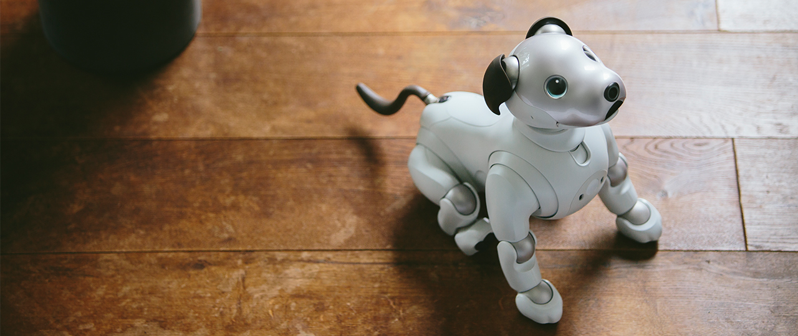
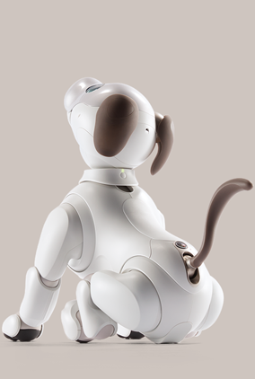
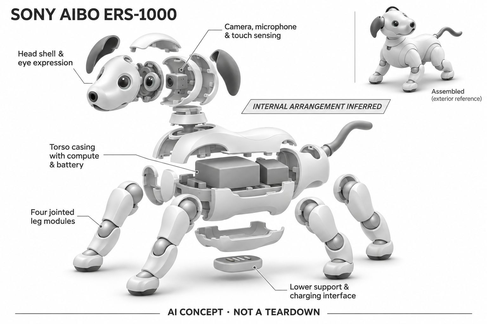

# aibo ERS-1000

**Sony** · 陪伴与宠物 · 核查 2026-11-04

以持续行为学习形成个性的机器犬

消费渠道：个人零售。

## 产品图片与结构参考

### 产品图

aibo ERS-1000 官方生活场景图 · 来源：[Sony · 官方图片](<https://us.aibo.com/>) · [原始图片](<https://us.aibo.com/images/intro-mv-pc-0.jpg>)

### 参考图

aibo ERS-1000 官方背面参考 · 来源：[Sony · 官方图片](<https://us.aibo.com/>) · [原始图片](<https://us.aibo.com/share/images/feature/product-feature-0.png>)

### AI 生成爆炸示意

**AI 生成 · 非实物拆机。** 内部为概念推断，不能作为元件布局、BOM 或维修依据。[生成提示词](../../content/hardware/prompts/sony-aibo-ers1000.txt)

> 已目视核对产品外形与AI标识；verified不代表内部布局经实物拆机验证。

> 参考图保留官网提供的284×422原始分辨率，没有人工放大。

> 分析为基于公开资料的案头研究与 AI 辅助判断，未经用户访谈、销量审计或实物拆机。需求、画像、竞争冷门度、审美及商业机会均为研究假设，不是投资结论。

## 销售与购买

- 状态：待复核。美国Sony商店仍显示US$3,199.99及ADD TO CART；日本官方2026-06-25通知库存耗尽即结束国内销售，日本官网搜索结果已显示销售结束。地区状态不同，保守列待确认。

- 地区：美国（商店仍列购入）、日本（官方已公告结束国内销售）

- 价格：美国官网 US$3,199.99。所列白色SKU含三年AI Cloud Plan；美国页面仍可加购但需核实现货及地区资格，不代表日本仍在售。

- 中国大陆：未核实大陆官方新机渠道；区域云计划、账户和维修安排需分别确认，不建议把境外商品页视为大陆服务承诺。

- [官方产品 / 商店](<https://electronics.sony.com/more/aibo/p/ers1000>)

## AI 的实际作用

官方说明通过日常互动和深度学习形成不同个性，识别人、触碰与声音，并用机器犬动作响应；不等同通用生成式聊天。

服务与联网依赖：完整My aibo功能需要AI Cloud Plan、账户和应用；日本停售公告同时说明相关服务继续，停售不等于立即停服。

## 是否冷门

细分专业（研究判断）：高价格、多关节控制和长期服务使其成为专业细分，区域退市增加核查要求。

## 需求与市场

需求假设：用户购买的是可长期相处的机器犬角色，而不是家务效率或知识问答。研究要关注照护习惯、角色记忆与多年后继续使用的动机，不能用短期功能清单替代关系价值。

## 用户画像

用户画像推断：机器人爱好者、预算较高且愿意接受专属服务计划的人更适合。机器犬也可能作为家庭礼物，但需确认实际使用者接受机械声、充电和维修等待等日常条件。

## 竞争与替代

竞争判断：高价机器犬陪伴是专业细分，品牌历史和运动控制构成门槛。它同时面对更便宜的轮式宠物及真实养宠选择；区域停售提醒创业者，长期产品存在并不保证市场持续扩张。

## 供应链

供应链推断：多关节驱动、结构件、传感器和专用充电系统需要长期备件维护；本次未获得制造工厂信息。官方日本公告继续维修等服务，说明退市后的支持也属于供应链责任。

## 技术路径

官方强调深度学习、人物识别及随互动改变的行为。推断重点在动作自然度、个体状态保存与云服务协同；生成式语言并非必要前提，应先研究非语言反馈能否建立持续使用习惯。

## 产品审美

审美判断：明确机器犬形象降低用户对“像人”的期待，关节动作和眼部表达承担性格塑造。相较毛绒产品，硬质外壳更突出机械美感，也更依赖运动节奏来传递亲近感。

## 关键风险

风险判断：日本地区结束销售与美国商店仍可购造成状态理解成本，购买前应核实真实库存及服务地区。云计划、无退货条款和特定美国地区限制都需要在当地官方条件下评估。

## 机会与验证

机会假设：值得研究的不是复制完整机器犬，而是长期服务、角色状态迁移及可维修设计。若团队无法承诺多年的云服务和备件，宜先选择结构更简单、退出机制更明确的产品。

## 功能分层示意

这是功能关系，不是实物拆机、真实空间结构或已核实 BOM。

1. **人物与触碰输入**：官方列识别人、声音及触碰的响应能力。（官方披露）

2. **行为学习**：日常互动逐步影响个性与反应。（官方披露）

3. **机器犬表达**：自然动作与面部表达构成陪伴反馈。（官方披露）

4. **云端与应用**：AI Cloud Plan及My aibo支持完整应用功能。（官方披露）

5. **生命周期服务**：日本结束新机销售后仍继续相关云计划和维修服务。（官方披露）

## 来源

1. [Sony美国aibo商店](<https://electronics.sony.com/more/aibo/p/ers1000>) — 当前有加购入口、云计划说明及地区限制，未实际下单。

2. [Sony日本国内销售结束公告](<https://info.aibo.sony.jp/info/2026/06/20260625-01.html>) — 2026-06-25公告库存售罄后结束日本销售，同时说明服务继续；不推断全球停产。

[返回目录](../hardware-market.md) · [网页分析](https://romanagent.github.io/Roman/#hardware/product/sony-aibo-ers1000)
